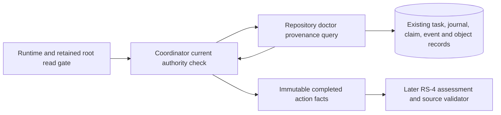
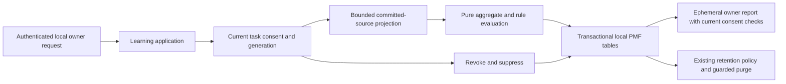
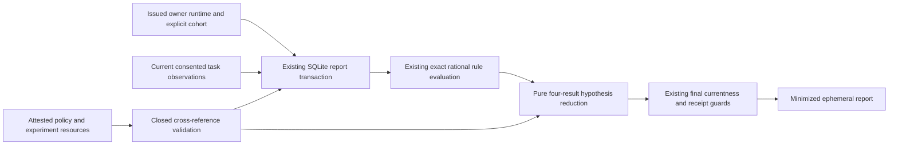
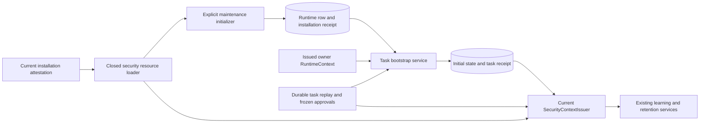
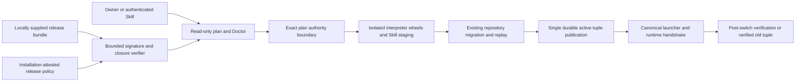
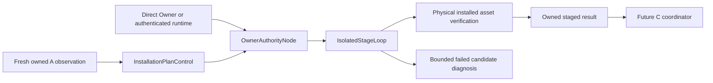
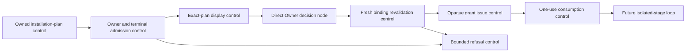
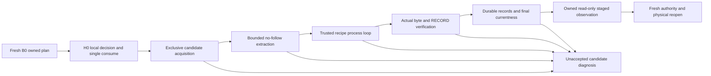
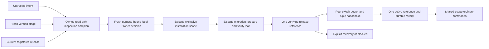

# Graph Engineering Workflow — Tech Spec

## 2026-09-20 RS-C installed currentness implementation detail

The cold operation receives factories already created by the existing installed
bootstrap. Capture only a private path/size/hash read plan from that validated
bootstrap, bind it to the exact original factory inputs, and adopt the complete
plan with the other retained configuration under RS-C-0b. On every cold use,
freshly verify the raw bytes that established those semantics. An unchanged raw
digest proves the previously validated schema, pins and signature still apply;
it does not permit skipping the current reads. Source installations rehash the
closed327-member attestation set twice and its key/attestation three times,
including exact root, lock, descriptor and path checks. The ordinary installed
and validation-only document factory behavior remains available outside cold
operations. Missing factory/context bindings reject before any legacy fallback.

The wheel branch below remains pending independent implementation-choice
review. It must preserve the actual supported interpreter's path-based discovery
semantics, including distribution uniqueness, while avoiding a new unbounded
RECORD, provenance TOML or zip central-directory materialization during cold use.

- Capture the ordered `sys.path`, including duplicate entries and empty/relative
  entries resolved against the original cwd. Revalidate their current resolution
  and filesystem kind; absent roots becoming present or changed roots reject.
  Accept only the standard path-based distribution discovery provider and its
  unchanged implementation. Unsupported custom discovery providers cannot issue
  a cold read plan; ordinary factory construction does not gain a new authority.
- For directory roots, freshly enumerate with installed row, byte and work
  bounds before processing every entry, including filtered non-candidates and
  each repeated sys.path root occurrence. Never list or collect the whole
  directory before admission, and never return a truncated candidate set on
  overflow. Close the iterator on rejection or iteration failure. Compare the
  exact candidate set, covering `*.dist-info`, directory
  and single-file `*.egg-info`, and `*.egg/EGG-INFO`. Read every initial candidate's
  metadata, including non-selected distributions, by bounded streaming hash.
  Preserve `METADATA -> PKG-INFO -> candidate-file` fallback, including absent,
  empty-file and unreadable states under the standard reader's exact behavior;
  a new earlier fallback or an in-place Name change rejects. Directory timestamps
  alone cannot replace this discovery or metadata proof.
- Rehash every archive used as a discovery root, including non-selected archives.
  Verify the selected wheel's complete current bytes and physical identity; raw
  equality preserves the already-validated RECORD entries and central-directory
  uniqueness without rebuilding those collections. For an unpacked wheel, rehash
  its selected RECORD and every member required by the existing module,
  provenance, coverage, adapter and release closure. Bind the loaded module path
  and original resource inputs, including their recorded hashes and sizes.
- Capture and recheck the initial discovery and file identities around plan
  issuance. Repeat current topology, metadata and selected resource proofs before
  returning from a cold check. No discovery callback or path is supplied by the
  cold caller. All plan data, enumerator scratch and hashing buffers join the
  exact common owner before allocation; archive total size is streamed under the
  existing work allowance, never read as one document or used to raise a limit.

This is a private read strategy within the approved installed-currentness scope.
No public API, dependency, installed resource member, schema, write authority or
irreversible action is added by this detail. Complete C-L acceptance still needs
configuration adoption and repeated source/action/security/physical proof.

## 2026-09-20 RS-C installation-control read amendment — proposed R0

Human update (2026-09-20): the owner replied “确认” to the final one-file
request, approving GEW-REMAINING54-P3-COLD-INSTALLATION-CONTROL-V1. The
append-only p3_restart_cold_installation_control_amendment records this exact
extension. Current boundaries are185 product /195 effective /41 selected
targets. The reviewed proposal below is historical; its implementation scope
and all exclusions remain unchanged. Prior RS-C R2 approval stays valid.

Decision requested: `GEW-REMAINING54-P3-COLD-INSTALLATION-CONTROL-V1`.
This is a proposed one-file extension to approved RS-C R2. Implementation of
this extension waits for Human authority; the existing R2 approval remains valid.

Cold source and action reads call `InstallationCommandScope.require_current`,
including each `_connection_opened` callback. In
`storage/graph_engineering/storage/migration.py`, `_require_command_scope`
reaches `_current_manifest` and `_resolve_locator` -> `_load_locators`.
The two control JSON files currently use `read_text()` before any byte or
collection bound. An outer size check cannot bound a later growing-file read,
and omitting nested currentness would remove an existing authority check.

Authorize changes only to these private control-read paths and their private
bounded helper in that file. The cold path must join RS-C-0b's exact installed
reservation owner before its first control-file read and retain that binding
through nested connection admission and each reuse. The lexical carrier may
be a private ContextVar containing the exact installed context; the ledger
remains operation-owned. Match owner, task, command scope, ports, process and
thread; reject missing, foreign, overlapping or changed bindings. Restore the
binding in `finally`. No standalone fallback context is allowed during a cold
operation. Existing public signatures and ordinary command semantics remain.

Open only the configured active-manifest and locator-registry members beneath
the already trusted control root. Check descriptor type, owner, mode, size and
path identity before allocation; admit actual size against installed document
limits and the owner's remaining aggregate allowance. One size-bounded read
and a one-byte growth probe must reject growth, short reads and replacement.
Reserve raw, decoded, parsed, locator and comparison representations for their
actual overlapping lifetimes; bound locator count before constructing locator
objects. Keep the first full recovery closure charged while these reads recur.
Release descriptors and scratch on every success or failure without I/O repair.

Preserve the shared installation lock, exact manifest schema/digest/context,
ordinary-command mode, locator schema/order/uniqueness/digest, repository ID,
root device/inode/path and current-scope comparisons. Continue checking every
connection admission; no memoized PASS can replace a fresh control-file check.
No new control file, public API, persisted schema/event, migration/upgrade
write, locator registration, installation activation or WP-10 behavior is
authorized by this amendment. RS-C's source, action and physical proof and
separate irreversible boundaries remain unchanged.

## 2026-09-20 RS-C cold-source reconstruction detail — R2

Human update (2026-09-20): the owner's response “继续” to the final R2
API request authorizes GEW-REMAINING54-P3-COLD-SOURCE-READ-API-V1, recorded
in p3_restart_cold_source_read_api_amendment. The not-yet-authorized wording
in the reviewed proposal below is historical and is superseded only for this
exact API, consumers, resource hardening, tests and independent review.
The184/194 boundaries and all irreversible exclusions remain unchanged.

This supplement makes RS-4/RS-5's existing source joins and root lookup
implementable under the accepted P3-RS-A architecture. It does not authorize
implementation until its independent review and actual reducer advance.
RS-AP R1 is the accepted action reader. Positioning, PRD Intent Baseline v2,
the184-target Envelope and all earlier irreversible boundaries remain unchanged.

### RS-C-0. Proposed bounded task/source reader and authority gate

R0 review GEW-REMAINING54-RS-C-SOURCE-BOUNDS-R0-001 found that the
existing resolver transitively reads unbounded SQL rows and CAS bytes. The
following repair proposes one additional private storage read API,
`TaskRepository.read_category_recovery_sources(task_id, *, phase)`, in the
already-listed `storage/graph_engineering/storage/repository.py`.
`phase` is the closed discriminator `locator` or `sources`, never a SQL,
path, record kind or caller query. Both return immutable data, no capability.

This API is **proposed, not yet authorized**. Existing Human RS-AP approval is
for action provenance. The RS Impact rule requires a concrete decision for a
new storage API even though the184 file allowlist does not grow. Required
decision: authorize this bounded query and its exact application consumers,
focused RED-first tests, installed pin maintenance and independent review.
No code may implement it before that Human decision.

| Read phase | Bounded source and complete validation |
|---|---|
| Preliminary locator | Doctor-only query of this task's exact wrapper/head, current assessment evidence identity and corresponding same-task reference/object row. Bound SQL bytes before returning text, parse wrapper/evidence under WorkContext, reject duplicate/stale/unsupported assessment selectors, then bounded descriptor-read only that assessment body. Output task/head/ref/CAS identity and target logical ID; no authority or source seal. |
| Gated task/materialization | Requery wrapper, events/transaction heads and task refs/objects in one bounded capture. Validate task snapshot digest, indexed event chain and transaction/revision/head joins; use the captured committed materialization bytes and installed policy's exact MaterializationRecord to validate domain GraphRef. Do not issue a mutable materialization reference or call a legacy resolver. |
| Gated source bodies | Read only the exact task-reference set from the captured metadata, once per raw digest, through the RS-AP bounded CAS descriptor primitive. Preserve raw IDs for assessment, category records, full ArtifactRecords, manifests, raw bodies and prior-review sources. No arbitrary CAS enumeration or unreferenced body lookup. |
| Scope/extension state | Capture this task's project-scope metadata and verify its existing digest/approval-event binding from the same bounded event view. Any project realization requiring an external identity resolver, or extension pin requiring authority unavailable in this closed recovery reader, rejects as unavailable-authority before issuance; never skip the existing check or invoke an unbounded/external resolver. |
| Final capture and every reuse | Invoke the identical bounded `sources` query again; compare full wrapper/head, event/transaction, scope, references and raw object identities, then all RS-C source and RS-AP action/security facts. No old cached bytes, nested repository lock or legacy read follows this capture. |

Inside each query enforce exact current InstallationCommandScope and same
TaskRepository/ObjectRepository/lock/WorkContext identity. Require no existing
repository tokens/transaction, then acquire installation -> object locks once.
Use parameterized fixed SELECT/CTE statements through the existing doctor role.
Use SQL-side byte-length CASE sentinels for every potentially large text/blob
field and bounded result rows (installed array limit plus one overflow sentinel);
never fetch an unbounded row set or materialize an oversized column. Account
for the complete raw SQL field budget before parsing/retaining, including task
snapshot, runner, events, transactions, scope and reference metadata. Optional
source-state rows receive the same bounds, not a separate unchecked query.

Reuse the existing RS-AP `_read_provenance_object` contract rather than
ObjectRepository.get/_verify_file/_read_descriptor. Actual fstat size must fit
the per-document and remaining aggregate allowance before allocation, then
match persisted size. One admitted read plus a one-byte growth probe, exact
short-read rejection, final descriptor/path identity and raw digest checks
apply. Reserve aggregate retained bytes across SQL projections, retained raw
CAS bodies, parsed projections and transient serialization within the installed
temporary/result limits; count overlapping representations, not only their
largest member. Release scratch only after its corresponding data is dropped;
transfer returned-result reservations to the outer owner defined below.
Reject before allocation if the full immutable result cannot fit. A short read or drift rejects
without retry, re-sign, repair or metadata normalization.

Application consumers in existing tasks.py and profile_execution.py validate
the resulting domain/runner state with existing pure validators, installed
materialization and exact runtime owner/kind/lineage. They resolve the unique
assessment from these captured bytes themselves. The caller supplies no
snapshot/projection and cannot substitute a materialization callback. Generic
runtime_show and CategoryAssessmentResolver behavior for other consumers stays
unchanged; the dedicated cold locator/capture path must never call them, nor
TaskRepository.load/replay/referenced_objects/category_source_seal or the
legacy CAS/materialization helpers. Action joins use the accepted RS-AP bounded
capture through the complete action/security route below.

Root scope sequence remains preliminary bounded locator -> release all tokens
-> root gate -> repeated bounded source/action/physical reads. Query failures
release only their tokens/connections; outer recovery revokes/closes its root
handle before returning an error. No durable writes, clock persistence, leases,
mutation results, source-fence capabilities or new persisted records are issued.


### RS-C-0a. Action and security reads within the same bound

R1 findings ACTION-SECURITY-BOUNDS-R1-001 and OUTER-RETENTION-R1-001
apply to the whole cold operation, not just its new task query. In
application/actions.py, cold completion validates current action authority
directly from the exact internally obtained RS-AP journal/index projection.
Reuse current installed policy validators, uniqueness/index checks and the
terminal-state, prepared/authority digest, action kind/resource, issuer,
revocation, owner, lineage, baseline and target checks. Do not re-enter
ActionJournal.load/find_prepared or the legacy _read_action_authority route
from cold recovery. A private pure validator may share those checks with the
existing route; callers cannot supply the projection to the cold entry.
The next complete bounded capture must detect any journal change between
capture and validation. Existing mutation APIs and standalone authorization
semantics remain unchanged; storage/actions.py stays read-only.

In storage/security.py, bound every selected text/blob field and row count
inside the existing load_installed_runtime and _load_task_state statements
before SQLite returns Python values. This includes manifest/state JSON,
identifiers, digests and status/index fields, not only the largest JSON column.
Use installed limits and the outer remaining allowance; validate exact storage
types, sentinel absence, current task revision/snapshot and canonical security
digests before returning. Account for encoding, parsing, freezing and current
manifest comparison, and retain all existing validation. The public method
signatures, doctor role, no-clock read semantics and issued security types do
not change. No new security query API or caller-supplied state is introduced.

This covers SecurityContextIssuer construction, read_task_state,
ReleaseOperationsRegistryFactory._open_retained_storage_query.current and
every admission/reuse callback. Construction's existing local WorkContext bound
must hold before a cold owner exists; its retained installed manifest is
charged when that owner adopts the issuer. During cold reads the security
methods join the same outer budget as task/action/physical captures. Missing,
foreign or changed security authority rejects; no issue_task_context,
trusted_now, renewal, repair or durable write may satisfy the read.

### RS-C-0b. One reservation owner for the complete cold operation

Use one private in-memory reservation ledger implemented in the existing
repository.py; it performs no I/O and grants no authority. The cold factory
creates its owner from the exact installed WorkContext instances of category,
action, security and release readers. Derive aggregate temporary-unit and
retained-result-byte ceilings from the minimum remaining installed allowance
across these contexts, including their pre-existing retained use. Do not merge,
replace, reset or increase any WorkContext's work budget or limits.

A fixed internal lexical scope binds that ledger to the exact task, command
scope, current thread and participating repository/security/factory ports.
No public method gains a budget override, callback or caller projection.
Existing method signatures remain unchanged. Refuse a foreign owner, omitted
participant, overlapping owner, reentry or changed context identity. Remove
the lexical port bindings on every exit; the ledger may outlive a call only
as the private owner of an issued read-only handle's retained data.

Every fixed reader and pure validator uses child reservation frames from this
owner, including both captures inside read_action_provenance and
_read_completed_action_provenance, security callbacks and physical member
reads. Before SQL field return, CAS read, parse, freeze/thaw or serialization,
admit the allocation against both its own installed limits and the remaining
common allowance. Bound SQL lengths/rows without first returning the fields;
use bounded lengths/structural counts to admit parsed and frozen projections.
Count raw SQL/UTF-8/CAS buffers, retained parsed structure units and every live
copy/serialized buffer. Keep byte and structural-unit accounting distinct;
neither a canonical output length nor a maximum single component substitutes
for the aggregate. Existing WorkContext checks and charges still apply.

A child frame transfers ownership of each returned immutable projection to its
caller before return; return does not release that projection's reservation.
Only scratch whose data is no longer retained may release then. The first
complete closure remains charged while nested currentness checks and the
second complete closure allocate. Compare under that same owner, then discard
unneeded closures and release their reservations. No retained bytes disappear
from accounting between scopes or become uncharged because another reader
uses a different WorkContext. Tests observe the owner and local reservations
rather than treating independent query success as composite evidence.

Before publication transfer the minimal historical assessment/identity
projection retained by the handle to its persistent private reservation.
Reuse begins with that reservation already charged, then adds both fresh
closures under the same ceilings. Close/revoke drops all retained projections
and releases their reservations; failure drops all new allocations and closes
the partial handle. A successful temporary read returns to its entry accounting;
an open handle retains exactly its documented projection charge until close.
No persisted budget record, new limit value, global singleton or cross-task
ledger is introduced.


### RS-C-1. Locator and read scope

The application entry remains `restore_current_release_assessment`, supplied
with exact current TaskApplication, RuntimeContext, installed category/release
factories, same-repository object/action ports, runtime-issued retained
namespace, and task ID. A preliminary bounded cold-resolver read defined by RS-C-0 obtains
the unique current assessment CAS identity and target ID only. This is the
locator step in ADR-0009, not evidence or a source seal. It releases all
repository tokens and connections before entering the root gate. Unsupported
schema/Profile/column, missing/duplicate ref or malformed target fails here.

The adapter opens exactly the namespace key for these task/target IDs, using
the existing private directory checks and exclusive nonblocking root gate.
A new internal marker-only admission step reads the fixed protocol marker with
no-follow, exact owner/mode/link/descriptor/path/size checks and installed
WorkContext bounds. It does not scan candidate directories or guess a fixture.
The parsed binding's exact installed fixture ID selects the allowed member set;
validate every member and the complete binding before producing a raw reader.
No caller-provided member selector or callback supplies this authority. Failure
at either step closes the partial lease. Marker-only admission is unavailable
for ordinary member reads and never enables a write.

All authoritative reads then occur under that lease. Use RS-C-0 to resolve the same unique
assessment again and require identical locator/ref/CAS bytes before RS-3–RS-5.
This clarifies RS-2's table: repository reads used as proof occur after the gate;
the preliminary locator retains no repository lock when acquiring it. On every
use, recheck installed scope, task, sources, action history, target and health,
then the whole closure a second time. No retry hides a change.

### RS-C-2. Durable artifact and runner linkage

Keep every task-reference CAS digest, verify each raw body, and parse exact
canonical records. The normal category artifact record has precisely its
existing fields: schema_version, record_kind, task_id, artifact_id, contract_id,
body_digest, author_id, reviewer_id, status, record_digest. Require version1.0.0,
accepted-for-category, canonical distinct actors and installed contract closure.

Join each category record to exactly one same-task committed full
`artifact-record:1.0.0` by task/artifact/contract/body/author/reviewer fields.
Validate the full record's existing schema, semantic artifact digest, installed
contract ID/digest/type, accepted exit status, canonical actors, closed findings
and exact required PASS validation/review records against the same semantic
body. Human-policy records require their recorded approval to bind the task
owner and same body. This is verification of committed acceptance/body/review
facts; it does not rerun semantic validators or issue a new ArtifactRecord
acceptance. Do not call ArtifactValidator.load with known inputs, requirements
or baselines copied from the record itself.

The record's logical_body_ref joins uniquely to a committed existing
LogicalBodyManifest by manifest ID, artifact ID, entry digest and extracted
digest. Its physical_body_digest locates an already same-task referenced raw
CAS object. Reuse LogicalBodyManifest's installed schema, selector, physical,
entry and manifest checks, and recompute semantic_body_digest from verified
bytes and the record's semantic_fields. Record baseline and target bindings
must match current task baseline refs and the already verified durable action
target. Persisted source input/requirement fields remain immutable historical
facts; this recovery does not claim independent reevaluation of the original
authoring requirements. Preserve all joined raw object identities in the
read-only source projection, including historical bodies used by final review.

Runner outputs must have the exact existing RunnerSnapshot shape and installed
required-node closure. Each selected output's semantic body must resolve through
exactly one referenced accepted ArtifactRecord/LogicalBodyManifest with matching
author/reviewer; the output evidence_refs must explicitly include that record's
raw CAS identity. Verify the record before trusting this join. No string-to-CAS
digest conversion is allowed: `sha256-jcs-v1` identifies the validated logical
body; `sha256:` identifies bytes. Existing real NodeCandidate raw bodies are not
relabelled as semantic bodies. A source unable to satisfy the stored category
review contract is ineligible.

Reconstruct final review using the original issuance selection: the last PASS
in verified review history, then the last prior distinct body before that PASS.
Join the PASS to exactly one selected output and the prior review to the same
node/run and a distinct committed validated logical body; enforce canonical
independent actors and monotonic exact-integer attempts. Recompute the exact
six-field category-independent-review digest. Another unrelated PASS or a label
digest cannot replace either linked body. The normal runner fact is recomputed
only after the complete output/body/review closure passes.

Existing synthetic category fixtures lack these sources and remain cold-read
negative fixtures. New synthetic producers publish complete bodies, manifests,
records and runner references through existing CAS/runner-transition APIs before
assessment commit. This proves durable reconstruction, not execution of actual
specialist agents or new mandatory/scenario coverage.

### RS-C-3. Read-only result and physical proof

Return a factory-registered opaque read-only assessment handle with exact
historical assessment bytes/digest, source projection and query/close lifetime.
It is not a CategoryCompletionAssessment issued into a live oracle registry,
ReleaseOperationsEvidence issued into the live registry, or ActionOutcome.
Clones, serialization, foreign ports, closed handles and mutation/commit use
fail. Default restore_projection still rejects absent a resolver-issued binding.
No historical body, reference, phase counter or execution continuation is written.

Read all configured state/active/staged manifest and artifact members. Validate
typed state, artifact sizes/raw hashes/provenance, active/stage pointer agreement,
generation and configured health predicates. Join deployment/rollback fields to
RS-AP's exact prepared/authority/claim/receipt/attempt records. Match historical
before/after digests and phase/fault facts against that committed chain; retain
them as history, without reconstructing last_execution or original_binding.
Normal apply-B and completed partial compensation-to-A are the two positives.
The current typed target contract must describe this same terminal state and
resources. A separate disposable target cannot supply the proof.

Fresh observation revisions start in a new opaque lease epoch, independent of
stored JSON counters. Every successful reuse advances the local revision after
two matching complete source/target/health reads; drift revokes and closes the
handle. Initial/final full source projections include task head, assessment CAS,
each joined source CAS identity, security and action/claim/attempt revisions.
Use exact canonical equality, not bool-equals-int language equality.

RS-6 errors, zero recovery writes/replay/network, budget and trust limits apply.
Remaining open implementation choices must be resolved by independent review
before source changes; any material boundary change follows the existing Human
gate. Schema1.0–1.4 bytes and live completion fences are unchanged.


## 2026-09-20 RS-AP authorized action provenance read contract — R1

Human approval `p3_restart_action_provenance_amendment` authorizes the existing
storage repository source in addition to the prior183 targets (184 total).
This supplement supplies the missing read boundary for RS-3; the approved
Positioning/PRD/Intent and RS-1–RS-6 remain governing. It adds no database
schema, persisted record type, event, dependency or mutation permission.



### RS-AP-1. Repository input and output

`TaskRepository.read_action_provenance(task_id, action_id)` is a data-only
library read for the current command-scoped repository. Exact nonempty IDs are
lookup hints; callers cannot supply journal bodies, claim digests, references
or completion truth. The current exact journal verifier, object repository,
locks and connection factory must share its repository and command scope.
Maintenance, foreign ports and caller-held repository locks/connections reject.
The caller owns any required runtime/retained-root authority before this call.

Return a recursively immutable JSON mapping with `schema_version`, `task`,
`journals`, `claim`, `recovery`, `events`, `references`, `receipt_objects`, and
`source_digest`. Task includes its ID, revision, head sequence/digest and
snapshot digest. Journal entries include their row identities/state/revision,
both persisted digest-index columns and schema/digest-validated prepared,
authority, optional receipt and reconciliation bodies. Claim includes the
actual persisted outcome digest, original action/task/lease/start identity,
state/revision and complete resources/fences. Recovery is null or the actual
attempt including its persisted receipt digest/index and parsed bodies. Events
retain their transaction identity; references retain digest, kind, transaction,
size and availability; receipt objects contain their digest and validated JSON
document. `source_digest` binds this whole returned value except itself.

Capture the selected task, original/restore journals and digest aliases,
claims/resources, recovery attempts, complete task event/transaction history
and task object references in one parameterized SQLite SELECT/CTE/UNION
statement. This avoids composing an apparent snapshot from separate table
reads. Stream a bounded result using the installed WorkContext limits; reject
over-limit strings/row collections before retaining an unbounded result.
Reuse existing event-chain/transaction validation, bounded canonical parsers
and closed journal contracts. CAS verification must use the bounded reader
below. Duplicate candidate rows,
digest aliases, missing index/body matches, blocked tasks and dangling or
foreign transaction references fail closed. Select journals by durable IDs,
not caller projections.

Implement receipt CAS reads within the authorized `repository.py`. Before any
body allocation, open through the existing bound directory with no-follow
semantics and validate the actual descriptor/path identity, regular-file type,
owner, mode and actual `fstat` size. Check actual size against the installed
`raw_document_bytes` limit and remaining aggregate receipt-byte allowance,
then require agreement with persisted object size. Database metadata cannot
establish the bound. Preserve descriptor/path binding checks before and after
reading, require stable size/identity, and verify the resulting object digest.
Enforce the same byte ceiling incrementally if the file grows after inspection:
retain at most the admitted bytes and read at most that allowance plus one
sentinel byte before rejection. Bound all retained receipt bytes across objects
by the installed `result_bytes` and `temporary_units` limits, with duplicates
read/retained only once. Check the final serialized result against result limits.
Do not reach the existing unbounded object verification/read helpers, including
through replay; reuse only pure event validation and bound-directory primitives.
No changes to `objects.py` or `connection.py` are needed or authorized.

Acquire and release installation/object locks within the call, after the root
gate. Use doctor query-only access, no immediate transaction, clock update,
lease renewal, reference insertion, cache repair or normalization write.
Capture and verify again before return; compare complete immutable snapshots
and revalidate command authority. Changes or read errors reject without retry;
all descriptors/connections/tokens unwind. The result is data, never a
durable execution gate, ActionOutcome, recovery issuer or assessment object.

### RS-AP-2. Completed action joins

The coordinator's private `_read_completed_action_provenance(task_id, action_id)`
combines freshly read provenance with current `_read_action_authority`
facts for every involved action. Match prepared/authority bodies and persisted
index digests, task/action/owner/lineage/target/baseline/resource identities and
current authority membership. Repeat the complete provenance/authority read
before return. Historical authorization timestamps remain structurally valid;
do not renew them or compare execution expiry against the current read time.

For ordinary completion require one reconciled original journal, its exact
`claim:<action_id>` in `reconciled_effect_verified`, no recovery attempt, and
unique ordered execution-start, receipt and effect-reconciliation events.
Bind start prepared/authority/snapshot/lease/fences, receipt task/action/claim/
start/payload/target/fence and recorded receipt digest/object, and reconciliation
target/resource/fresh observation/postcondition. Recompute `claim-outcome-v1`
from the recorded reconciliation and compare the persisted claim outcome digest.
An earlier unknown receipt can legitimately end in verified reconciliation;
receipt result alone is not the completion verdict. No-effect and unresolved
histories remain ineligible for this normal-release completion reader.

For compensation require the original journal to be compensated, the same
original claim in `compensation_reconciled`, one reconciled recovery attempt,
and its distinct reconciled restore journal. Bind original started event,
restore action/prepared/authority, target/resources/fences/lease, baseline and
snapshot, unique ordered compensation start/receipt/reconciliation events,
and the exact attempt/restore receipt. Its receipt must succeed; both recorded
reconciliations must be identical and bind that receipt, observation digest,
revision and rollback postcondition. Compare the persisted claim outcome
digest with that exact reconciliation. The original receipt may be absent
only when its history has no receipt event; otherwise validate it as historical
evidence. Never require the original journal to remain reconciled after rollback.

Each receipt needs a current available CAS object, canonical closed bounded
receipt body, matching raw-result/object/receipt digests and committed task
reference. Identical redacted receipt bytes may be reused by several actions:
the reference's transaction must be a verified same-task transaction at or
before the receipt event, not necessarily that receipt event's transaction.
This follows the existing first-reference-preserving insert behavior.

### RS-AP-3. Errors, limits and integration boundary

Use existing RepositoryIntegrityError/RepositoryConflictError/object errors for
missing, corrupt, duplicate or changed durable facts; propagate current-scope
and resource-limit failures. Coordinator semantic/current-authority failures
reject with ValueError. Failure performs no repair, issue, renewal or retry.
Synthetic tests cover normal/compensation, substitution, coherent digest
tampering, shared receipt references, drift and no writes. Existing resource
profiles supply limits; native verification stays serial/failfast/600seconds,
without new latency, benchmark or coverage claims. No deployment topology or
privacy changes: the read uses the same local installed repository and existing
task data. Full assessment recovery and RS-5 fresh-process evidence remain
separate; this result cannot enter live evidence or mutation registries.

References: [Impact](../impact/graph-engineering-workflow.md),
[Plan](../plans/2026-08-13-graph-engineering-workflow.md),
[Test Plan](../test-plans/graph-engineering-workflow.md),
[PRD](../prd/graph-engineering-workflow.md),
[Positioning](../positioning/graph-engineering-workflow.md).

## 2026-09-19 RS-BS prerequisite supplement — R0

Authority: `p3_restart_bridge_security_amendment`; ADR-0009 RS-BS. Pending
independent design review. This refines accepted P3-RS-A R1 without changing
Intent Baseline, durable formats or existing assessment bytes. RS-1 is accepted;
RS-2–RS-5 and cold recovery remain incomplete.

### RS-BS-1. Same-task producer bridge

The existing wrapper remains exactly task_id/revision/domain/runner. Add an
application-owned pure snapshot bridge, used at every ActionCoordinator
snapshot write, including concrete actions and compensation. If either domain
or runner is present, require both and the exact wrapper, matching outer/domain
task identity, positive exact-integer repository/domain counters and domain
last_event_seq == task_revision. Reject any extra action_state or malformed
wrapper before constructing the successor; never silently drop unknown data.
Deep-copy domain and runner byte-equivalent as canonical JSON; increment only
outer revision. The action journal and claim transaction remains unchanged.
For a legacy action-only snapshot (neither domain nor runner), preserve existing
snapshot keys and action_state behavior.

Repository replay already verifies contiguous envelope sequence, digest chain,
transaction grouping/revision, task head and referenced bytes. A TaskApplication
bridge validator additionally joins replay to the loaded view: final transaction
revision equals view.repository_revision; every envelope belongs to that task;
domain event ordinal is its position after excluding the exact existing action
event set. That closed action set comprises action.execution_started,
action.receipt_recorded, action.reconciled_effect_verified,
action.reconciled_no_effect, action.compensation_execution_started,
action.compensation_receipt_recorded and action.compensation_reconciled.
Unknown action events, unknown domain events and mixed action/domain transaction
groups reject. Domain event kinds must be existing TASK_TRANSITIONS or the
application's existing runner/finding kinds. The number of domain events must
equal both snapshot.last_event_seq and snapshot.task_revision. Action groups
are single-event transactions. Ordinary multi-event domain transactions remain
valid. This is sequence mapping validation, not a substitute for the six-part
RS-4 source/artifact validator or a claim of full semantic replay.

Run the validator on normal TaskApplication reads and both domain write paths,
including extension-rebase's explicitly validated replay variant. Read races
between snapshot load and replay fail closed on revision mismatch; do not retry
or conceal drift. New repository envelopes use verified replay head sequence
plus offset, while core DomainEvent retains domain ordinal/revision. Creation
starts both at zero. Repository expected_task_revision remains outer revision;
core reducers keep domain expected_task_revision. Repository CAS still rejects
a change after validation. Do not call repository replay while holding outer
repository locks; existing read methods acquire their own locks.

The positive integration fixture must create the category/domain task first,
then execute a real local simulator action on the same repository and task ID,
and then read/advance it through TaskApplication. Use genuine existing prepared,
authority, lease, security and journal ports; fixture trust setup is explicit
and occurs before execution. No copying an action task's rows or repairing a
snapshot after action. A legacy action-only positive remains a compatibility
check. RS-BS does not by itself prove a completed category assessment or restart.

### RS-BS-2. Read-only current security projection

Add SecurityStateRepository.load_current_task_state_readonly(task_id, context).
Use factory.open("doctor") and the existing _load_task_state SELECT join and
bounded canonical/digest validation; no transaction(), application connection,
trusted_now, clock observation, journal write, lease or repair. Freeze the
complete state recursively (not a shallow MappingProxyType) and return a
distinct immutable storage record with state and state_digest, but no time.

Add SecurityContextIssuer.read_task_state(task_id), returning a distinct frozen
data-only ReadOnlyTaskSecurityProjection. Re-read and validate installed runtime
pins against the issuer's attested runtime on every call; reject replaced
installation. Validate binding with the existing exact SecurityBinding parser,
current schema/runtime membership, and the complete current task security row
(authority digests and destinations/data/evidence/retention registries).
Expose recursively immutable state and validated binding data, state digest and
runtime manifest digest. Never return SecurityBinding with issuer authority or
TaskSecurityContext; the read projection is not a mutation authorization and
has no current_time. No constructor or serialized projection grants authority.

Downstream RS-3/4 must call this read method afresh at entry and final use, bind
the expected repository through its configured issuer/factory, compare task,
owner/runtime lineage, target/baseline/snapshot and current authority membership
to the durable action/CAS. Previously returned data cannot establish currentness
or authorize a write. Revocation between calls must be visible; malformed,
missing, stale, cross-task binding and runtime-pin substitution fail closed.
Expiry decisions cannot be invented without trusted time; this projection only
supplies current durable facts and never replaces mutation-time expiry gates.

These two APIs do not complete retained-root lifecycle, durable cold action
validation, six-part source validation or exec-based recovery proof. Existing
RS-2–RS-5 gates remain required. No new schema/package member/event/API is added;
affected installed raw-source pins must be re-signed only from actual bytes.

## 2026-09-19 P3 restart-safe read-only recovery design — R1

Status: design proposal P3-RS-A under
`human-decision-p1-p2-p3-r0.json#p3_restart_design_amendment`; not accepted
implementation architecture. ADR-0009's same-date supplement owns the material
choice. Earlier foundation behavior remains authoritative until separately
approved implementation is verified. Positioning and PRD Intent Baseline v2
(`594b4437301853919ce3b4aa93e703a395ed45bff924ea6266b3a8e202a30be7`)
are unchanged. All names below describe proposed internal contracts, not APIs
already present. No public CLI, GraphRef, database or repository-event API changes.

### RS-1. Recovery binding and original issuance

A retained namespace is runtime configuration established independently of
stored evidence. Its exact typed runtime authority binds the current repository
and installation command scope; accepting a raw path, duck-typed object or
caller callback is forbidden. OS identity belongs to the local adapter, not
platform-neutral graph logic. The namespace and target directory must be owned
by the runtime user, private, non-symlink directories. Configured fixture names
continue to select stage/active/state members; the existing protocol marker
`.release-simulator-root` carries the new binding only for retained mode.

The proposed closed binding schema has exact fields:

| Field | Meaning / validation |
|---|---|
| `schema_version` | Exact `1.0.0`; duplicate/extra/missing keys rejected |
| `binding_kind` | Exact `retained-local-release-root`; never production evidence |
| `task_id, fixture_id, target_id, resource_id` | Nonempty canonical IDs, exact current task/action/installed fixture membership |
| `repository_scope_digest` | Runtime-attested durable repository-root identity, independent of task-supplied bytes |
| `namespace_identity, root_identity` | Adapter-typed physical identity: kind plus device/inode/owner/birth identity; fresh lstat/fstat equality, no boolean/float integers |
| `root_nonce` | Factory-generated random identity, not a credential or user input; no reuse/adoption |
| `installation_pins` | Exact current installed release bootstrap/policy/fixture/schema/protected closure pins |
| `binding_digest` | Semantic digest of all preceding fields under the new binding input schema |

The schema/input pair is proposed, not yet in allowed_targets. Bound sizes and
parse work use existing installed WorkContext/string/integer/object limits;
all paths, runtime locations and fixture values remain configuration or
runtime inputs, not engine constants. Identity values are opaque to core
algorithms; only the configured adapter validates their physical meaning.

The namespace lookup key is a versioned deterministic encoding of the complete
task/target IDs, with a collision checked against those exact IDs in the binding;
it contains no caller path component. Creation is exclusive and fails if an
entry exists, including malformed/orphan entries. It never truncates a file or
adopts an existing root. The marker and initial target bytes, root directory and
namespace directory are fsynced before returning an actionable live session.

For retained mode only, the internal `local-release-target:2.0.0` digest
projection contains fixture/resource/target/task IDs and `binding_digest`.
The existing disposable `local-release-target:1.0.0` projection is unchanged.
The new digest must appear in the original task security target binding,
prepared action, journal and target contract before apply. No grant is inferred
from a matching root marker alone. Current assessment 1.4 can carry this opaque
digest without adding fields; assessment 1.0–1.4 and release-observation 1.0
schema contracts and previously committed bytes are not rewritten.

### RS-2. Lifecycle, crash and exclusion

Proposed retained state machine:
`LIVE -> QUIESCED -> READ_ONLY_OPEN -> QUIESCED`, with owner-only
`LIVE/QUIESCED -> DESTROYED`. Process exit releases OS handles; it does not
change durable eligibility. Reopening after an unexpected exit is permitted
only for a committed completed assessment after RS-3 through RS-6. An
uncommitted root may remain as an orphan but has no recovery evidence authority.

Legacy session close still cleans its disposable TemporaryDirectory. Retained
close/quiesce closes live mutation/session handles and preserves bytes. A fresh
read-only handle exposes query, health and close only: no mutation target,
execution gate, prepare/authorize/execute/reconcile/compensate or context manager
that implicitly deletes files. A revoked/closed handle cannot be reused.

A runtime-wide, nonblocking exclusive OS lock on the exact retained root is
required even for read-only recovery. Original mutation, lifecycle cleanup and
every recovery reader use that same lock; one opener is admitted, competitors
fail closed rather than wait indefinitely. R1 replaces R0's incompatible order
with **installation command control scope -> retained-root gate -> existing
repository locks**. InstallationCommandScope's `_ControlLockRegistry` token
is distinct from LockedFileRegistry installation/object/resource tokens. The
root gate is an adapter-owned PID/thread-bound process mutex plus OS lock,
outside the repository lock registry. Acquire it only with no repository token
or transaction held. Nested session use validates the same opaque lease, never
reacquires a gate or lets another caller adopt it. Public repository readers
manage their own locks once, in their existing installation -> object -> sorted
resources order. Never wrap `runtime_show`, `referenced_objects`,
`category_source_seal` or journal/claim reads in outer repository tokens.

| Path | Proposed ownership / existing calls / release |
|---|---|
| Create retained root | Enter existing InstallationCommandScope; proposed adapter `create_retained` exclusively creates the child and takes its root gate before coordinator/repository calls; fsync binding/bytes; LIVE session owns that gate |
| Original mutation | Release facade verifies session root lease before ActionCoordinator prepare/authorize/execute/recovery entry. Coordinator then manages existing repository locks and durable-start commit. Target invoke verifies the already-owned lease and consumes the unchanged one-shot gate; it never acquires a root lock under repository locks |
| Assessment commit | LIVE session holds the root lease through CategoryExecutionApplication and TaskApplication completion. Existing source/target fences retain existing repository locking; retained observer only asserts the same lease. No root acquisition/release inside a fence or transaction |
| Cold recovery / reuse | Enter fresh command scope; proposed `open_retained_readonly` takes root gate with no repository tokens. Call resolver/runtime_show/referenced_objects/action readers sequentially; each returns after its own tokens close. Perform RS-4 and final RS-5 rereads in that lease. Returned read-only handle retains the lease; repeat use validates it without reacquisition |
| Close / errors | Close cursors and per-call repository tokens first, revoke handles, release root gate/descriptors, then exit command scope. Failed inner acquisition releases only this attempt's acquired resources |
| Owner destruction | Current command scope, no repository tokens; acquire root gate nonblocking, validate identity/eligibility, durably remove binding and clean exact owned members; release root gate then scope. Never borrow another live lease |

Retained target issuance/use enforces this additional protocol in the already
allowed application/actions.py and adapter file; generic coordinator behavior
and all storage lock APIs/ranks/non-reentrancy rules remain unchanged. If an
entry cannot verify the root lease before its first repository acquisition,
implementation must stop, not acquire inside a target callback. Root busy
rejects immediately; repository busy retains its existing bounded policy and
unwinds this attempt's root lease. No upgrade, lock handoff or recursive root
acquisition is allowed. The read path opens members read-only with
no-follow, rejects nonregular files, hard links, unowned residue, wrong owner/
mode, aliases and all descriptor/path identity changes, and closes all partial
handles on failure. No directory scan, parent traversal or fallback path exists.

Owner destruction first removes and fsyncs the binding under the exclusive
lock, then cleans only the validated owned root. No silent orphan cleanup or
recreation occurs during recovery. Missing/torn markers and interrupted cleanup
are permanently ineligible for that attempt. Removing a currently open root is
prevented by the shared lifecycle lock and additionally detected by final
identity checks. Any runtime without the required primitives must refuse, not
replace them with a process-local mutex. Lock metadata and OS access timestamps
are not product writes; target content, journal, task and CAS writes are forbidden.

### RS-3. Typed read-only authority, not restored mutation authority

The proposed application entry `restore_current_release_assessment` takes
fresh exact TaskApplication/runtime/installed policy/object ports and a
runtime-issued retained-root authority plus task ID. It resolves the current
assessment itself. It cannot take a caller projection as its source of truth.
`ReleaseOperationsRegistryFactory.restore_projection` may consume an opaque
read-only binding issued by that resolver, but its no-authority/default call
continues to reject. Direct factory construction and `from_documents()` remain
validation-only. No old Python object, pickled issuer or inherited descriptor
may establish a cold-process PASS.

A proposed coordinator read-only projection method validates the durable action
bundle but does **not** call `_issue_outcome` or add to `_issued_outcomes`.
It uses current installed action policy/adapter/security bindings and existing
journal/lease/receipt APIs, with exact repository identity. Required joins are:

- Ordinary completion: task/action IDs, prepared and authority digests, target
  ID/digest/resource set/fences, reconciled journal, original claim identity
  `claim:<original action ID>`, resolved claim and exact receipt/digest.
- Completed compensation: original journal is compensated; the same original
  claim is resolved; its unique completed recovery attempt binds original
  started event, compensation action/prepared/authority/target/resources/fences;
  the separate restore journal is reconciled and its receipt is exactly the
  attempt's receipt and recorded rollback observation. The original deployment
  observation is historical, not incorrectly required to remain reconciled.
- Receipt objects and their existing references, reconciliation and authority
  facts must be freshly read and fully digest/schema-validated. Missing,
  duplicate, substituted, unresolved, revoked or changed records reject.
  Historical execution authorization need not be renewed for a read; current
  runtime read authority and all relevant revocation/currentness rules still apply.

The rehydrated evidence is registered only in a fresh factory's **read-only**
identity registry after complete validation. It cannot be passed to live
deployment issuance or any mutation path. An independent fresh call can recover
the same immutable assessment again; the old opaque handle cannot be cloned,
serialized, cross-bound or reused after close. Recovery never issues a new
assessment object, task reference, action receipt or coverage record.

### RS-4. Current assessment and source reconstruction

Resolve exactly one current task-referenced 1.4 CAS body through the existing
CategoryAssessmentResolver. Check raw object digest, schema, assessment and all
nested digests, selector/request digest, release-only projection, profile and
six GraphRef pins, epoch, completed lifecycle and
`current task revision = assessment task revision + 1`, including the exact
committed evidence reference. Arbitrary CAS enumeration, old refs, duplicate
refs and resurrecting an unreferenced object are forbidden.

The first supported positive column is exactly **normal**, for both ordinary
apply-B and completed partial-compensation-to-A histories. The release scenario/
outcome still comes from installed release policy and the terminal action chain,
not a new coverage binding. All other eleven columns, including rollback and
real-e2e, reject at the cold-entry discriminator before source-seal issuance.
Compensation here is release history inside a normal-column assessment, not
implementation of the rollback column or any missing coverage binding.

Existing `require_assessment_evidence`/`_expected_evidence_facts` are useful but
**insufficient**: normal currently checks only runner-output digest, while the
restore helper does not bind the independent review digest or fully validate
artifact/target contracts. A proposed `validate_cold_normal_sources` validator
in the existing application/profile_execution.py must add the following checks
using fresh verified runtime_show/referenced_objects, installed policy and the
read-only release/action binding. It copies no old issuer and issues no live
CategoryFacts or mutation source fence.

1. **Task/authority:** runtime owner/kind/lineage is authorized; completed task
   matches assessment task/epoch/GraphRef and revision+1; exact authority refs
   match snapshot, installed policy and assessment; no open findings or
   unresolved claims. Revalidate RS-3 authority/revocation/resource/fence joins;
   never accept a caller `authority-status=current` string.
2. **Runner:** exact installed required-node closure, with no missing/extra/
   duplicate selected output. Validate node ID, typed body digest, exact
   independently_reviewed trust, PASS and canonical distinct author/reviewer
   identities for every output. Recompute normal's category-runner-outputs
   digest against the unique typed column evidence and its assessment digest.
   Compare assessment.runner_outputs with installed materialization output.
3. **Independent review:** resolve the policy-defined final PASS and distinct
   previous body from verified history; join node/body/reviewer to exactly one
   required output and its author. Rebuild the original full projection
   `{author_id, reviewer_id, trust: independently-reviewed, verdict: PASS,
   body_digest, previous_body_digest}` and require its category-independent-
   review digest equals assessment.review_digest. Changed identities, bodies,
   prior body or linkage reject even if another PASS exists.
4. **Artifacts:** retain object digests from referenced_objects, verify raw CAS
   bodies, exact record schema/version/semantic digest, task, contract ID,
   artifact ID/body digest, accepted-for-category status and canonical actor
   independence. Unique contract closure equals BOTH installed policy and
   assessment.artifact_contract_ids. Resolve required artifact-body/review
   linkage through existing committed source contracts; missing proof rejects,
   never synthesizes it from a label. No unreferenced record, duplicate or
   equal-cardinality substitution may satisfy this closure.
5. **Target/resource:** exactly one verified typed target contract; exact
   task/profile/target/resource IDs, record digest and full expected state.
   Match original durable action target binding, resource/fence set and fresh
   retained release terminal target, including generation and active/staged
   artifacts. Recompute selector/request digest from that target. The generic
   target_observation_digest remains historical in verified CAS; it is not
   recomputed from a fresh counter. RS-5 supplies the separate fresh physical
   proof; neither replaces the other.
6. **Column evidence:** exact fields, task/profile/normal column, original
   assessment revision/snapshot/epoch, installed outcome and required facts;
   record digest equals assessment.column_evidence_digest. Apply the existing
   expected-facts check only AFTER checks 1–5, not as their substitute.

Seal the complete validated projection (object digests, review/runner/artifact/
target/authority fields, task head and action revisions) in a new read-only
registry only after all joins pass. RS-5 rereads compare this full result.
Stability between two reads is not proof of those joins. Whole trusted-repository
coherent replacement remains the ADR's explicit trust limit. New producer
fixtures must provide required sources through existing durable APIs; legacy
evidence lacking them stays unavailable without upgrade. Existing in-process
restart and non-release semantics stay unchanged and do not count as cold proof.
Another column requires its own complete source contract and review, not removal
of the discriminator.

### RS-5. Fresh observation and final fence

Re-read installation policy/fixture/schema/bootstrap, source/build/package/
wheel/RECORD closure at entry and use. Validate the retained binding against
the durable target digest and actual same root. Read complete state, active/
staged manifests and bytes, pointer/generation and configured health predicates.
Compare full current observations to committed terminal evidence. Completed
partial compensation must equal the recorded original A state, including absent
stage and the recorded generation; do not invent a generation increment.

Committed phase history, fault point and before/after digests are historical
facts validated against the committed CAS and durable action chain; do not
repopulate old `last_execution`, `original_binding` or phase counters. Restore
no execution continuation. Fresh observation revision is local to a new opaque
read-only lease epoch: compare state and health semantically, leave the old
projection's revision and digest unchanged, and require strictly newer reads
within the new epoch on every subsequent use. Seeding a counter from JSON or
removing freshness checks on live evidence is forbidden.

Capture source/task/action/claim/recovery-attempt revisions/digests, observe
health and target, then reread the complete durable source bundle and target/
installation identity before publishing the handle. All exact before/after
values must agree, under the runtime's read scope and exclusive root lease.
No retry hides a changed read set. A change rejects and closes the handle.
No caller callback occurs after this final validation. On subsequent use,
perform the same fresh closure, not a cache-only check. This is a current-state
proof at the fenced observation, not a claim that nobody can ever mutate it
after return. A future coverage/precommit consumer must revalidate while its
existing fence is held; the foundation's final completion-binding check after
the generic observer callback must stay intact.

### RS-6. Failure, safety and compatibility contract

Errors are stable categories of existing ReleaseOperationsError/
CategoryExecutionError, proposed labels: unavailable-authority, unsafe-root,
stale-installation, noncurrent-assessment, unresolved-action, inconsistent-
compensation, stale-target, source-currentness and busy-root. They carry
sanitized logical IDs only, not arbitrary paths, credentials or raw artifacts.
Any failure returns no live evidence; use of an already issued stale handle
fails closed. Recovery itself has exactly zero apply, restore, action replay,
task/event/snapshot/object/reference/claim/receipt/target writes and network/
DNS/socket/proxy calls. A preceding mutation during setup or an injected
adversarial mutation is recorded separately, never attributed as zero setup work.

Old installation or format versions fail closed on cold recovery; no automatic
schema/pin upgrade or historical record re-sign. Only the two new binding
schemas and actual affected installed pin/resource projections would be added
after authority. Existing source architecture rules and pre-existing static
finding remain separate; design review is not a whole-project static PASS.
No performance claims are made. Unknown effect recovery continues to route
the configured owner; read-only recovery is not an action-recovery engine.


## 2026-09-18 P3 foundation evidence-path amendment

Human approval `明确批准这五个路径` authorizes
`GEW-REMAINING54-P3-FOUNDATION-RECORDS-WP07A-V1`: the Envelope grows
from 174 to 179 exact targets, adding only
`tests/contract/test_wp07a_action_contracts.py` and the four
`p3-foundation-{source-manifest,state,review-verdict,decision}-r2.json`
records under `.workflow/delivery/GEW-REMAINING54-V1/`. Correct only the
WP07A exact adapter-kind expectation and preserve its substitution tests;
align the existing authority-membership regression with the five-path delta.
Persist bounded verification and independent review using the new paths.
Historical r1 records remain unchanged. The prior exact174 and pending-r2
statements below describe the 2026-09-17 boundary; all other foundation
constraints, including 244 bindings / 122 oracles / 30 missing, still apply.

## 2026-09-10 approved memory-repair supplement

Human approval `批准先修复` and amendment
`GEW-REMAINING54-LOSSLESS-TRACE-MEMORY-REPAIR` govern this bounded repair
(exact174 targets); the revision table below retains the prior F1 baseline.
This supplement changes storage representation, not WP-01 charging semantics.
Before any caller reads `WorkContext.trace`, consecutive charged events may
share one run only when event ID, coefficient, count, multiplier, operation
path and balance continuity all match. Store the full run length and first
balance; reconstruct every individual event and ordinal exactly. Rejections
remain separate attempts without `post_balance`. Never sample, truncate,
disable charging, reset balances, or batch logical events.

On the first `trace` read, materialize a normal Python list once and keep it as
the live trace: indexing, slicing, equality, JSON/freeze encoding, retained
references, mutation and subsequent appends retain the existing list behavior.
Later emits use that same list. Explicit full trace inspection therefore still
costs O(events) memory; uninspected storage costs O(runs), not O(bytes charged).
No machine-specific memory threshold or fixture value enters engine code.

Action document fixture helpers accept an optional caller-owned WorkContext;
otherwise each top-level helper creates a fresh one. Nested construction shares
that operation context. Preserve the exported legacy context for existing tests,
but internal helpers and remaining54 action setup must not accumulate into it.
Real action/schema contexts remain bound to their existing handles; do not reset
them between currentness checks or weaken E1 serial fresh-root isolation.
This is fix-and-review only: the owner-aborted cumulative run has no final
receipt, monitoring stays paused, and no cumulative rerun is launched here.

## 2026-09-17 P3 foundation bounded supplement

Human approval `GEW-REMAINING54-P3-FOUNDATION-BOUNDED-V1` supersedes historical
exact168 wording only for the current P3 foundation execution boundary. The
current Envelope remains exact174 with no new source-edit target. This first
sub-batch implements only the ADR-0009 schemas, installed closed configuration,
protected local artifact authority, private filesystem simulator and no-network
observer, existing ActionCoordinator integration, and release-only assessment
1.4 validation. It does not issue release coverage records: production shape
remains 244 bindings / 122 oracles / 30 missing and every release ID remains
missing. Mandatory24, the three release scenarios, cumulative or performance
execution, monitoring, network, WP-10 and irreversible actions are excluded.
Historical `p3-foundation-*-r1.json` evidence is F2-owned and must not be
overwritten; a later request must authorize new append-only review paths before
this sub-batch's independent verdict can be persisted.

The foundation implementation uses a one-shot coordinator-issued mutation gate,
factory-local manifest/session/evidence ledgers, exact nested schema references,
and descriptor-relative no-follow filesystem operations. Both active-B and
staged-B/active-A executions retain their exact before/after states. Partial
unknown state stays owner-routed and its original claim remains unresolved until
the same-claim compensation verifies the original receipt, generation, staged
artifact and exact restored-A postcondition; apply is never replayed.

The gate's target-visible facet can only consume; arming state remains in the
coordinator-owned registry after the durable start commit. Action outcomes have
no public constructor and release observations accept only outcomes tracked by
that coordinator and rebound to the current journal, claim and receipt. Artifact
issuance accepts fixture/artifact IDs only: bytes, version and distribution
identity come from the raw-pinned installed fixture registry. Their provenance
identifies that deterministic fixture; independent package/source/build pins are
still verified but are not attached to arbitrary caller bytes.
Only an exact factory returned by `from_installation()` receives the opaque
production-issuance seal. Direct construction and `from_documents()` remain
validation-only seams: they cannot issue manifests, sessions, observations or
evidence, and the category oracle rejects them even when caller-owned fixture,
bootstrap and schemas have been coherently re-signed.

Health expectations are derived from the factory-issued terminal deployment or
rollback observation. A manual/partial apply cannot issue passing final evidence
without the configured same-claim rollback and a healthy restored target. Stored
release projections are schema/digest/install checked but fail closed on restart
until a future authorized design can reopen and revalidate the live simulator,
journal, claim, receipt, artifact bytes and health. Foundation work therefore
does not claim portable release-evidence rehydration or any release scenario PASS.

## 1. 文档控制

| 项目 | 内容 |
|---|---|
| 产品 | Graph Engineering Workflow |
| 版本 | v1 Approved，implementation-alignment revision 36 |
| 状态 | Approved baseline；remaining54 F1 routine source/observation traceability R1 candidate；R1/R2/R3/A/B/C/D/E1 and accepted F1 R0 remain historical lineage |
| 日期 | 2026-09-06 |
| Author | Codex `/root` |
| 批准记录 | Human Owner 于 2026-08-13 同意进入下一步 |
| 上游定位 | [Positioning v2 Approved](../positioning/graph-engineering-workflow.md) |
| Intent Baseline | [PRD v2 Approved](../prd/graph-engineering-workflow.md) |
| Positioning digest | `968d4b574008b53ce79f7fe4c1e1b3d5f71d44bca890425848f388577883f799` |
| PRD digest | `594b4437301853919ce3b4aa93e703a395ed45bff924ea6266b3a8e202a30be7` |
| Authority task | `GEW-TECH-SPEC-V2` |
| 架构决定 | backend-neutral event-sourced contract 已冻结；ADR-0002 已接受 SQLite DELETE/EXTRA + filesystem objects；ADR-0005 已接受 exact recovery-claim compensation |
| 当前授权 | `GEW-REMAINING54-V1` 仅授权本仓库本地/离线文档、实现、验证与独立审核；不授权真实部署、发布、网络、WP-10、commit/push/merge/外部通信 |

本文把已批准产品意图转换为可实现的技术设计，不改变九类任务、三条风险路径、
单 Owner、单 runtime、关闭即暂停、同 runtime 恢复或 Skill-first 产品边界。

## 2. 设计目标与非目标

### 2.1 设计目标

1. 用一个平台中立、确定性的本地核心执行真正的 Agent Graph；
2. 让 Codex Skill 与 Hermes Skill 作为完整但轻量的 runtime adapter；
3. 用持久、可重放、可审计的 typed state 和 append-only events 驱动状态转换；
4. 确定性执行 intent、authority、digest、schema、budget、invalidation 和完成门禁；
5. 用共享节点加九类 Profile/子图满足逐类完整验收；
6. 不依赖 daemon，在 runtime 存活期间同步推进，到达稳定边界后返回；
7. 安全恢复被中断的任务，不静默重复未知或非幂等副作用；
8. 保持项目、环境、命令、阈值、拓扑和 adapter 能力配置化。

### 2.2 非目标

- 不设计后台 scheduler、常驻 Graph Core service 或中心数据库；
- 不设计跨 Codex/Hermes 的任务转移、共享状态或授权复用；
- 不设计自动 CI、监控或安全事件监听；
- 不建设九个独立引擎；
- 不支持多 Owner、非 Git VCS、OpenClaw 或软件工程外业务流；
- 不在本文决定具体编程语言、数据库库、CLI 框架或打包工具；这些实现选择由 ADR
  在 Impact 阶段判断并记录；
- 不授权任何实现、commit、push、merge、deploy、release 或会话外通信。

## 3. 架构概览

### 3.1 组件图

```text
Codex Skill ──┐
              ├─ Runtime Adapter ── Application Service ── Graph Kernel
Hermes Skill ─┘                         │                     │
                                       │                     ├─ Reducer
                                       │                     ├─ Policy Engine
                                       │                     ├─ Validator Registry
                                       │                     └─ Invalidation Engine
                                       │
                                       ├─ Agent/Tool Ports ── runtime tools, subagents,
                                       │                     project commands, connectors
                                       │
                                       └─ Local Repository ── snapshot + event stream +
                                                             artifacts + evidence
```

### 3.2 核心决策

| 决策 | 选择 | 理由 |
|---|---|---|
| 产品形态 | 薄 Skill + 可调用的本地核心库/CLI | Skill 提供发现和交互，确定性逻辑不依赖提示词 |
| 执行模型 | runtime 内同步 cooperative runner | 符合关闭即暂停，不引入 daemon |
| 持久化 | backend-neutral event-sourced repository + 可重建 snapshot + 内容寻址对象 | 冻结一致性与恢复契约；具体文件或 SQLite backend 由 ADR 以可靠性证据选择 |
| 并发 | backend-neutral task lease + 资源租约 + compare-and-swap revision | 防止同一任务或共享资源被并发破坏 |
| Graph 定义 | 版本化声明文件，core 按 schema 加载 | 拓扑与数据不写死在引擎逻辑 |
| 节点执行 | Agent Loop 或 deterministic control node | 保持真正 Graph Engineering 语义 |
| 外部动作 | prepare → authorize → execute → reconcile | 把副作用、权限和恢复绑定为显式协议 |
| Reviewer | runtime 提供独立 actor；core 验证身份不同并消费结构化 verdict | 质量判断与权限判断分离 |
| Runtime 归属 | task metadata 永久绑定 runtime kind 与 instance lineage | v1 明确拒绝跨 runtime 接续 |

Human Owner 已批准冻结 backend-neutral event-sourced repository 语义。ADR 只能在
满足第 5 节一致性、耐久性、恢复、并发和审计契约的实现中选择具体 backend；该选择
不改变领域接口。改成非 event-sourced 语义、远程中心服务或后台 daemon 仍属于重大
架构变化，必须重新获得 Human Owner 决策。

### 3.3 分层与依赖规则

```text
skills/                    用户交互、能力发现、结果呈现
adapters/                  Codex/Hermes 与外部工具协议适配
application/               用例编排、runner、命令处理、查询服务
core/                      纯 Graph 语义、状态 reducer、policy、validation
storage/                   event-sourced repository ports 与本地 backend 实现
config/                    graph、profile、policy、schema、adapter capability
```

依赖只能从外层指向内层。`core/` 不导入 Codex、Hermes、Telegram、Discord、GitHub
或云厂商 SDK。用户值、路径、命令、阈值、预算和拓扑只通过配置进入核心。

## 4. 核心领域模型

### 4.1 标识与绑定

| 类型 | 必需字段 | 约束 |
|---|---|---|
| `TaskIdentity` | `task_id`, `owner_id`, `runtime_kind`, `runtime_lineage_id` | 创建后不可变；owner/runtime 不匹配即拒绝 |
| `BaselineRef` | `kind`, `version`, `digest`, `approved_by`, `approved_at` | 语义输入必须绑定 digest |
| `GraphRef` | `graph_id`, `graph_version`, `graph_digest`, `profile_id`, `profile_version`, `risk_path` | 运行期间不静默漂移；同 ID/version 的内容变化也拒绝 |
| `ProjectScopeRef` | `scope_id`, `version`, `digest`, `status` | PRD 批准时冻结；变化触发 intent/authority 检查与失效 |
| `ResourceRef` | `resource_id`, `kind`, `locator_ref` | locator 可脱敏或引用化；不可把秘密放入标识 |
| `ActorRef` | `actor_id`, `actor_kind`, `runtime_session_ref` | author/reviewer 规范化后必须不同 |

`runtime_kind` v1 为 `codex` 或 `hermes`。`runtime_lineage_id` 标识创建任务的 runtime
会话谱系，而不是任意新会话；adapter 必须把平台会话解析为稳定 lineage。Hermes
的 Telegram/Discord channel、thread 和用户 ID 只保存在 adapter binding 中，core
仅处理不透明引用。

### 4.2 Project Scope 与目标绑定

`ProjectScope` 是版本化、digest-bound 的任务输入：

```json
{
  "schema_version": "1.0",
  "scope_id": "...",
  "version": 1,
  "mode": "create-or-attach",
  "repositories": [],
  "services": [],
  "environments": [],
  "target_bindings": [],
  "discovery_digest": "...",
  "scope_digest": "..."
}
```

- `RepositoryBinding`：binding ID、`create_new|attach_existing`、VCS=`git`、locator ref、
  canonical Git common-dir/worktree identity；新项目批准时保存由 canonical parent + basename
  得出的 `planned_target_id`，`realized_git_identity` 初始为空；另含 allowed path boundary、
  default branch ref、规范与工程命令 refs；
- `ServiceBinding`：service ID、所属 repository/component refs、build/test/run capability、
  dependency refs 和 target-state contract ref；
- `EnvironmentBinding`：environment ID/kind、adapter locator ref、关联 service、sensitivity、
  allowed operation classes 和 target-state validator ref；
- `TargetBinding`：PRD target/acceptance ID 到 repository/service/environment/resource refs、
  required final state 和 verification contract 的映射。

在 discovery 中，`bind_project_scope` 只做只读解析并产生 `project.scope_drafted`：
existing repository 必须解析到唯一 Git canonical identity；new repository 只能验证目标
parent boundary、名称冲突和 Git capability，不能创建目录。非 Git repository、无法解析
identity、重复 binding ID、同一 canonical target 的不一致声明、symlink 越界、不同 Owner/
runtime 或超出候选 target allowlist 均拒绝。

`approve_prd` 同一 transaction 冻结 ProjectScope digest、Intent Baseline 和初始 Authority
Envelope，并产生 `project.scope_frozen`。批准后新增/删除 repository、service、environment
或改变 target-state/locator 都是 scope semantic change：先生成新 candidate version，停止
相关节点；新增资源还要求 authority expansion；Human 重新批准后产生
`project.scope_rebased`，递增 invalidation epoch 并按 TargetBinding 依赖图失效下游。仅
locator 的等价规范化更新必须由 adapter 证明 canonical identity 未变，仍记录新 metadata
revision，但不改变 scope digest。

新项目的实际目录、Git 初始化或 scaffold 属于批准后的 Action Journal 动作；既有项目
接入不迁移目录。多仓库/服务/环境通过一个 ProjectScope 原子冻结，资源 lease 与 action
始终引用具体 binding IDs。新项目动作后产生 `project.repository_realized`，把实际 Git
identity 绑定到既有 planned target；实际 path 越界或 identity 冲突则 blocked，这种实现
事实补充不改变 scope digest。恢复时重算可重算的 canonical identities；不匹配则
blocked，不能静默重绑定。

### 4.3 Graph 定义

```json
{
  "schema_version": "1.0",
  "graph_id": "software-delivery",
  "graph_version": "1.0.0",
  "nodes": [],
  "edges": [],
  "completion_policy_ref": "completion/default-v1"
}
```

一个 `NodeDefinition` 至少包含：

- `node_id`、`node_kind`：`agent_loop` 或 `deterministic`；
- `input_schema_ref`、`output_schema_ref`；
- `executor_capability`；
- `authority_requirement` 和 `side_effect_class`；
- `review_policy_ref`、`loop_budget_ref`、`timeout_policy_ref`；
- `artifact_contract_refs`；
- `failure_routes` 和 `invalidation_tags`。

一条 `EdgeDefinition` 至少包含：

- `edge_id`、`from_node`、`to_node`；
- `input_mapping` 和目标 input schema；
- `route_condition`；
- `required_trust` 与 evidence requirement；
- `join_policy`；
- `invalidation_rule`；
- `failure_route`。

`GraphDefinition.registry_pins` 还必须逐一绑定 closed schema、predicate、error-rule、
completion-policy 与 loop-budget registry 的精确 `registry_id + registry_digest`。这些 pin
属于 graph semantic digest projection；加载时任一实际 registry 不匹配即拒绝，不能让
同一 graph ID/version/digest 在不同 registry 内容下产生不同 route、validation、budget
或 completion 语义。

`GraphDefinition.resource_pins` 还必须绑定完整 `ResourceProfile profile_id + body_digest` 与
`CostSchedule schedule_id + body_digest`。profile 的所有 limits/work budget 和 schedule 的
全部 coefficients 都进入各自 identity digest；Graph load 及其后 route/join/completion 必须在
任何收费、验证或求值前比较实际 `WorkContext`。为测试单次余额边界而降低 initial balance
不改变已安装 ResourceProfile，也不改变 pin。

`GraphDefinition` 的 self-digest 必须使用在 closed registry 中分别登记的 source schema 与
digest-input schema；registry build 或 load 时结构证明两者只相差顶层 derived `digest` property、
对应 required entry 与 `$id`。创建与验证都通过同一 `WorkContext` 对 schema、canonicalization
和 digest input bytes 逐 occurrence 收费，不能先计算未收费摘要再补记 trace。
public create/load 建立 root frame；input/source schema validation 与 semantic digest 各自在调用点
分配独立 child frame，semantic digest 再为 canonicalization 和 digest bytes 分配 children。
create 完成 source validation 后直接进入已验证 semantic loader，不能再次执行一条未嵌套的
完整 verification path。

completion-policy 与 loop-budget registry 是 schema-validated、identity-digested 的 closed
configuration；其实际 `registry_digest` 由完整 registry document 通过 charged semantic digest
产生。route、join、completion 与 loop-budget decision 全部编译为 GEEL 并通过调用方提供的
`WorkContext` 执行；不得存在直接 Python predicate、未收费 loader 或 schema-bypass public path。

route condition 使用受限、无副作用的表达式 DSL，只能读取已验证状态；不执行任意
shell 或模型文本。配置加载时检查节点存在、schema 可解析、边类型兼容、起点可达、
循环具有 budget、终点具有 completion policy。正常 edge、node failure route 与 edge
failure route 均属于控制拓扑，统一参与 reachability、dead-end 与 cycle-budget 检查。

v1 typed `input_mapping` 使用 fail-closed exact assignability：source/target path 必须解析到
同一个单一 JSON type，且 `$ref` 完整解析后的 schema fragment canonical-identical。带 sibling
assertion 的 `$ref`、多类型或不能证明 subset 的不同 fragment 均拒绝；不能只比较 primitive
`type`。因此 disjoint const/enum/range、required object member 或 array item contract 在 graph
load 时拒绝。closed registry 中的 schema arrays 冻结为 immutable tuple 后，`required`、
combinator、`prefixItems`、`dependentRequired` 的验证与收费语义必须与原始 JSON array 完全一致。

### 4.4 任务状态

`TaskSnapshot` 是 committed event stream 的物化视图，至少包含：

```json
{
  "schema_version": "1.0",
  "task_revision": 42,
  "identity": {},
  "project_scope_ref": {},
  "baseline_refs": [],
  "graph_ref": {},
  "contract_pins": {
    "schema_registry": {},
    "resource_profile": {},
    "cost_schedule": {}
  },
  "lifecycle": "running",
  "node_runs": {},
  "authorities": [],
  "artifacts": [],
  "evidence": [],
  "resource_leases": [],
  "unresolved_action_claims": [],
  "action_claim_authorities": {},
  "open_findings": [],
  "invalidation_epoch": 3,
  "last_event_seq": 87,
  "desired_state": null,
  "snapshot_digest": "sha256-jcs-v1:..."
}
```

`TaskSnapshot` 同样使用独立登记的 source/digest-input schema pair 和唯一
`snapshot_digest` projection。reducer、command dry-run、snapshot restore 与 coordination
更新必须显式接收 exact `ClosedSchemaRegistry + WorkContext`；每个新物化 snapshot 在发布前
先验证 digest-input schema、charged canonicalize/hash，再验证完整 source schema。`nonexistent`
只作为 revision/event sequence 为零的内部初始 snapshot 状态，首次 `task.created` 后进入公开
生命周期。

`contract_pins` 是 snapshot semantic body 的 required exact member，绑定 closed schema registry
完整 manifest 的 `registry_id + registry_digest`、ResourceProfile `profile_id + body_digest` 与
CostSchedule `schedule_id + body_digest`。restore、replay、command decision 和 coordination update
必须先比较这些 pin；registry 即使只增加无关 schema、同 ID manifest 内容变化、profile limit/
budget 或 schedule coefficient 变化也拒绝。非空 `graph_ref` 必须包含 GraphDefinition 的
`graph_digest`，因此同 ID/version graph content drift 会改变 snapshot digest 或被拒绝。

生命周期状态全集是：

```text
discovering, awaiting_prd_approval, ready, running,
paused, awaiting_human, blocked, failed,
canceling, canceled,
rollback_pending, rolling_back, rolled_back,
completing, completed,
archived
```

规范集合定义为：

- `WAITING = {awaiting_prd_approval, paused, awaiting_human, blocked, failed}`；
- `RESUMABLE = {paused, awaiting_human, blocked, failed}`；
- `CANCEL_DIRECT = {discovering, awaiting_prd_approval, ready, paused, awaiting_human,
  blocked, failed}`，但只适用于无 `UnresolvedActionClaim` 和 node/tool lease；
- `CANCEL_DEFERRED` 包含所有 `running`，以及 `CANCEL_DIRECT` 中仍存在
  `UnresolvedActionClaim` 或 node/tool lease 的状态；
- `ROLLBACKABLE = {paused, awaiting_human, blocked, failed, canceled, completed}`；
- `CLOSED = {canceled, rolled_back, completed}`；
- `ARCHIVABLE = {paused, blocked, failed} ∪ CLOSED`；
- `SCOPE_CHANGE_SOURCE = {ready, paused, awaiting_human, blocked, failed, completed}`；
- `IMMUTABLE = TERMINAL = {archived}`。

`CLOSED` 和 `archived` 的全局 invariant 是不存在 `UnresolvedActionClaim` 或 live
node/tool lease。`archived` 无出边。`canceling`、`rollback_pending`、`rolling_back` 和
`completing` 是内部
过渡态，不接受通用 resume/cancel/rollback/archive。`completed` 必须由 Completion Gate
产生。`failed`、`canceled` 和 `rolled_back` 不是伪完成，必须保存真实副作用、未知状态
及后续路径。`CLOSED` 是交付结果集合而非 terminal：在契约明确列出的 rollback、archive
或 scope rebase 中仍可离开。Authority 的 `active → revoked/expired/superseded` 是独立
状态机。

状态主干与下表使用相同集合：

```text
create → discovering → awaiting_prd_approval → ready → running
                        ↑          │           │       ├→ awaiting_human/blocked/failed
                        └──────────┘           └──────→ paused ──resume──→ ready
                                                       │
CANCEL_DIRECT ──task.canceled──────────────────────────→ canceled
CANCEL_DEFERRED ─→ canceling ──reconcile/release claim→ canceled
ROLLBACKABLE ─→ rollback_pending ─→ rolling_back ─→ rolled_back
running ─→ completing ─→ completed
ARCHIVABLE ─→ archived
SCOPE_CHANGE_SOURCE ──propose_scope_change──→ awaiting_prd_approval
```

Owner/runtime command contract 的每一行产生一个 repository event；未列出的
`state × command` 组合全部非法：

| Command | 精确来源与 action 条件 | Event | 唯一直接目标 |
|---|---|---|---|
| `create` | task ID 不存在；Owner/runtime lineage 有效 | `task.created` | `discovering` |
| `bind_project_scope` | `discovering`；ProjectScope schema、canonical identities、target allowlist 和只读规则有效 | `project.scope_drafted` | `discovering` |
| `request_prd_approval` | `discovering`；ProjectScope candidate 和 PRD candidate 均有效，且无目标项目写入 | `task.prd_approval_requested` | `awaiting_prd_approval` |
| `revise_discovery` | `awaiting_prd_approval`；Owner 未批准或要求修订 | `task.discovery_reopened` | `discovering` |
| `approve_prd` | `awaiting_prd_approval`；无已批准 scope；PRD/baseline/envelope/ProjectScope digests 与 Owner decision 有效 | `project.scope_frozen` + `task.prd_approved` | `ready` |
| `approve_prd` | `awaiting_prd_approval`；存在已批准 scope；新旧 scope diff、PRD/baseline/envelope digests 与 Owner decision 有效 | `project.scope_rebased` + `task.prd_reapproved` | `ready` |
| `propose_scope_change` | 任一 `SCOPE_CHANGE_SOURCE`；无 `UnresolvedActionClaim` 或 live lease，新 scope candidate 与目标差异有效 | `project.scope_change_proposed` + `task.downstream_invalidated` | `awaiting_prd_approval` |
| `run` | `ready`；版本兼容、无 `UnresolvedActionClaim`、所需 leases 可获取 | `task.run_started` | `running` |
| `pause` | `ready`；无 `UnresolvedActionClaim` 或 node/tool lease | `task.paused` | `paused` |
| `pause` | `running`；无 `UnresolvedActionClaim` 且 node/tool lease 已安全结束 | `task.paused` | `paused` |
| `pause` | `running`；有 `UnresolvedActionClaim` 或 node/tool lease | `task.pause_deferred` | `awaiting_human`，并记录 `desired_state=paused` |
| `resume` | 任一 `RESUMABLE`；阻塞/决定已解决、无 `UnresolvedActionClaim`、版本兼容 | `task.resumed` | `ready` |
| `cancel` | 任一 `CANCEL_DIRECT`；无 `UnresolvedActionClaim` 和 node/tool lease | `task.canceled` | `canceled` |
| `cancel` | `running`，或 `CANCEL_DIRECT` 中仍有 `UnresolvedActionClaim` 或 node/tool lease 的状态 | `task.cancel_requested` | `canceling` |
| `revoke` | `ready`；指定 active authority 存在 | `authority.revoked` + `task.paused` | `paused` |
| `revoke` | `running`；指定 active authority 存在且没有绑定它的 `UnresolvedActionClaim` | `authority.revoked` + `task.paused` | `paused` |
| `revoke` | `running`；指定 active authority 已绑定 `UnresolvedActionClaim` | `authority.revoked` + `task.authority_reconciliation_required` | `awaiting_human` |
| `revoke` | `paused/awaiting_human/blocked/failed/canceling`；指定 active authority 存在 | `authority.revoked` | 原状态；禁止后续依赖该 authority 的动作 |
| `revoke` | `rollback_pending/rolling_back/completing`；指定 active authority 存在 | `authority.revoked` + `task.authority_reconciliation_required` | `awaiting_human`；已开始 action 先协调 |
| `rollback` | 任一 `ROLLBACKABLE`；有已执行可补偿动作、无 `UnresolvedActionClaim` 或 live lease、计划和所需授权有效 | `task.rollback_requested` | `rollback_pending` |
| `archive` | 任一 `ARCHIVABLE`；无 `UnresolvedActionClaim` 或 live lease、无需未完成 rollback、retention plan 有效 | `task.archived` | `archived` |

非空 action 条件不能只存在于调用栈中：`request_prd_approval` 事件绑定 PRD candidate ref；
PRD approval 事件绑定 Owner decision ref；`run` 绑定 compatibility evidence 与 lease plan；
`resume` 绑定 resolution evidence 与 compatibility evidence；`rollback` 绑定已执行可补偿
action refs、rollback plan 与 authority ref；`archive` 绑定 retention plan 与 rollback
clearance。payload 必须 exact，且这些引用随 event durable 保存。Application/Repository 在
同一 coordination boundary 内解析并验证引用的当前记录；仅提供一个字符串不能形成信任。

内部 reducer transition contract：

| Transition | 精确来源与条件 | Event | 唯一目标 |
|---|---|---|---|
| runner 等待 Human 决定 | `running` | `task.human_decision_required` | `awaiting_human` |
| runner 遇到外部阻塞 | `running` | `task.blocked` | `blocked` |
| runner 不可自动恢复失败 | `running/rolling_back/completing` | `task.failed` | `failed` |
| 延迟 pause 已协调 | `awaiting_human` 且 `desired_state=paused`，无 `UnresolvedActionClaim` 或 live lease | `task.paused` | `paused` |
| cancel 已协调 | `canceling`；所有 node/tool leases 结束且所有 `UnresolvedActionClaim` 已释放 | `task.canceled` | `canceled` |
| rollback 开始 | `rollback_pending`；补偿 action 通过 Execute Transition Gate | `task.rollback_started` | `rolling_back` |
| rollback 完成 | `rolling_back`；全部补偿已 reconciled/验证且无 `UnresolvedActionClaim` 或 live lease | `task.rollback_completed` | `rolled_back` |
| completion 开始 | `running`；无 open blocker、`UnresolvedActionClaim` 或 live lease | `task.completion_started` | `completing` |
| completion 通过 | `completing`；Completion Gate PASS | `task.completed` | `completed` |
| completion 需重做 | `completing`；routine invalidation/finding | `task.completion_rejected` | `ready` |
| completion 外部阻塞 | `completing`；不可在现有权限内解决 | `task.blocked` | `blocked` |

任务进入 `CLOSED` 时，所有未使用 authority 以 `authority.superseded` 失效。`list/search/
view` 是 TaskCatalog query，不改变 lifecycle；按 Owner/runtime 过滤，敏感 view 另写审计
event。恢复只从持久事实推导，不相信聊天上下文。所有 transition 都校验 Owner/runtime、
expected revision；任何未列组合或条件不满足均 fail closed。

### 4.5 Node Run 状态机

```text
pending → ready → leased → running → produced → validating → reviewing
   ↑        │        │        │          │           │           │
   └────────┴────────┴────────┴── retry/revise ◀─────┴───────────┘
                                  │
                                  ├→ awaiting_human
                                  ├→ invalidated
                                  ├→ blocked
                                  └→ passed
```

每次 Node Run 使用稳定 `run_id` 和递增 `attempt`。任何 transition 都由 command 经
reducer 校验后生成 event；adapter 不直接改 snapshot。Agent 文本只能作为 candidate
output，经过 schema、policy、evidence 和 review 后才成为 trusted output。

## 5. 事件、持久化与事务

### 5.1 Repository contract 与逻辑命名空间

具体本地 backend、根路径和物理布局由配置与 ADR 决定，不进入领域逻辑。所有 backend
必须实现同一组 ports：

```text
TaskRepository       load(task_id), commit(command_batch), replay(task_id)
TaskCatalog          register(identity), query(owner/runtime/filter), update(index_delta)
ResourceLeaseRepo    acquire_many(resources), renew(lease), validate_fence(token),
                     claim_action(action, resources), reconcile_claim(claim, outcome), release(lease),
                     start_claim_compensation(request),
                     record_compensation_receipt(request),
                     reconcile_claim_compensation(request, fresh_observation)
ObjectRepository     put_verified(bytes, digest), get(digest), quarantine(digest), purge(digest)
MigrationRepository  export_bundle(scope), validate_bundle(bundle), import_bundle(bundle)
```

逻辑命名空间包括全局 `catalog`、`resource-leases`、`schema-versions`，每任务 `events`、
`snapshot`、`runtime-binding`、`actions`、`reviews`、`artifact/evidence metadata`，以及共享
的 content-addressed `objects`。TaskCatalog 和 ResourceLeaseRepository 必须位于所有
本地任务共同可见的同一 authority boundary；不能退化为每任务各自判断冲突。
这些 ports 是领域接口，不表示独立事务库；TaskRepository commit 与 lease/action-claim
delta 必须由同一 backend coordination unit 原子提交，或通过一个具有同等原子语义的
repository transaction coordinator 提交。具体实现由 ADR 证明满足该契约。

三个 compensation ports 是 ADR-0005 唯一的 expired-lease mutation surface。每个 request 都含
repository 派生的 `compensation_attempt_id`、stable transaction ID、expected task revision、
expected claim revision、original claim/action、compensation action/authority、same lease、完整
resources/latest fences 与所需 event/payload digest；caller 不能提交时间、删减 claim 或选择替代
lease。它们必须按 §5.4.1 的唯一 transaction table 校验并与 TaskRepository event/snapshot commit
原子组合，不是三个可独立绕过 event/reducer 的数据库写 API。

metadata 和 event 使用 canonical JSON 语义，但 backend 不必用 JSON 文件保存。
artifact/evidence body 以 digest 寻址，metadata 记录媒体类型、来源、敏感级别、
baseline、producer、freshness 和 retention class。秘密本体不得进入 repository。

### 5.2 Event Envelope

```json
{
  "schema_version": "1.0",
  "task_id": "...",
  "sequence": 88,
  "event_id": "...",
  "event_type": "node.output.validated",
  "occurred_at": "...",
  "actor": {},
  "expected_task_revision": 42,
  "baseline_digests": [],
  "payload": {},
  "previous_event_digest": "...",
  "event_digest": "..."
}
```

`TaskRepository.commit` 接受稳定 `transaction_id`、`expected_task_revision`、一个或多个
framed events、reducer 计算的新 snapshot、TaskCatalog index delta、引用的 object digests
和可选 lease delta。协议为：

1. 校验 task lease、CAS revision、event sequence/digest chain、objects 与 schema；
2. 将 referenced objects 写入不可变 staging，并验证实际 digest；
3. 在一个 backend 原子事务中发布 event batch、commit record/head、新 snapshot 与索引；
4. durable commit point 是新 head/commit record 对恢复进程可见且 backend 已保证落盘；
5. `commit()` 仅在 durable 后返回，并以 `transaction_id` 保证相同请求只提交一次。

崩溃后的 `recover(transaction_id)` 必须只有 `NOT_COMMITTED` 或
`COMMITTED(revision, head_digest)` 两种确定结果，不允许 partial visible。event stream 是
权威事实：snapshot 落后时由已提交 events 重建；snapshot 超过 committed head 时丢弃
未提交 snapshot 并重建。只有 committed record 的 digest 链损坏、缺少已引用 object、
或同一 revision 出现冲突事实时才进入 `blocked:state_integrity`。

若 ADR 选择文件 backend，必须使用带 length 与 checksum 的不可变 transaction segment：
写并 `fsync` objects/segment，`fsync` 所在目录，以原子 rename 发布唯一 head，再次
`fsync` head 目录；只有没有被 committed head 引用且 framing 可证明未提交的 tail 才可
隔离或清理。若选择 SQLite，events、head、snapshot 和 indexes 必须在一个启用 durable
同步的数据库事务中提交。两类 backend 都必须通过相同 crash-point conformance suite。

### 5.3 一致性边界

- 单任务写入由 task lease 串行化，`expected_task_revision` 提供 optimistic CAS；读取可并发；
- `ResourceRef` 由确定性 resolver 规范化：repository 使用解析后的 Git common-dir/worktree
  identity，文件使用防 symlink escape 的 canonical target，环境和外部系统使用 adapter
  提供的稳定资源 ID；无法规范化时禁止有副作用的并发执行；
- `acquire_many` 先按 canonical resource ID 排序，再在 ResourceLeaseRepository 的一个
  原子事务内检查整组冲突、为每个资源递增 monotonic fencing token 并同时授予；不能
  获得全组时不保留部分 lease；
- lease 记录 task、run、operation、resource set、issued/expiry、heartbeat revision 和
  fencing tokens；不依赖 daemon，runner 在安全检查点显式 renew；
- Execute Transition Gate 在提交 `action.execution_started` 的同一 repository transaction
  中，为全部 action resources 创建 durable `UnresolvedActionClaim`。claim 记录 action、
  task、resources、fencing tokens 和 started event digest，无 TTL；只有
  `action.reconciled_no_effect`、`action.reconciled_effect_verified` 或
  `action.compensation_reconciled` event 才能原子释放；
- `acquire_many` 同时检查 live leases 和 UnresolvedActionClaims。即使原 lease 过期或
  runtime 崩溃，只要旧 action 仍为 `executing/unknown` 或副作用未协调，相关资源就
  冻结且不能授予其他任务；lease 过期绝不等于 action claim 过期；
- action executor 在产生外部副作用前验证最新 fencing token。支持原生 fencing/条件写
  的 adapter 必须把 token/precondition 传到目标系统；旧、缺失或过期 token 被拒绝；
- 不支持原生 fencing 的 adapter 必须在本地取得覆盖“execution_started 已 durable →
  整个外部调用 → raw receipt 已 durable”的 call-span 排他锁。进程崩溃导致 OS 锁丢失
  时，durable claim 继续冻结资源，直到同 runtime 恢复并完成 action reconciliation；
  若 adapter 无法提供可靠目标状态查询，或本地 repository 无法保证 call-span 排他，
  该资源上的并发副作用 fail closed，不允许仅记录风险后继续；
- 工具返回时若 lease 已过期，receipt 只能作为 reconciliation input 持久化，不能直接
  触发第二次动作或提升完成状态；必须重新验证目标状态并关闭 claim；
- lease 过期后的 compensation 只能使用 ADR-0005 的 recovery-claim transition：复用 original
  exact unresolved claim 的同一 task/lease identity、完整 canonical resource set 与 repository
  latest fences；它不 renew/grant lease、不创建第二 claim，也不能调用 original action。只有
  separate exact rollback authority 通过、call-span locks 已覆盖完整 claimed resources、
  compensation started 已 durable 后才可调用 tool；receipt 在释放 locks 前 durable，原 claim
  仅在 fresh target verification 证明 compensation outcome 后由 reconciliation event 原子消费；
- catalog/lease transaction 损坏时重放 task events 重建候选索引，再与未终结 action
  协调；无法证明唯一持有者时冻结相关资源并升级；
- event stream 只追加；更正通过补偿 event 表达，不覆写已提交历史。

### 5.4 WP-03 concrete backend alignment

ADR-0002 的 v1 backend 通过 backend-neutral ports 暴露，SQLite schema 和物理 object path
不是公开 API。当前实现对齐如下：

#### 5.4.1 ADR-0005 唯一 expired-lease transaction table

`compensation_attempt_id` 不是 caller nonce，而是 repository 对下列 exact tuple 的 semantic digest：

```text
(protocol_version, task_id, original_claim_id, original_action_id,
 compensation_action_id, compensation_authority_digest,
 compensation_prepared_action_digest, lease_id,
 canonical_sorted_full_resources, exact_latest_fencing_tokens,
 original_started_event_digest, start_expected_claim_revision)
```

同一 tuple 在所有恢复中得到同一 ID；任一 action、authority、claim、lease、resource、fence 或
expected claim revision 改变都得到不同 ID，不能继承原 attempt。三个 transaction ID 唯一派生为
`<attempt_id>:start`、`<attempt_id>:receipt`、`<attempt_id>:reconcile`。backend 对相同 transaction
ID + 相同 request digest 返回既有 committed result；相同 transaction ID + 不同 request digest
返回 conflict。application 只能在 fresh start commit 的返回路径调用 compensation tool；读取到
already-committed start 时不得再次调用，只能 query/reconcile/manual。

下表是 ADR-0005 compensation transition 在 expired lease 下可执行的**全部** repository
mutations；不存在第四类 compensation recovery commit。既有 exact target reconciliation 与第三行
同属“fresh-observation reconcile/consume” transaction class，不构成额外 mutation class。除这三类
外，所有 repository commit 继续要求 live lease 与 latest fence，不能把 recovery assertion 用于
普通 action、original replay、lease renewal/grant、second claim、authority issuance 或其他 task
mutation。

| Port / transaction | Expected state 与 revisions | 同 transaction event / payload | Delta、reducer state 与 claim mutation | Exact bindings | Idempotency / recovery | Fail-closed rejection |
|---|---|---|---|---|---|---|
| `start_claim_compensation` / `<attempt_id>:start` | task revision 与 claim revision 都等于 request expected values；original action=`executing/unknown`；claim=`unresolved` 且 recovery substate=`none`；rollback authority current | `action.compensation_execution_started`；payload 精确含 attempt ID、original claim/action/started event、compensation action/authority/prepared digest、task、same lease、full resources/latest fences、target/baseline/snapshot/disclosure digests | 原子追加 event、推进 task revision；action reducer `awaiting_compensation → compensation_executing`；claim identity/resources/fences/state 保持不变，只 CAS recovery substate `none → started` 并记录 attempt/start event；不创建/消费 claim，不 grant/renew lease | attempt tuple 全字段、Owner/runtime/lineage、compensation-only kind、rollback payload/verify/disclosure、same target/task/lease、exact full sorted resources 和 repository latest fences | start 未提交或 transaction=`NOT_COMMITTED`：同 exact request 可重跑；已提交：同 transaction/request 返回原 result，但 application 禁止再次 tool call；distinct attempt/action/authority/start transaction conflict | revision/state/authority 不符，wrong task/lease，missing/extra/duplicate resource/fence，stale fence，second claim/new lease，original/normal action 全拒绝 |
| `record_compensation_receipt` / `<attempt_id>:receipt` | expected task revision 为 committed start 后 revision；expected claim revision 精确匹配；claim lifecycle state 仍为 `unresolved`、recovery-attempt substate=`started`；同 attempt/start event 已 committed | `action.compensation_receipt_recorded`；payload 精确含 attempt ID、start event digest、original claim、compensation action、receipt digest、receipt source（tool return 或 post-crash target query）、target identity、full resources/fences 与 result class | receipt/observation body 先 durable；同 transaction 追加 receipt event、推进 task revision；reducer `compensation_executing → compensation_receipt_recorded` 或 `compensation_unknown`；claim 不消费，只 CAS recovery-attempt substate `started → receipt_recorded` 并绑定 receipt event/body digest | receipt 必须绑定 exact committed attempt/start event、tool target、compensation action、original claim/task/same lease/full fences；不能以 caller receipt 自报 success target state | 相同 receipt transaction/request 返回既有 result；start 后 crash 且无 committed receipt时禁止再次 call，只能 query target，再记录 started-bound query receipt 或 manual；distinct receipt/start/action/authority fail closed | 无 start、wrong attempt/start digest、receipt substitution、revision/state mismatch、claim/resource/fence drift、重复不同 receipt 全拒绝；不得消费 claim |
| `reconcile_claim_compensation` / `<attempt_id>:reconcile` | expected task/claim revisions 精确匹配；claim lifecycle state 仍为 `unresolved`、recovery-attempt substate=`receipt_recorded`；独立 fresh observation revision 新于 start/receipt evidence并满足 rollback postcondition | `action.compensation_reconciled`；payload 精确含 attempt ID、original claim、compensation action、start/receipt digests、fresh observation digest/revision、verified outcome | 同 transaction 追加 event、推进 task revision；reducer `compensation_receipt_recorded/compensation_unknown → compensated`；仅此行将 original claim `unresolved → reconciled/consumed`，并清除资源冻结；journal/action/claim 一次原子收敛 | fresh read-only observer 的 target identity/digest/resource 与 prepared rollback 完全一致；attempt、authority、claim、same lease/full resources/latest fences 仍精确绑定 | 相同 reconcile transaction/request 返回既有 result；crash 前未提交可在重新 fresh query 后以同 exact observation request 重跑；已提交返回既有 consumed result | stale/unverifiable/wrong target/state observation、missing receipt/start、revision/state drift、不同 outcome 或任何提前 claim consumption 全拒绝并保持 claim unresolved |

reducer 的 authoritative recovery states 只有：

```text
awaiting_compensation
  → compensation_executing
  → compensation_receipt_recorded | compensation_unknown
  → compensated
```

`compensation_execution_started` 一旦 committed，任何 process restart 都从
`compensation_executing/compensation_unknown` 进入 target query；没有返回 execute/call edge。
manual route 不修改或消费 claim。只有 fresh observation reconcile transaction 能进入
`compensated`。

`claims.state` 在 start/receipt 阶段始终为 `unresolved`；`acquire_many` 和全部资源冻结查询继续
只依赖 original claim 的 unresolved lifecycle state。`none/started/receipt_recorded` 属于独立的
recovery-attempt row/substate，不能替代、掩盖或缩小 claim。只有 reconcile transaction 同时写入
verified event 时，claim lifecycle state 才原子进入终态。

- `ConnectionFactory` 是唯一数据库入口；构造器和 filesystem capability 均为 factory-only。
  `RepositoryDoctor` 从 live mount、approved filesystem policy、exact SQLite VFS、macOS
  `fullfsync` 与 PRAGMA readback 生成 capability，每次 open 重新探测并与初始化 attestation
  精确比较；调用方不能以配置字典自报“本地且 durable”；
- 初始化在任何 chmod/open/write 之前以 no-follow descriptor 验证已有 root、database、objects、
  staging、locks 与 resource/fanout 路径；不支持的 filesystem 在创建 repository 前拒绝。
  factory 冻结上述目录的 device/inode/owner/mode identity；ObjectRepository 与 lock registry
  绑定这些 directory descriptors，fanout/staging/lock/resource 的 mkdir/open/link/unlink/fsync
  全部使用相对 descriptor 操作并在每次操作前复核 attested identity。新路径只在验证父目录后
  创建，并仅通过已验证 descriptor 执行 `fchmod`；初始化后替换任一 ancestor 为 symlink 也不得
  改变 repository 外部 target 的 node、mode、bytes 或 links；
- object publication 保留已写入并 fsync 的 staging descriptor 直到 metadata 完成；hard-link 前
  staging name 必须仍绑定该 descriptor 的 device/inode，link 后 final no-follow descriptor 必须
  与 retained inode 一致。final owner/mode/size/digest/name-to-inode binding 在 metadata transaction
  前、transaction 内的 explicit pre-commit fault boundary 后和返回前复验；上述任一窗口的
  mismatch 都必须调度错误 final/staging cleanup，不得产生 available metadata。若 digest 已因
  先前成功 publication 存在 `available` metadata，则 pre-transaction 或 transaction-internal
  mismatch 必须先回滚当前 transaction，再以独立 durable transaction 将旧 metadata 改为
  `quarantined`；post-commit mismatch 同样必须持久化 quarantine。任何失败返回都不得留下
  `available` metadata 指向缺失或未经验证的 final；错误 final/staging 必须安全清除；
- 每个 digest 的完整 publication、metadata commit、failure cleanup 持有独立 exclusive
  publication lock；全局顺序固定为 installation shared → 全部 action resource exclusive →
  digest publication exclusive → object maintenance shared。同 digest 的另一 writer 只能在前一
  writer 完成 cleanup 并释放后进入。publication identity 是独立 rank/filename namespace，不是
  隐藏业务 resource，不能依赖 resource ID 字典序；public publication API 在 caller 已持有同一
  registry 的 installation scope 时复用而不重入 acquisition，因此 raw receipt 可在 call-span
  resources 释放前 durable；
  cleanup 还必须记录 mismatch 时观察到的 final device/inode，并只在 cleanup 时 name 仍绑定该
  inode 时 unlink；不得用陈旧 boolean + filename 删除后来安装的不同 inode；
- SQLite URI 显式选择 policy 锁定的 `unix` VFS，DELETE/EXTRA/foreign-keys/NORMAL/finite busy
  timeout 每次设置并回读。Linux 的发布支持仍需 Test Plan 规定的 `xSync`/filesystem
  durability conformance evidence；当前 macOS candidate 不等于 Linux release evidence；
- `doctor` 与 `backup` 使用 SQLite `mode=ro`、`query_only=ON` 和 deny-by-default authorizer；
  `WITH` 前缀的 UPDATE/DELETE/INSERT 与其他 write opcode 必须在 SQLite 执行边界拒绝；
- lease API 接受 TTL 而不接受 caller-provided `issued_at`/`validated_at`。repository 从系统
  wall clock 生成时间，并在同一 SQLite authority boundary 保存 non-decreasing
  `clock_high_water_ns`；系统时间回拨只能延长阻塞，不能复活 stale lease；
- 普通 task commit 要求 live、latest task lease/fence。expired lease 唯一允许 §5.4.1 的三类
  transaction：exact compensation start、started-bound receipt、fresh-observation
  reconcile/consume；既有 exact target reconciliation 是第三类的非 compensation outcome，
  同样要求 event type、payload `claim_id`、同 task/lease/full resources/latest fences 在一个
  transaction 精确绑定，不是第四类。任何未列 commit 仍要求 live lease；
- action claim 在 atomic commit 内必须与 task lease assertion 绑定，并与该 lease 的完整、排序
  resource/fencing-token 集合精确相等；缺少、额外、空集合、stale token 或不同 lease 均拒绝。
  resource lock 的 canonical ID 升序覆盖同线程当前持有与新请求的完整序列，不只约束单次调用；
- event replay 同时验证 canonical body/digest chain、冗余 index columns、transaction identity、
  transaction revision 与 transaction head。`recover(transaction_id)` 返回 committed 前必须将
  transaction row 与其 exact event batch、task history 和 authoritative head 完整重放绑定；
  snapshot 只在 installation exclusive 下、权威 replay 和 head CAS 成功后修复；
- WP-03 只建立 migration ledger/schema/port foundation。ADR-0002 的完整 export/import/
  activation state machine、holds 与 restore-gap 实现在 WP-06，不允许在 WP-03 另造简化路径。

## 6. Graph 执行语义

### 6.1 Runner

`ApplicationRunner.run_until_stable(task_id, runtime_context)` 在当前 runtime 请求内循环：

1. 验证 runtime lineage、Owner 和任务 revision；
2. 恢复或重放 snapshot，协调不确定 action；
3. 计算所有满足依赖、route、trust 和 authority 的 ready nodes；
4. 对独立且资源不冲突的节点请求 runtime 并发能力；能力不足时公平串行执行；
5. 每个输出先持久化为 untrusted candidate，再执行确定性校验和独立审核；
6. reducer 应用 verdict、finding、retry、fallback、invalidation 或 join；
7. 到达 `awaiting_human`、`blocked`、`paused`、budget exhausted、无 ready node 或
   `completed` 时返回稳定结果。

关闭 runtime 不触发新工作。进程被终止时，持久的 lease 与 action journal 让下一次
同 runtime 调用能够协调；产品不依赖 finally hook 才能正确恢复。

### 6.2 Join 与信任

支持的 v1 join policy：

- `all_required`：全部必需输入有效；
- `any_passed`：至少一个受信输入通过；
- `quorum`：仅用于多个独立 Reviewer，数量来自 policy 配置；
- `human_decision`：等待绑定 Owner 的显式决定。

信任等级按 policy 词汇定义，例如 `candidate`、`validated`、`independently_reviewed`、
`human_approved`、`executed_verified`。core 只比较词汇及允许的升级边，不把自然语言
“看起来通过”当作信任提升。

### 6.3 Finding 路由与收敛

Review verdict 必须是 `PASS`、`REVISE`、`ESCALATE` 或 `BLOCKED`，finding 包含稳定
ID、severity、evidence、required change、verification 和 owning node。规则为：

- routine finding 路由到 owning node，revision 增加且 digest 必须变化；
- 修订后由不同 canonical actor 重新审核；
- 同一 finding ID 保留到 verified resolved；
- revision/时间/token/tool-call budget 任一耗尽即 `awaiting_human:non_convergence`；
- reviewer 对阻塞结论冲突时升级，不用多数票掩盖冲突；
- author/reviewer 身份规范化后相同则 fail closed。

### 6.4 Invalidation

每个 artifact/evidence/node output 记录：

- 输入对象 digests；
- baseline digests；
- graph/profile/policy versions；
- producer run 与 validation/review records；
- semantic tags 与 freshness policy。

输入或 baseline 改变时，Invalidation Engine 从显式依赖索引向下游传播：先标记
`invalidated` 并递增 epoch，再撤销依赖它的 ready/passed/completion 状态。若已经发生
外部副作用，不删除事实；创建 reconciliation node，要求复验、补偿或 Human 决策。

### 6.5 完成门禁

Completion Gate 必须确定性证明：

1. 当前 graph/profile/risk path 的所有 required nodes 已通过；
2. 当前 Intent Baseline 与 Authority digests 有效；
3. 所有 Must requirement 有有效 trace 和证据；
4. 项目定义的测试、构建、静态、安全或性能门槛通过；
5. 独立 Candidate Review 为 PASS；
6. 必要外部动作已执行并完成 target-state verification；
7. 当前 ProjectScope digest 有效，全部 TargetBinding 仍匹配 canonical target identity；
8. 无 open blocking finding、未知副作用、未协调失效、`UnresolvedActionClaim` 或 live
   node/tool lease；
9. Completion Record 已生成并绑定当前 snapshot digest。

### 6.6 WP-04 implementation alignment

WP-04 r3 把上述语义落实为以下边界，不改变已批准的产品意图：

- `TaskApplication` 通过 repository/catalog/lease ports 提供封闭 command 与只读 query；一个
  public command 的多个 domain events 在同一 repository transaction 原子提交。domain revision
  按 event 递增，repository revision 按 transaction 递增，两者分别持久化、不得混用；command
  request digest 用作 idempotency identity；list/search/show 不申请写 lease、不生成 event；
- repository snapshot 包含 self-digest `TaskSnapshot` 与 exact `RunnerSnapshot`。RunnerSnapshot
  绑定 runtime lineage、Graph digest、candidate object digests、selected edges、failure routes、
  stable findings 与 review history；恢复时任一 task/Owner/runtime/Graph/snapshot binding 不匹配即拒绝；
- `ApplicationRunner.run_until_stable` 只在当前调用内推进。它按 ready/join/route 顺序创建 node
  attempt，先把输出作为 content-addressed candidate 持久化并引用，再进入 deterministic validation
  与独立 review。正常 route、join、completion、loop budget 继续只调用 WP-02 的 GEEL/WorkContext
  语义；调用返回后没有 daemon 或后台推进；
- routine `REVISE` 以 stable finding ID 路由回 owning node；下一 revision 必须产生 body digest
  progress，PASS review 才能关闭 finding。`REVISE` 后同 body digest 即使 reviewer 返回 PASS，也保持
  finding open 并进入 `awaiting_human`；重复 digest、同 ID 冲突内容、无 loop budget 或 budget
  exhaustion 同样升级；author/reviewer canonical identity 相同直接拒绝；
- runtime 可声明 stable error code。命中 Graph failure route 时持久化 source→fallback 选择并继续
  fallback；未声明错误 fail closed 为 task `blocked`。WP-04 仍只使用 deterministic fake adapters，
  真实 runtime/tool/action 等待 WP-05A、WP-05 与 WP-07；
- completion 使用两阶段边界：Runner 先从真实 `completion_ready` 进入 `completing`，再生成并验证
  Candidate Review 与 Completion Record。Gate 只接受 WP-04A `ArtifactValidator` 实际加载的封闭
  `ArtifactRecord`，并逐项绑定 task/baseline/current snapshot/Graph/requirements/project gates/
  external target verification/TargetBinding/unresolved state。任一缺失返回 `INCOMPLETE` 且不写
  `task.completed`；
- reducer-owned transitions 不属于 `TaskApplication` public API。Runner 每次只能取得绑定当前 task、
  source snapshot、operation 与 exact event types 的 one-use opaque authority，且 authority 永不由
  issuer API 返回给 caller。`ApplicationRunner` 只能由 `TaskApplication.create_runner` 绑定注册 channel；
  generic channel 禁止 `node.review_recorded`、`node.passed` 与 `task.completed`；
- review verdict 先以独立 `node.review_recorded` transaction 持久化。下一 transaction 的
  `node.passed` 只由 semantic review-pass API 从 repository 中已存在的 current run/attempt/body
  PASS record 派生 runner state、finding closure 与 routes，不接收 caller 提供的 PASS state；latest
  review、independent actor、reviewed body digest、trust、digest progress 与 finding-close events
  任一不一致都零写入；
- completion 不提供 authority issuer；唯一 public semantic path 在 application boundary 对 current
  snapshot 重新执行 Completion Gate，只有 PASS 后才在同一路径内部产生一次性 completion authority。
  普通 caller、generic runner channel 或 direct internal call 注入 `task.completed` 必须零写入。

## 7. 九类 Profile 与三条风险路径

### 7.1 组合模型

最终可执行图由三个版本化层合成：

```text
base delivery graph
  + task-category profile
  + risk-path overlay
  + project policy/configuration
  = materialized task graph (digest locked)
```

合成器使用确定性 precedence 和冲突检查。不可变 `CoreInvariantSet` 包含 authority
校验、digest 绑定、schema、有限 budget、invalidation、非幂等重放保护、独立审核和
completion gate；任何 Human 决定、配置、Profile、overlay、Skill、adapter 或 extension
都不能关闭或弱化它们。

Owner 可以通过显式流程扩大 Authority Envelope 的资源或动作范围，也可以调整非底线
task policy。project/task override 只能增加节点、提高验证、缩小资源范围或在仍为有限
值的前提下降低/调整 budget；若请求扩大资源或动作权限则返回 Human authority node，
若请求弱化 CoreInvariantSet 则无条件拒绝。

### 7.2 Profile 契约

| Profile | 必需的专门节点或验证器 |
|---|---|
| `new-feature` | project discovery、目标/验收、实现、回归、目标环境状态 |
| `bug-fix` | reproduction、root-cause boundary、regression guard |
| `hotfix` | impact/containment、minimal change、production verify、rollback readiness |
| `refactor-debt` | behavior baseline、behavior preservation、quality/debt proof |
| `migration` | compatibility matrix、data integrity、sequencing、forward/rollback rehearsal |
| `dependency-security` | applicability/exposure、upgrade/fix、security regression、residual exposure |
| `performance` | repeatable baseline、comparable measurement、correctness/non-target regression |
| `release-operations` | artifact provenance、environment action、health verify、rollback readiness |
| `incident-response` | impact、containment、recovery、service verification、residual risk/postmortem |

`ProfileDefinition` 必须包含：

- `profile_id`、semantic `version`、`schema_version`、canonical `digest`；
- required/optional node 与 edge IDs、route overrides、artifact contract IDs；
- validator IDs、completion predicates、compatible risk paths；
- `rollback_contract`：eligible actions、preconditions、compensation graph、authority、
  verification 和 `rollback_not_possible` 处理；
- required case IDs、category boundary case IDs、real-E2E requirement ID；
- required capabilities、known unsupported integrations 和 evidence policy。

`RiskOverlayDefinition` 包含 overlay ID/version/digest、node/edge additions 或合并规则、
artifact compaction mapping、budget policy、required invariants、entry/exit conditions 和
适用/禁止 Profile。合成后执行 `SafetyMonotonicityValidator`，确保 overlay 没有删除
Profile 或 CoreInvariantSet 的 required semantics。

`SupportMatrixDefinition` 是版本化冻结发布数据，包含九个 required profile IDs、每类
required normal/boundary/failure/authority/drift/invalidation/recovery/artifact/review/
target-state case IDs、至少一个 `real_e2e=true` case、三条风险路径与两 runtime 的代表
coverage，以及每个结果的 evidence refs。共享核心通过不代表 Profile 通过。

`ReleaseCoverageGate` 确定性加载冻结 matrix，逐 case 验证 PASS、evidence digest、
freshness、profile/overlay/runtime version 和真实 E2E 标记。缺一类别、任一 required
case、逐类 rollback contract、三条 overlay contract 或所需 runtime coverage时均失败；
发布时不能修改 matrix 来规避失败。

每个冻结 coverage binding 还必须在 versioned execution plan 中拥有确定性、唯一的
`task_id`。该 identity 是 selector/request/oracle 的一部分，随 plan canonical digest 一起
重新签名；alias、duplicate、顺序漂移、跨 binding substitution 或一致重签后的错误绑定都在
执行前拒绝。Historical pre-E1 Option C测试/coverage fixture曾让同一Profile的独立task rows复用一个
disposable `TaskRepository`/`TaskApplication`资源栈；该历史优化不适用于Human-approved E1或current cumulative。
E1要求每binding独占fresh private repository root、task、target、branch/ref、action root与command root，且
real-E2E Git fixture同样不跨binding/profile共享。这不新增生产repository lifecycle API，不改变
TaskRepository/GraphRef/DB边界，也不允许shard、放宽或替代一次性的combined `ReleaseCoverageGate`
currentness/zero-write验证。

coverage authority 自身使用独立、进程内、consumer-local 的 fail-closed lifecycle。唯一 owner
是签发 `CoverageRecord` 的 factory；每个 candidate 只能选择一个单调终态：
`active-uncommitted → abort-prepared → aborting → aborted`，或
`active-uncommitted → combined-gate-consumed → closing → finalized`（既有 `closed` 语义）。
两个分支共享 factory-local 线性化锁且互斥；不能重新打开、转移、重新注册或从 bytes/restart
恢复 authority。

`ReleaseCoverageGate` 只有在 exact matrix 下成功重验该 factory 已签发的完整、无 duplicate 的
record identity set 后，才把 exact decision identity、assessment digest 和 record projection
绑定回 factory；partial/sharded assessment、foreign/clone decision、少/多/替换 record 或 pre-gate
调用都不能获得 finalize capability。factory 随后可以一次性 finalize：先进入 fail-closed
`closing`，撤销自身 record/observation registry 及每个注册 execution authority 的 issued
identity graph，再进入 `finalized`。finalize/revoke 重复调用幂等；异常切点保持单调关闭并继续
best-effort 撤销剩余本地 authority，绝不恢复为可签发状态。

尚未产生 exact combined gate decision、未进入 `closing/finalized` 的 candidate 可以要求 factory 调用
`prepare_abort_uncommitted_candidate`。factory 在与 register/gate/finalize 共用的锁内冻结 exact current
candidate generation、plan digest、完整 registered-authority/issued-record identity projection 及其 canonical
digest，并把 `(state=abort-prepared, frozen generation/projection, one-shot abort-capability identity)` 作为一个
不可分割 tuple 写入 factory-local closure；只有该 tuple 原子线性化后才向 caller 返回已存 capability。
从该线性化点起禁止新增、删除、替换 record/authority，也禁止 gate/finalize。capability 以对象 identity
绑定 exact factory、candidate、
frozen generation/projection digest；不能序列化、复制、跨 factory/candidate 使用，也不能由 caller
mapping、相等 dataclass、`object.__new__` clone 或部分 record set 推导。调用者不能向 prepare/abort API
提交或覆盖 projection。若 register 先线性化则新 identity 必须进入 frozen snapshot；若 prepare 先线性化
则后续 register 拒绝，因此不存在早期空 projection、可变 capability version 或 caller 选择 partial graph
的分支。

prepare 在 tuple 线性化前发生 injected exception 时不留下任何 snapshot/capability/state，candidate 保持
`active-uncommitted`；tuple 线性化后到 return 之间异常或返回丢失时，同一 factory/candidate 重复 prepare
必须返回 closure 中同一个 capability 对象，不重新签发、不改变 frozen generation/projection，也不生成
第二个 capability。capability 一旦被 abort 原子消费，prepare 永久拒绝；同一个已消费 capability 的 abort
重试仍按下述规则幂等。

`abort_uncommitted_candidate` 只能原子消费该 factory 在 `abort-prepared` 保存的 exact one-shot capability
与 frozen snapshot，并先把状态改为 `aborting`；此后所有 execution/observation/factory/gate/current/restart
与 register/reopen 入口立即 fail closed；cleanup 只撤销上述 factory-owned snapshot 对应的 local
capability/issuance tables 和已注册 authority 强引用，最终进入 `aborted`。abort 不调用或伪造
`ReleaseCoverageGate`，不生成 gate assessment/decision，也不把 partial diagnostic assessment 解释为
combined decision。

同一 exact abort capability 在同一进程/同一 factory 对象的 `abort-prepared/aborting/aborted` 重试为幂等
开始/继续/完成
cleanup；foreign/clone、错误 candidate 或任何 caller-supplied partial selection 始终拒绝且不能撤销正确
candidate。对 injected exception，prepare 线性化点前保持 `active-uncommitted`；prepare 后、abort 消费前
保持 `abort-prepared`，同对象只接受已签发 exact capability；abort 消费后保持 `aborting`，同对象重试只
继续已冻结 snapshot cleanup。真正的 process termination 会销毁
全部进程内 authority/capability，重启后不得从 immutable bytes、record documents 或 digest 重建、重试
或恢复 candidate；OS resource teardown 后只有 durable documents 保持原样、且不具 use authority。
若 exact gate consumption/finalize 与 abort 并发，先取得线性化点者决定唯一分支：gate/finalize 先赢则
abort 拒绝，abort 先赢则 gate/finalize 拒绝；`finalized` 不能 abort，`aborted` 不能 gate、finalize、
re-register 或 reopen。

`finalized/aborted` 后所有 execution/observation/factory/gate/current/restart 检查一律拒绝，且不能产生
新 execution、observation、CoverageRecord 或 gate assessment。已经返回的 immutable record documents
以及已存在的合法 gate decision 仍可作为非权威审计值读取；abort 分支不存在 gate decision。两个分支
都不得改写 durable task/event/snapshot/object/ref/action/target 状态。该 lifecycle 只释放 coverage
authority 的强引用与 capability，不关闭或修改 caller-owned repository/application/target，也不新增
持久 schema、DB、GraphRef、网络或外部 authority 边界。

#### Dependency-security offline advisory authority

`dependency-security` 的 real-E2E 不能把 fixture label、project command 自报 PASS 或 WP-08A wheel
preflight 单独解释为 vulnerability/fix truth。依据 Accepted ADR-0006，v1 使用安装固定、完全离线、
self-digested 的 closed advisory registry，并由 factory-issued、consumer-local opaque authority 把
advisory truth 与真实 offline wheel closure 绑定。

registry root exact order为 schema/registry ID、generation、update kind、previous digest、rollback-of digest、
revocation high-water、source records、advisories、registry digest。genesis exact `(1,genesis,null,null)`；
forward/rollback均只能current+1且previous=current，rollback还必须指向verified historical digest。
high-water exact包含与source/advisory identity set双向相等、canonical sorted unique的state rows；status enum
`active|superseded|revoked`只允许active→superseded/revoked、superseded→revoked及identity transition，
revoked不复活。candidate generation g中，新identity必须active/status_generation=g，unchanged status保留
prior generation，changed status必须status_generation=g，且所有row满足`1 <= status_generation <= g`。
source使用repository clock exact验证`not_before <= clock < not_after`；status只存在
high-water，source/advisory record bytes immutable。

registry/advisory/fixed closure exact绑定source provenance、PyPI distribution、affected specifiers、
applicability kind、name/version/wheel/RECORD pins、residual policy与security-regression command。业务 IDs、
versions、sources、policies、pins和expiry均为versioned config data。source/input schema closure exact为
ADR-0006冻结的10 pairs：source record、fixed closure、advisory record、status high-water、registry、
installation bootstrap、offline closure observation、applicability observation、residual exposure observation、
final security observation；每pair的source与`-input` schema IDs/raw hashes双向登记于Profile schema registry。
每个digest-input只排除自身derived digest，parent仍包含nested child body与child digest，不能只摘要ID。

唯一 registry issuer 从受保护 installation byte pipe 读取 exact bytes，验证 source checkout 或
installed wheel 的 distribution root/RECORD/source-build attestation，并绑定registry/bootstrap、10 schema
pairs、protected-member ordered list/digest，不接收caller path/digest/fallback。registry/bootstrap/schema/
observation member结构或replacement攻击在authority issuance前拒绝。

`DependencyOfflineClosureObservationFactory`位于WP08A build/install/package-verification boundary，复用
ADR-0004 r6/r7 的 `packaging==26.3`、physical ZIP、singular
METADATA/WHEEL/RECORD、open-fd/parent-entry recheck 与 closure-wide wheel/byte/edge/depth/requirement
budgets，并为before/after各签发独立one-use exact closure identity。它只产生package-verification observation，
绝不产生 install、activation、
ReleaseInstallManifest 或 executable authority。core/runtime 不 import `packaging`，也不解析 package index。

同一WP08A boundary的`DependencyApplicabilityObservationFactory`只接受same-factory current registry、selected
advisory/source identities、before/after closure observations与repository clock，以boundary-owned parser计算
before affected match和after approved fixed-closure match。`DependencyResidualExposureFactory`消费同一registry
与closures，按canonical order枚举current registry**全部**advisory/source。evaluation universe exact为
high-water中`status=active`的canonical sorted-unique advisory identity set，必须与rows中非inactive
identities双向相等；active rows逐行计算`not-applicable|fixed|residual`并导出sorted-unique
residual set。row identity set必须与registry全部advisory identities双向相等。superseded/revoked历史
advisory产生`inactive` row、不要求历史source仍active/time-valid且不进入residual set；new
advisory revision可作为candidate generation的new active identity，旧superseded/revoked identity永不复活。
active advisory必须引用active/time-valid source，否则issuance拒绝，source失活update还必须同步
使引用它的active advisories失活。caller bool/list/count/omission、duplicate row、伪造inactive identity
为active、foreign/clone/cross-advisory/source或coherent resign均拒绝。

`DependencySecurityObservationFactory`只消费上述issued authorities、current TaskSnapshot/GraphRef、durable
regression record、target observer、ActionCoordinator facts与clock，绑定test/selector/request/oracle/unique
task、revision/snapshot/epoch/six pins、registry/bootstrap/source/advisory、applicability、fixed closure、完整
residual rows/set/policy、regression、target/action与所有child digests。caller mapping/bytes/self-digest/equality
不能获得authority。

P path 在 disposable local Git/wheelhouse fixture 中证明 A closure 命中 current advisory，expected-ref
mutation 一次切换到 registry 批准的 B fixed closure，security regression PASS，residual exposure empty
或按 exact policy 记录，fresh target 与 B 一致；R path 使用 stale C expected ref 或 unapproved closure，
在 Git/tool/task mutation 前拒绝，随后才允许 isolated rejection oracle 签发 R record。两者都不安装/
激活 dependency，不访问用户 repository，不声称 scanner/deploy/release 能力。

issue、assessment、coverage observe/factory/gate、commit前与restart每次重新读取完整installation bytes，
重新preflight before/after并重算selected applicability与全registry residual rows/set。same-path replacement、
expired/revoked/stale/clock rollback、caller omission、alias/duplicate、foreign/clone/cross-advisory、coherent
re-sign或post-observation replacement均zero issuance/zero mutation。

current→candidate generation/high-water比较归属既有build/install installation-verification boundary；WP-08
不新增head DB/pointer/update transaction，runtime只读current。boundary拒绝downgrade/skip/wrong previous、
high-water decrease/removal/resurrection；rollback也必须current+1并合并保留全部deny。WP-10
ReleaseInstallManifest/activation仍blocked。DNS、socket、proxy、remote advisory/scanner/index fallback永远禁止。
status-generation future value、用旧generation记录transition或无transition推进generation也在candidate
installation mutation前拒绝。

该24-binding batch在Historical pre-E1 Option C中曾复用per-Profile shared repository；该历史复用不适用于E1/current
cumulative。E1下每binding必须使用fresh private repository root并保持unique task/target/branch-ref/action-root/
command-root，coverage lifecycle语义不变；完成后plan为170、oracle bindings为85，combined gate仍为
`170 valid / 104 missing / passed=false`。只有
exact combined gate 后才 finalize/revoke；尚未提交给该 gate 的 partial P/R candidate 用 exact
consumer-local capability abort，不能伪造 gate decision。finalized/aborted 后 registry/closure/observation/
coverage current/restart 入口全部 fail closed，既有 immutable records 与 durable task/action/target 不变。

#### Performance offline benchmark observation authority

`performance` 的 real-E2E 不能把 fixture label、child elapsed/PASS、ambient benchmark output 或 repository
wall clock解释为可信性能结论。依据 Accepted ADR-0007，v1 使用 installation-pinned closed benchmark
registry，并由 parent-owned `PerformanceBenchmarkObservationFactory` 以 `monotonic_ns` 围绕每次
factory-attested `StructuredCommandLauncher.execute` 的完整调用计时；计时窗口包含 process startup、child
execution、bounded output collection 与 process reap。child output exact 只有 `correctness_digest`，不得返回
elapsed、samples、ratio、environment truth 或 verdict。

registry exact绑定 environment policy、statistics policy、benchmark case、command registry/runtime policy、
fixture/sample、baseline/candidate source identities与 expected correctness digest。warmup/repetition及noise/
target/rollback ratios全部是versioned config exact integers；repetition count必须是bounded odd integer且至少3。
engine不含项目阈值、硬件值、路径或样本。Profile schema registry双向exact登记ADR-0007的9组source/
digest-input pairs：benchmark case、registry、installation bootstrap、environment observation、correctness
observation、measurement sample、sample-set observation、statistics observation与final performance observation。
每个input projection只排除自身derived digest，parent保留nested child body/digest；bootstrap固定registry、
schemas、command、fixture/sample、distribution/RECORD/source-build attestation与protected-member closure。

environment fingerprint exact包含OS、architecture、CPU identity/count、Python implementation/version/cache tag/
executable hash、installed distribution/RECORD、command/toolchain、fixture root、locale/timezone和safe static env
projection。baseline、candidate、rollback fingerprints必须byte-exact相等；任何缺失/变化都inconclusive并fail
closed，禁止cross-hardware normalization、字段子集或caller等价声明。

sequence严格serial。每个warmup与measurement invocation前后都重读current registry/bootstrap/case、command
executable/cwd、fixture/sample/source和environment；warmup duration只进入provenance，不进入统计。measurement
sample exact为positive integer nanoseconds并按iteration index `0..n-1`存储。n为odd，因此median取duration
排序后的中间integer；MAD取`abs(duration-median)`排序后的中间integer。每个sample set先验证：

`mad * noise_ceiling_denominator <= median * noise_ceiling_numerator`。

超限outcome exact为`inconclusive-noise`并fail closed；不能删outlier、重抽直到通过、float rounding或自动扩大
阈值。lower-is-better target exact为：

`candidate_median * target_ratio_denominator <= baseline_median * target_ratio_numerator`。

rollback restored exact为：

`restored_median * rollback_ratio_denominator <= baseline_median * rollback_ratio_numerator`。

R3 current statistics registry把noise ceiling配置为numerator=`1`、denominator=`2`；core仍只读取受保护config并执行
通用integer median/MAD与cross-product，不得按Profile/scenario硬编码该ratio。P samples只能来自parent
`monotonic_ns`对每次完整`StructuredCommand`（含startup）的真实测量，并须继续满足完整performance success。
R `noise-outlier`只消费授权oracle JSON冻结的`[1,2,100,200,201]`，独立重算median=`100`、MAD=`99`，以
`99*2 > 100*1`确定性得到`inconclusive-noise`；它只验证fail-closed，不能进入P measurement/projection或冒充PASS。

Human-approved A把该R input从诊断字符串移到typed oracle field。既有
`urn:gew:schema:profile-coverage-oracle-input:1.0.0` raw bytes、registry row、已签oracle与历史验证全部保持不变；新增
closed `1.1.0` schema与digest projection。1.1沿用1.0 exact fields/conditions，并additive允许且只允许current tuple
`(ORA-PROFILE-PERFORMANCE, performance, scenario, boundary, noise-outlier,
GEW-PSC-PERFORMANCE-NOISE-OUTLIER-P)`使用required `rejection_input`：

```json
{
  "kind": "integer-vector",
  "values": [1, 2, 100, 200, 201]
}
```

schema只约束`rejection_input` exact fields=`kind,values`、`kind="integer-vector"`、`values`是non-empty ordered array且
每项为positive JSON safe integer；它不把上述sample values写成schema `const`。真正vector只存在于授权oracle JSON并
进入oracle digest。`reject_error_message`仍是普通non-empty diagnostic ID，不得包含、编码或承载vector；任何尝试从
message parse input都失败。

`core/graph_engineering/core/profile_coverage.py`按declared version选择exact 1.0或1.1 field set、schema ID、digest
projection并验证typed safe integers；它不导入performance implementation，不识别scenario ID的统计含义，也不保存
任何sample literal。`core/graph_engineering/core/profiles.py`的`PROFILE_DOMAIN_SCHEMA_IDS`必须以exact 1.0+1.1 schema ID
构造domain registry，不得接受missing、extra或version alias；`core/graph_engineering/core/source_checkout.py`把1.1 schema与
current generic sources纳入exact source attestation。`config/verification/wp-00-targets.json`的exact target set必须加入
`config/contracts/schemas/profile-coverage-oracle-input-1.1.0.json`，使source manifest接受更新后的exact set并实际纳入
1.1 schema bytes，missing/extra/alias均fail closed。只有
`application/graph_engineering/application/performance_benchmark.py`可在noise-outlier R path读取
integer-vector，并调用既有通用statistics authority独立重算median/MAD和`99*2 > 100*1`；P path拒绝
`rejection_input`替代measurement，仍由parent真实`monotonic_ns`完成全部performance success gates。

statistics observation绑定ordered/sorted samples、median、deviations、MAD、ratios、cross-products与outcome；
caller sample/median/MAD/ratio/PASS不能成为input。wire values受safe-integer schema限制，交叉乘积不得
overflow/truncate/coerce。

baseline/candidate必须same case/fixture/toolchain/policy/correctness/environment，只允许approved A→B source/code
identity变化。P path在disposable local Git project测A，经ActionCoordinator/GitNativeAdapter一次expected-ref
mutation到B后测B；correctness、noise、target与fresh B target observation全部通过，restart只重读durable
evidence/current installation并重算统计，zero benchmark replay。rollback继续走existing action-scoped prepared→
authorized→execute/reconcile恢复exact A，fresh target后重新测restored sequence并通过rollback ratio，才产生
`performance-baseline-restored`。R path的stale A/actual C在mutation与benchmark launch前拒绝；noise超限、
correctness regression、target miss与environment drift另以negative probes证明不能签发P execution。

issue、sequence、assessment、coverage observe/factory/gate、commit前与restart都重读protected installation，
重算ordered samples/statistics并重验TaskSnapshot revision/snapshot/epoch、GraphRef six pins、command results/
object refs与fresh target。foreign/clone/cross-case、clock substitution/rollback、sample omit/add/reorder、warmup
混入、coherent re-sign、post-observation replacement或任何DNS/socket/proxy调用均zero issuance/zero mutation。
process termination后local clock/launcher authority不可从bytes恢复；restart不能自动重跑benchmark。

Human-approved Option B 把 Slice B final observation 放入现有 category completion durable path。每个
performance binding继续产生唯一task，`task.category_assessed` event的exact `EvidenceRef`仍为
`(assessment_digest, category-completion-assessment, assessment_object_digest, assessment_digest,
factory-attested)`；其 `source_ref` 指向包含完整 performance typed projection 的单一immutable assessment CAS
object。不得新增 generic task event、DB/storage schema、GraphRef pin或通用 evidence API。

冻结既有category assessment 1.0 pair供非performance使用，并新增exact
`urn:gew:schema:category-completion-assessment:1.1.0` /
`urn:gew:schema:category-completion-assessment-input:1.1.0` pair作为profile-discriminated演进：仅
`profile_id=performance` 时要求closed `performance_evidence_projection`，其他Profile禁止1.1与该字段。它不
改变ADR-0007的9个benchmark authority schema stems。projection
exact包含task revision/snapshot/invalidation epoch、GraphRef six pins、factory/install/environment/session pins、
ordered A→B→A source generations/history、三阶段warmup/sample/correctness bodies、statistics、target/rollback
comparison与final observation；nested body/digest完整保留，projection自身只排除自身derived digest。A/B/A
generation exact连续`1,2,3`并以previous-observation digest形成链；label-only、同root异bytes、skip/reorder/
duplicate/wrong previous或stale restored A拒绝。

assessment issuance必须消费exact consumer-local projection seal并从ordered evidence重算所有digests、median/MAD/
noise、target/rollback products与outcome。`TaskApplication.complete_category`在现有category transaction/resource
fence中，于全部hooks后、DB COMMIT前重读current TaskSnapshot、GraphRef、installation、environment、session、
command与source target，byte-exact重算assessment projection，再原子提交单一既有event与assessment object
reference。commit前异常zero task/event/snapshot/ref/action/target write；commit后assessment和projection同时可见。

restart只能从current task唯一EvidenceRef以`require_referenced=true`重读assessment CAS，重算CAS digest、
assessment digest、projection/nested digests与statistics/comparisons，并绑定current task/profile/column/pins。
它只重新签发consumer-local use authority，launcher count exact为零。caller mapping/bytes/digest、foreign/clone/
stale、alias、reorder、coherent nested resign、CAS delete/replace或current pin变化全部fail closed。现有
CategoryFacts、Option C per-binding unique task、combined gate、finalize/revoke与pre-gate abort语义不变。

该24-binding batch继续复用Option C、strict serial/private roots和coverage lifecycle。current170增加后plan为
194、oracle bindings为97，combined gate仍为`194 valid / 80 missing / passed=false`，static evidence为
`0/274`。只有exact combined gate后才能finalize/revoke；pre-gate candidate只能走approved one-shot abort。
本authority不新增dependency、DB、GraphRef、category policy、network、deploy/release或WP-10能力。

#### Migration rehearsal observation authority

Human-approved ADR-0002 revision 6在WP-08只授权disposable rehearsal。`MigrationRehearsalFactory`由current
installation bootstrap唯一注册，consumer-local strong ledger绑定existing `InstallationMigrationRepository`、
migration ledger、verified bundle、active manifest、maintenance lock、epoch/fence与fresh target；caller mapping、
self-digest、clone或fixture label不构成authority。protected config exact为
`migration-rehearsal-registry-v1.json`、`migration-rehearsal-fixture-v1.json`、
`migration-rehearsal-transform-manifest-v1.json`与`migration-rehearsal-installation-bootstrap-v1.json`，
registry/bootstrap IDs分别为
`urn:gew:migration-rehearsal-registry:v1`与`urn:gew:migration-rehearsal-bootstrap:v1`。

Profile schema registry双向登记7组source/input pairs：

- `migration-rehearsal-fixture-manifest:1.0.0` / `migration-rehearsal-fixture-manifest-input:1.0.0`；
- `migration-rehearsal-transform-manifest:1.0.0` / `migration-rehearsal-transform-manifest-input:1.0.0`；
- `migration-rehearsal-registry:1.0.0` / `migration-rehearsal-registry-input:1.0.0`；
- `migration-rehearsal-installation-bootstrap:1.0.0` /
  `migration-rehearsal-installation-bootstrap-input:1.0.0`；
- `migration-step-observation:1.0.0` / `migration-step-observation-input:1.0.0`；
- `migration-crash-recovery-observation:1.0.0` /
  `migration-crash-recovery-observation-input:1.0.0`；
- `migration-rehearsal-observation:1.0.0` / `migration-rehearsal-observation-input:1.0.0`。

上述省略前缀均为`urn:gew:schema:`。每个input只排除自身derived digest；bootstrap exact固定registry/
fixture/transform、7 pairs、Profile schema registry、distribution/RECORD、source/build attestation与ordered
protected closure。registry exact固定唯一A→B/B→A transform paths、compatibility、partial-data dispositions与
crash cut IDs；engine不含fixture值或transform选择。

forward rehearsal从current A生成verified export，在isolated repository执行唯一transform/import/replay/
integrity/compatibility并只接受更高generation/epoch的verified B。backward是B→A的新monotonic rehearsal，不能
恢复旧pointer/counter。partial-data逐fixture row产生`preserved|defaulted|rejected|owner-route` exact disposition；
crash cuts逐ledger state只接受完整old A或完整verified new B，mixed/verifying/epoch rollback/restore-gap unlock
拒绝。final observation exact绑定task/revision/snapshot/epoch/GraphRef six pins、factory/installation/registry/
fixture/transform、A/B/A manifests、ordered ledger/history、bundle/object/integrity/compatibility、partial rows、
crash outcome、claims/fences/high-water与fresh target。

issue/use/precommit/restart/coverage每次重读repository与protected installation并byte-exact重算。restart从task唯一
referenced assessment CAS恢复local use authority，migration replay count为0。foreign/clone/stale、wrong root/
transform、history omit/reorder、coherent replace、epoch/fence rollback及post-observation target replacement在commit
前zero task/event/snapshot/ref/action/target/input。它不新增DB schema、GraphRef pin、network、真实activation或WP-10
authority。

#### Dependency graph and unavailable-fix disposition authority

Human-approved ADR-0006 revision 7在既有offline advisory/closure authority上增加两个installation-pinned
registries：`urn:gew:dependency-graph-policy-registry:v1`与
`urn:gew:dependency-remediation-disposition-registry:v1`。graph factory只从current WP08A-verified closure中每个
distribution的exact METADATA `Requires-Dist` rows产生canonical nodes/edges；marker/extras/specifier由固定
environment与`packaging==26.3` boundary求值。nodes exact绑定name/version/wheel/METADATA/RECORD，edges绑定
parent/child/original requirement/normalized requirement digest；root reachable set与closure双向exact，caller
graph、node-set equality或label不能授权。

现有dependency 10 pairs之外增加5组source/input pairs：graph-policy registry、closure-graph observation、
remediation-disposition registry、dependency-security-observation 1.1与dependency-advisory-installation-bootstrap
1.1；full URNs与digest projection以ADR-0006 §7为准。bootstrap 1.1同时固定existing10/new5 schema members、
advisory/graph/remediation registry digests、distribution/RECORD/source-build与protected closure，禁止1.0/1.1
cross-use。

revision 8在上述revision 7五组之外exact只增加bootstrap 1.2 source/input pair，dependency amendment累计六组；
不存在no-new-schema例外或第七组隐式schema。generation-1/current generation-2 registry members分别exact为
`config/security/dependency-advisory-registry-v1.json`与
`config/security/dependency-advisory-registry-v2.json`，两者不得alias。

transitive P要求selected affected distribution由root经长度>1 exact path可达、after closure匹配approved fix、
regression/target current；fix-unavailable P只接受same-advisory/revision、current/time-valid、config-owned
`approved-unavailable` disposition及nonempty residual owner route。missing fix、empty fixed closure、command failure、
network unavailable或caller owner route永远不能推导unavailable。R path在mutation前拒绝broken/foreign path或
missing/wrong/expired disposition。

两个authority共同演进category assessment为exact
`urn:gew:schema:category-completion-assessment:1.2.0` / input1.2 closed union。migration只允许
`migration_rehearsal_projection`；dependency graph scenarios只允许`dependency_graph_projection`；performance
继续1.1，generic继续1.0。1.2仍只使用既有`task.category_assessed`与单一referenced CAS，无新table/event/API。
两种projection都绑定unique task与six pins、factory/install registries、全部nested authority bodies/digests和
fresh target；precommit在hooks后重算，restart从current ref重解且zero action/migration/graph replay。

migration 4 scenario pairs完成后plan/oracle/gate为`216/108/216 valid,58 missing,false`；再完成dependency graph
2 pairs后combined exact为plan`220`、oracles`110`、gate`220 valid / 54 missing / false`、static`0/274`。
Historical pre-E1 Option C的per-Profile shared repository只保留为lineage，不适用于E1/current cumulative。E1要求
每binding unique task/target/branch-ref/action-root/command-root与fresh private repository root，并保持strict serial、
combined gate后的finalize/revoke及pre-gate one-shot abort；terminal后all current/restart/register/gate拒绝且durable state不变。

ADR-0006 revision 8 R2（digest
`73512e3c93020879d8ad0fb7098b75c76fe7bb948bcd00bb18cd1122bfe58986`）进一步关闭transitive advisory
selection与source provenance history。generation-1
registry、offline-v1 artifact/attestation、bootstrap/schema bytes保持exact immutable；generation-2 forward head的
previous digest仍指向该generation-1 registry。新增`source:dependency-advisory:offline-v2@1`及versioned v2
artifact/attestation，v2 artifact是包含packaging revision 2与cffi revision 1的完整snapshot而非delta。
generation-2 high-water把v1 source和packaging revision 1转为superseded/status-generation 2；v2 source、
packaging revision 2与`advisory:cffi:security-v1@1`均active/status-generation 2。每个active advisory必须解析到
same-registry active/time-valid v2 source完整row与byte-matched v2 artifact+attestation；fix-unavailable随之使用
packaging revision 2的additive disposition，旧revision 1 records/history只读保留。cffi row exact配置为pypi/cffi、affected
`>=2.0.0,<3.0.0`、`verified-offline-closure-member`，approved closure `closure:cffi:2.0.0`只固定
`cffi==2.0.0` wheel/RECORD hashes与既有security-regression/residual policies。

current generation-2使用`dependency-advisory-installation-bootstrap-v1.2.json`与exact
`dependency-advisory-installation-bootstrap:1.2.0` / input1.2 schema pair，必须带closed ordered
source-snapshot history，exact映射`config/security/dependency-advisory-registry-v1.json`↔v1
artifact/attestation与`config/security/dependency-advisory-registry-v2.json`↔v2 full snapshot/attestation，并把两代registry、source artifacts、attestations、
历史bootstrap/schema和current graph/bootstrap全部加入source/package protected members。old-source omission、mixed
generation/snapshot、delta v2、artifact-attestation cross-pair、history remove/reorder/replace、same-path replacement或
coherent re-sign均在任何issuance前fail closed；schema branch不能回写或重新解释generation-1 bootstrap bytes。
alternate/alias registry path也必须与history及protected closure不匹配。

transitive P必须由factory从current registry选择cffi advisory，并从physical METADATA重建ordered path
`distribution:graph-engineering-workflow@0.1.0 → distribution:cryptography@50.0.0 →
distribution:cffi@2.0.0`。两条edge exact来自root `cryptography==50.0.0`与cryptography `cffi>=2.0.0`；
path最少三节点且与closure graph双向exact。现有packaging direct path、任何raw/normalized alias、caller advisory/
graph/path、阈值降为两节点都不属于此branch。before independently proves affected；after independently proves
approved fixed closure、regression PASS与fresh target，即使版本相同也不能合并phase/physical identity/digest。

final observation与category assessment 1.2 exact task-bind上述v2 advisory/source/full snapshot/high-water/bootstrap
history、before/after closure、
nodes/edges/path、residual/regression/target及nested digests。use/precommit/restart重新读取安装bytes与task current CAS；
restart graph/action replay=0且network=0。raw advisory alias、direct substitution、foreign/clone/stale graph、edge
omit/duplicate/reorder、source/high-water或fixed-closure pin drift必须先于assessment/observation/record失败，并保持
task/action/target/input zero writes。fix-unavailable仍选择既有packaging advisory/disposition，不得交叉复用cffi row。

#### Remaining54 local/offline authorities

Human-approved P1/P2/P3 保持 Positioning/PRD、DB schema、GraphRef six-pin API 与既有 assessment 1.0～1.2
冻结。Historical Human-approved A author R0 suite为ADR-0007 revision 5、ADR-0008 revision 4、ADR-0009 revision 4、Spec revision 28、
Historical Impact revision 22、Plan revision 27与Test Plan revision 35。Routine finding
`GEW-REMAINING54-ORACLE-CASCADE-A-R1-001`保持**CLOSED**；Historical A R1 suite为ADR-0007 revision 6、
Historical ADR-0008 revision 5、ADR-0009 revision 5、Spec revision 29、Impact revision 23、Plan revision 28与Test Plan revision 36。
Historical Human-approved B suite为ADR-0007 revision 7、ADR-0008 revision 6、ADR-0009 revision 6、Spec
revision 30、Impact revision 24、Plan revision 29与Test Plan revision 37。Routine finding
`GEW-REMAINING54-ACTION-RUNTIME-CASCADE-B-R1-001`由C关闭。Historical Human-approved C suite为
ADR-0007 revision 8、ADR-0008 revision 7、ADR-0009 revision 7、Spec revision 31、Impact revision 25、
Plan revision 30与Test Plan revision 38。Historical Human-approved D suite为ADR-0007 revision 9、
ADR-0008 revision 8、ADR-0009 revision 8、Spec revision 32、Impact revision 26、Plan revision 31与
Test Plan revision 39。Historical initial E1 suite为ADR-0007 revision 10、ADR-0008 revision 9、ADR-0009 revision 9、
Spec revision 33、Impact revision 27、Plan revision 32与Test Plan revision 40。Historical E1 R3 suite为ADR-0007
revision 11、ADR-0008 revision 10、ADR-0009 revision 10、Spec revision 34、Impact revision 28、Plan revision 33与
Test Plan revision 41。Independently accepted F1 R0 suite为ADR-0007 revision 12、ADR-0008 revision 11、
ADR-0009 revision 11、Spec revision 35、Impact revision 29、Plan revision 34与Test Plan revision 42。Current routine
traceability R1 suite为ADR-0007 revision 13、ADR-0008 revision 12、ADR-0009 revision 12、本文Spec revision 36、
Impact revision 30、Plan revision 35与Test Plan revision 43；实现严格串行：

1. P1 复用 performance authority 完成 `noise-outlier`、`correctness-regression` 两对。P仍由parent真实计时且要求
   noise/correctness/target/fresh B/current environment全部通过；R的frozen negative vector只证明超限noise fail-closed，
   correctness R只证明mismatch拒绝，二者均不能冒充performance success；
2. P2增加 installation-pinned scenario policy/fixture/bootstrap、通用 observation factory 与assessment 1.3
   `scenario_truth_projection`，只服务 new-feature multi-target、hotfix两场景、refactor三场景、incident四场景；
3. P3增加 protected artifact/local release policy、filesystem simulator adapter、local health observer 与assessment
   1.4 `release_operations_projection`，只服务release-operations 24 mandatory与三场景。

assessment schema是closed profile-discriminated chain：1.0 generic；1.1 performance；1.2 migration/dependency；1.3
仅P2十场景；1.4仅release-operations。每个新版本只允许其唯一projection，任何dual/cross-profile/cross-version
projection拒绝。所有版本仍只提交现有`task.category_assessed`与单一task-unique referenced CAS，不新增event/table/API。

scenario truth engine只实现config驱动的 exact-set、ordered-transition、digest、integer comparator与状态机逻辑。
P2 policy/fixture拥有target roles、branch isolation、phase/fact IDs、threshold、fault与owner route。每个P/R使用unique
task、fresh private repo/root、unique branch/ref及不共享的mutable targets；multi-target要求两个role全部达到各自B；
emergency baseline必须在mutation前current；production-like只能声明local；refactor先保行为再证明architecture/
nonfunctional；incident按detect→contain→known recovery闭合。`unknown-effects`的正确内层终态固定为
`blocked-owner-route`，不得replay/recover或声称`service-restored`；其P CoverageRecord只证明正确阻断。

release simulator仅允许config-bound apply/query/restore，且沿用既有ActionCoordinator claim/fence/journal/receipt/
reconcile。它只能访问factory创建的private filesystem root，health observer只读local state且DNS/socket/proxy=0。
artifact manifest绑定installed wheel/version/RECORD、source/build attestation与protected closure；partial deploy必须query
中间态并authorized restore A，不能升级为release success。release `real-e2e`指一次真实local simulator action，evidence
kind明确为`authoritative-local-release-simulator`，绝不表示真实staging/production。

P1/P2/P3 observation/assessment issue、use、precommit、restart、coverage逐次重读TaskSnapshot revision/snapshot/epoch、
GraphRef six pins、installation/schema/config/source/package/target bytes和nested digests。precommit在全部hooks后fresh
reobserve；restart只从current task唯一referenced CAS用fresh factory重解，performance launcher、scenario mutation、
release apply/restore replay count均为0。foreign/clone/stale、CAS/config/source/package/branch/target post-observation
replacement、missing/duplicate ref、coherent re-sign与cross-scenario substitution全部fail closed且task/event/snapshot/
object/ref/action/target/input零写。

exact evolution为`220/110/54 missing`→P1 `224/112/50`→P2 `244/122/30`→P3 mandatory
`268/134/6`→final plan274/oracle137/dynamic gate`274 valid,0 missing,passed=true`。static-only candidate保持
`0 valid,274 missing,passed=false`。只有final exact combined decision可finalize/revoke；之前仅允许既有one-shot abort，
不允许shard/waiver。incident scenario recovery oracle使用
`profile-incident-response-scenario-recovery-v1.json`，不得覆盖mandatory recovery oracle。

Historical pre-F1 build/resource closure以exact167-target Envelope为边界；Current F1只增加
`application/graph_engineering/application/dependency_security.py`形成exact168。Historical R1/R3分别把Envelope增至157/159；
Historical A把Envelope增至164且只新增以下五项：

1. `config/contracts/schemas/profile-coverage-oracle-input-1.1.0.json`；
2. `core/graph_engineering/core/profile_coverage.py`；
3. `core/graph_engineering/core/source_checkout.py`；
4. `config/security/dependency-advisory-installation-bootstrap-v1.2.json`；
5. `config/migration/migration-rehearsal-installation-bootstrap-v1.json`。

其余A affected cascade targets当时已在164且当前仍在167内，exact为：

- `config/contracts/profile-schema-registry-v1.json`；
- `config/performance/performance-benchmark-registry-v1.json`；
- `config/performance/performance-benchmark-installation-bootstrap-v1.json`；
- `config/profiles/profile-coverage-execution-plan-v1.json`；
- `config/release-coverage/oracle-manifest-v1.json`；
- `config/test-oracles/profile-performance-noise-outlier-v1.json`；
- `application/graph_engineering/application/performance_benchmark.py`；
- `application/graph_engineering/application/profile_coverage.py`；
- `application/graph_engineering/application/profile_coverage_oracle.py`；
- `core/graph_engineering/__init__.py`；
- `core/graph_engineering/core/profiles.py`；
- `config/verification/wp-00-targets.json`；
- `pyproject.toml`；
- `tests/support/source_checkout_attestation.py`；
- `tests/support/wp08_performance_benchmark.py`；
- `tests/support/wp08_release_coverage.py`；
- `tests/contract/test_wp08_remaining54_contracts.py`；
- `tests/unit/test_wp00_packaging.py`；
- `tests/unit/test_wp08_profile_contracts.py`；
- `tests/integration/test_wp08_release_coverage.py`；
- `tests/security/test_wp08_remaining54_authority.py`；
- `tests/e2e/test_wp00_installed_wheel.py`。

digest order为oracle1.1 bytes/digest→profile domain/schema registries→generic core/source checkout→wp-00 exact targets/
source manifest→noise oracle→oracle manifest/
coverage plan/application consumers→performance bootstrap、dependency current v1.2 bootstrap、migration current v1 bootstrap
各自的schema/source/profile-registry/protected-closure pins与bootstrap digests→pyproject selection→只读builder digest→wheel
archive/unpacked resources/RECORD。dependency v1.1是明确historical bootstrap，bytes与digest禁止修改；1.0 oracle schema也
保持byte-identical。现有`scripts/build_backend.py`只作为current raw-digest-pinned read-only input，不在Envelope内。
所有层必须从source到installed wheel及反向都exact；missing/extra/reorder、version alias、same-ID replacement、stale pin、
message-encoded vector、checkout fallback或archive/unpacked mismatch均在factory issuance前拒绝。特别地，
`PROFILE_DOMAIN_SCHEMA_IDS`必须exact接受1.0+1.1并拒绝missing/extra/version alias；wp-00 target/source-manifest closure必须
exact接受更新set并纳入1.1 schema。Historical A authority lineage为
`GEW-REMAINING54-ORACLE-REJECTION-INPUT-A`，其routine closure
`GEW-REMAINING54-ORACLE-CASCADE-A-R1-001`保持CLOSED。

Historical Human-approved B仅把`config/actions/action-policy-v1.json`加入Envelope，形成exact165 unique
project-relative/no-glob targets；删除该唯一B项必须exact恢复164。B不授权第166个path，也不改变action kind、capability、
operation、adapter、external-action gate、P1/P2目标或任何历史文件。完整action provenance是下列有向无环图：

1. 在P2全部packaged-source declarations落定后，冻结`pyproject.toml`的builtin action implementation build projection，
   由exact builtin module bytes与该projection计算每个implementation digest；
2. `config/contracts/action-adapter-registry-v1.json` exact绑定implementation ref/digest；
3. `config/actions/concrete-action-policy-v1.json` exact绑定adapter registry ID/digest与closed adapter/operation sets；
4. concrete policy/registry分支进入两份current policy：newly authorized
   `config/actions/action-policy-v1.json`与既有`config/actions/action-policy-local-actions-v1.json`，两者各自重算
   `concrete_action_authority` pins与self digest，互不互引；
5. `config/security/security-runtime-local-actions-v1.json` exact绑定local action policy ID/digest；
6. 全部current chain bytes/digests进入既有source/package closure并正反向核验。

P2新增packaged sources会改变步骤1的build projection/implementation provenance，因此步骤2～5必须顺序重签。default
policy若仍指向旧registry/concrete digests，P1 verified child在installation/currentness gate正确fail closed；这是必须保留的
安全结果，禁止通过跳过factory、删除pin、放宽比较、读取ambient checkout、caller override或coherent fake re-sign绕过。

步骤6的exact、already-in-Historical-B-165 downstream closure为：

- `core/graph_engineering/__init__.py`；
- `core/graph_engineering/core/source_checkout.py`；
- `tests/support/source_checkout_attestation.py`；
- `config/verification/wp-00-targets.json`；
- `config/performance/performance-benchmark-installation-bootstrap-v1.json`；
- `config/security/dependency-advisory-installation-bootstrap-v1.2.json`；
- `config/migration/migration-rehearsal-installation-bootstrap-v1.json`；
- `config/profiles/scenario-truth-installation-bootstrap-v1.json`；
- `config/release-operations/release-operations-installation-bootstrap-v1.json`；
- `pyproject.toml`；
- `tests/support/wp08_performance_benchmark.py`；
- `tests/support/wp08_release_coverage.py`；
- `tests/contract/test_wp08_remaining54_contracts.py`；
- `tests/unit/test_wp00_packaging.py`；
- `tests/integration/test_wp08_release_coverage.py`；
- `tests/security/test_wp08_remaining54_authority.py`；
- `tests/e2e/test_wp00_installed_wheel.py`。

Historical B重签拓扑是final P2 source declarations→final upstream pyproject build projection→registry→concrete policy→
two-policy branch→local security runtime→source/wp-00/current bootstraps→仅位于build projection之外的pyproject package/resource pins→只读
`scripts/build_backend.py` digest→wheel archive/unpacked resources/`RECORD`。downstream digest不得反馈进步骤1或任何自身输入，
禁止fixed-point重签；最后反向验证每个source/resource/raw SHA-256/size/semantic digest/RECORD row。某downstream pin按值未变时
仍须重验，但不得为制造变化改历史文件。Historical B要求P2a packaged-source恢复并冻结后先使整链current，再复跑P1 currentness
sibling；该sibling通过后才能继续P2a scenario issuance。Historical B authority lineage为
`GEW-REMAINING54-ACTION-PROVENANCE-B`。

Historical Human-approved C只把`config/security/security-runtime-v1.json`加入Envelope，形成exact166 unique
project-relative/no-glob targets；删除该唯一C项精确恢复B的165，且在C当时不存在第167个path。C保持B shared prefix，但把
policy之后的currentness冻结为两个互不互引的runtime分支：

1. `pyproject.toml` builtin implementation provenance →
   `config/contracts/action-adapter-registry-v1.json` →
   `config/actions/concrete-action-policy-v1.json`；
2. default branch → `config/actions/action-policy-v1.json` →
   `config/security/security-runtime-v1.json`；
3. local branch → `config/actions/action-policy-local-actions-v1.json` →
   `config/security/security-runtime-local-actions-v1.json`；
4. 两份runtime current后共同进入source checkout、`config/verification/wp-00-targets.json`、五份current
   performance/dependency-v1.2/migration/scenario-truth/release-operations bootstraps、pyproject package/resource pins、
   read-only builder、wheel archive/unpacked resources与`RECORD`闭包。

`scripts/evidence_utils.py`只读加载default runtime并核验其default-policy current ID/digest；它不在Envelope allowlist，
不得修改，也不能用consumer rewrite替代default runtime重签。default policy已重签而default runtime仍保留旧pin时，
`evidence_utils`和P1 verified child必须在任何evidence/benchmark/action/target write前fail closed。实现与验证的唯一恢复顺序是：
P2a packaged sources恢复并冻结→shared prefix与两policy重签→两份runtime分别按拓扑重签→
`evidence_utils` default-runtime currentness通过→P1 currentness sibling PASS→继续P2a scenario issuance。
两runtime不得互引，任一下游digest不得反馈上游，禁止digest cycle、fixed-point、pin bypass或pin weakening；每条source/
resource/raw hash/size/semantic/nested digest/RECORD binding都须正向重算及反向exact。C不改变action kind、capability、
operation、external-action gate、P1/P2目标或历史bytes；`scripts/build_backend.py`仍只读且不在allowlist。
`GEW-REMAINING54-ACTION-RUNTIME-CASCADE-B-R1-001`由此**CLOSED**，Historical C authority lineage为
`GEW-REMAINING54-ACTION-RUNTIME-C`。

Historical Human-approved D且仅D把`tests/security/test_wp07a_action_contract_security.py`加入当时的Envelope，形成exact167
unique project-relative/no-glob targets；删除该唯一D项精确恢复C的166，且D revision不授权第168个path。D不允许修改任何implementation、
config或其它test。触发事实是：获批P2a scenario sources与`pyproject.toml`改变了合法builtin build projection；C action
chain完成重签后factory/WP08 currentness与package/wheel均PASS，但扩大security run为17/18，唯一失败来自历史WP07A方法
`WP07AActionContractSecurityTests.test_gew_act_001b_installation_anchor_rejects_re_signed_registry_and_provenance_substitutions`
仍期待旧`_action_build_manifest_digest(pyproject.toml)`常量
`b9e8e75bca0436651a723da05d9bcea27f06768666c8c1d9f9fc6b9b80707944`。

D implementation contract只允许把该旧literal替换为current approved `pyproject.toml` build projection的预先独立计算、
exact完整SHA-256常量。禁止在assertion中调用同一`_action_build_manifest_digest`作为expected、接受ambient/caller expected、
prefix/loose comparison、skip/remove baseline gate或回退合法P2a source。原方法对dependency、declared external imports、
build mapping、entrypoint以及registry/provenance substitution的全部negative vectors与strict rejection必须保留；产品/action
语义、factory authority和C双runtime graph均不改变。

Candidate finding lifecycle在D下不重置、不自闭合：

- `GEW-REMAINING54-P2A-CAND-R1-001`：full installed closure currentness，focused GREEN，仍OPEN；
- `GEW-REMAINING54-P2A-CAND-R1-002`：exact full task namespace/branch/ref，focused GREEN，仍OPEN；
- `GEW-REMAINING54-P2A-CAND-R1-003`：real generic assertion evaluator/`required_fact_ids`，focused GREEN，仍OPEN；
- `GEW-REMAINING54-P2A-CAND-R1-004`：executable cumulative selector与exact dynamic226/48/static0/274，等待D后
  `p2a-cumulative-r2`，仍OPEN；
- `GEW-REMAINING54-P2A-CAND-R1-005`：R task/factory/root attack evidence绑定R record/oracle，focused GREEN，仍OPEN。

只有新的独立Candidate reviewer可关闭这些stable IDs。D后的恢复边必须严格为exact test baseline update→上述WP07A
method→WP08 security/evidence/package/wheel/P1 currentness sibling→`p2a-cumulative-r2`；任何省略、换序或复用旧结果均
fail closed。D不改变P2a完成态plan226/oracle113/dynamic `226 valid / 48 missing / passed=false`，static-only仍
`0 valid / 274 missing / passed=false`。Historical D authority lineage为`GEW-REMAINING54-WP07A-BUILD-BASELINE-D`。

#### Historical E1 process-local sealed/quiescent/reopen architecture retained by F1

Historical E1不新增allowed target：当时Envelope保持exact167 unique project-relative/no-glob，D仍是相对C唯一新增path，
删除D恢复166，且E1 revision不授权第168项。Current F1单独新增dependency-security application source形成exact168，同时
完整保留E1 per-binding隔离：每个binding仍有唯一fresh private repository root、task、target、branch/ref、
action root与command root；root bytes不跨binding/profile共享，也不把226 bindings合并到共享repository。

process-local authority是opaque、non-serializable typed state machine：

```text
OPEN --execution/observation--> SEALED(g)
SEALED(g) --quiesce--> QUIESCED(g)
QUIESCED(g) --runtime reopen(purpose, same root)--> REOPENED(g, purpose)
REOPENED(g, purpose) --fresh compare + phase + reseal--> SEALED(g+1) --quiesce--> QUIESCED(g+1)
QUIESCED/REOPENED --finalize|revoke--> PERMANENTLY_CLOSED
```

`purpose` closed set仅为`issue|use|precommit|gate`。seal generation `g`由runtime创建、consumer-local且single-use，绑定：

- current installation/action provenance/source checkout/package/wheel/`RECORD`完整closure及各nested digests；
- runtime-attested private root identity和binding locator；core不得存储或比较机器absolute path，adapter必须拒绝same-path
  replacement、wrong root/ref和symlink escape；
- exact task revision/snapshot/epoch、referenced object identities/digests、target bytes/state、action claim/fence/receipt状态、
  command identity/result状态；
- current record/observation object identities与digests，以及该binding expected profile/scenario/oracle identity。

`quiesce`必须释放该binding所有repository/object/action/Git/launcher/session handle及live FD，使active-handle counters归零，
但不删除、复制、重建或转移private-root bytes。`RuntimeBindingReopenPort`是core定义的platform-neutral typed port；actual
filesystem/repository/object/action/Git/launcher/session reopen/close属于runtime/test adapter。port只接收runtime拥有的
opaque seal和closed purpose；返回的reopened authority仍consumer-local，不暴露可构造data mapping。

runtime维护deterministic process-local exclusivity guard，同一时刻最多一个reopened binding。reopen必须先用descriptor/
runtime-attested identity打开同一root，再全量重读上述closure和task/object/target/action/command/record/observation状态；
所有比较成功后才允许phase验证。phase不得重执行action、重放mutation或launcher command；完成后从post-phase current
state形成下一opaque generation，撤销旧seal并再次quiesce。missing/extra、same-path/coherent re-sign、wrong root/ref、
foreign/forged/cloned/shared/serialized seal、old generation、double/concurrent/out-of-order reopen、cross-binding/profile reuse、
terminal reopen均在write/mutation/replay前fail closed。进程退出后seal消失且不可portable；existing restart若需继续只能用
现有factory从durable current state建立新process-local authority，仍不得重放已完成action。

finalize/revoke原有GraphRef/coverage lifecycle不变，但会永久关闭该binding全部live和quiesced authority，后续reopen拒绝。
E1不新增DB schema/table、event kind、GraphRef field/API/lifecycle、dependency、daemon、WP10或真实环境authority；core只有
universal state transitions与port contract，路径、runtime/heartbeat limit及诊断策略由testability config/adapter拥有。

触发证据是两次`p2a-cumulative-r2`：first在4.086s因C provenance正确fail closed后已修复；second exact7200s
`TimeoutExpired`且无receipt。retained contexts FD4→885、maxRSS7.20GB，teardown FD4。same-root phase probe为
plan0.546s、base7.801s、226 authorities4.904s、226 observations226.608s、factory1.085ms、issuance114.974s、
dynamic>545.166s且900s timeout，诊断为live resource accumulation加三次currentness passes，不是single binding stuck。
机器RSS/FD值只作diagnostic，不成为engine threshold；不得提高runtime/heartbeat掩盖lifecycle defect。

E1 acceptance先由valid current API RED证明close后stale/226 contexts累积，再在exact226 bindings证明
execute→seal/quiesce→lazy reopen issue/use/precommit/gate→requiesce。最终必须保持113 oracle unique/current、P1 sibling
current，并机械构造六个identity集合与combined tuple：repository-root、task、target、branch/ref、action-root、command-root
的集合cardinality必须各为226，六维combined binding tuple cardinality也必须为226；任意两个bindings（包括跨Profile）
在每一维都不得共享identity。dynamic `226 valid / 48 missing / passed=false`与static
`0 valid / 274 missing / passed=false`保持不变。所有negative vectors
write/mutation/replay=0，resource proof使用deterministic lifecycle/active-handle counters与FD baseline-return。D baseline/
WP07A/WP08/package/wheel/P1顺序不变。五个Candidate findings仍OPEN；`GEW-REMAINING54-P2A-CAND-R1-004`新增E1闭环，
只能由fresh independent Candidate review关闭。Current authority lineage为
`GEW-REMAINING54-PROCESS-LOCAL-QUIESCENT-REOPEN-E1`。

Stable finding `GEW-REMAINING54-E1-REPOSITORY-ISOLATION-TRACE-R1-001`在本author revision中标记
**ADDRESSED / pending independent reviewer resolution**；author不得把它标成resolved或closed。

#### Current F1 dependency-security typed rehydrate/current-seal contract

F1唯一新增exact target是`application/graph_engineering/application/dependency_security.py`，使Envelope从Historical
D/E1 exact167变为current exact168；删除该F1 path精确恢复167，不存在第169项。application层可在既有
`DependencySecurityObservationFactory`上提供generic typed rehydrate/current-seal API。Factory与
`DependencySecurityObservation`是不同类型和身份：factory只重水化同一binding已有typed observation并签发
runtime-owned opaque process-local current seal。descriptor与immutable snapshot只能从current issued
observation机械提取；quiesced authority不保留live repository/category对象。downstream dependency graph/category
assessment仍为独立consumer，不得反向充当factory输入、seal或authority issuer。

seal/reopen必须按issued observation的exact schema区分既有两条合法branch：1.0当且仅当source factory的`_graph`为
`None`；1.1当且仅当`_graph`是同binding exact `DependencyGraphObservationFactory`。1.1 seal从issued frozen graph inputs
机械保存唯一advisory selector、graph policy/remediation/installation、before/after graph与disposition bodies；reopen从fresh
current registry、physical before/after closures、applicability与residual开始，用sealed唯一advisory identity取得fresh graph
factory，重算graph/disposition，再执行`from_graph_authorities`→`observe_graph`。只有factory、observation和完整sealed projection
全部exact比较相等后才能原子进入`LIVE`；失败保持quiesced/fail-closed。既有`_task_projection`的profile/category、task
revision、snapshot与invalidation discriminator不得放宽，既有schemas和graph contract均不变。

rehydrate exact绑定same fresh private root、task revision/snapshot/epoch、`dependency-security` category、P/R identity及
current installed closure。`issue`、`use`、`precommit`、`gate`四个phase各自重新读取bootstrap1.2、new source、
source/package/wheel/`RECORD`与root/task/category state；执行顺序必须是fresh registry→physical closure parser reread→
applicability/residual→generic observe exact compare，不允许cache/skip。resolver/network执行exact0不表示physical parser
reread为0，后者必须真实发生并受current closure约束。mandatory、scenario与dependency-security real-E2E保留原有
candidate/scenario/oracle选择；其current issued source若是exact `DependencySecurityObservationFactory`/Observation，便按1.0或
1.1 schema走typed rehydrate。`DependencyGraphAssessmentFactory`/Evidence仍是distinct downstream consumer，不能替代source
factory、observation、seal或issuer。特别是`GEW-PRO-DEPENDENCY-SECURITY-ARTIFACTS-R`继续选择
`GEW-PSC-DEPENDENCY-SECURITY-FIX-UNAVAILABLE-P`且冻结原
`request_digest=sha256-jcs-v1:e9315eb7ced2072939c95533b7f8aeb53e11e1e1c137d5e462c69c5130a9b938`；不得替换为
`vulnerable-graph`或修改scenario/plan/oracle来让测试通过。forged/cloned/serialized/stale、
P↔R、cross-root/task/category/installation、same-path replacement及terminal seal全部拒绝，resolver/network/action/
command/mutation replay exact0，拒绝前后task/event/snapshot/object/ref/action/target/input zero-write/zero-mutation。

current closure按真实input projection解释：new application source必须同时存在于
`core/graph_engineering/__init__.py::_SOURCE_FILES`与source-checkout attestation exact set，并由
`pyproject.toml` package/protected-source mapping进入archive/unpacked wheel与`RECORD`双向验证。
`config/security/dependency-advisory-installation-bootstrap-v1.2.json`没有application source protected-member字段；它只重读并
验证自身实际schema、registry、source-artifact、source-attestation与history成员，输入未变时其1.2 bootstrap/schema/history
bytes和digests不得伪造变化。performance bootstrap的实际protected files包含
`application/graph_engineering/application/profile_coverage.py`，相关bootstrap只在其真实protected inputs变化时重算。
`pyproject.toml` currentness、C default/local runtime branches与D WP07A baseline必须逐层验证，但只有对应actual projection变化时
才重签；action build projection剔除dependency-advisory与performance-benchmark tables，所以不能强制制造C/D digest变化。
这些要求只关闭routine finding `GEW-REMAINING54-F1-SOURCE-CLOSURE-TRACE-R1-001`的author traceability缺口，
`authority_effect=none`且状态为**ADDRESSED / pending independent reviewer resolution**。
agent-added schema1.0-only/routing限制由routine finding
`GEW-REMAINING54-F1-OBSERVATION-VERSION-TRACE-R1-002`纠正，同样为`authority_effect=none`及
**ADDRESSED / pending independent reviewer resolution**；它不改变authority、API、schema、target、安全底线或coverage输入。
`config/profiles/scenario-truth-policy-registry-v1.json`当前为 Human 在 2026-09-10 批准的14400-second future cumulative limit与
60-second heartbeat。旧 agent-only 86400 不获追认；这些 config-owned 数据不能替代seal/quiesce/reopen、four-phase reread、
exclusive reopen、active-handle或zero-replay gates。

**Agent audit note（无Human authority effect）：**“index25”仅由plan顺序与stack context推定；没有完整last-binding日志，
所以不能声称directly observed binding index或stall location。两个pre-existing dirty且未授权的support test paths保持未修改。

### 7.3 Risk overlay

| 路径 | 变化 | 不可删除的底线 |
|---|---|---|
| `full-planned` | 完整 discovery、PRD、Spec、Impact、Plan、Test Plan 与 review loops | 全部安全、追踪、验证和审核 |
| `compact-planned` | 合并低风险产物、减少非必要节点和 budget | 意图、authority、测试、独立审核、证据、完成门禁 |
| `emergency` | 使用紧急 baseline，先遏制/恢复，再补齐后续分析 | 影响、止损目标、authority、验证、rollback、证据、复盘 |

风险分类器只给出建议；Positioning/PRD 阶段由 Owner 批准最终路径。运行中风险上升
可以自动收紧为更完整路径；降级或删除门槛视为 intent/authority 变化并升级 Owner。

## 8. Authority 与外部动作协议

### 8.1 Authority Envelope

Envelope 至少包含：task/Owner/runtime、goal/non-goals、target allowlist、allowed change
kinds、human-required change kinds、resource scopes、authorized action kinds、expiry 和
baseline digest。缺失权限即拒绝。

PRD 前只允许写产品自身候选文档与 task state；对目标项目和外部资源只读。PRD
批准冻结初始 Envelope，但 commit、push、merge、deploy、release 和会话外通信仍需
针对具体动作分别授权。

### 8.2 Action Journal

任何可能产生副作用的 action 使用稳定 `action_id` 和以下状态：

```text
proposed → prepared → awaiting_authority → authorized → executing
                                              │             │
                                              │             ├→ succeeded → reconciled
                                              │             ├→ failed → reconciled/compensating
                                              │             └→ unknown → awaiting_human
                                              └→ denied/expired
```

`prepared` record 绑定 command/tool、资源、预期前置状态、预期后置状态、idempotency
class、验证计划、rollback plan、impact、baseline/snapshot digest。授权必须绑定该 record
digest；record 改变使授权失效。

### 8.3 Execute Transition Gate

首次执行和恢复执行使用同一个 deterministic gate。在调用任何外部 tool 前，core 必须
在一个 repository transaction 中验证并记录：

1. 请求 actor 与 task 的 Owner、runtime kind 和 lineage 一致；
2. authority kind 覆盖具体 action/resource，未 revoked/superseded/expired；
3. authorized `prepared_action_digest` 与当前 action body 完全一致；
4. 当前 Intent Baseline digest、pre-execution snapshot digest/revision 与授权绑定值一致；
5. adapter 重新读取的资源前置状态满足 prepared precondition；
6. 当前 task/resource leases 有效，fencing token 是 repository 最新值；
7. idempotency class、key 和既有 action journal 不表示已执行或 unknown；
8. 适用的 DataDisclosurePlan 已验证；
9. rollback/verification plan 仍可用，所需 capability 未降低。

全部通过后，transaction 追加 `action.execution_started` 并绑定 authority、action、state、
lease/fence 和 disclosure digests，并创建第 5.3 节的 durable UnresolvedActionClaim；
只有提交成功，且需要的 call-span 排他锁仍被持有，才调用 tool。任一变化在外部调用
前产生 `action.execution_rejected`。调用后用新 transaction 写
`succeeded/failed/unknown` 和 raw receipt digest，再运行 target-state reconciliation；
只有 reconciliation/compensation event 可释放 claim。adapter 无权绕过该 gate。

### 8.4 恢复规则

- `prepared` 但未 `authorized`：可安全重新展示或放弃；
- `authorized` 但未 `executing`：重新运行完整 Execute Transition Gate；
- `executing` 且无终态：查询目标系统；可证明未执行且幂等时才重试；
- 无法证明：标记 `unknown` 并请求 Owner 协调，禁止自动重放；
- rollback 若产生新风险、扩大资源范围或本身不可逆，必须单独授权。

#### 8.4.1 Expired-lease recovery-claim compensation

当 original action 为 `executing/unknown`、其唯一 claim unresolved 且原 lease 已过期时，normal
Execute Transition Gate 继续拒绝任何新 action。只有 ADR-0005 的 compensation-only recovery
transition 可以使用该 expired lease identity。请求必须精确匹配 claim 的 task、lease、original
action、完整 sorted resources 和每项 latest fencing token；missing/extra resource、replacement
lease、renewal、stale fence、second claim 或 original payload replay 一律拒绝。

compensation 必须拥有与 original authority 分离的 current exact rollback authority，并绑定同
task/target/resources、当前 baseline/snapshot、rollback prepared-action/payload、verification 与
disclosure digests。expired lease 下唯一允许的 start、receipt、reconcile/consume transactions、
events、payload bindings、expected revisions、claim mutations 和 rejection conditions，以 §5.4.1
的三行 transaction table 为唯一权威定义；本节不增加其他 commit 例外。

no-auto-replay 状态机为：

```text
exact start NOT_COMMITTED
  └─ same attempt/start transaction + same request digest 可重跑 gate/commit

exact start COMMITTED
  ├─ same transaction/request → 返回既有 committed result（不得再次调用 tool）
  ├─ distinct attempt/start/action/authority → fail closed
  └─ fresh target query → started-bound receipt → fresh verify/reconcile | Human/manual
```

application 只在刚刚成功提交、此前不存在的 start result 上获得一次 compensation call permission。
process crash、timeout 或响应丢失后，即使无法判断 tool 是否被调用，也没有返回 call edge；恢复只
能 query/reconcile/manual。original claim lifecycle state 在 start 与 receipt 后仍为 `unresolved`，
所以资源冻结保持有效；只有 §5.4.1 第三行的 fresh-observation transaction 能消费 claim。任何
verification failure/stale/mismatch 都保留 claim，且永不恢复 original action 的 replay 权限。

## 9. Runtime 与 Skill Adapter

### 9.1 Runtime contract

```text
RuntimeAdapter
  identity() -> RuntimeIdentity
  resolve_owner(input) -> OwnerIdentity
  resolve_lineage(input) -> RuntimeLineage
  discover_capabilities() -> CapabilitySet
  invoke_agent(request) -> AgentResult
  invoke_reviewer(request, independence) -> ReviewResult
  invoke_tool(prepared_action) -> ToolResult
  request_human(decision_request) -> HumanDecision | Pending
  present(status_or_result) -> DeliveryReceipt
```

adapter 输出都经过 schema 校验。core 不假设 runtime 支持真正并行；没有并发能力时
按同一依赖图串行运行。runtime 能力变化会在任务恢复时重新协商；缺少 required
capability 时明确阻塞，不能静默降低安全或跳过节点。

### 9.2 Codex Skill

Codex 入口采用标准 Skill 目录：`SKILL.md` 描述触发条件与交互，`references/` 保存
工作流说明，`scripts/` 调用本地核心，必要时由 Skill 请求独立 subagent。Skill 不
自行持有 Graph 真相或权限。官方 OpenAI 文档确认 Skill 可包含这些组成部分并由
Codex 显式或隐式触发；实现和测试时以当时官方能力为准。

### 9.3 Hermes Skill

Hermes 使用同一工作流 Skill 内容与 Hermes adapter metadata；Telegram/Discord
gateway 负责消息 transport，pairing/allowlist 提供平台身份输入。adapter 必须：

- 把平台 user ID 映射为 Owner reference，拒绝其他用户的正式输入和授权；
- 把 channel/thread/session 映射为稳定 runtime lineage；
- 保证长消息、按钮/文本批准和恢复结果具有明确 delivery receipt；
- 只允许当前绑定会话中的正常回复；向其他 channel/user/system 发送消息走 action
  authority 协议；
- 不把 bot token 或模型凭据写入 Graph State。

Hermes gateway 可以是用户已有的 transport 进程，但 Graph Core 不负责安装或维持
后台任务执行；gateway 存活不意味着任务会自行继续，只有新的 Owner turn 才调用
runner。

### 9.4 Runtime 拒绝规则

任务绑定 `runtime_kind + runtime_lineage_id`。不同 runtime kind、不同 Owner 或无合法
lineage proof 的请求只能获得只读的拒绝说明，不能读取敏感 artifact、继续节点、
批准或复用 authority。v1 不提供 transfer token。

## 10. Artifact、Evidence 与隐私

### 10.1 Artifact contract

`ArtifactContract` 是版本化配置，包含 `artifact_type`、`contract_version/digest`、
`content_schema_ref`、required semantic fields、required trace types、validator IDs、
review policy、approval policy、exit predicate、allowed statuses 和 sensitivity policy。

每个 `ArtifactRecord` 包含 artifact ID/type/contract、revision、author/reviewer、targets、
input/baseline digests、requirement traces、logical body ref、body digest、status、findings、
validation/review records、created_at 和 supersedes。通用状态为：

```text
candidate → validating → under_review → reviewed
    │            │              │          ├→ awaiting_human → approved
    │            │              │          └→ accepted_for_next_node
    └────────────┴──────────────┴────────────→ invalidated

quiescent superseded/invalidated artifact → archived
```

确定性 validator 负责 schema、必填语义字段、targets、input/baseline digests、trace 完整性
和 reviewer independence；Reviewer 判断内容质量。缺少任一项都不能满足 exit predicate。

| 逻辑产物 | 必填语义字段 | Review / exit policy |
|---|---|---|
| Positioning | 市场背景、用户、问题、类别、价值、替代方案、差异化、边界、成功假设、风险、定位与状态 | 定位变化需独立质量审查和 Human approval |
| PRD | JTBD、目标、范围/非目标、User Stories、验收、依赖风险、FR/NFR、追踪与状态 | 独立质量审查后 Human approval；批准冻结 baseline/envelope |
| Tech Spec | 架构、组件、状态数据、接口、流程、安全、可靠性、迁移回滚、替代方案与追踪 | Independent Technical Review PASS 后等待 Human approval |
| Impact | 受影响模块/用户/数据/依赖、兼容性、安全、运行影响、风险与 ADR 判断 | Independent Review PASS 且 ADR disposition 完整 |
| Plan | 工作分解、依赖、责任节点、交付物、风险、检查点、退出条件与需求映射 | Independent Plan Review PASS |
| Test Plan | 策略、追踪、环境、正常/边界/失败/恢复/安全场景、通过标准与证据 | Independent Test Review PASS |
| Implementation | change manifest、代码/配置/迁移 refs、需求映射、项目规范结论、已知偏差 | 实现 validation 通过且独立 code/change review PASS |
| Verification | build/test/static/security/performance 结果、目标状态、证据、偏差与残余风险 | required checks 全部有效；verifier 与实现 author 独立 |
| Candidate Review | 独立 Reviewer、逐项需求结论、findings、意图和证据完整性、交付建议 | 无 open finding 且 verdict PASS |
| Completion Record | 实际变化、目标状态、authorization、actions、副作用、rollback、遗留与审计入口 | 在 `completing` 阶段生成并绑定 current snapshot；deterministic Completion Gate PASS 后接纳并完成 |

WP-04A 的实现对齐冻结以下机械契约：

- `config/contracts/artifact-contracts-v1.json` 是 exact 10-entry、逐 contract digest 和 registry
  digest 绑定的 closed registry；Positioning、PRD、Tech Spec 的 exit 是 Human `approved`，其余
  七类是 Agent `accepted_for_next_node`，十类都要求 author/reviewer 独立；loader 必须接收任务
  已锁定的 expected registry ID/digest，不能信任 registry 自己声明的 self digest；
- `ArtifactRecord` 通过 closed schema 后，依次验证 contract、task/baseline/input/target、三类
  trace、logical-body、semantic fields、findings、validation records、review/approval、status、
  revision/supersedes 和 self digest；record、manifest 与 caller-supplied baseline/input/target maps
  必须在首次 ingress 时递归 snapshot，validator 和最终 frozen record 只消费同一 snapshot；exit
  状态存在任一失败即同时判 `status` failure；
- logical body 同时绑定 `manifest_id + entry_digest + artifact_id + extracted raw digest`；每个
  `entry_digest` 绑定 selector、raw digest、shared section 与 dependencies，记录的 semantic body
  digest 绑定 `{artifact_id, extracted_body_digest, semantic_fields}`。aggregate manifest digest 只证明
  整份物理 manifest 的完整性，不再让无关 gap/其他 logical entry 的变化失效当前 record；
- `LogicalBodyManifest` 在读取 physical bytes 前检查 `raw_document_bytes`，抽取前检查
  `result_bytes`，hash state 受 `temporary_units` 约束，并把 physical/extracted digest 的每个输入
  byte 计入同一 `WorkContext`。随后验证 canonical sorted selectors；selector 只可不重叠，或在
  完全相同区间且同一 non-null shared section ID 时共享；依赖必须已知、无环；
- input refs 以 `ref_id + ref_kind(artifact|evidence) + digest + task/baseline` 绑定，调用方提供的
  authoritative known-input entry 必须逐字段 pin 同一完整 tuple，不能把 input 重关联到任务中
  另一个仍 current 的 baseline；三类 trace
  分别强制每个 requirement→artifact、每个 input→artifact、artifact→每个 target 的 exact closure；
  targets 必须命中调用方提供的 authoritative ID/digest/task binding，允许同类型多条边但拒绝
  duplicate、missing 或 invented edge；
- `ArtifactDependencyIndex` 从已验证 record 的 artifact/evidence input refs 与 requirement traces
  建立最小 descendants，并复验 index 内 artifact 的 current digest；logical body、dependency 或
  shared-section 变化只传播到声明的 consumers；
- actor refs 必须是 ASCII、去空白、case-fold 后不变化的 canonical ID；author 与 reviewer 按
  canonical identity 比较，禁止大小写、Unicode normalization 或空白别名绕过 independence；
- lifecycle transition 使用 closed state table，并通过 factory 产生绑定 artifact digest、body
  digest、revision、前后状态、时间和 event digest 的 immutable audit event，且 bound record 的
  status 必须等于 event current status；validation evidence
  同样只能由 validator factory 产生。revision 必须从 `invalidated/archived` predecessor 开始，
  精确 supersede 前一 revision、产生 body digest progress，并显式关闭上一 revision 的 stable
  open finding ID；
- `config/verification/wp-04a-mutations.json` 冻结 identity、authority/trace、lifecycle、resource
  boundary 与 minimal invalidation 的逐 subcase probes；每个 assertion 只报告自己真实执行的
  subcase，gate 对 declared/executed 做 exact equality，并拒绝无 dispatcher/oracle 的声明。

上述 registry、schema、manifest、record、lifecycle 和 invalidation 都属于 deterministic core；
Runner、文件模板、runtime 命令与项目内容不写入这组引擎逻辑。Artifact sensitivity 沿用
§10.4 的 `public/internal/confidential/secret` vocabulary，v1 built-ins 默认 `confidential`。

阶段模板属于配置/asset，不硬编码篇幅。compact/emergency 可以把多个逻辑 artifact
放进同一物理文件，但必须提供 `LogicalBodyManifest`：每个 artifact ID 映射到不重叠或
明确共享的 section selector、canonical extracted-body digest 和独立 metadata。一个
逻辑 artifact 的输入变化只失效依赖它的 records；不能因为共享文件或另一 artifact
通过而继承 trust。

### 10.2 Evidence contract

Evidence 必须包含：类型、来源、采集动作、目标资源、时间、结果、producer、
baseline/snapshot digest、freshness、sensitivity、redaction 和 content digest。
Completion Gate 只接受当前任务、当前 baseline、未过期且满足 required trust 的证据。

### 10.3 Secret 与泄露处置

- state 仅存 secret provider 与 key reference，不存值；
- agent request 按最小需要解析 secret，默认不回显、不记录；
- stdout/stderr 与 tool result 在持久化前执行结构化过滤和可配置 redaction；
- 发现疑似 secret 时隔离原对象、撤销其 trust、失效下游并生成不复述秘密的报告；
- 删除、轮换或对外通知可能需要额外 authority；core 不自动假设已处置。

### 10.4 数据分类、披露与留存

数据 sensitivity 为 `public`、`internal`、`confidential`、`secret`；unknown 默认按
`confidential` 处理，secret 只允许 provider reference。repository 根目录、transaction
staging、objects、backup 和 export 使用当前 OS 的 owner-only 等效权限；权限无法验证
时禁止写 confidential/secret metadata 并明确阻塞。

每次向模型、runtime tool、connector、目标系统或诊断导出发送本地数据前，生成
`DataDisclosurePlan`，至少包含：disclosure ID、destination identity/trust boundary、
purpose、data/object refs、最高 sensitivity、字段 allowlist、redaction transform、
retention expectation、applicable Authority Envelope、prepared action/snapshot digest 和
审计 receipt requirement。Policy Engine 必须在数据离开本地边界前验证：

- destination 与 purpose 已声明，且 adapter capability 允许该分类；
- 发送内容是完成目的所需最小集合并已经过确定性 redaction；
- confidential 及以上符合 task disclosure policy；secret value 默认禁止；
- 会话外第三方/系统通信或扩大既有披露范围具有动作级 Human authority；
- plan、实际 payload digest 与调用 receipt 可审计绑定。

未经计划的 `invoke_agent`、`invoke_tool`、connector 或 export 一律拒绝。当前任务会话内
回复 Owner 不需要额外通信授权，但仍执行最小化与 redaction。

`RetentionPolicy` 是配置数据，必须为 event metadata、artifact/evidence body、tool raw
output、backup、quarantine 和 PMF aggregate 分别声明 retain-until、purge trigger、legal
hold/rollback dependency 与 tombstone policy。安全默认值为：raw secret 不持久化；原始
tool output 在提取/脱敏后不保留；任务活动期间保留完成与恢复所需事实；archive/cancel
时执行或安排受约束 purge，仍保留不含敏感正文的最小审计 tombstone 与 digest。具体
时长不写死在引擎中。

没有 daemon 时，retention enforcement 在写入、task open/resume、archive/cancel、升级、
doctor 和显式 garbage-collect 命令时运行。purge 不删除未终结 action、rollback/legal
hold 所需对象；清理失败记录为 blocking maintenance finding，不虚假报告已删除。

## 11. 配置与扩展

### 11.1 配置层级

```text
built-in safe defaults
  < installed product config
  < project config
  < task config frozen into GraphRef
```

低层覆盖高层时必须通过 schema 和 monotonic safety check。以下均为数据：graph/profile
拓扑、risk overlay、policy 词汇、budget、timeout、evidence freshness、命令、路径、
平台 capability、模板和集成 locator。

### 11.2 Extension manifest

高级扩展声明：ID/version、node/edge/validator/adapter kind、input/output schemas、所需
capabilities、authority、side effects、failure semantics、verification、compatibility 和
package digest。安装时验证 schema 与来源策略，任务开始后锁定版本；扩展不能覆写
core invariant。在线 marketplace 不在 v1。

ADR-0004 r5 固定 v1 Ed25519 primitive provider 为 PyCA `cryptography==50.0.0`（Python ≥3.12）。core
仅依赖平台中立 verifier port；provider adapter 的 distribution/origin/version/hash/attestation 由
ReleaseInstallManifest exact pin。trust plane 不得联网下载或 fallback；正式 dependency artifact pin 与
升级属于 WP-10 supply-chain/install-manifest transaction。该选择不关闭 ADR-0003 executable gate。
ADR-0004 r6 同时固定 PyPA `packaging==26.3` 作为 wheel filename/tag/PEP 508 requirement 的标准
parser，仅在 build/install/package-verification boundary 使用；core 不依赖它。parser 与 dependency
closure 全程离线，distribution/wheel/source/RECORD/attestation exact pins 仍由 WP-10
ReleaseInstallManifest 管理，缺失或 mismatch 时 mutation 为零且不得 runtime fallback。
ADR-0004 r7 要求 verification child 只执行 descriptor/pipe 传入的 manifest-bound runner/module/callable
bytes，目标代码无 filesystem import fallback，并绑定执行前后 code/source/result digest；wheel preflight
同时按配置限制整个离线 closure，并逐一核对 local header/data descriptor/central directory/EOCD/RECORD
物理成员与 singular METADATA/WHEEL fields。任何竞态、隐藏成员或预算耗尽均 zero-record/zero-mutation。

Accepted ADR-0006 在上述 build/install/package-verification 结果之上定义 WP-08
`dependency-security` 的 offline advisory observation authority。它不改变 ADR-0004 parser boundary：
advisory registry/source/provenance、affected version、approved fixed closure、residual-exposure 与 security-
regression facts 由独立 installation-pinned data authority 提供；WP08A preflight 本身仍不能声称漏洞或
修复结论。registry/currentness/revocation 全程离线，任何 DNS/socket/proxy/index fallback、dependency
activation 或 ReleaseInstallManifest promotion 均拒绝；正式 install/update 仍由 WP-10 单独授权。
WP08A-bound applicability/residual factories必须接收same-factory registry/advisory/source与before/after
closure identity并全量重算current registry residual rows；caller truth/list/omission不得进入结果。
generation/high-water current→candidate比较只发生在既有installation-verification boundary，WP-08不新增
registry head DB或activation pointer。

## 12. 安装、升级与迁移

### 12.1 安装模型

产品安装一份本地核心和一个或多个 Skill adapter。Skill 可调用版本探测命令定位
核心，不依赖旧项目绝对路径。支持 macOS/Linux；Windows 只通过 WSL。安装后运行
read-only doctor，验证 Git、filesystem owner-only 权限、repository backend contract、
runtime adapter 与 schema compatibility。

### 12.2 版本兼容

所有持久对象携带 schema version；core、graph/profile、Skill/adapter 分别声明兼容
范围；Repository backend 另声明 repository contract 与 export bundle 版本。恢复任务前
先做兼容检查，不兼容即停止并给出迁移计划，不能 best-effort 猜测。

### 12.3 升级事务

升级流程：取得 repository 全局升级租约 → 检查 task/resource leases 和 unknown actions →
导出并校验 backend-neutral bundle → dry-run migration → 在隔离 repository 导入并重放 →
全量 integrity/conformance scan → 原子切换 active backend reference → 释放租约。失败时继续
使用旧 backend 与配置；若旧版本不能读取新格式，切换前必须保留可执行回滚包。

文件与 SQLite 等 backend 间迁移只能通过 MigrationRepository export/import，不复制
内部物理文件。切换记录 source/target backend IDs、bundle digest、schema transforms、
验证结果和 rollback reference；进行中任务 graph/profile version 不随 backend 迁移改变。

## 13. 可观测性与 PMF 数据

### 13.1 审计与诊断

本地结构化事件记录状态转换、actor、输入/输出 digest、authority decision、tool action、
validation、review、invalidation 和 completion。默认不记录 prompt body、secret 或完整
源码。诊断导出先生成 manifest 和 redaction preview；会话外发送需授权。

### 13.2 PMF 记录

以任务级最小聚合记录：类别、风险路径、完成/放弃、PRD 后 Human 中断次数与原因、
revision、耗时区间、失败/恢复、重复使用和用户主动授权到达的阶段。产品指标配置与
原始用户内容分离。Agent 可以生成假设与反证报告，不能自行改变产品方向。

WP09 的类别与风险路径从同一有界捕获中校验过的 `TaskSnapshot.graph_ref`
提取，仅接受安装策略中的 `category_codes` / `risk_path_codes`；未知编码保留不可用。
失败计数只覆盖同意生效且当前 PRD 窗口内的真实 `task.failed`，或运行中的节点
经 runner 进入 `node.blocked`；评审阻塞不计作运行失败。恢复尝试仅在已观察到失败后，
任务从 blocked/failed 经真实 `task.resumed` 进入 ready 时计数，消耗待恢复标记。
恢复尝试不等于完成，也不把自动 fallback 当作 owner resume。重新同意或 PRD 重批
重置失败/恢复窗口，不从旧事件回填；普通 pause/resume 不增加恢复计数。

## 14. 可靠性与失败处理

| 失败 | 确定性处理 |
|---|---|
| runtime 崩溃或关闭 | 停止推进；下次同 runtime 重放并协调 lease/action |
| snapshot 与 event stream 不一致 | 以 committed head 重建；仅 committed digest/object 损坏时 fail closed |
| Agent 输出 schema 错误 | 不提升 trust；在 budget 内修订 |
| Reviewer 不独立或 verdict 无效 | 拒绝 verdict，重新分配或升级 |
| tool timeout | 查询 action 状态；无法证明时标记 unknown |
| 权限拒绝/过期/digest 变化 | 阻止动作并废弃旧授权；必要时重新请求 |
| 资源冲突 | 排队、暂停或升级；不抢占未知副作用 |
| graph/profile/config 不兼容 | 任务 blocked，提供兼容或迁移路径 |
| evidence 过期或来源失效 | 失效依赖节点并重新验证 |
| budget 耗尽 | 保留全部事实并升级 non-convergence |

## 15. 安全威胁与控制

| 威胁 | 控制 |
|---|---|
| prompt injection 要求绕过权限 | deterministic policy 只接受结构化 command 与有效 authority |
| 伪造 Owner 或跨会话批准 | runtime identity、pairing/allowlist、lineage 和 decision digest 绑定 |
| 路径穿越或越界写入 | canonical target resolver、allowlist、symlink policy、sandbox capability |
| shell 注入 | argv 结构化 action；需要 shell 时显式声明并二次 policy 校验 |
| artifact/evidence 篡改 | content digest、event chain、immutable object、trust invalidation |
| author 自审 | canonical actor independence 和 reviewer policy |
| 恢复时重复外部动作 | action journal、idempotency key、reconciliation、unknown fail closed |
| 恶意扩展 | manifest/schema/source 校验、capability isolation、core invariant 不可覆写 |
| secret 泄露 | provider reference、最小注入、redaction、quarantine 与 evidence invalidation |
| 陈旧 lease 或双任务写同一资源 | 全局 ResourceLeaseRepository、atomic acquire-many、monotonic fencing 与 execute gate |
| 模型或 connector 过度外发 | DataDisclosurePlan、字段 allowlist、redaction、分类 policy 与 payload receipt digest |

## 16. 需求追踪

| PRD | 设计章节 | 主要验证方向 |
|---|---|---|
| FR-01 Skill 入口 | §9 | Codex/Hermes 创建、发现、批准、执行、恢复、结果契约 |
| FR-02 任务归属 | §4.1、§9.4 | runtime/Owner mismatch 拒绝与数据隔离 |
| FR-03 本地状态 | §4.4、§5 | committed event stream/snapshot 重放、损坏检测与恢复 |
| FR-04 图执行 | §4.3、§6 | typed edge、routing、join、fallback、budget |
| FR-05 自动收敛 | §6.3 | finding 回路、digest progress、冲突与 budget |
| FR-06 意图保持 | §4.1、§6.4 | baseline binding、依赖失效、外部副作用协调 |
| FR-07 权限门禁 | §8、§15 | PRD 前只读、action authority、过期和 digest mismatch |
| FR-08 中断恢复 | §5、§6.1、§8.3～8.4 | crash points、execute revalidation、unknown action、non-idempotent replay |
| FR-09 标准产物 | §10.1 | artifact contract、合并产物的逻辑追踪 |
| FR-10 可信完成 | §6.5 | 所有 completion predicates 与虚假完成拒绝 |
| FR-11 隐私证据 | §10、§15 | classification、retention、secret reference、quarantine、disclosure gate |
| FR-12 配置分离 | §3.3、§11 | 不同用户/项目仅改配置；安全单调性 |
| FR-13 产品学习 | §13.2 | 最小指标、反证报告、无内容泄露 |
| FR-14 九类 Profile | §7 | Profile/overlay/matrix schema、rollback 与 ReleaseCoverageGate |
| FR-15 项目与任务生命周期 | §4.2、§4.4、§5.3 | 新建/既有、多仓库/服务/环境绑定；command/query、并发、全局 lease、暂停、取消、撤权、归档、回滚 |
| FR-16 安装升级 | §12 | macOS/Linux、备份、兼容检查、失败回退 |
| FR-17 真实操作 | §6.5、§8 | prepare/authorize/execute/reconcile/target verify |
| FR-18 高级扩展 | §11.2 | manifest、compatibility、malicious extension 拒绝 |
| NFR-01 简单性 | §3、§9、§12 | 无 daemon 的 Skill-first 安装与运行 |
| NFR-02 可靠性 | §6.5、§14 | fail closed、真实完成与明确阻塞 |
| NFR-03 可恢复性 | §5、§8、§14 | 重放、lease/action 协调与未知副作用 |
| NFR-04 平台中立 | §3.3、§9.1 | core dependency scan 与 adapter contract |
| NFR-05 数据逻辑分离 | §3.3、§11 | engine 无环境/用户硬编码扫描 |
| NFR-06 隐私 | §10、§13、§15 | 最小留存、秘密引用、redaction 与隔离 |
| NFR-07 可审计性 | §5、§6、§13 | digest chain、状态重放和决策追踪 |
| NFR-08 兼容性 | §9.1、§12 | capability/schema mismatch 明确阻塞 |

九类发布矩阵与三条风险路径的具体测试用例属于后续 Test Plan，但测试数据结构、
门槛和逐类全部通过语义已由 §7 与 Completion Gate 约束。

## 17. 验证策略

### 17.1 确定性验证

- schema/property tests：Graph、edge、state、event、authority、artifact/evidence、Profile、
  overlay、Support Matrix、DataDisclosurePlan 与 RetentionPolicy；
- reducer model tests：由 §4.4 的状态与 command/transition tables 生成完整笛卡尔测试；
  每个合法组合只产生规定 event 和唯一目标，每个未列组合 fail closed；查询不改变状态；
- project-scope fixtures/application tests：单个新项目及 actual Git realization、既有 Git、
  多仓库、多服务、多环境、重复 binding/canonical target、非 Git、symlink/allowlist 越界、
  不同 Owner/runtime、批准后 scope change/reapproval/invalidation 和恢复 identity mismatch；
- repository conformance：同一 suite 验证任一 backend 的 atomic commit、transaction
  idempotency、old/new 二态恢复、snapshot rebuild、committed corruption fail-closed；
- replay/crash tests：repository 和 action 每个步骤注入崩溃，验证无 partial visible；
- concurrency tests：task lease、atomic acquire-many、相反资源顺序、CAS conflict、lease
  expiry、stale fencing、catalog/lease rebuild；在无原生 fencing adapter 注入长调用、
  TTL 到期、runner 崩溃及 executing/unknown，第二任务必须被 durable action claim 阻止，
  直到第一动作证明未执行、已验证或已补偿；
- action tests：授权后分别改变 action、baseline、snapshot、resource、lease、revocation、
  expiry 和 disclosure plan，必须在 tool call 前拒绝；
- artifact contract fixtures：十类逻辑产物逐项删除必填语义、trace、digest 或 review，
  以及合并文件中单个逻辑 artifact 独立 invalidation；
- release coverage fixtures：九类逐类 rollback、required cases、real E2E、三 overlay 和
  runtime coverage 缺一即失败；
- privacy tests：owner-only permission、retention/purge、archive/cancel、quarantine，及
  未声明 destination、超分类、缺授权或未 redacted 的 disclosure 拒绝；
- security tests：path traversal、shell injection、identity spoof、digest swap、secret leak；
- compatibility tests：core/Skill/adapter/graph/profile/schema 版本矩阵；
- golden trace tests：给定 events 必须产生唯一 snapshot 与 completion decision。

### 17.2 Runtime contract

- Codex：显式/隐式 Skill 触发、项目规范读取、独立 reviewer、恢复和权限拒绝；
- Hermes：Telegram 与 Discord 分别验证 pairing/allowlist、thread lineage、批准、长消息
  delivery receipt、恢复和他人输入拒绝；
- 两 runtime 各自完成 full/compact/emergency 代表任务；
- 尝试跨 runtime 接续必须明确失败且不泄露状态或复用 authority。

### 17.3 九类矩阵

每类 Profile 必须通过正常、类别边界、失败修订、authority failure、intent drift、
invalidation、runtime recovery、标准产物、独立 review、target-state verification 和
真实项目 E2E。共享节点测试只能复用底层证据，不能替代类别完成语义测试。

## 18. 迁移、回滚与兼容

v1 没有已发布运行时，因此首次实现不需要用户数据迁移；但从第一个可运行版本开始，
所有 schema 与 repository bundle 都必须提供 version 和迁移契约。配置、状态或 backend
迁移前必须导出可验证的 backend-neutral bundle，并在隔离 repository 完成 import、重放
和 integrity scan 后才能原子切换。失败时继续使用原 backend；任务 graph/profile version
在完成或显式迁移前保持锁定。

旧项目 `/Users/ezio/Documents/MyProjects/agent-engineering-workflow` 仅可作为只读设计
参考；安装、测试和运行时都必须在其不可访问时仍完整工作。

## 19. 替代方案与取舍

| 方案 | 结论 | 原因 |
|---|---|---|
| 纯 Skill / prompt 实现全部逻辑 | 拒绝 | 无法可信强制 authority、digest、replay 和 completion |
| 常驻 daemon + 中心数据库 | v1 拒绝 | 与关闭即暂停及简单安装的已批准边界冲突 |
| backend-neutral event-sourced repository | 采用 | Human Owner 已批准；冻结一致性、事务与恢复语义，具体 backend 由 ADR 以 conformance 证据选择 |
| SQLite DELETE/EXTRA + filesystem objects | ADR-0002 采用 | 统一 transaction authority、成熟 recovery、短事务；由 capability/crash conformance 控制风险 |
| 纯文件 backend | ADR-0002 v1 拒绝 | 需要自建 transaction coordinator、全局 lease/index/recovery；仍保留 backend-neutral ports |
| 每类任务一个引擎 | 拒绝 | 重复安全语义并增加漂移；共享核心 + Profile 更符合基线 |
| Codex/Hermes 共享任务库 | v1 拒绝 | 与单 runtime 归属冲突，扩大身份与并发复杂度 |
| runtime 自由解释自然语言 graph | 拒绝 | route、trust、budget 和 invalidation 无法确定性复验 |
| 后台 gateway 自动继续 Hermes 任务 | 拒绝 | gateway 仅 transport，不能成为隐藏 scheduler |

## 20. Implementation alignment decisions

ADR-0001 已选 Python distribution/四责任 roots；ADR-0002 已选 SQLite DELETE/EXTRA、filesystem
objects 与 POSIX lock 协议；ADR-0003 已冻结 canonical JSON、schema、GEEL、digest 和 resource
accounting。Codex/Hermes adapter compatibility、secret provider priority 与 extension package
trust 仍由后续 WP/ADR 收敛。若任何后续选择改变无 daemon、单 runtime、本地状态、九类范围、
三条路径、确定性安全底线或 Skill-first 入口，必须返回 Human Owner。

## 21. Candidate 退出条件

本文只有在以下条件满足后才能请求 Human Owner 批准：

- 所有 FR/NFR 有设计映射，无遗漏或与 PRD 冲突；
- 图节点、typed edge、routing、trust、fallback、join、budget 和 invalidation 已定义；
- 本地持久化、runtime 中断恢复、外部副作用和并发语义可测试；
- 九类 Profile 与三条风险路径均有实现契约；
- Codex/Hermes Skill-first 入口不承担确定性安全职责；
- 独立 Technical Reviewer 返回 PASS，或只剩需要 Human 决策的明确事项；
- 本文没有扩大 Authority Envelope 或授权实现。

## 22. 批准状态

本文已通过独立 Technical Review，Human Owner 于 2026-08-13 同意进入下一步，因而
成为 Impact Analysis、ADR 与批准 Plan 的输入。计划内可逆实现由后续批准链授权；本文自身
不授权 commit、push、merge、deploy、release 或会话外通信。


## 2026-09-10 approved Candidate defect repair

Target validation must reject symbolic links before resolution, including every relative directory component, the target and the private root; owner/type/link-count checks apply consistently to execute, target snapshots, currentness and restored evidence. Open file descriptors must use no-follow semantics for reads/writes. Restore revalidates targets on every use. R receipts must be registry-issued from actual failed zero-write attempts, owned by the same scenario factory, ordered exactly as installed fixture rejection expectations, uniquely rooted, and bound to task revision/snapshot/invalidation, graph and installation pins, scenario, test and frozen oracle. A typed opaque aggregate carries the receipt projection digest through the existing coverage execution typed_evidence_object_digest and hence observation/CoverageRecord digests. Issue/use/precommit/gate reread current receipt identity and target bytes; omitted, altered, reordered, stale, foreign or P-substituted evidence fails closed. Existing scenario fixture schema gains only an optional ordered rejection attack-ID closure; no new path, persistence schema or GraphRef API.

Current governing budget: **14400 seconds (4 hours)** for future separately authorized cumulative runs; heartbeat remains 60 seconds. Historical 12600/86400 values and old receipts are retained as history, not current authority. Monitoring remains PAUSED and no automatic rerun is authorized.

### P2b bounded implementation contract — 2026-09-11

This slice implements only ADR-0008 `hotfix/emergency-baseline` and
`hotfix/production-like-gate` from the accepted P2a commit. It does not change
Positioning/PRD intent, add production access, or authorize cumulative execution.

The existing installed fixture row gains an optional closed `execution_contract`
for guarded scenarios. Its data owns environment identity, the explicit
non-production classification, local authority kind, exact impact/containment
roles, private control-resource identities/paths/expected bytes, a safe-integer
minimal-change budget, health predicates, and ordered gate IDs. These values
are never selected by a profile/scenario branch in engine code. Control resources
are installed-fixture copies inside the same fresh private root, not external
credentials or evidence of real emergency/production authority. Each health
predicate selects an exact field from freshly read candidate target JSON and
compares it to its configured expected scalar; malformed/missing fields and
non-exact scalar types fail closed. No caller health boolean is accepted.

A guarded observer exposes `capture_baseline()`, returning a non-serializable,
factory-owned identity receipt. It reads all A targets, current installed
authority/impact/containment/health controls and rollback readiness before any
candidate mutation. The receipt binds the complete task/revision/snapshot/epoch,
GraphRef pins, profile/scenario, installation closure, branch/ref and private-root
identity, baseline/control byte digests and the pre-mutation sequence. It is
issued only when the observer mutation count is zero and all targets equal A;
a baseline from B, after execution, from another observer, cloned/re-signed or
stale against any current control/target is rejected. Factory identity tables
retain the original receipt and immutable projection, not equality-only checks.

`execute(request, baseline_receipt=...)` requires that current receipt for guarded
fixtures; unguarded P2a calls remain unchanged. The guarded request additionally
binds the exact configured environment/classification and ordered gate selection.
All request, baseline, authority, role/scope, rollback and control checks precede
the first patch. The deterministic minimal-change metric is the byte span
remaining after stripping the common prefix and suffix from A and B, counting
removed plus inserted bytes; it must not exceed the config-owned safe integer.
Candidate writes remain the existing fenced private-target writes. After fresh B
reads, execute the complete ordered impact/health/rollback gate and reobserve
controls/targets before issuance. No gate omission, alias, failed/stale health,
production classification elevation or caller-supplied facts may issue evidence.
Unexpected failure after an authorized patch is reported as failure with no
observation/coverage issuance; it is not represented as a zero-write rejection.

The guarded observation includes a closed optional `execution_proof`: exact
contract/environment, complete baseline/control observations, causal phase
sequence, measured change metric and ordered gate results. It is required iff the
installed fixture has `execution_contract`. The proof participates in the
observation and all downstream digests. Existing 1.0 scenario and 1.3 assessment
schema pairs gain this conditional closed shape without changing legacy
unguarded projections or assessment 1.0/1.1/1.2 bytes. Currentness and restoration
must compare installed fixture/policy and complete binding, recompute proof
relationships and fresh target/control predicates, then issue new consumer-local
authority only from the existing unique referenced CAS. Serialized proof bytes
are evidence, never a reusable baseline authority. Restart performs zero patch,
command or action replay.

Each scenario has its own installed complete rejection vector and separate
fresh private root per attack. Factory-issued rejection receipts bind actual
failing operations, arguments, control/target snapshots and zero-write outcome;
the full ordered receipt aggregate participates in execution/coverage currentness.
Dedicated tests also exercise post-patch failures, which must never be mislabeled
as zero-write R receipts. Existing P2a symlink defenses, exact task namespaces,
eight-receipt closure, four-phase quiesce/reopen and terminal invalidation remain.

Add only the two already-authorized oracle paths and four corresponding bindings.
Any source/config change follows the existing exact schema/bootstrap/action pin
cascade using actual changed bytes, including package/source closure. No pinned
digest or validation rule is weakened. This slice reports bounded implementation
evidence and plan 230/oracle115; 230 valid/44 missing is a future cumulative claim,
not established by these isolated tests.

### P2b cumulative entry preparation — 2026-09-12

The Human go-ahead authorizes entry preparation, not execution. The approved PRD
Intent Baseline v2 and ADR-0008 are unchanged. Add `p2b-cumulative-r1` beside
`p2a-cumulative-r2`; preserve the latter's historical 226/113/48 checkpoint.
The new checkpoint expects plan230/oracle115, dynamic230 valid/44 missing/false,
static0 valid/274 missing/false, four new hotfix records and 226 retained records.
These are frozen acceptance-oracle data in the test fixture, not configurable
engine/business logic, and are not evidence until a separately authorized run.

Factor the existing private cumulative orchestration into one checkpoint-driven
helper with immutable test-fixture expectations. Before the performance sibling
or any binding mutation, verify exact plan/oracle counts, unique oracle keys and
all checkpoint-new IDs. Reject unknown checkpoints, shape drift and omitted or
substituted hotfix IDs. P2a must fail fast on the current P2b plan rather than run
the wrong checkpoint. Keep installed plan/source validation authoritative.

Execute every installed binding in order in its own fresh private root. Preserve
the g0→issue→use/precommit→gate quiesce generations, distinct identity vectors,
single reopened binding, actual current observations, one combined dynamic gate,
static-only denial, consumed-gate finalization versus pre-gate abort, reversed
teardown and FD/active-handle baseline return. Do not copy an old cumulative
receipt, filter out old bindings, replay mutations, or shard the combined gate.
Count new/retained records from actual issued IDs and bind the new selector in
the receipt. Validate its closed count/status fields before a parent returns it;
wrong selector, malformed/extra fields, bool-as-count and foreign counts fail.

The P2b parent uses the existing attested fresh-child handoff and immutable
registry testability limits (14400 seconds and 60-second heartbeat), without
changing their values, timeout enforcement or failure propagation. Existing P2a
and other selectors remain registered. No approval is inferred from invocation
availability: actual cumulative execution and monitoring need separate authority.

This slice performs only bounded mocked orchestration/dispatch/failure tests and
selected real hotfix lifecycle regressions. Mocked records never become an
acceptance receipt. No production schema, core API, dependency, adapter or ADR
change is needed; reconcile actual affected source/package pins if required.

### P2b real-entry oracle closure repair — 2026-09-12

The real run failed before any P1 or binding work: the installed115 identities
were compared with a frozen113 expectation. Preserve that failure and prior
review evidence; this bounded repair does not grant another launch. PRD v2 and
ADR-0008 remain unchanged.

Keep the original independent mandatory/scenario fixture identities intact.
Resolve oracle expectations by an explicit cumulative checkpoint: P2a is exactly
the original113 identities; P2b is exactly those113 plus the two approved hotfix
scenario tuples (emergency-baseline and production-like-gate). Compare all five
identity fields, not only counts. Unknown checkpoints, omissions, extras,
duplicates and same-count substitutions fail closed. Never derive the expected
closure from the installed plan being checked.

The expectation helper and installed-plan loader default to the current P2b
checkpoint for existing no-argument current-source callers. Cumulative children
pass their own checkpoint explicitly through plan loading and the P1 sibling's
plan loading. This preserves the P2a113 identity set and226/48 expectations;
P2a against the current115 installation is rejected before expensive work.
No lifecycle, gate, receipt, source attestation, resource or timing rule changes.

Regression must exercise the real installed-plan loader, the actual cumulative
child's loader-to-preflight path and the P1 sibling's loader path. Only the first
expensive boundary is replaced with a distinctive stopping sentinel. Forbid
native subprocess launch and binding/performance operations within those tests.
Reaching that boundary proves loader integration only, never a successful
cumulative receipt or performance measurement.

### P2c bounded refactor-debt contract — 2026-09-14

Authority is `human-decision-p1-p2-p3-r0.json#p2c_continuation_amendment`.
This slice implements only the three ADR-0008 refactor-debt scenarios and does
not change Positioning, PRD intent, ADR choice, Support Matrix, runtime budget or
the exact174 target boundary. The plan shape after this slice is exactly
236 bindings / 118 oracle members / 38 missing; those counts are configuration
shape and are not cumulative acceptance evidence.

The installed fixture row gains an optional closed `refactor_contract` only for
the three refactor-debt rows. All case identities, ordered input digests,
expected output/error/side-effect digests, directed architecture edges, metric
identity, comparator, threshold and environment identity are protected config
data. Engine/application code contains only generic validation, observation and
ordered-gate logic; it must not branch on profile/scenario IDs or embed fixture
values. A refactor target's configured A and B bytes are exact JSON documents
containing its state ID, environment ID, ordered behavior observations, directed
architecture-edge observations and integer metric observations. Unknown fields,
duplicate IDs/edges, noncanonical paths, non-exact scalar types, booleans where
integers are required and unsafe integers fail closed.

`refactor_contract` has an exact ordered `gate_ids` vector and closed data for:

1. `behavior-equivalence`: a nonempty ordered case vector. Each case binds an
   exact `case_id` and `input_digest` to expected output, error and side-effect
   digests. The observer reads A before mutation and B after mutation, preserves
   case order and requires each complete A/B vector to equal the installed
   expectation and each other. Set/count equality, aliasing one expected vector,
   caller equality booleans and omitted/added/reordered cases are invalid.
2. `architecture-invariant`: a nonempty exact directed required-edge vector and
   an exact directed forbidden-edge vector over canonical installed path IDs.
   This gate may appear only after `behavior-equivalence`. Fresh B must contain
   every required edge and no forbidden edge; direction and path identity are
   material, so node-set or edge-count equality is insufficient.
3. `nonfunctional-target`: one config-owned environment, metric ID, comparator
   from the closed generic comparator set and safe integer threshold. This gate
   may appear only after `behavior-equivalence` and, if an architecture gate is
   installed, after it. Fresh B's environment and integer metric observation
   must be exact and must satisfy the comparator. Floats, booleans, hardcoded
   thresholds, caller-supplied results and current-environment drift fail closed.

The three installed gate closures are respectively
`[behavior-equivalence]`, `[behavior-equivalence, architecture-invariant]` and
`[behavior-equivalence, nonfunctional-target]`, matching their ADR meanings.
The executor evaluates the exact vector in order and appends a result only after
that gate succeeds. Any failure raises before a later gate is evaluated. It then
freshly rereads B and the protected installation before issuing a typed
`refactor_proof`; a proof contains the exact A/B observations, ordered successful
gate results, metric comparison inputs when applicable, environment identity and
fresh-B digest. The proof is required iff `refactor_contract` is installed and
participates in observation digesting, factory identity, issue/use/precommit,
CAS restart rehydration and coverage currentness. Unguarded P2a and P2b guarded
proof semantics remain unchanged.

Each scenario gets one independent frozen oracle member and distinct P/R task
bindings. Rejection closure owns the complete installed attack vector: behavior
case omission/addition/reorder, expected alias and delta; architecture forbidden
or missing edge, path alias, count/set-only comparison and skipped behavior gate;
nonfunctional hardcoded/float threshold, environment drift, metric miss and
behavior regression. Pre-mutation invalid request/config failures have zero
target/task/event/CAS/ref/action writes. A fault observed after the fenced B write
must issue no observation/assessment/coverage evidence and must report truthful
nonzero mutation accounting; it may not be mislabeled as a zero-write rejection.
No caller-provided receipt, vector, edge set, metric or pass flag can substitute
for the installed contract plus fresh local observation.

### P2d bounded incident-response contract — 2026-09-14

Authority is `human-decision-p1-p2-p3-r0.json#p2d_continuation_amendment`.
This slice implements only the four ADR-0008 incident-response scenarios and
does not change Positioning, PRD intent, ADR choice, Support Matrix, runtime
budget or the exact174 target boundary. The post-slice plan shape is exactly
244 bindings / 122 oracle members / 30 missing; this is configuration shape,
not a cumulative acceptance result.

The installed fixture gains an optional closed `incident_contract` on exactly
the four incident rows. It owns the exact effect classification, ordered gate
IDs, signal identity and freshness, impact roles and severity, affected and
unaffected roles, authority and fence identities, residual state, compensation
identity, prohibited original action, fresh service predicates, follow-up fact,
unknown claim, allowed/forbidden action vectors, owner route and expected inner
outcome. Scenario target bytes carry closed incident observations. Core and
application code validate these generically and must not branch on profile or
scenario IDs or embed incident values.

The four config-owned closures are cumulative in meaning but independently
evidenced:

1. Detection accepts only the installed fresh signal and its exact impact scope
   and severity; missing, stale or foreign signals, scope substitution and
   caller-provided severity/detection claims fail closed.
2. Containment requires the known detected effect, current authority/fence and
   exact affected isolation, while every unaffected observation remains
   byte-exact and residual state plus owner route remain current. Over/under
   containment, unaffected mutation or stale authority/fence/target fails.
3. Recovery requires a known and contained effect, the authorized compensation
   rather than replay of the original action, fresh complete service predicates,
   and nonempty follow-up/residual facts. Unknown/uncontained, partial/stale
   verification, replay or missing follow-up fails.
4. Unknown-effects has the exact inner outcome `blocked-owner-route`. It retains
   the unknown claim and residual state, performs no target mutation, replay,
   recovery or compensation, emits no `service-restored` claim, and routes the
   config-owned nonempty owner. Its outer P record means only that this blocking
   behavior was correctly proven.

The executor evaluates the configured gate vector in order and appends a result
only after that gate succeeds. A failure prevents every later gate. It issues a
typed `incident_proof` only after fresh target/config reads. The proof binds the
exact incident observation, ordered successful gates and actions, mutation
accounting, unknown-claim disposition, owner route and inner outcome. It is
required iff `incident_contract` is installed and participates in observation
digesting, factory identity, issue/use/precommit, CAS restart rehydration and
coverage currentness. P2a, P2b and P2c proof semantics stay unchanged.

Each scenario receives one independent frozen oracle member and distinct P/R
task bindings. Scenario recovery uses only
`profile-incident-response-scenario-recovery-v1.json`; the mandatory
`profile-incident-response-recovery-v1.json` remains byte-identical. Pre-mutation
invalid request/config failures have zero target/task/event/CAS/ref/action writes.
Any fault after a started write issues no observation/assessment/coverage and
reports truthful nonzero mutation accounting. Unknown-effects positive execution
is a separately proven zero-mutation blocked outcome, not a rejection receipt.

No database/event/GraphRef/API, dependency, daemon, runtime-adapter, network,
real-repository or production-operation change is introduced. Existing
assessment 1.3 and one task-referenced CAS remain the durable carriers. This
refines ADR-0008 without a new ADR. Target expansion, material architecture
change, cumulative/performance execution, P3 or irreversible work returns to
Human first.

### P3 mandatory24 bounded contract — 2026-09-21

Authority is the immutable proposal `GEW-REMAINING54-P3-MANDATORY24-BOUNDED-V1`
and `human-decision-p1-p2-p3-r0.json#p3_mandatory24_bounded_amendments[0]`.
This amendment implements the existing ADR-0009 mandatory semantics. It adds
exactly twelve mandatory P/R pairs and twelve oracle members, with configuration
shape 268 bindings / 134 oracles / six absent release scenario bindings. These
counts are not a cumulative dynamic-gate result. No PRD intent changes.

#### Durable column reconstruction

Every successful column assessment uses the existing closed release-only 1.4
union and exactly one current task-referenced assessment CAS. Reconstruction
retains the RS-C owner-scoped byte/object/depth budgets, two complete captures,
full inventory identity checks and zero writes. No live repository helper may
silently reread sources outside that captured view. Unknown, duplicate, malformed,
oversized or ambiguous candidate controls fail closed before a handle is issued.

The shared join validates task/profile, six GraphRef pins, revision, previous
snapshot and invalidation epoch; the unique final category event and CAS ref;
runner invocations and final independent PASS reviews; every required output's
ArtifactRecord, logical body manifest, raw bytes, validator/contract, baseline
and applicable human approval; category artifacts, target contract and selected
column evidence. Reconstruct the pre-assessment view from captured sources rather
than trusting caller-supplied task data. All digests are recomputed from bodies.
The selected column must belong to the unchanged installed support matrix and
its installed category rule. The release projection selector must equal the
assessment selector and name an installed positive release case.

| Column | Additional authoritative source and reconstruction rule |
|---|---|
| normal | Exact required output vector and its digest, with no missing or extra output. |
| boundary | Exact installed positive boundary case equals column evidence and assessment scenario. |
| revise | Unique revision control with task/profile/revision/snapshot/epoch binding; current and previous distinct body digests join the same runner/review lineage; safe integer iteration budget is positive and at most the installed limit; owner route is exact. |
| authority | Installed authority references equal the reconstructed precommit task authorities; current read authority remains independently valid. |
| drift | Unique drift control with the five task bindings, resolved status and exact target ID / expected-state digest. |
| invalidation | Current non-boolean integer epoch and current status, with no reuse across invalidation. |
| recovery | Unique recovered control with five task bindings and nonempty recovery ID, plus the same-action release query/reconcile/authorized restore proof and fresh restored-A health. |
| artifacts | Complete category contract set and sorted record-digest vector, each joined to its full artifact/body chain. |
| review | Exact final independent PASS author/reviewer/node/run/attempt/body and distinct prior body; no open finding; recomputed review-record digest. |
| target | Exact target ID and expected-state digest join the fresh physical release state; current identity is required. |
| rollback | Exact original apply claim and completed restore journal, authority, receipt and terminal claim; restored-A artifact and health. Category rollback assessment reconstructs PASS / action-coordinator with the actual target observation digest. |
| real-e2e | Sealed local-release predecessor and task-bound before/after facts, joined to actual ActionCoordinator provenance and fresh physical state; successful mutation delta is exactly one. |

The existing normal guard is replaced by this closed dispatch, not merely removed.
Column controls retain their existing private record formats. The cold return is
historical read authority only; it cannot issue live evidence, create sessions,
authorize actions, reopen mutation ownership or replay apply/restore. A rejected
R execution never has a completed P assessment to reconstruct.

#### Release rollback and recovery integration

Recovery and rollback fixtures execute the existing partial-action path: apply
reaches the installed durable partial cut, query determines the exact original
claim state, and an explicitly authorized compensation restores A once. The
original apply and restore action IDs differ and are linked by the existing
recovery provenance. The release factory validates its own opaque outcomes,
sessions, component seals and current journal/claim/receipt before producing the
release projection. Generic recovered controls alone cannot prove restoration.

A private completed-release adoption path in the existing CategoryRollbackBridge
consumes a factory-issued, current release evidence object and the same exact
ActionCoordinator. It records the projection, original action ID, restore action
ID and immutable target binding privately. It rejects other profiles/columns,
foreign or cloned factories/outcomes, an absent recovery link, a wrong logical
rollback mapping or a nonterminal/unhealthy target. It does not prepare, authorize
or execute another action. For this private context, both pre-final and final
evidence checks read the completed restore's journal and original linked claim;
facts retain exactly action-id/action-status/claim-status and must equal the
actual persisted terminal records. No hypothetical future status is accepted.

On rollback assessment, the bridge freshly verifies this context and reobserves
the target, emits PASS / action-coordinator, then rechecks it at precommit. The
generic prepared-action branch remains unchanged. Recovery uses the same release
restoration proof but keeps generic rollback status NOT_REQUESTED because the
selected category column is recovery. Cold reconstruction reproduces the correct
branch from captured source bodies and never calls either live bridge path.

#### Local simulator real execution authority

Use a private opaque authority and observer in existing application modules.
They are issued only by the exact release factory/session/coordinator, registered
by identity, and bound to task, installed policy/fixture pins, action ID, target,
before/after observations and actual mutation accounting. Category facts,
source binding, use/precommit and coverage dispatch accept this exact sealed
release type only for release-operations; existing exact Git authority checks
remain in force for other profiles. Duck-typed read-only flags, caller PASS
values, test doubles or Git predecessors cannot satisfy this release branch.

P uses one authorized simulator apply and fresh query/health, with delta=1.
R uses an actual stale-generation or stale-artifact request which is rejected
before adapter mutation; journal/claim and invocation boundaries plus a fresh
unchanged target prove delta=0. A fault after a write is never counted as such R.
The private predecessor is deterministically derived from the existing action
journal/receipt/claim and the release deployment/current-target projection;
no new database table, event, GraphRef field, public schema or public API is
introduced. Generic real-toolchain-execution column facts keep their existing
five-field contract and digest domain; the release projection separately denotes
authoritative-local-release-simulator. Cold P reconstruction recomputes the
predecessor from captured action provenance and projection. It never mints a
live predecessor/observer authority. No R predecessor becomes a P assessment.

#### Coverage and currentness

Coverage accepts release 1.4 only with the release profile and mandatory selector,
exclusive of every older projection, and exact task/revision/snapshot/epoch/pins,
column/scenario and unique current CAS bindings. Currentness is checked at issue,
use, precommit, quiescent reopen, record verification and finalization. Existing
CoverageRecordFactory revoke/abort/finalized behavior and teardown limits apply.
Each P/R uses distinct task, request, execution, observation, record and private
target identity. R evidence proves its actual expected rejection through the
existing rejection lifecycle; it cannot borrow a positive assessment.

Internal use of an installed positive release scenario to supply mandatory truth
does not issue any of the six scenario CoverageRecords. Publish all 24 mandatory
bindings and twelve independent frozen oracles together; failures do not produce
partial acceptance. Existing records and oracle meanings are unchanged.

Simulator artifacts remain installation-protected fixture bytes. Distribution,
RECORD/source/build and protected resource closure are verified separately; a
fixture is never described as a wheel archive. Update only affected authorized
pins, using existing package/attestation machinery. Keep historical schema bytes,
Support Matrix and performance thresholds exact. No cumulative/performance run,
network, real environment operation, commit or external action is implied.
### P3 scenario6 bounded contract — 2026-09-22

This amendment implements the existing PRD release-operations intent under
`GEW-REMAINING54-P3-SCENARIO6-BOUNDED-V1`, following committed mandatory24
Candidate `a129e2328cad16721ea1548a2dc1ed6fb49fdb12f13f523b94b01fef881a2cb8`.
It supersedes only that batch's six-scenario exclusion. Existing architecture,
public interfaces, schema1.0–1.4, budgets and authority boundaries remain binding.

#### Scope and architecture

Add exactly `artifact-provenance`, `health-gate`, `partial-deploy` × P/R,
using the installed `GEW-PSC-RELEASE-OPERATIONS-<SCENARIO>-<ROLE>` identities.
All are `scenario` selectors on category column `boundary`, with their own task,
private root, branch/ref, candidate request, oracle and action authority.
The existing positive boundary-case ID is selected for the authoritative task;
R identifies a rejected request for that same scenario, not a successful R assessment.

```text
installed fixture + scoped ActionCoordinator -> apply/query/[restore]
 -> release factory: artifact + deployment + full local health joins
 -> opaque release evidence -> category assessment1.4 -> coverage execution
 -> quiesce -> fresh bounded read ports -> currentness + coverage gate
```

Production core retains platform-neutral semantics; actual mutations occur only
through the existing local simulator adapter. Existing source/package attestation
and installation pins remain independent from simulator fixture provenance.
Configured counts become 274 bindings/137 oracles/0 missing selectors. This is
not a dynamically accepted cumulative274 gate; that workload remains excluded.

#### Scenario semantics and rejection

| Scenario | P proof | R authority boundary and additional negative matrix |
|---|---|---|
| artifact-provenance | Actual A→B apply and query, installation-pinned B bytes and complete manifest/provenance; outcome `artifact-provenance-verified` | Caller digest/PASS cannot replace opaque issuer evidence; altered bytes, coherent forged provenance, stale/foreign/cloned evidence fail closed. |
| health-gate | Actual active B, fresh generation/artifact binding and every installed local predicate; outcome `local-health-verified` | Caller PASS without issuer evidence rejects; stale health, missing predicates, staged B presented as active and fabricated success reject. |
| partial-deploy | Durable staged B/active A is first rejected as release success; query/reconcile original claim+receipt, separately authorized restore A, fresh complete health; outcome `partial-deploy-restored` | Caller completion without recovery evidence rejects; apply replay, wrong original claim/generation, missing restore authority, incomplete restore and fabricated success reject. |

Canonical R requests exercise the real category completion gate with no valid
opaque release evidence. The exact expected failure is the release-evidence
authority rejection, not an unrelated missing record or wrong category fact.
Each scenario's installed R oracle binds the exact request and error. Additional
fault tests independently exercise the scenario-specific rejection matrix; a
caller exception string, boolean or configuration count never substitutes for
those actual failing operations. P persists a typed assessment1.4; R persists
no assessment and retains the opaque authority-issued rejection execution record.

The partial P outcome means successful compensation, not successful deployment.
Do not call partial R globally mutation-zero: preparation may have staged B and
restored A. Measure original apply/restore deltas and residual states explicitly;
the rejected completion and every subsequent read/reopen add zero mutations.
Unknown effects route to the existing owner path; no automatic apply replay.

#### Cold recovery and lifecycle

Generalize the existing private release coverage reader from mandatory selectors
to these exact installed scenario selectors only. Check scenario ID, boundary
case, column, task, original execution identity and plan/oracle bindings before
sealing. Cold P reconstructs the complete unique referenced assessment, category
boundary evidence, action/security/journal/receipt closure, installed artifact
bytes and final health. Partial P also joins original partial and restore actions.
Cold R preserves the exact rejected request/record and absence of assessment,
with the existing full bounded source/action/security/physical capture; it never
re-executes a command to rediscover failure. A serialized record cannot mint
an execution authority. Fresh-process tests reconstruct typed read authority
from durable P sources; R coverage lifetime remains opaque process-local while
its underlying source ports are completely closed and freshly opened.

Retain shared pre-allocation resource ownership, exact limits, no-follow file
identity, two-capture consistency, and original sealed history. Wrong task/root,
scenario, installation, generation, CAS/SQL source, cloned handle or same-byte
inode replacement rejects with no additional durable or target mutation.
No new database/event/GraphRef/public port contracts are introduced.

#### Verification and stop conditions

All six actual bindings must pass issue/use/precommit/gate plus quiescent reopen
and terminal lifecycle tests, with native leases/FDs back to baseline. Exercise
all three P scenarios in a fresh interpreter with apply/restore replay forbidden.
Use real local repositories and simulator operations; fault injection is confined
to tests. Command limits remain native≤600s and canonical≤300s, strictly serial
and fail-fast. Preserve existing268 bindings/134 oracle semantics and protected
bytes; change source/package pins only for actual changed inputs. External,
cumulative/performance, monitoring and WP-10 work remain excluded. No open
material architecture choice is introduced; any discovered need for one stops
before implementation of that change. Independent artifact and Candidate
reviews remain required; commit requires separate human authorization.

### P3 cumulative274 entry design — 2026-09-23

#### 1. Overview

Design a new test-only `p3-cumulative274-r1` entry for the complete installed
Profile matrix. This amendment extends the existing offline verification path;
it does not change the approved Intent Baseline or authorize implementation or
execution. Human approval covers these four design documents and independent
review, recorded in `p3-c274-design-approval-r0.json` under the task's detached
records. Base: local commit `852b0dae9b0acde1a1f856c06eb8fc69e574dafa`.

#### 2. Goals

Trace to [PRD](../prd/graph-engineering-workflow.md) FR-06, FR-07, FR-08,
FR-10, FR-12 and FR-14: validate exactly 274 installed case identities and 137
oracle identities; obtain 274 actual current execution records in one child;
accept only an actual combined gate with zero missing, invalid, stale or duplicate
records; close every native resource without replay. Configuration completeness,
a helper double, and a previous bounded PASS cannot satisfy these goals.

#### 3. Non-goals and authority

The current design approval excludes implementation and all workload launches.
Future entry implementation and an actual cumulative launch are separate scopes.
Keep previous P2a/P2b checkpoints, Support Matrix, protected schema versions,
dependencies, public interfaces and thresholds unchanged. No WP10, network,
external target, monitoring, commit or deployment is authorized. These are phase
boundaries under the existing PRD, not new product non-goals.

#### 4. Architecture and ownership

```text
separately authorized parent -> fresh attested child -> exact installed preflight
 -> retained P1 sibling proof -> serial 274 isolated bindings
 -> one CoverageRecordFactory -> actual dynamic ReleaseCoverageGate
 -> static-evidence negative control -> consumed-gate finalization -> receipt
```

Use the existing local interpreter, installation attestation, SQLite/CAS read
ports and simulator/action adapters. The parent owns child lifetime and timeout;
each binding owns its private task/root/target/ref and action/command resources.
The existing deterministic factory and gate own acceptance. No durable service
or engine contract is added. Retain the P1 sibling's actual performance evidence
and attacks within the future cumulative launch, explicitly included in that
launch's authority and total budget; it is not a second acceptance record set.

#### 5. Identity and state model

Freeze the source plan `config/profiles/profile-coverage-execution-plan-v1.json`
at raw SHA-256 `a9817d7d0173f28d23d8fdfe394b96b8894c5cb3922fc7fac7d62c85f34b0bf5`.
The detached `p3-c274-identity-inventory-r0.json` contains all case IDs, all oracle
identity tuples and full binding/oracle rows; raw SHA-256 is
`15fbf96a9d3f672b7d03435d17e7de8fd22abd287f9bd2eabc2265eaa51762a0`.
This is a design input, not a runtime dependency on delivery records. Future
implementation must express independent expected identities using existing
fixture constants and installed schemas; never define expected identities as
whatever the loaded plan supplies. Validate full binding rows and installed
oracle bytes/digests, including P/R request, selector, category boundary, task,
profile, column and scenario. Counts and sets both match, with no duplicates.
Changes to the frozen input require design invalidation before launch.

For each binding use existing lifecycle transitions: quiesced generation0/issue,
1/use, 3/gate after use+precommit, then 4/no-next-purpose after gate. Every read
phase opens fresh bounded sources and closes them before the next binding.
The terminal state is PERMANENTLY_CLOSED. Actual consumed gate identity, not a
non-null decision object or its `passed` flag, controls finalize versus abort.

#### 6. Internal entry and receipt contract

Add `run_p3_cumulative274_r1_verified() -> dict[str, object]`, child dispatch and
CLI selector `p3-cumulative274-r1` only in the test support runner. These are
proposed symbols, not available commands today. Preserve the existing private
child marker and attestation checks. The parent forwards immutable registry
limits to `_run_verified_selector_in_fresh_child` and validates a distinct full
receipt; do not relax `_validate_cumulative_receipt` for old partial selectors.

The new receipt has exactly these fields: `selector`, `plan_bindings`=274,
`oracle_bindings`=137, `dynamic`, `static`, `p1_sibling`, `closure`.
`dynamic` is exactly `{valid:274, missing:0, passed:true, invalid:0, stale:0,
duplicate:0}`; `static` is exactly `{valid:0, missing:274, passed:false,
invalid:0, stale:0, duplicate:0}`. Require exact JSON types (bool is not int),
reject extra or missing fields. `p1_sibling` retains the existing actual P1
receipt and its attack/restart evidence with current 274/137 bindings.
`closure` has exactly `case_ids` (sorted 274 IDs), `oracle_identities` (the 137
five-field tuples sorted by canonical JSON), `plan_digest` (installed plan's
existing digest), `terminal_bindings`=274, `active_handles`=0,
`active_reopened_bindings`=0 and `maximum_active_reopened_bindings`=1.
Parent compares identities to its independently validated installed inputs.
The receipt summarizes actual checks; serialized receipt data never issues an
opaque authority or replaces the gate. No new persistent schema is introduced.

#### 7. Error model

Reuse test-runner AssertionError for unknown selector, preflight mismatch,
wrong receipt, failed child and timeout, preserving the original exception as
cause. Preserve typed underlying authority/currentness errors. Any error is a
failed run with no success receipt, no automatic retry or resume. A subsequent
attempt needs fresh launch authority and fresh roots; retain failed evidence.

#### 8. Failure, terminal handling and recovery

| Failure | Detection | Required handling |
|---|---|---|
| Same-count substituted plan/oracle | Exact identity, row and installed digest preflight | Reject before P1 sibling, binding allocation or action. |
| Drift at issue/use/precommit/gate | Existing fresh bounded currentness joins | No accepted record; terminalize/close all owned objects and fail. |
| Missing/duplicate record or failed full gate | Exact record set and actual gate | No success receipt; finalize only if that exact decision was actually consumed; otherwise existing abort capability. |
| Partial setup or cleanup exception | Owner ledger and resource counters | Close acquired objects in reverse order, retain primary plus cleanup failure; never hide leaks behind a PASS. |
| Timeout/cancel/child crash | Parent deadline, cancellation or nonzero exit | Stop and reap child before removing its control root; no receipt or automatic rerun. |

Do not infer consumption from `dynamic_decision is not None`: existing partial
and static gates can return failed decisions without consuming the dynamic
factory. Test this routing against the actual factory contract. Parent cleanup
must cover cancellation as well as timeout and nonzero exit; forced termination
cannot claim child counters were observed closed. Preserve that distinction in
failure evidence and retain uncertain side effects for owner reconciliation.

#### 9. Runtime and resource budget

Future cumulative execution is serial with one reopened binding at a time.
Read `cumulative_runtime_limit_seconds=14400` and `heartbeat_interval_seconds=60`
from installed scenario-truth policy; the total includes P1 sibling, all four
currentness phases, both gates and terminal cleanup. Do not increase limits to
mask lifecycle cost. Parent termination/reaping is failure cleanup, not extra
successful workload time. Native bounded tests remain <=600s each; canonical
commands <=300s, split by independent test methods. RSS/FD are diagnostics;
deterministic owner/lease counts are required, with platform FD baseline-return
checks where already supported. No unmeasured latency/throughput promise is made.

#### 10. Security and privacy

| Actor | Allowed data/action |
|---|---|
| Design author | Four approved documents and detached evidence only. |
| Independent reviewer | Read artifacts, source and evidence; return verdict. |
| Future authorized runner | Synthetic private local fixtures through existing scoped authorities. |
| Parent/receipt reader | Validate exact current inputs and child result; cannot mint execution evidence. |

No credentials or real PII enter fixtures/receipts. Preserve raw-source and
installed-resource attestation, no-follow identity checks and original evidence
history. Sanitized failures may include selector and test IDs, never environment
dumps. A P compensation outcome remains recovery success, not deployment success;
R setup may mutate private fixtures, while rejection and reread add no mutation.

#### 11. Open decisions and phase exit

No new engine architecture decision is proposed. Exact implementation targets
and focused verification commands are specified in the Plan/Test Plan. A need
for production-core changes, schema changes or broader writes is a new material
choice before implementation. Current phase exits after independent artifact
reviews; the unchanged graph must stop before unauthorized implementation.
A reviewed design is not a tested implementation or cumulative PASS.

#### 12. References

Reuse [Positioning](../positioning/graph-engineering-workflow.md), approved
[PRD v2](../prd/baselines/graph-engineering-workflow-v2.md), ADR0008/0009 and the
preceding scenario6 contract. See the matching cumulative274 sections of
[Impact](../impact/graph-engineering-workflow.md),
[Plan](../plans/2026-08-13-graph-engineering-workflow.md) and
[Test Plan](../test-plans/graph-engineering-workflow.md). Existing whole-document
structure is retained; this amendment adds no public API or external standard.

### C274-RUN-001 release identity repair — 2026-09-25

The authorized actual run reached all274 execution/issue observations but failed
before factory construction: release bindings use a retained release reader, not
generic private repository/action roots. This is an internal test-runner adapter
correction under the existing Intent Baseline; no public API or engine change.

Before the generic-root branch, quiescent release identity projection must verify
exact reader/authority/record/lifecycle types, registered reader context and object
associations, original record issuance, the current process-local lifecycle seal,
and the installed binding's task/profile/column/selector/disposition. Use only
the original reader's sealed recovery binding. Validated JSON is lookup data, not
execution authority; a reconstructed reader or foreign record cannot substitute.

Map repository_root and command_root to the sealed repository_scope_digest
(the release command scope is repository-backed); task to its verified task_id;
branch_ref to the existing logical branch/ref convention for that task; action_root
to namespace_identity; target to root_identity alone so a changed target label
cannot conceal a shared physical target. Return fresh detached data. Preserve
all six cross-binding uniqueness checks; do not mix task labels into physical
identity fields. Identity projection must not run lifecycle phases, reopen ports,
observe current resources, or invoke simulator actions. Existing gate phases
remain responsible for fresh physical currentness. Closed or foreign capability
associations fail closed. The generic and real-E2E branches remain unchanged.

### C274-RUN-002 pure projection reuse

The approved runtime-remediation increment targets repeated deterministic parsing,
not cached currentness. One measured normal-P observation repeats bootstrap425
times; physical reads, source attestation and preflight remain mandatory.

Flow: fresh authenticated installation bytes -> operation-local pure parse lookup
-> detached parsed projection -> existing authority/physical/currentness checks.
Only application dependency-security code owns the memo; the coverage lifecycle
opens an independent operation immediately around each run_phase call (including
reopen and reseal). No public API, persistence, schema, installation pin, budget,
phase ordering or success/receipt semantics change. The current Intent Baseline
and existing opaque authority remain authoritative.

Split bootstrap and graph installation helpers into acquisition wrappers and
pure parsers. Wrappers invoke existing protected resource loaders on every call,
including hits; errors retain their existing fail-closed category. Parsers take
all resource bytes and schema-identity tuples as explicit immutable inputs. Memo
keys bind parser identity, exact tuple-of-bytes and schema tuples, without lossy
digests or path-only keys. Byte/type changes miss; parse failure does not populate
an entry. Returned parsed dataclasses/projections are defensively detached from
stored values; memoized data cannot issue an authority or mark evidence current.

The private synchronous operation records PID and thread identity, with two
slots at most (latest bootstrap and graph inputs). It is installed in thread-local
state and contains no live authority, callback, file handle or validity boolean.
A nested explicit operation starts empty and restores its enclosing operation
on return; it never shares entries with another phase or binding. On all exits
including BaseException, clear entries and restore prior thread-local state.
Foreign PID/thread, absent context or unsupported inputs bypass reuse. Standalone
calls retain uncached behavior. No global/thread-lifetime result cache is allowed.
The operation does not yield to async work; adding such use requires a new review.

Do not reuse observation/currentness results, clock/advisory status, reconstructed
physical state, capabilities, preflight responses or registry authorities. Each
require_current and before/after closure preflight still executes, so mutation
within a phase and across issue/use/precommit/gate remains observable.

Acceptance requires equivalent evidence/decisions and rejection behavior, bounded
retention/cleanup, fewer repeated pure parse calls, and lower unprofiled normal-P
observation time than the matching baseline. Collect P/R samples separately from
setup and profiler output; report variance/limits without promising full-run PASS.
No new timeout or full cumulative run is authorized by this increment.

### C274-RUN-003 performance installation pin repair

The owner authorizes a focused correction after the committed pure-reuse change
left profile_coverage.py outside the performance installation's pinned closure.
Keep the existing Intent Baseline and architecture. Update only that resource's
raw SHA256 in the performance bootstrap and pyproject performance section, then
recompute the dependent protected closure semantic digest, bootstrap semantic
digest and bootstrap raw SHA256 using the existing canonical digest contract.
Do not alter runtime validation, resources/order, schemas, dependencies, limits
or benchmark thresholds. Inspect transitive pins before declaring the closure
complete; a newly required target outside this repair must be reported.

Acceptance: the real performance registry initializes from the current attested
checkout without invoking a benchmark; all 38 protected bytes and both pin vectors
agree; changed bytes and replaced protected installation inputs remain rejected.
The build backend must accept and package the corrected closure. This is source
readiness only: full274/P1 execution and commit require separate authority.

## WP-09 local product learning — design R1, 2026-10-02

### W9.1 Overview and authority

This supplement makes FR-13 / US-12 and §13.2 implementable. The owner approved
`GEW-WP09-LOCAL-LEARNING-DESIGN-V1` for five design files only. Existing PRD and
Intent remain approved. Every interface and table below is **proposed**, not
present in the product. Independent design PASS does not approve W9-D1 (the
storage decision), implementation, collection of real task data or release.

The local owner requests an aggregate or a learning report through an authenticated
runtime. No scheduler or background collector is introduced. The accepted full274/P1
run on `2cd667e` remains evidence for its exact local execution, not PMF evidence.

### W9.2 Goals

- Cover all four GEW-PMF journeys with positive and rejection evidence before
  WP09 exit, including consent, counter-evidence and retention.
- Produce byte-identical semantic aggregates for the same verified source head,
  consent generation, owner-context version/digest, relation dependency vector and policy; duplicate requests add no sample.
- Persist zero source/prompt/secret/body text in PMF rows, diagnostics or reports.
- Distinguish observed facts, unavailable facts and hypotheses for every metric;
  no unknown observation becomes zero or an inferred success.

These are contract criteria under [PRD FR-13](../prd/graph-engineering-workflow.md),
not business success thresholds. Real PMF validation remains a Human/Agent activity.

### W9.3 Scope exclusions

This design adds no automatic product-direction change (PRD owner control), cloud
telemetry or external messages (local-first and separate disclosure authority),
or WP10 installation/activation and WP11 release proof (separate work packages).
It does not reinterpret continued coding authority as telemetry consent. No
historical prompt parsing, sentiment analysis, cross-owner tracking or collection
from the reference repository is proposed.

### W9.4 Architecture and verified existing seams



All components execute in the caller's local process; SQLite and installed policy
resources remain local. Core owns closed data and deterministic rules. Application
owns runtime authorization and source joins. Storage owns atomic consent/aggregate
updates and bounded queries. Runtime adapters expose the same owner operations.

Existing code, inspected at `2cd667e`:

| Source | Available guarantee | Required WP09 addition |
|---|---|---|
| `TaskApplication.runtime_show`, `RuntimeContext.require_issued` | owner/runtime/lineage binding; bare `show` is denied | consent-aware learning application, no bare query bypass |
| `TaskRepository._validate_replay_rows`, `replay` | committed head, transaction and chain integrity | bounded projection; existing `replay` uses `fetchall` and verifies referenced objects, so it is not a bounded PMF reader |
| `TaskSnapshot.graph_ref` | profile and risk-path binding | versioned projection to closed metric codes |
| `CompletionGate.complete` and task lifecycle reducer | gated `task.completed`, `task.category_assessed`, canceled/failed/rollback states | read facts only; never synthesize completion |
| `OwnerTurnRequest` / `OwnerTurnApplication` | exact owner operations and authenticated dispatch | explicit learning operations; existing `approve` is not consent |
| `RetentionEngine.evaluate`, `SecurityContextIssuer.authorize_purge` | current task security subject, blockers, consumed purge authorization | PMF subject registration and transactional aggregate deletion; category existence alone supplies neither |

W9-D1 recommendation: add dedicated PMF tables **inside the existing local
repository database**, using its connection/locking/transaction/security machinery.
Do not place disposable PMF aggregates in immutable CAS/event bodies. Alternative:
a separate database avoids a main schema change but creates consent/source/purge
coordination across databases. Main-database tables are preferred for atomic
revocation and purge. This is a material, unapproved architecture proposal;
record an ADR and explicit owner decision before code. No migration runs in this
five-file design task. Existing task event schemas and six-pin GraphRef stay intact.

### W9.5 Closed data, provenance and storage proposal

Contract family `pmf-v1` rejects unknown fields, bool-as-integer, non-finite numbers,
unknown enum/config IDs and oversized inputs. No caller-supplied metric bodies are
accepted. Metric codes, reason codes, duration buckets and rule thresholds come
from versioned installed configuration, never from arbitrary owner text.

Proposed persisted entities (all identifiers are opaque internal references;
reports expose only authorized local navigable references, not arbitrary paths):

| Entity | Exact semantic fields and constraints |
|---|---|
| Consent | task key, owner/runtime/lineage binding digest, monotonic generation, state (`granted`, `revoked`), allowed metric IDs, grant source-head sequence, expiry, policy digest, owner-request receipt digest; no default grant |
| Aggregate | schema version, task key, source revision/head digest, consent generation, owner-context version/digest, relation dependency vector, policy digest, selected metric values and per-metric availability codes, provenance sequence ranges, content digest; unique `(task key, policy digest)` current row |
| Owner context | task key, consent generation, monotonically increasing context version, canonical context digest, owner request digest, abandonment code (`abandoned` or `not-stated`), optional same-owner prior-task reference; explicitly owner-reported, not machine-measured |
| Suppression/tombstone | task key, consent generation, action code, policy digest, trusted time, purge authorization digest when required; no copied metrics or raw request text |
| Learning report | ephemeral view: rule/config digest, cohort vector of source heads, consent generations, context versions/digests and relation dependency vectors, eligible/unknown/excluded counts, metrics with denominators, hypothesis ID, verdict, counter-evidence references and experiment ID; never an authority artifact |

Proposed tables `pmf_consents`, `pmf_aggregates`, `pmf_owner_context`, `pmf_tombstones` use task foreign
keys and unique constraints. Consent receipts contain only allowlisted decision
fields; their digests are reproducible integrity checks, not proof of owner identity
on their own. Identity comes from the live issued runtime and current task binding.
No raw owner name, repository path or free-form text enters these tables. Task keys
and digests are linkable local metadata, **not anonymized data**. Use existing
owner-only repository filesystem controls. No automatic export or backup copy is
introduced. SQLite deletion means logical removal, not guaranteed forensic erasure
of journals, filesystem snapshots or user-created backups; do not promise otherwise.

Metric source contract:

| Metric | Allowed evidence and precise meaning | Missing-data rule |
|---|---|---|
| category / risk path | current verified materialized `graph_ref.profile_id` / `risk_path` at captured revision | unsupported legacy or unmapped profile = unknown |
| completion / abandonment | validated terminal completion events; canceled is a distinct observed outcome, never inferred intent to abandon | absent terminal = incomplete; abandonment comes only from `record_learning_context`; otherwise unknown |
| post-PRD interruptions | distinct transition into `awaiting_human` via `task.human_decision_required` after an accepted PRD event, excluding duplicates/replay and initial PRD negotiation | no proven PRD boundary or incomplete source window = unknown; reason is a mapped closed code, unmapped reason = unknown |
| revisions | validated review outcome requiring revision, counted by distinct node/review identity, not task transaction count | lack of a mapped review outcome = unknown |
| elapsed bucket | provenance-qualified endpoints for `task.run_started` and terminal; trusted elapsed bucket only with verified clock provenance in the same domain; includes pauses, not CPU time | current `runtime.occurred_at` is caller-reported, not a trusted elapsed source; invalid, ambiguous, backward or absent endpoints = unknown |
| failure / recovery | validated failure event and later recovery/resume sequence; report recovery attempt separately from eventual completion | resume alone is not successful recovery |
| repeat use | consented explicit task relation supplied by owner, verified same owner and consent on both tasks; no identity/device inference | no relation = unknown, not first use |
| authorized stage | current, owner-issued action authority records linked to task and exact stage; record granted and consumed separately | planning text, action attempt, test PASS and generic `approve` are not voluntary action authority; unsupported source = unknown |

First grant is prospective: it records the current source head. Historical event
payloads before that boundary may be read only for minimal identity/PRD/graph
validation, not mined for metrics. A report must label the observation window;
zero is valid only for a complete verified window. Regrant starts a new window;
revoked data is not silently backfilled. Relations and source fields not supported
by the initial mapping remain explicitly unknown. This does not claim complete
historical learning; future mappings require versioned design and tests.

Bounded source capture uses one repository read transaction and verified current
head. Authorize owner identity and consent before reading event payloads. Preflight
row count and encoded byte totals, iterate bounded rows, validate transaction/chain
links and filter within the same reader, retaining only allowlisted facts. Reject
oversize before `fetchall`, JSON allocation or copying referenced CAS bodies. Never
call `referenced_objects` to collect content for PMF. Do not accept caller-created
head digests as trusted provenance. Recheck head, consent generation, context version/digest, every relation endpoint dependency, policy and
security subject in the aggregate write transaction; mismatch aborts without a row.
No cross-transaction partial totals or automatic pagination through a failed bound.

Owner context contributes separately labeled self-report metrics. A task can be machine-completed and owner-abandoned; preserve both as counter-evidence rather than overwrite one. Changing owner context invalidates its aggregate and report head vector. Revoke/expiry of either end removes the relation from reports.

Context concurrency contract: absent context has version0 and a fixed canonical
empty digest; an accepted mutation uses compare-and-swap and increments the version,
even when task head and consent generation are unchanged. Each aggregate binds its
local context and a flat relation vector `(prior task key, current source head,
consent generation, context version, context digest)`. Relation endpoints must be
in the explicit bounded task set, belong to the same owner, have live metric consent,
and differ from the current task. No recursive traversal or relation-chain expansion.
Capture and final publication/retrieval validate both ends under one database snapshot
and transaction; a changed/deleted context or revoked endpoint produces E_STALE or
E_CONSENT and zero publication. Canonical digest covers the complete closed context
including the optional relation; digest alone is not proof of currentness. Old
aggregates become stale and are suppressed until an explicit new collection. Reports
cannot return a current-looking old context alongside a new task head. This applies
also to owner-context deletion and both-end expiry/regrant.

Time provenance contract: `repository._validate_event` checks `occurred_at` as an
identity string; `TaskApplication` stores `runtime.occurred_at`. A valid event digest
proves retained bytes, **not a trusted clock**. Current historical endpoints therefore
have provenance `caller-reported`; they never populate `trusted_elapsed_bucket`.
The proposed clock-qualified input has source kind (`trusted`, `caller-reported`,
`unavailable`), clock-domain ID, endpoint instants and an issuer-bound provenance
reference. A trusted pair requires independently validated issuer provenance and one
compatible clock domain. Endpoints must parse as bounded RFC3339 timestamps with
explicit UTC offset, normalize to UTC and remain ordered. Invalid format, missing
offset/endpoints, mixed or unverified domains, forged clock label and reverse order
produce unavailable/unknown trusted duration. A syntactically valid arbitrary caller
time remains caller-reported even if ordered; an optional separately named reported
bucket cannot enter a rule requiring trusted elapsed. The repository trusted clock
used for consent expiry and purge does not retroactively attest old event timestamps.
Any new trusted observation source must be specified, target-bound and independently
reviewed under W9-D2 before implementation; no current source guarantee is invented.

Only closed facts enter projection output. Event bodies can exist transiently in
the trusted reader to verify hashes, never in PMF output/logs/exceptions. Errors
contain stable code and opaque reference only, not rejected values.

### W9.6 Proposed API surface

These are new application contracts, **not existing callable APIs**. All operations
require `RuntimeSession`/issued task runtime identity; reject foreign owner,
runtime or lineage before source access. A request ID is idempotent only for the
same exact request digest; reuse with different fields is a conflict.

| Operation | Request → response | Authority / errors |
|---|---|---|
| `grant_learning(task_id, request_id, expected_generation, metric_ids, expires_at)` | closed consent request → consent receipt with new generation and source boundary | explicit owner operation; E_AUTH, E_CONSENT, E_CONFLICT, E_POLICY |
| `revoke_learning(task_id, request_id, expected_generation)` | task/generation → suppression receipt and purge status | owner can revoke without active grant; replay is idempotent; E_AUTH, E_CONFLICT, E_STORAGE |
| `record_learning_context(task_id, request_id, expected_generation, expected_context_version, abandonment_code, prior_task_id)` | closed owner context → context receipt; optional relation requires current consent on both same-owner tasks | explicit owner report, never derived from inactivity; E_AUTH, E_CONSENT, E_CONFLICT, E_SOURCE |
| `collect_learning(task_id, expected_head, expected_generation, expected_context_version)` | exact source binding → aggregate reference or stable refusal | live grant + requested metric subset; E_AUTH, E_CONSENT, E_SOURCE, E_LIMIT, E_STALE, E_POLICY |
| `report_learning(task_ids, experiment_id)` | bounded explicit task set and installed experiment ID → ephemeral learning report | current consent for each task, no catalog-wide discovery; E_AUTH, E_CONSENT, E_STALE, E_LIMIT, E_POLICY |
| `purge_learning(task_id, trigger, expected_generation)` | current subject and allowed policy trigger → tombstone or blocked decision | live owner/runtime plus existing retention and purge authorization; E_AUTH, E_STALE, E_HOLD, E_STORAGE |

Runtime integration extends the versioned owner-operation vocabulary rather than
reusing `approve`. Schema registration rejects older clients that send unsupported
operations; existing operations retain their exact fields and behavior. No HTTP,
new transport, daemon, implicit scheduled sweep or CLI activation is required.
Returned aggregate/report objects are immutable and short lived; retained handles
must recheck consent/generation/head/policy on every use. Revoke cannot retract
text already viewed or manually copied by an owner; it prevents later system use.

### W9.7 Error model and report decisions

`E_AUTH`: denied identity, no automatic retry. `E_CONSENT`: absent/expired/revoked
consent, owner action required. `E_SOURCE`: corrupt or unverified source, task
integrity handling rather than skipping rows. `E_STALE` / `E_CONFLICT`: observed
head/generation changed; no partial success, owner may issue a fresh request.
`E_LIMIT`: policy resource bound exceeded; no silent truncation. `E_POLICY`:
unknown/malformed config or incompatible schema, fail closed. `E_HOLD`: purge
blocked by current retention constraints; remain suppressed. `E_STORAGE`: write
failure; transaction rollback, no success receipt. Messages never interpolate input.

Rules produce `supports`, `counter-evidence`, `mixed`, or `insufficient-data` with
sample count, known denominator, excluded/unknown counts and exact predicate
configuration. Threshold comparison uses integer/rational arithmetic. A config
must specify required metrics, comparator, threshold, minimum sample count,
hypothesis ID and next-experiment ID. No metric may substitute for another.
All configured rules, including unfavorable ones, appear in deterministic order.
Insufficient samples take precedence over a favorable rate; report does not claim
causality or approve product direction. No business threshold is invented here.

### W9.8 Failure, concurrency and retention

| Failure | Detection and required result |
|---|---|
| revoke races with collection/report | generation checked in final transaction; revoked generation cannot publish or be returned; no silent retry |
| process crashes during write | one database transaction rolls back or commits complete receipt; same request recovery cannot duplicate a sample |
| partial/corrupt source or newer task head | reject whole capture; do not merge snapshots or preserve a favorable partial result |
| unknown fields or synthetic secret in nominal metric | closed schema/code registry rejects before persistence; stable error only |
| expiry/clock rollback | trusted repository clock and current expiry check; time regression rejects; old report handles denied |
| disk full / lock timeout | existing bounded connection/lock behavior; no success receipt, source task state unaffected |
| revoke with retention hold | atomic suppression first; physical purge waits for live guard clearance, with visible blocked status |

Revoke invalidates consent and suppresses all aggregates for the task atomically;
subsequent reports exclude it even if physical deletion is blocked. Expiry has the
same read suppression, without requiring a background job. Grant never resurrects
old rows. GC runs only on an explicit operation. Register the PMF subject in current
task security state; call the existing retention engine and consume an engine-issued
purge authorization through the existing issuer. Deletion and tombstone consumption
must share the repository transaction; a separate successful authorization followed
by an unchecked delete is prohibited. New storage hooks may be required; their
implementation is not authorized here. Legal hold, rollback dependency and unresolved
actions still block deletion. The current `pmf-aggregate` policy is 7,776,000 seconds
(90 days), `garbage-collect`, tombstone required; this design does not increase it.
Consent-expiry/revoke suppression is immediate regardless of that retention age.

### W9.9 Resource and verification budgets

Versioned proposed PMF policy carries maximum tasks/request, source rows/task,
encoded bytes/row and total capture bytes, aggregate bytes, rule count and report
bytes. Initial synthetic-test defaults proposed for review: 32 tasks, 10,000 rows
per task, 64 KiB/row, 8 MiB total capture, 16 KiB aggregate, 64 rules, 256 KiB report.
These are engineering admission bounds, not observed throughput or PRD performance
claims; all must be enforced before allocation and tested at/over boundary. Shared
request accounting prevents per-task multiplication of the total byte budget.
No raw source survives into aggregate/report buffers. Host latency distributions
will be measured during implementation; no p95/p99 claim exists yet. Local test
commands keep native 290s / evidence 300s limits; no full274/P1 rerun in this scope.

### W9.10 Security and privacy matrix

| Actor | Task facts | Consent | Aggregate/report | Purge |
|---|---|---|---|---|
| bound local owner | existing authorized read | explicit grant/revoke | selected consented tasks | guarded request |
| same runtime agent | only within issued request | cannot infer or mint owner decision | approved metric projection only | cannot bypass guard |
| foreign owner/runtime/lineage | deny | deny | deny | deny |
| report/rule engine | immutable minimized facts only | read checked generation | deterministic evaluation | none |

Workspaces, identifiers, chronology and digests may be sensitive metadata. Only
closed codes, counts and buckets leave the trusted reader. Configuration and
schema digests are bound to installed WorkContext; changed bytes invalidate use.
Do not pass prompts or source to a model to construct a learning report. Any future
narrative generator consumes only the minimized report and needs separate design.

### W9.11 Decisions before implementation

W9-D1, deadline **before storage code or migration**: owner selects the recommended
same-database PMF tables and ADR, or the separate-store alternative. Design review
assesses this proposal; it does not grant the decision. W9-D2, deadline **before
implementation**: freeze exact source mapping, schema/pin target list and synthetic
verification argv after W9-D1; any extra target returns to the existing authority
boundary. No business success threshold or real-data consent is requested now.
Implementation remains stopped until these conditions and independent design gates
are met. No unresolved question is hidden behind a callable API placeholder.

### W9.12 References

[Positioning](../positioning/graph-engineering-workflow.md),
[PRD](../prd/graph-engineering-workflow.md),
[Impact](../impact/graph-engineering-workflow.md),
[Plan](../plans/2026-08-13-graph-engineering-workflow.md),
[Test Plan](../test-plans/graph-engineering-workflow.md), ADR-0001/0002 and existing
security/retention contracts govern this design. No external dependency or standard
change is introduced. Approval and review records are retained in the existing
Policy-permitted detached directory with the distinct WP09 task ID; the old C274
checkpoint remains its completed history.


## WP09 approved implementation and three-metric sources — 2026-10-04

## 目标与当前状态

用户批准先补齐可信耗时、评审修订次数和 PRD 批准后人工中断次数的真实来源设计，再实施。本补充取代 A2 R2 中将这三项永久留空的首轮建议；第四项授权阶段统计仍不在本增量实现。沿用主 PRD FR13、主 Spec W9 的最小化、显式同意、窗口、上下文和保留约束。本节设计和确切实施范围已获用户批准。真实数据采集与提交未授权。

## 来源审计与选择

- `application/graph_engineering/application/tasks.py::_record_review_from_runner_channel` 校验专用通道、reviewing run、已验证候选、作者/评审者独立性，再写 `runner.review_history` 并发出 `node.review_recorded`。事件 payload 只有 run_id；不能只数事件名字来推断 REVISE。
- `core/graph_engineering/core/graph/state.py` 的 `task.prd_approved` / `task.prd_reapproved` 带 baseline_refs、graph_ref、authority_refs、owner_decision_ref；状态机从 awaiting_prd_approval 到 ready。`task.human_decision_required` 从 running 进入 awaiting_human，`task.pause_deferred` 也能进入 awaiting_human，但不代表代理请求人工决策。
- `storage/graph_engineering/storage/repository.py::commit` 在同一事务中验证事件链、旧 snapshot 和新 snapshot，再持久化事件/任务。现有 occurred_at 来自 RuntimeContext 调用方；不能作为可信耗时。

## 采集位置与数据流


在显式 grant 后，已安装的前台任务事务同步维护最小 observation 状态；无守护进程、无扫描历史内容。此处是相对旧设计“仅 collect 时读取”的明确变更，须纳入实施授权。未 grant、已过期、已撤销均不采样、不读取额外评审内容、不写 PMF。普通任务事件不增加 PMF 内容或新字段。

四张表不增加：`pmf_aggregates` 的每 task/policy 行分开存储 observation_state 与 derived_view。Observation 不随 collect 或 context 变更清零；derived_view 则按原 context/version/vector 规则失效。撤销立即抑制使用，删除遵守现有 retention/hold/purge。策略切换或 regrant 开新 observation epoch，绝不沿用旧计数伪装完整窗口。

拟新增 observation_state 闭合字段：schema_version、task_key、policy_digest、consent_generation、epoch、grant_sequence、last_observed_sequence、last_transaction_id、last_head_digest、current_prd_sequence、current_baseline_digest、revision_count、human_interruption_count、start_sample、terminal_sample、availability_codes、state_digest。字段必须有配置上限；不保存 review body、finding 文本、author/reviewer 姓名、原始 boot identity。start/terminal sample 仅含 event_sequence、event_digest、clock_kind、clock_domain_digest、ticks_ns。opaque task key 和 digest 仍是可关联元数据。

## 应用通道与原子性

不得新增接受调用方 counter、时间样本或 trusted=true 的公开 API。应用安装时建立 factory-only 测量通道；仅真实 run/PRD/review/人工等待/terminal 语义路径可请求投影。仓库在持锁事务中对照旧/新 domain snapshot、runner state 与 validated events 再导出标量，不信任调用方提交的任意 runner JSON。普通 commit、裸构造 measurement 对象、跨 task/runtime/lineage 通道都不能产出可信 observation。精确实现必须覆盖应用 tasks.py 的关键语义路径与仓库 commit/recover，而非只在 CLI 包装计时。

事件、observation 和 transaction receipt 同事务提交；任何回滚不推进 observation。重复 transaction_id 返回原结果，不能重采样或增加计数。崩溃恢复只接受已提交 observation；若存在已提交任务事件但没有应有 observation（旧版本写入或缺失 hook），标记 source_gap，直到新 grant 开新窗口；不从 caller 时间补洞。可检测的计量错误在本事务写 unavailable 状态，不妨碍合法任务；数据库事务故障仍整体回滚。不得吞掉未知异常并宣称采集完整。

信任边界沿用已验证安装和 owner-only 本地仓库：应用输入伪造、跨任务、状态替换必须拒绝；单纯摘要匹配不授予采样权限。拥有系统管理员或对整个受信任安装/数据库进行任意改写的攻击者不在该测量证明能力内。本补充不声称提供硬件级防篡改时钟。

## 指标一：可信运行观测耗时

定义：同一 observation epoch 内，真实 task.run_started 事务即将提交时的系统采样，到首个真实 terminal（task.completed / task.category_assessed 成功终态 / task.canceled / task.failed）事务相同位置的采样差。名称为“运行观测耗时”，包含人工等待与系统睡眠，不是 CPU 执行时间，也不包括第一次 run_started 之前的 PRD 讨论。失败是一个结束点；恢复后的新运行段单独标记，不覆盖首段。多个事件同事务只有一个采样点，允许同事务起止为零但标注事务粒度。

平台适配器拟新增 `storage/.../learning_clock.py`，core 只消费闭合样本：Darwin 使用 mach_continuous_time 加 mach_timebase_info 的整数纳秒换算；Linux 使用 CLOCK_BOOTTIME。两者均采用包含系统休眠的连续时钟。时钟域须绑定 repository/installation incarnation、系统 boot identity、clock kind/version；Linux 还绑定 time namespace identity。原始机器/boot 值仅瞬时读取后归一化摘要，不记录或报告。无法可靠获取域身份则 unavailable，不用 wall-clock 代替。Darwin 域固定由 sysctlbyname(kern.bootsessionuuid) 的有效 UUID 建立；Linux 固定由 /proc/sys/kernel/random/boot_id 的有效 UUID 及 /proc/self/ns/time 的 fstat 设备/inode 建立，采样前后重读域并要求相等。未知、读失败或不稳定均 unavailable，禁止 boot wall-time 回退和 caller 注入域。安装/仓库 incarnation 使用已有绑定的身份；复制到另一根目录或安装域变化不能沿用样本。

同一 boot/domain 下，进程重启后可沿用持久化 start_sample；系统重启、namespace 改变、counter 倒退、采样缺失、未知 provider 或整数溢出均 unknown，并保留原因。壁钟调整不改变该差值。机器关机跨 boot 的总时间不可由连续时钟证明，明确不估算。report 只输出配置分桶与来源标记，不暴露 raw ticks。正常新任务必须存在真实 provider 的集成正例；旧任务或 grant 晚于 run start 不假造起点。

官方依据：[Apple mach_continuous_time](https://developer.apple.com/documentation/kernel/1646199-mach_continuous_time)、[Linux timekeeping](https://cdn.kernel.org/doc/html/latest/core-api/timekeeping.html)。OS provider 是否可用须由实现测试证明，文档不是已执行证据。

## 指标二：评审修订次数

只在有效 `node.review_recorded` 提交中计数。比对 old/new runner.review_history，必须恰有对应新增记录，并匹配 event.payload.run_id、当前 run.node_id/run_id/attempt、validated output.body_digest、真实 ReviewResult.verdict、评审独立性检查。仅 verdict=REVISE 加一；PASS/ESCALATE/BLOCKED 不算修订。`node.revise_requested` 是后续执行动作，不重复加一。

窗口为 sequence > max(grant_sequence,current_prd_sequence)，截至 last_observed_sequence。新 PRD/reapproval 开当前 baseline 统计窗口并重置窗口内两项计数，报告标注 window_start 和 baseline_digest；不是累计全部历史项目次数。去重依赖已验证 event_id/sequence + transaction 唯一性，(run_id,attempt,body_digest) 标识评审尝试；重复提交不增计数。同一内容再次被合法评审算新的尝试，但不得将一次评审重复写入。只保存计数和游标，关联字段瞬时验证，不保存审稿内容。窗口完整且无 REVISE 才能显示 0。

## 指标三：PRD 批准后人工中断次数

有效 PRD 边界由真实 approve_prd 应用路径提交的 task.prd_approved/reapproved 及其 baseline/owner_decision/authority 绑定建立。grant 前最近一次批准只读取最小身份/边界元数据，不挖掘历史指标；若无法在有界读取中证明，显示 unknown。之后重新批准按上述 baseline 窗口重开。

只计 validated task.human_decision_required 导致的 running→awaiting_human，一次状态进入算一次。一个等待状态中的消息、重复通知、查询、恢复重放都不重复计数；用户主动 pause / pause_deferred、初次 PRD 审批、取消请求、单纯 BLOCKED 不计入该指标。该名称明确是“代理请求人工决策次数”，不是所有聊天消息或审批按钮次数；平台 UI 之外未进入引擎的人工对话不在覆盖范围内。

## 测试与实施顺序补充

沿用 W9-C01–C10 和原 106 条逐项命令，新增具名测试，仍为每项 native 290s / recorder 300s，串行失败即停：

1. ClockProviderTests：真实 provider 单调采样；跨子进程同域；域/boot/namespace 改变拒绝；伪造 provider/channel 拒绝；整数换算、倒退、缺失、wall-clock 改变；平台不可用明确报 unavailable。Darwin/Linux 各自需要原生平台证据，不能以模拟另一 OS 宣称通过；真实 sleep 语义由原生接口契约加适配器测试支撑，不自动让用户机器休眠。
2. LearningMetricSourceTests：真实 run 到合法终态的正例；暂停/恢复；重复请求不重采样；事务失败/崩溃边界；重启保留起点；grant 晚于 start；计量源 gap；revoke 与 task commit 竞态；context 更新不丢 observation。
3. LearningMetricSourceTests：真实专用 reviewer channel 的 REVISE/PASS/ESCALATE/BLOCKED；一次 review 与 revise_requested 不双计；伪造 runner.history、错 run/attempt/body、同作者评审、重复 tx 拒绝/不计；reapproval 重置并标窗口。
4. LearningMetricSourceTests：真实 approve_prd 后人工等待；grant 在批准前/后；未批准、pause_deferred、重复通知不计；再次运行再进入等待可再计；边界缺失/超限为 unknown 而非 0。
5. Privacy/packaging：配置关闭或未授权时 clock/review reader 调用次数为 0；错误/记录无 canary/原始 boot identity；真实 wheel 采样与三个现有 active pin consumer 校验。

先更新主 Spec/Impact/Plan/Test Plan 和 ADR 草案，再独立审查受影响部分，然后 TDD 实施时钟/通道、事务 observation、三指标投影、安装闭包。此前同数据库位置决定不重开。新增观测机制、文件范围和测试必须在具体实施授权中明示；实现授权见 2026-10-04 用户明确批准及 detached 绑定记录。

## 尚未解决与边界

授权阶段统计仍 unavailable，不能宣称 WP09 全部完成。用户已明确批准“初始化 PMF 后禁用导出”的兼容性限制；尚未实施。真实数据、安装升级、commit/push、full274/P1 均排除。Darwin 原生接口已完成只读可用性探测（非产品测试）：连续时钟/时间基数有效；启动 UUID 在沙箱内被拒绝，系统环境可用。Linux 尚无原生证据，实现交付时须分平台如实报告，不以 Mac 的结果声明 Linux 通过。原生双平台证据是平台支持声明的门槛，不可用 wall-clock boot timestamp 推断域。

本节在冲突处替代旧 W9 提案：已批准 foreground consent-gated observations；前三项不再整体 unavailable。第四项授权阶段统计仍 unavailable。保持原数据访问、保留与预算要求。

## WP09 report completion design — R0, 2026-10-08

### R9.1 Overview

Complete FR-13 / US-12's local hypothesis, counter-evidence and next-experiment
reporting. Owner approved the mixed-result meaning and exact six-file design
stage; this is detailed design, not product implementation authority. The approved
PRD and Intent Baseline are unchanged. Historical W9 unavailability/implementation
status above describes earlier increments: `c051c09` now implements authorized_stage
under [its reviewed contract](authorized-stage-learning.md). No success predicate
for that count is introduced here. [ADR0013](../adr/0013-learning-hypothesis-report-decisions.md)
records this report decision. This section supersedes W9.7's ambiguous mixed rule
language and earlier future-only API descriptions for the affected report behavior.

### R9.2 Goals

R9-G1: every selected experiment rule appears once, with its exact rational
predicate, numerator, known denominator, unknown/excluded counts and unfavorable
task references. R9-G2: every configured hypothesis yields exactly one of four
defined decisions and one configured next-experiment reference. R9-G3: genuine
synthetic cohorts establish all four decisions and the complete FR13 owner
journey, without fabricated completion/authority records. R9-G4: two valid
installed configurations change rules/bounds and behavior without engine edits;
invalid or changed inputs produce no partial report/receipt. These are exact
oracles, not adoption, causal or latency claims.

### R9.3 Non-goals and delivery boundary

Retain the [PRD boundary](../prd/graph-engineering-workflow.md): no default
telemetry, autonomous direction approval or content export. This increment does
not introduce predicates for count/time/category metrics, real-data experiments,
background collection or automatic experiment execution. The accepted restriction
on migration export from PMF-initialized repositories remains, even after purge.
Owner installation upgrades, Linux/release acceptance, WP10/WP11 execution and
full274/P1 are later work, not weakened product requirements. Commit, push, merge,
deployment, release and external communication require their separate authority.

### R9.4 Architecture



Core owns pure hypothesis reduction; application owns installed resource validation;
storage owns current cohort/source reading and report assembly. Execution remains
foreground local processes and the existing repository transaction. There is no
new table, service, daemon, runtime adapter or command vocabulary. Owner/runtime
identity, security subjects, consent, source ordering and final currentness are
unchanged. A pure result or suggestion never supplies action authority.

### R9.5 Data model and closed configuration

Preserve all existing resource bytes and versioned contracts. Add policy `1.2.0`
(`learning-policy-v3.json`), experiment document `1.1.0`
(`learning-experiments-v2.json`), its separate closed schema
`learning-experiments-1.1.0.json`, policy schema `learning-policy-1.2.0.json` and
report schema `learning-report-1.2.0.json`. Observation/derived records stay `1.1.0`,
owner input stays `1.0.0`, PMF marker stays `1.1.0`, ordering and bundle formats
stay unchanged. No storage migration or historical record rewrite is needed.

Policy rules retain their existing fields and meaning; `1.2.0` adds bounded
positive integer `max_hypotheses` and `max_suggested_experiments` to limits. Installed
defaults are64 and256, respectively: at most64 hypotheses and four distinct
outcome suggestions each. Existing max_rules64, max_tasks32, 8MiB capture,16KiB
aggregate and256KiB report limits remain. Changed fixture limits may be smaller;
they cannot exceed these schema ceilings. Policy cannot turn the categorical
authorized_stage metric into an unapproved Boolean predicate.

Experiment document is the closed object `{kind:"learning-experiments",
schema_version:"1.1.0",experiments:[...],suggested_experiments:[...]}`. At most64
reportable experiment entries, each `{experiment_id,rule_ids,hypotheses}` with
1..64 unique rule IDs and1..max_hypotheses hypothesis entries. Each hypothesis is
`{hypothesis_id,required_rule_ids,next_experiment_ids}`. Required IDs are nonempty,
unique and contained in that experiment's rule_ids; their union must equal all
experiment rule_ids. The same rule may belong to multiple hypotheses, but never
appears twice in the report's rules list. Hypothesis IDs are globally unique.
All IDs use the existing bounded128-character identifier grammar. Unknown keys,
duplicate JSON keys, duplicate IDs, nonexistent rules and incomplete coverage
are invalid. Every rule refers to a known policy metric; existing unapproved
metric predicates remain insufficient-data, never implicitly mapped to completion.

`next_experiment_ids` has exactly four keys: supports, counter-evidence, mixed,
insufficient-data. Each value names a suggested_experiments entry. Catalog entries
are closed `{experiment_id,purpose_code}`, with unique IDs disjoint from reportable
experiment IDs; purpose_code is one of `replicate`, `investigate-counter-evidence`,
`resolve-rule-disagreement`, `collect-more-samples`. At most
max_suggested_experiments entries. The catalog contains planning references only:
no outgoing references, task content, prompt, command, URL, thresholds or execution
payload. Suggestions are not reportable experiment configurations; passing a
catalog ID to report_learning refuses with LEARNING_EXPERIMENT. This bipartite,
one-way reference structure makes cycles impossible: an attempted self/cross-cycle
through a reportable ID, or outgoing catalog edge, is invalid. Missing/dangling
catalog IDs refuse. Extra unused catalog entries are valid bounded configuration.
The Owner/Agent must separately design and authorize any actual next experiment.

The new installed default retains the existing synthetic-completion rule and its
threshold1/2 and min_samples2, under one configured synthetic hypothesis. Outcome
references may use four synthetic catalog IDs with matching purpose codes. No
new business threshold or real experiment is invented. More demanding/disagreeing
completion rules exist only in explicitly valid synthetic test configurations.

### R9.6 API and report decision semantics

Keep all six owner learning operations and request fields unchanged. Existing
`report_learning(task_ids,experiment_id)` authenticates every cohort endpoint and
requires live consent before source bodies. Active output becomes report `1.2.0`;
it preserves `1.1.0` fields and adds ordered `hypotheses`. Each entry is exactly
`{hypothesis_id,required_rule_ids,verdict,next_experiment_ref,counter_evidence_refs}`.
next_experiment_ref is the exact `{experiment_id,purpose_code}` catalog projection.
Counter references are the sorted unique union of required rules' unfavorable
references, bounded by the explicit cohort. Required rule IDs and all output
rule/hypothesis lists are sorted by ID. Existing per-rule predicate/count fields
carry the evidence; no sum of overlapping rule denominators is reported as a
distinct sample count. Output reveals no names of authorized action categories,
authority bodies or task text.

Evaluate a hypothesis from all its required rule decisions: any insufficient-data
has precedence; otherwise both supports and counter-evidence produce mixed;
otherwise unanimous supports produces supports, and unanimous counter-evidence
produces counter-evidence. Empty/unknown/duplicate rule decisions are invalid,
not vacuous success. A single threshold rule with a mixture of completed/canceled
tasks still yields its rational threshold decision, not automatically mixed.
Existing pure evaluate_rule remains unchanged. Proposed pure
`hypothesis_verdict(required_rule_results) -> str` and config-driven report summary
are internal deterministic functions, not authority-bearing ports.

Rules for completion use the existing genuine completed/canceled/failed event
classification; incomplete or unobserved completion is unknown. Unselected metric
consent is excluded, not unknown or false. No terminal outcome substitutes for
owner-reported abandonment. Cohort identity remains bound to exact source heads,
consent/context/relations, policy digest and authorization end watermarks. The
combined installed policy digest includes the new experiment/catalog resources;
changing any rule/group/suggestion invalidates old consent/aggregate/report use.
Fresh consent/collection is required; old request replay cannot return a current
looking report with a new recommendation. Suggestions grant no new reading scope.

### R9.7 Error model and version compatibility

Retain stable LEARNING_SCHEMA/POLICY/EXPERIMENT/BOUND/SOURCE/STALE/CONSENT/SECURITY
errors and current request-conflict handling. Invalid closed objects/reference
partitions reject at loading before task metric access; raw rejected values never
appear in messages. A stale source/config or revoke/expiry rejects the whole report
and writes no receipt. No automatic retry or sample exclusion hides such failures.

Retain explicit validators/resources for reports1.0/1.1, policies1.0/1.1 and
experiments1.0. They validate historic inputs only and do not fabricate hypotheses
for old reports. The active installed configuration must be the matched
policy1.2/experiments1.1 pair. Old owner request schemas still work; an old consumer
that accepts only report1.1 must reject unknown1.2, not assume response-shape
compatibility. This increment does not claim automatic upgrade of that consumer.

### R9.8 Failure and recovery

| Failure | Detection and required behavior |
|---|---|
| Missing group/rule/suggestion or cycle attempt | closed semantic validation refuses before cohort source reads |
| Rule lacks minimum samples | hypothesis insufficient-data, all known/unknown/excluded counts retained |
| Source/config changes or consent revokes before publication | existing final guard refuses whole report, no partial result or receipt |
| Crash at report receipt write | owned transaction commits the complete receipt or nothing; exact retry cannot add samples |
| Catalog/report allocation exceeds limit | refuse before allocation/serialization exceeds admitted budgets; no truncation |
| Fresh fixture configuration changes result | exact pinned resources permit changed result; stale prior handles/receipts refuse |

Keep original task/event/action authorization receipt bytes unchanged. Revoke
suppresses learning before guarded physical purge. Real retention authorization,
tombstone and deletion remain atomic; holds and unresolved claims stay visible.

### R9.9 Resource budget

Use installed limits before iterating/copying hypothesis/catalog collections and
before growing emitted summaries; bounded IDs/counts prevent unbounded sort or
reference graph storage. Admission accounts for total report observations, rules,
hypotheses, repeated required IDs and counter-reference unions within max_report_bytes.
Check conservative schema capacity before retaining candidate output, then exact
UTF-8 length before return. Report-specific additions may not allocate beyond the
existing shared capture allowance or new count limits. Existing attested-resource
physical bounds remain; no permission or trusted-source bypass is introduced.
Each future test native child<=290s/canonical recorder<=300s, serial and fail-fast.
Record actual elapsed time; no p99, throughput, network or dollar budget is claimed
for this local report design. These metrics are outside its measured boundary.

### R9.10 Security and privacy

| Actor/resource | Allowed access |
|---|---|
| Issued same-owner runtime, selected cohort with live consent | current minimized observations/rule/hypothesis report |
| Foreign owner/runtime/lineage or absent/expired/revoked consent | zero metric/source body reads and no report publication |
| Installation resource verifier | exact attested closed config/catalog bytes; no caller config substitution |
| Owner/Agent viewing a suggestion | read its opaque ID/purpose, no implied experiment/action execution |

Task IDs and counter references remain local identifiers already in reports.
Catalog IDs/purpose codes contain no PII, source/prompt/body/secret or arbitrary
instructions. Positive test fixtures must be genuinely installed/attested, including
their changed exact resources; monkeypatching the production loader to trust caller
maps is not evidence. Same-database isolation/currentness and retention protections
remain as in W9 and authorized-stage design. No catalog-wide task discovery occurs.

### R9.11 Implementation boundary and open decisions

No product meaning is left unspecified: group reduction and planning references
are selected above. Implementation is still separately unauthorized. Before that
decision, freeze the exact dependency/pin closure and named tests in the Plan/Test
Plan; independent reviewers must verify all four exit gaps (FR13 references,
mixed/genuine cohorts, full P/R lifecycle, valid installed config change). A newly
required production port/file, permission/data-access expansion, raw prose payload,
predicate or budget changes return to the Owner rather than becoming a test seam.
The six-file design graph ends after independently reviewed Test Plan. Linux and
WP10/WP11 acceptance remain explicit later requirements, not grounds to reinterpret
this synthetic-only scope or loosen accepted export behavior.

### R9.12 References and currentness

Upstream: [Positioning](../positioning/graph-engineering-workflow.md),
[PRD FR13/US12](../prd/graph-engineering-workflow.md), [ADR0010](../adr/0010-local-product-learning-storage.md),
[authorized-stage contract](authorized-stage-learning.md), [ADR0012](../adr/0012-authorization-learning-window-cursor.md).
Downstream: [Impact](../impact/graph-engineering-workflow.md),
[Plan](../plans/2026-08-13-graph-engineering-workflow.md),
[Test Plan](../test-plans/graph-engineering-workflow.md). Source baseline `c051c09`;
current scoped increment211 tests/6statics is historical support for unchanged
product bytes, not execution evidence for any proposed report feature.


## Security trust bootstrap design — B1, 2026-10-08

### B1-S1 Intent, authority and existing failure

Owner approved the exact six-file design request r1 (raw SHA256
`7a34e218b1a82bcdb2cad7d07021b222bca3b01261ecf85659efede91d98fb25`).
PRD FR-13 / US-12, R9 report semantics and R9-T2 genuine positive evidence remain
unchanged. Current report implementation r1 has partial verification and an actual
ESCALATE decision; it is not a completed Candidate. This design does not authorize
bootstrap code, tests, Owner upgrades or irreversible actions. Four revision cycles
remain the design limit. [ADR0014](../adr/0014-security-trust-bootstrap.md) records
this realization of the explicitly approved installation/task initialization choice.

SecurityContextIssuer validates durable trust, but no production service creates
security_runtime_installation or the first task_security_states row. Migration
copies existing rows; test SQL INSERT helpers cannot establish new positive trust.
Add explicit deterministic initialization services, independent of Agent outputs.

### B1-S2 Components and trusted input

Proposed InstallationMigrationRepository.initialize_security_storage() acquires
the existing installation control-exclusive lock, obtains the current exact factory,
and loads the closed installation resource bundle internally. It has no manifest,
registry, policy, owner, trust-document or alternate-root argument. No foreground
request, issuer constructor or migration open silently initializes or repairs trust.

Proposed SecurityBootstrapService.initialize_task(task_id, request_id,
expected_revision, expected_snapshot_digest, runtime) executes inside the current
manager command_scope and one factory-owned transaction. Runtime must be an exact,
currently issued RuntimeContext produced by a live RuntimeSession; require_issued
must succeed and owner/kind/lineage must equal the durable task
identity. Task ID/request ID/revision/snapshot are untrusted selectors and CAS
expectations, never trust inputs. The service receives exact production repository
dependencies; the caller cannot provide a state, targets, authority array, clock,
issuer seal or schema/policy override. Internal storage write methods require the
owned transaction and application validation, and are not public trust-map setters.
Both initializers return their validated closed receipt1.0.0 as immutable data;
it is audit output, never an execution capability. All components run locally in
the same application process over the existing SQLite repository; wheel fixtures
use a fresh process with the same semantics.



| Actor | Installation maintenance | Task initial state | Execute/report |
|---|---|---|---|
| Local installation maintenance owner | Current exclusive lock and attested resources | No caller trust setter | No grant implied |
| Issued same-owner runtime | Cannot bypass maintenance | Current task/CAS/frozen approvals | Existing consent/authority gates |
| Foreign runtime / agent output | Denied | Denied | Denied |
| Read-only reviewer | None | None | Reads authorized sanitized evidence only |

### B1-S3 Installed resource contract

Use _installation_owned_resources via a security-specific production loader. Source
checkout requires the existing owner-bound installation attestation; wheel requires
the unique matching distribution, exact RECORD/path/hash checks and before/after
identity checks. The caller cannot issue source attestation as a production shortcut.
Tests may attest a private complete synthetic source fixture through the existing
test issuer; installed-wheel positives use RunningDistributionProbe, real
ExecutableLocator and RuntimeAdapterFactory, never direct private seal construction.

The exact31 resource paths are frozen in detached
security-trust-bootstrap-implementation-inventory-r0.json. They comprise5 new
descriptor/registry/schema resources, the existing default runtime and foundation
registry,3 existing work/schema profiles,6 existing policies and15 foundation
schemas. Add all31 owned-resource mappings to pyproject as needed, and all missing
members to both source-attestation inventories. Existing resource bytes remain
unchanged. The descriptor is installation-owned configuration, not a caller input;
it binds ordered path/raw-digest pairs for the other30 members (excluding itself
to avoid a circular raw hash), foundation/bootstrap registry identities,
runtime manifest and policy identities, existing resource/cost/schema profile
identities and descriptor_digest. No network resolution or fallback paths.

Validate each schema body against its registry raw hash, the closed registry and
schema IDs; each policy through its existing parser and domain-separated semantic
digest; manifest references must exactly match these policies/registry. Bootstrap
descriptor and two receipts use separate closed bootstrap schemas1.0.0, leaving
foundation registry/manifest1.0 and legacy resources intact. Descriptor digest uses
semantic_digest_charged with contract security-bootstrap, schema security-bootstrap
1.0.0 and projection excluding descriptor_digest. Closed resources are captured
once under bounds, then installation identity/resource currentness is checked again
immediately before commit and at issuer use. A stale cached blob is insufficient.

### B1-S4 Durable initial task derivation

Within the owned transaction, bounded repository capture/replay validates current
task snapshot, revision, integrity, task.created identity, PRD approval/baseline
events and the unique frozen scope approval record/event. No snapshot-only body is
trusted. Require at least one approved PRD baseline; build baselines by kind from
current baseline_refs, rejecting duplicate kinds and absent/unapproved references.
Use current project_scope_ref and exact frozen source/approval digest. Drafted,
missing, ambiguous, rebased mismatches or non-current sources refuse.

Initial SecurityBinding1.0.0 derives task/owner/runtime lineage from these sources,
scope_id/scope_digest from the frozen scope, baselines from approved refs and
snapshot_digest from the current replayed snapshot. Its sole initial target is the
approved aggregate ProjectScope: target_id=scope_id, target_kind=project-scope,
canonical_identity=scope_id, target_digest=scope_digest. It represents all scope
content by its digest and satisfies the existing nonempty target contract. It does
not create individual repository/service action targets or allow execution against
them; later executable target binding needs its existing authorized action path.
Compute binding_digest using SecurityBinding.digest_document; validate the resulting
binding through the existing closed schema/identity contract before persistence.

State keys/version remain the current exact task-security-state-v1 contract:
schema_version1.0.0, task_id, task_revision, task_snapshot_digest, binding,
destinations, authority_digests, data_refs, evidence_expectations, retention_subjects.
authority_digests=[]; all four registries={}. Task/binding snapshot references agree.
state_digest is semantic_record_digest({'contract':'task-security-state-v1',
'value':state}). Empty executable authority grants no action, disclosure, data
retention exception or PMF consent. Existing unresolved claims are checked by the
actual retention service at use; later PMF subject registration preserves all flags.

### B1-S5 Receipt schemas and storage atomicity

Use two auxiliary append-only tables created only during explicit maintenance:
security_bootstrap_installation_receipts (singleton key1, receipt_json,
receipt_digest) and security_bootstrap_task_receipts (task_id primary key/FK,
request_id unique, request_digest, receipt_json, receipt_digest). Install marker is
schema_versions component=security-bootstrap/version=1.0.0. Existing security row
schemas and task event/transaction contracts are unchanged; do not repurpose task
transactions or invent an unaudited task event. Task initialization does not increment
task revision or generate a completion/authority event.

Closed installation receipt fields: schema_version1.0.0, origin_installation_id,
origin_repository_id, origin_activation_epoch, descriptor_digest,
resource_vector_digest, manifest_digest, schema_registry_digest, receipt_digest.
resource_vector_digest binds the exact ordered path/raw-hash vector. The installation
row, marker and receipt are all-or-none in one owned transaction. Receipt digest is
semantic_digest_charged with contract security-installation-receipt, schema1.0.0,
projection excluding receipt_digest; nonnegative integral activation epoch follows
the existing installation contract, not a caller clock. No timestamp is needed.

Closed task receipt fields: schema_version1.0.0, task_id, request_id, request_digest,
installation_receipt_digest, initial_task_revision, initial_snapshot_digest,
initial_state_digest, identity_digest, baseline_refs_digest, scope_approval_digest,
receipt_digest. Identity/baseline digests use semantic_record_digest domains
security-bootstrap-identity-v1 and security-bootstrap-baselines-v1 respectively;
scope_approval_digest is the validated existing scope approval record digest.
request_digest is semantic_record_digest(domain security-bootstrap-request-v1,
value={task_id,request_id,expected_revision,expected_snapshot_digest,identity_digest}).
Receipt uses semantic_digest_charged contract security-task-initialization-receipt,
schema1.0.0, projection excluding receipt_digest. Initial state and task receipt
commit atomically. No task body, evidence text, clock sample or raw path is in receipts.
JSON IDs/digests remain correlatable local metadata, not anonymized data.

### B1-S6 Replay, existing rows and recovery

Maintenance on a complete same-resource initialization returns the same receipt
without writes. Any partial marker/row/receipt combination, unknown marker, invalid
receipt, manifest mismatch or changed trust-resource vector refuses; no overwrite,
adoption of preexisting unreceipted trust, resealing or policy downgrade. Historical
fixtures without the new marker can still exercise legacy issuer tests, but cannot
count as new bootstrap positive provenance. A detected new marker with missing
receipt/table or malformed rows always fails closed, never falls back to legacy.

Same task request ID/digest returns the original receipt only after checking current
installation proof, task identity, frozen scope and baseline continuity plus current
security state integrity. Its expected initial revision/snapshot are checked against
the stored receipt on replay, not against a legitimate later snapshot. Existing
_evolve_security_state may advance snapshot/revision and PMF/action services may add
registries/authority: replay preserves those exact current bytes. Different request
ID for an initialized task, ID reused for another digest/task, changed baseline/scope/
owner/lineage, unreceipted existing state or partial state/receipt rejects. Missing
state with an existing receipt is corruption, not a bootstrap retry. A crash before
commit yields neither row; after durable commit a lost response retries to the same
receipt. Concurrent initializations serialize; one commit, same-request replay or
different-request rejection. No policy/clock fence is consumed twice.

### B1-S7 Currentness and issuer integration

For marker-bearing roots, SecurityContextIssuer constructor, read_task_state,
issue_task_context and _issue_task_context_locked all require the actual current
manager/factory command binding and freshly verified installed resources/receipt.
The locked entry point uses its existing owned transaction and shares the command
scope; it does not acquire an installation-exclusive lock from inside a transaction.
Validate task receipt and bounded durable source continuity before issuing opaque
attestations. Compare current binding identity/baselines/scope/aggregate target with
fresh durable facts; compare current revision/snapshot/state digest through the
existing state reader. Reapproval/rebase therefore fails closed until a separately
designed authorized transition; initialization never refreshes or erases it. Ordinary
snapshot evolution with unchanged baseline/scope continues normally. Unreceipted
legacy roots retain their existing API behavior, are explicitly distinguishable and
do not establish new acceptance. No private seal or mutable marker can be supplied
by a caller to select legacy mode on a bootstrapped root.

Control lock ordering remains installation lock → managed connection/transaction.
Installation initialization uses exclusive; task/issuer use command_scope shared.
Before publication recheck active installation/repository/activation tuple and
resource identity, task CAS and immutable source bindings. Roll back on any race.
Trust resources changed after issuance cause refusal on next use, not cached reuse.

### B1-S8 Migration and compatibility

Add optional receipt namespaces/marker to the existing migration codec, namespace
order, digest projection, bounded validation and atomic import initialization. Old
bundles with no marker/tables retain their exact format/meaning. Marker-bearing
bundles require complete receipt tables and state/manifest referential consistency;
missing, unexpected or digest-invalid records refuse. Export/import preserves
origin receipt bytes as historical provenance, never calls initialization or grants
new authority. Current destination command/resource attestation remains mandatory;
origin tuple is audit identity, not a token for the destination activation. Runtime
owner/kind/lineage and task/scope/baseline must still match. Installation retries
compare current trusted resource identities, not require current origin tuple equal
to historical origin. No implicit policy/resource upgrade or state reset is allowed.
Imported bootstrap records cannot be read as legacy by removing their marker.

PMF presence/marker keeps the existing export refusal even after purge. This design
does not enable PMF export or introduce a blanket export restriction for security
bootstrap alone. Synthetic no-PMF roundtrip acceptance covers preserved receipts,
destination currentness and transplanted mismatches. No actual Owner installation
migration/upgrade is authorized. Foundational state/manifest/binding versions stay
1.0.0, learning observation/PMF1.1 and report1.2 remain as previously designed.

### B1-S9 Resource, privacy and failure bounds

All parsing, resource capture, snapshot/event/scope joins, receipt rows, hashing and
projection allocation use existing WorkContext/resource/cost/schema profiles.
Admit counts and UTF-8 bytes before fetch/materialization/allocation; bootstrap
descriptor has closed path/hash arrays and schema limits consistent with these
profiles and the31-member closure, without increasing any profile budget. Task
identity IDs follow gew-id; digests use the specified domains; baselines<=16 and
aggregate target count=1 satisfy existing contract limits. Marker/table probes
do not perform task-body reads before runtime/installation admission. Never echo
raw records in errors. Bounded error categories: SECURITY_BOOTSTRAP_RESOURCE,
AUTHORITY, STALE, INTEGRITY, CONFLICT and RESOURCE_LIMIT. SecurityBootstrapError
carries only code and a constant message; maintenance wraps it as the existing
MigrationRepositoryError without raw cause text. They do not add outcomes
to existing learning report semantics. Unknown exceptions cannot be labeled success.
RESOURCE_LIMIT requires smaller admitted inputs; AUTHORITY/RESOURCE/INTEGRITY/
CONFLICT require correction or an explicit maintenance decision, never blind retry.
STALE requires fresh current selectors after recapture, unless retrying a durable
same-request receipt under B1-S6. Lost-response retry uses the original request.
Receipts stay in the owner-only repository with the existing repository retention/
backup rules; no automatic deletion, external export of PMF data or new logs.
HTTP latency/throughput targets do not apply to this explicit local maintenance
port. WorkContext admission and actual per-command290/300 ceilings are the
measurable limits; no unmeasured operation latency guarantee is introduced.

### B1-S10 Genuine report acceptance construction

Private source or wheel fixture → actual production resource/runtime handshake →
explicit installation initialization → TaskApplication create, scope freeze and
PRD approval → same-owner initialize_task → genuine PMF grant and normal prospective
task events → collect/report. Completion goes through existing runner, real artifact
validators/body manifests, CompletionGate and TaskApplication.complete; cancel
uses real prepared retention/cancel path. Only external typed agent/reviewer output
may be synthetic; unconditional PassingValidator, SQL trust/completion inserts,
direct issuer seals or fabricated aggregate fences do not qualify. Minimal scope
target is not executable authority; bootstrap cannot satisfy commit/deploy grants.

R9 I01–I09/S01–S06/W01–W04 remain mandatory, including genuine four-outcome cohorts,
owner P/R lifecycle, retry/races, configuration variation and wheel closure. Valid
two-known-rule configuration variants are independently installed/attested with
identical engine hashes and fresh grants; policy/config replacement without a new
valid installation is a negative. Real collect registers the minimized PMF retention
subject; real purge decision/authorization/consumption/tombstone paths remain. The
existing bounded synthetic retention/expiry clock exception does not alter elapsed
measurement or native290/canonical300 test ceilings.

### B1-S11 Exact future boundary and acceptance

The detached implementation inventory freezes the union of retained31 report
targets and17 additional bootstrap targets; duplicates are mechanically removed.
Only future Owner approval can activate that union. Schema/resource originals are
load inputs, not mutable targets. Pin closure includes core initializer, application
security/bootstrap, storage security/repository/migration changes; recompute exact
existing protected source hashes, closure/bootstrap digests and pyproject mirrors
in the three active bootstraps, preserving vectors/counts and untouched bytes. Add
new resources/code to owned-source lists, owned mappings and WP00 target inventory.
No base connection DDL, task reducer, runtime adapter or new dependency is required.
If feasibility shows another target or authority, stop before writing it.

Acceptance B1-C01: exact attested installation closure creates row/marker/receipt
atomically; malformed/missing/replaced resources refuse. B1-C02: current issued
same-owner task derives genuine approved bindings and empty execution state.
B1-C03: replay survives normal task/security evolution without reset, changed
requests/identity/scope/baseline refuse. B1-C04: faults/races create no partial trust,
issuer use checks fresh installed and durable state. B1-C05: optional migration
retains old compatibility and historical origin without destination trust bypass,
PMF export remains blocked. B1-C06: report acceptance uses these production services
on source/wheel; all retained37+211 selectors remain exact. Future Test Plan freezes
new bootstrap selectors plus that retained inventory, no directory/full274/P1 run.

### B1-S12 Delivery, rollout and unresolved authority

Design graph independently reviews Spec/ADR → Impact → Plan → Test Plan, then freezes
the concrete implementation extension and exact test argv for Owner decision.
No current bootstrap code/tests or product PASS claim. Future implementation is
test-first, isolated synthetic macOS/source/wheel only, serial fail-fast with the
existing290/300 ceilings. No Owner upgrade, real data, Linux certification, WP10/11,
monitoring or irreversible actions. Root remains sole writer; fresh read-only artifact
reviewers cannot acquire mutation authority. Existing report failures/evidence remain
immutable. New design bindings invalidate current shared-document descendants and
require a fresh combined implementation review/Candidate; historical evidence is not
promoted to current full verification. Commit/push/merge/release remain separate.


## WP-10 verified installation design

Date: 2026-10-10. W10 revision 0, design/review only under
`GEW-WP10-INSTALLATION-DESIGN-V1`. The exact six-file approval is retained in
`wp10-installation-design-approval-r0.json` in the configured detached directory.
Proposed interfaces below do not exist yet. This section refines accepted
[ADR0001](../adr/0001-core-implementation-and-local-packaging.md), without changing
[PRD](../prd/graph-engineering-workflow.md) or Intent Baseline v2.

### W10-S1 Overview

Provide a local, daemon-free verified-release boundary for Owner/Skill installation,
read-only diagnosis and staged upgrade. Reuse the packaged namespace, physical
wheel preflight, canonical executable locator and repository migration boundary.
The first implementation slice A admits local release inputs and diagnoses them;
installation/activation belong to later slices B/C. No slice alone proves WP10 exit.



### W10-S2 Goals and acceptance

Trace to PRD FR-01/FR-16, NFR-01/06/08 and US installation/recovery journeys.
G1: every admitted artifact and dependency edge is enumerated and byte-verified;
zero unlisted files, duplicate identities, unresolved requirements or ambient index.
G2: two clean installations of each identical platform bundle yield identical
semantic installed manifests, excluding installation-local identity as specified S5.
G3: every failure/crash boundary preserves an executable compatible old tuple, or
fails closed with an explicit blocked recovery state; zero mixed tuple execution.
G4: all planned `macos-arm64`, `macos-x86-64`, `linux-x86-64` native cells remain
obligations; a missing artifact/environment is BLOCKED, never a simulated PASS.
G5: Doctor and slice-A checking change zero task, repository, installation, locator,
clock-high-water or Skill bytes. Planning never grants mutation authority.

### W10-S3 Non-goals and retained limits

Reuse PRD non-goals: no daemon, server/control plane, Windows-native support,
cross-runtime task transfer or automatic external monitoring. This stage is design
only; product code/tests, downloads/resolution, real Owner installations/data and
irreversible actions require their later exact authority. PMF-initialized repositories
continue to refuse export, even when empty/partially initialized. No physical DB copy,
omission of PMF tables or new export version may bypass this accepted restriction.
The old full274/P1 run remains historical; no new run is authorized by this design.

### W10-S4 Components, graph and ownership

Core `release_installation.py` owns closed records, digest projections, compatibility,
set/graph equality and deterministic routing. It imports no packaging/cryptography,
filesystem or runtime adapter. Application owns orchestration and operation lifetime.
Adapter owns bounded no-follow bytes, actual platform/interpreter observations,
existing packaged wheel parser/provider attestation, signature verification and local
installer subprocesses. Storage in later slice C owns journal/CAS/durable publication;
existing `InstallationMigrationRepository` remains the sole repository export/import
implementation. Paths, sources, keys, thresholds and limits are installed configuration.

All code runs in a command process. There is no background retry, resolver or network
client. Verified inputs cannot be supplied as a caller trust map. A verifier obtains
policy/schema/key registry through the same actual SOURCE/WHEEL ownership checks as
other installation resources; it never promotes a candidate's embedded policy/key.

| Executable node | Typed input/output and route | Trust and invalidation |
|---|---|---|
| ReleaseAdmissionLoop | bundle ref + current policy -> verified closure or diagnostic | Re-read actual policy, parser/provider and every file binding; any change invalidates closure |
| InstallationPlanControl | closure + current platform/active tuple -> plan | Pure plan is a description, not capability; changed context requires a fresh plan |
| OwnerAuthorityNode | exact plan -> approved installation request or refusal | Direct trusted Owner/runtime authority, bound action/targets/prior tuple; scope change returns here |
| IsolatedStageLoop | approved request -> staged tool/Skills and installed manifest | No active-reference mutation; changed source revokes prepared result |
| MigrationControl | staged result + existing export/import -> verified repository | Same installation lock/quiescence, exact origin/currentness; PMF refuses before export |
| ActivationControl | all verified inputs -> verifying tuple -> active or restored tuple | One authoritative pointer, journal/CAS/fsync; no caller outcome or automatic retry |
| CompletionControl | active tuple + actual native/runtime evidence -> WP10 evidence | Missing cell/test/rollback evidence stays missing; WP11 release review remains separate |

Edges carry exact manifest/policy/source/current-state digests, action purpose and
owner/installation identity. Failure returns to its responsible node; material scope,
trust-policy or architecture change returns to Owner. Routine findings use the current
review budget. A changed upstream record invalidates all dependent completions.

### W10-S5 Closed data contracts and persistence

All new records use `schema_version="1.0.0"`, reject unknown fields recursively,
non-boolean integer limits, duplicate keys/IDs and noncanonical ordering. IDs are
bounded ASCII tokens. Raw artifact SHA-256 is 64 lowercase hex; semantic digests use
the existing charged canonical contract stack and distinct release contract/projection
IDs. Schema/profile/cost-schedule resources are installation-owned inputs. Do not
reinterpret existing ActiveRepositoryManifest1.0, GraphRef or task schemas.

ReleaseInstallManifest fields are exactly: `schema_version`, `release_id`, `product`
(name/version/cli_protocol), `platform` (os/architecture/python_abi), `interpreter`
(artifact_id/implementation/patch/build_id/executable_member), `installer`
(artifact_id/version/argv_policy_digest), `artifacts`, `dependencies`, `skills`,
`compatibility`, `lock_artifact_id`, `sbom_artifact_id`, `security_evidence_artifact_id`,
`policy_digest`, `trust_registry_digest`, `signing_key_id`, `manifest_digest`, `signature`.
`signature` is Ed25519 over the domain-separated canonical manifest projection that
excludes only signature and manifest_digest; manifest_digest covers that projection.
The separate domain prevents extension/advisory signatures authorizing releases.

Artifact fields: `artifact_id`, `kind`, `relative_path`, `distribution_name`, `version`,
`size_bytes`, `raw_sha256`, `source_id`, `provenance_artifact_id`, `license_ids`.
Kind is interpreter/installer/core-wheel/dependency-wheel/build-input/skill/lock/sbom/
security-evidence/provenance. Unused distribution/version fields are null, not absent.
Paths are portable relative segments, unique after platform case/normalization checks;
no absolute, dot-dot, symlink, hardlink, special file or duplicate archive member.
Source IDs resolve in the installed policy allowlist, never to a fetched URL.

Dependency fields: `parent_artifact_id`, `child_artifact_id`, `requirement`, `marker`,
`extras`. Resolve actual METADATA requirements with the attested packaged parser for
the exact manifest platform/interpreter/extras. The complete reachable closure must
match declared wheels, lock and SBOM bidirectionally; no extra/unreachable wheel,
ambiguous normalized name/version, unlisted sdist or runtime build. Build-only inputs
are a separately typed complete set, not runtime dependencies. Keep current direct
pins `cryptography==50.0.0` and `packaging==26.3`; transitive identities come from
verified metadata and supplied artifacts, never guessed or silently upgraded.

Skill fields: `runtime_kind`, `skill_id`, `version`, `artifact_id`, `entry_member`,
`protocol_range`. Compatibility fields are exact ranges for core/cli/adapter/Skill/
repository contract+bundle/schema registry/graph/profile/overlay/action protocols,
with required capabilities. Their values are configuration, not engine constants.

ReleasePolicy fields: `schema_version`, `policy_id`, `platforms`, `source_ids`,
`allowed_license_ids`, `security_rule_digest`, `required_provenance_kinds`,
`trust_registry_digest`, `resource_policy_digest`, `policy_digest`. ReleaseTrustRegistry
fields: `schema_version`, `registry_id`, `generation`, `keys`, `revoked_key_ids`,
`registry_digest`; each key is id/public_key_hex/purpose/allowed_release_ids. Trust
comes from owner-attested installation bytes. Checked-in initial release keys/sources
may be empty and must then refuse, not allow a default test issuer. Private test roots
may contain explicitly attested fixture trust, without altering a real installation.

ReleaseResourcePolicy fields: `schema_version`, `policy_id`, `max_manifest_bytes`,
`max_artifacts`, `max_dependency_edges`, `max_artifact_bytes`, `max_bundle_bytes`,
`max_archive_members`, `max_expanded_bytes`, `max_expansion_ratio`, `max_path_segments`,
`max_report_bytes`, `max_hash_bytes`, `policy_digest`. All limits are finite positive
integers, bounded by the existing resource profile where applicable. Signed sizes
cannot raise installed ceilings. No permissive fallback when policy/artifacts are
unavailable. Concrete production archive ceilings are frozen from the supplied exact
platform artifacts before an implementation release-acceptance request, not invented
as an installer performance claim. Test policies use small attested fixture limits.

InstallPlan fields: `schema_version`, `request_id`, `operation`, `installation_id`,
`prior_tuple_digest` (nullable for new installation), `release_manifest_digest`,
`policy_digest`, `closure_digest`, `platform_digest`, `target_refs`, `preserve_data`,
`plan_digest`. Operation is check/install/init/upgrade/rollback/uninstall. Target refs
are already validated configured root identities, never executable path text in reports.
Plan hashes confer no permission. A later opaque InstallationAuthority is produced by
the trusted Owner invocation/runtime boundary for this exact operation and plan.
A supplied boolean, signed bundle or JSON decision alone cannot produce that authority.

InstalledReleaseManifest contains exactly schema/release/platform, interpreter identity,
ordered distribution name/version/wheel+installed-RECORD hashes, Skill asset/protocol
hashes, lock/SBOM/security evidence/policy digests and installed_manifest_digest. These
are normalized logical entries; installation-local absolute paths, owner, inode and
incarnation live in a separate InstallationBinding and do not participate in the
same-bundle reproducibility comparison. They remain mandatory at every use; excluding
them from equality never excludes them from currentness validation.

Later ReleaseActivationRecord contains schema/installation/request/generation,
previous_tuple_digest, release_manifest_digest, installed_manifest_digest,
interpreter/tool/Skill-root bindings, repository locator+ActiveRepositoryManifest
binding, state (verifying/active/blocked), authority_ref, journal_head_digest,
record_digest. Immutable record history and a bounded same-directory active reference
live under the explicit owner-only installation control root. The reference selects
one complete record; publication is write+fsync(record) -> fsync(directory) ->
write+fsync(temp reference) -> atomic replace -> fsync(directory). Nothing executes
from a `verifying` or inconsistent tuple.

### W10-S6 Process/API surface and compatibility

Proposed stable commands: `graph-engineering release-check --bundle <root>
--manifest <file> --format json` and `graph-engineering doctor --format json`
are slice A; neither creates control roots or initializes state. Trusted policy roots
are discovered from the running distribution/verified locator, not from these request
arguments. `doctor` may take `--installation <existing-control-root>` for explicit
read-only diagnosis of that configured installation. Missing roots remain missing.

Later `install-plan --operation <install|init|upgrade|rollback|uninstall> --request
<closed-file> --format json` prepares only. `install-apply --plan <file> --format json`
requires a trusted exact-plan InstallationAuthority from the local Owner/runtime
adapter; no `--trusted`, `--force`, skip-verification or hash-only authorization flag.
Local Owner invocation confirms the displayed exact plan through the installer adapter;
Skill invocation requires the authenticated same-Owner runtime approval. These are
installation maintenance authority, not fabricated task ActionAuthorityLedger entries.
No generic new task action kinds or permissions are implied.

Library interfaces (proposed): core `ReleaseInstallManifest.from_dict(value, guard)`,
`compare_release_closure(manifest, observed)`, `build_install_plan(admitted, context)`;
adapter `InstalledReleaseInputs.open_owned()`, `LocalReleaseVerifier.check(bundle_ref)`,
`ReadOnlyDoctor.inspect(existing_ref)`; later application `ReleaseInstaller.plan(request)`,
`apply(plan, authority)`, `recover(existing_ref)`. Admission returns a process-local,
factory-owned typed observation plus a serializable diagnostic; reconstructing a Python
record or replaying its JSON cannot acquire apply authority. Every use rechecks actual
bytes/context and operation purpose. No long-lived memo or exported seal is introduced.

Diagnostic exact fields: schema_version/request_id/status/phase/code/checks/refs/
capabilities/next_route/diagnostic_digest. Checks contain only id/status/code/ref;
status is preflight-valid/blocked/rejected; phase identifies check/doctor/plan/stage/
migrate/activate/recover. The read-only first slice always reports install/upgrade/
release capabilities unavailable until their own evidence/implementation exists.
`preflight-valid` is not installed/supported/released. `refs` contain opaque IDs/digests,
no machine paths, task contents, raw parser output or secrets. Result bounds are charged
before forming the report. Existing CLI commands and JSON protocols remain unchanged.

### W10-S7 Error model

Use `ReleaseInstallationError(code)` with a closed sanitized code; adapter exceptions
map at the application boundary without echoing paths or source contents. CLI exits:
0 preflight-valid/read-only checks satisfied; 2 malformed request; 3 blocked prerequisite;
4 rejected trust/currentness/compatibility. Later successful apply requires its own
phase-specific completion record, never inferred from exit0.

| Code | Meaning and retry route |
|---|---|
| RELEASE_INPUT_INVALID | Closed record/order/ID/relative-path invalid; correct input, no retry |
| RELEASE_TRUST_REJECTED | Unknown/revoked/wrong-purpose key, signature/source/provenance/license/security refusal; Owner-approved input required |
| RELEASE_CLOSURE_MISMATCH | Bytes/METADATA/lock/SBOM/requirements differ; rebuild exact bundle |
| RELEASE_RESOURCE_LIMIT | Installed bound or cumulative expansion/work exhausted; no automatic higher limit |
| RELEASE_PLATFORM_UNAVAILABLE | Missing exact interpreter/artifact/native platform evidence; obtain explicit prerequisite |
| RELEASE_CURRENTNESS | Source/provider/policy/active context changed; new admission and plan |
| RELEASE_CLOCK_UNAVAILABLE | Actual OS clock invalid/rollback relative to retained trusted facts; refuse freshness-dependent conclusion |
| RELEASE_AUTHORITY_REQUIRED | Missing/wrong/stale operation+plan authorization; return to Owner |
| RELEASE_QUIESCENCE | Live leases/unresolved claims/holds/migration prevent transition; reconcile, never force |
| RELEASE_PMF_EXPORT_BLOCKED | Any initialized learning namespace blocks migration export; preserve old tuple |
| RELEASE_RECOVERY_BLOCKED | Journal/reference/history inconsistent or post-switch target unsafe; diagnostics only |
| RELEASE_PHASE_UNAVAILABLE | Requested phase not implemented/verified; route to its bounded delivery slice |

### W10-S8 Upgrade, crash and rollback protocol

Slice B stages immutable versioned interpreter/tool/Skill roots after authority and
full admission; it never uses ambient Python, uv configuration, index or an unlisted
installer. The adapter's exact argv/version are part of the verified installer policy;
prove offline/no-download semantics with the supplied binary before admitting a real
release. Missing binaries/argv support fail closed. No runtime dependency on uv.

Slice C coordinates under the existing installation-wide exclusive control lock,
then existing repository/object/resource lock order. All ordinary commands hold the
shared installation control scope for their entire operation. Recheck quiescence,
source/target currentness and authority immediately before publishing. Migration
uses only existing API export/import/replay; PMF refusal happens before source export
or candidate writes. Preserve leases/claims/fences/retention/bootstrap provenance.

Registered WP10 installations use one release active reference as the authoritative
selector. Their repository leaf manifests are immutable selected bindings, not a
second independently mutable active truth. Existing repository activation must prepare
and validate the leaf under that same coordinator/control lock; it cannot separately
publish a repository-only change inside a registered release. Each manager command
entry rechecks its release registration/selected tuple through an internally issued
control context. A caller flag or raw path cannot select legacy bypass behavior.
Unregistered historical repositories retain their current semantics; they are not
silently adopted or upgraded. Adoption needs an explicit compatible plan and export;
missing exact old release bundle/protocol or initialized PMF refuses before mutation.
Old tools/Skills that cannot understand the release registration/dispatch protocol
are unsupported transition inputs; do not make them read a new repository format.

Skill native roots install a verified stable bootstrap/locator once under Owner
installation authority. Upgrades select immutable versioned Skill assets through the
same active record as executable/repository. No independent per-Skill symlink writes
may masquerade as atomic whole-tuple publication. Bootstrap compatibility is checked
before staging; needing to replace an incompatible bootstrap is a separate explicit
plan, not an automatic fallback. Runtime may only invoke a tuple-verified executable.

Durable journal states: prepared -> staged -> repository-verified -> verifying ->
active, or failed-before-switch/restored/blocked. Request identity and exact input
bindings are append-only. Same-request replay returns the original completed receipt
after fresh validation; different request/stale prior generation cannot resume it.
After crash, explicit recover under exclusive control verifies journal, record,
reference and every retained binding. Before-switch failures leave old pointer intact.
A durable verifying pointer blocks commands until post-switch checks complete or a
verified old tuple is republished with a new generation. Never decrease generation,
fencing high-water, advisory/revocation state or erase action history to roll back.
If new irreversible actions occurred, automatic software rollback stops for action
reconciliation. Recovery is bounded, records outcomes and never launches background retry.

| Fault boundary | Required observation |
|---|---|
| manifest/streaming/archive/stage failure | No active/old repository/locator/Skill writes |
| export or PMF restriction | Old executable and repository unchanged; explicit refusal |
| candidate doctor/migration/replay failure | Old tuple usable; candidate quarantined under bounded retention |
| record or reference fsync/replace crash | Recover selects a fully durable old or verifying new record, never mixed |
| post-switch doctor/handshake failure | Old tuple verified and restored, otherwise blocked; no unsupported-format reads |
| concurrent apply/recover/request replay | Exactly one durable publication/receipt, no reset or duplicate migration |

### W10-S9 Resource and execution boundary

Read metadata and charge declared/observed sizes before body allocation, hashing,
archive traversal, JSON parsing and report materialization. Stream raw digests in
bounded chunks; account cumulative compressed/expanded sizes, members, path depth,
closure edges and repeated summaries, including duplicate-reference overhead. Existing
resource-profile raw JSON/work limits remain ceilings. Current archive/parser physical
bounds are reused and cannot be raised by a release document. Missing production
artifact sizing is an admission blocker, not permission for unbounded reads.

Every future named test retains native290s/canonical300s, strict serial/fail-fast;
no latency/SLA or installation-throughput claim is fabricated without native artifacts.
First-slice offline checks use zero network and zero persistent writes. Full native
clean install performance is measured in later bounded commands, with its concrete
argv/fixtures frozen before execution. No full274/P1 or automatic timeout retry.

### W10-S10 Security, privacy and authority matrix

| Actor | Read/verify | Mutation |
|---|---|---|
| Bundle supplier | Submit untrusted local refs only | None |
| Admitted verifier/Doctor | Owned policy + bounded local artifacts/current facts | None, including clock high-water |
| Owner/runtime authority adapter | Exact minimized plan + configured owner binding | Issue purpose/plan-bound installation approval only |
| Installer coordinator | Fresh admitted closure/authority/quiescent tuple | Only approved isolated targets and atomic active publication |
| Ordinary command/runtime | Selected compatible tuple under shared scope | Existing task authority only; no install promotion |

Wheel/policy digests and signatures establish byte authenticity, not human installation
permission. Same-user arbitrary modification of the entire trusted installation remains
outside the existing threat model; untrusted bundle/target/task inputs are inside it.
All directory components and file identities are revalidated before/use/after, no
followed symlinks or trust from caller hash/PASS. Installed key/policy changes invalidate
plans. Release trust is distinct from extension/advisory trust.

Doctor reads actual OS clock only for freshness checks, compares it to retained trusted
facts when present and rejects invalid/backward observations; it must not call
`storage.clock.strict_trusted_now`, which writes high-water. Such read-only observations
are never replayable activation clock authority. Apply later rechecks time under the
existing authorized maintenance transaction and monotonic retained state. Security
reports require the installed policy's current snapshot/validity and exact scope,
never caller-provided time or a vulnerability-free string. Missing evidence blocks.

No task content/prompt/secret/absolute path/boot identifier enters reports, SBOM or
journal. Native identity is normalized/digested. Retention cleanup is explicit and
uses existing hold/claim policy; uninstall removes only approved tool/Skill assets,
preserves repositories/data by default and refuses live/unknown operations. Deleting
retained data would need its own exact authority and is outside the proposed first slice.

### W10-S11 Prerequisites, slicing and decisions

Approved semantics are fixed by ADR0001 and the Owner's six-file design authority.
No PRD or architecture change is proposed. Design completion is not implementation
readiness, an install grant or product release. Slice A's exact implementation/test
request must identify all resource/packaging/pin effects. Later B/C/native evidence
remain required for WP10; no unavailable capability is waived.

Before A implementation approval, freeze finite fixture limits, exact new file/resource
closure and selectors; keep production trust empty if release keys/sources are not
provided. Before genuine release admission, require owner-approved exact interpreter,
installer and transitive wheels/provenance/license/security snapshot and lock/SBOM
bytes. Before B/C activation implementation, freeze concrete durable integration
oracles and supported old/new bootstrap formats. Before native acceptance, supply
actual three planned platform environments. These are explicit stage prerequisites,
not arbitrary dated promises or automatic network acquisition. Any new dependency,
license/security-policy exception, support-matrix change or budget expansion returns
to Owner; routine documentation precision stays within the approved review graph.

### W10-S12 References and traceability

[Positioning](../positioning/graph-engineering-workflow.md),
[PRD/Intent v2](../prd/graph-engineering-workflow.md),
[ADR0001](../adr/0001-core-implementation-and-local-packaging.md),
[ADR0002](../adr/0002-local-event-repository-and-coordination.md),
[ADR0015](../adr/0015-release-installation-and-upgrade.md),
[Impact](../impact/graph-engineering-workflow.md),
[Plan](../plans/2026-08-13-graph-engineering-workflow.md),
[Test Plan](../test-plans/graph-engineering-workflow.md).
Current source/deficiency observations are bound to pushed `3b5eaef` by the approved
continuation audit. Existing WP00 build/reproducibility and WP08A physical closure are
prerequisites, not ReleaseInstallManifest/installed/native/upgrade acceptance. W10-A
will test exact byte admission and read-only diagnosis; W10-B/C and native matrix must
supply all remaining GEW-PKG obligations before WP10 completion.

### W10-A1 Slice-A implementation clarifications and current gate

The Owner approved the exact39-path/313-command A request through a direct `批准`;
`wp10-release-admission-implementation-approval-r0.json` binds it to the immutable
request and effective Envelope in the delivery detached directory. The approved
six-file design bodies are preserved separately. This subsection clarifies A's
record/verification implementation; it does not change G5 or authorize B/C.

ReleasePolicy platform entries are closed objects containing os/architecture/python_abi,
`supported_versions` (the same11 compatibility names) and ordered `capabilities`.
These installation-owned configured values are compared to manifest ranges after
observing the actual OS/architecture/ABI. Artifact versions accept the already pinned
two-part `packaging==26.3`; compatibility ranges continue to use explicit three-part
bounds. No dependency version or parser activation status changes.

The artifact schema is a closed versioned wrapper with `schema_version` and `artifact`,
whose `$defs/artifact` is the exact unversioned nested Artifact described in S5. The
Manifest references that definition. This preserves the frozen schema profile's
versioned-root rule without adding a field to the nested Artifact contract. ASCII
IDs/paths, ordering and signature/version grammar use charged core validation;
schemas use only patterns already allowed by the frozen profile.

Local support records are closed and domain separated:

- Lock: schema_version/release_id/platform/components/dependencies/export_digest.
- SBOM: schema_version/release_id/components/dependencies/sbom_digest.
- Each component: artifact_id/distribution_name/version/raw_sha256/size_bytes/source_id/license_ids;
  its set is exactly the physical runtime wheels, including actual transitive wheels.
- Provenance: schema_version/release_id/subjects/provenance_digest. Subjects contain
  artifact_id/kind/raw_sha256/size_bytes/source_id/license_ids for the executable and
  build-input set. The manifest pins provenance bytes; support-record self-digests
  alone never establish trust.
- Security evidence: schema_version/release_id/policy_digest/security_rule_digest/subjects/
  issued_at/expires_at/verdict/signing_key_id/signature. UTC-second integers are
  compared to an actual OS read and the installed verification freshness rule.
  A separate `security-evidence` purpose key signs the canonical security-evidence
  domain. The release-purpose signature cannot substitute for it. Unknown/non-PASS,
  expired/future or incorrectly bound results refuse.

The legacy minimal SBOM command retains its limited declaration-check meaning.
`scripts/verify_supply_chain.py release-inputs --bundle ... --manifest ...` delegates
to the real release admission application and cannot promote empty legacy components
or the incomplete checked-in uv.lock into release evidence.

The physical reader binds descriptor, entry and every parent identity, owner/mode,
size/timestamps and raw hash until return. The entire archive closure is structurally
bounded before member parsing; no extraction or candidate code execution occurs.
ZIP central/local headers and RECORD reuse the attested backend. Tar currently admits
regular-file ustar without extension/link/device records; unsupported encodings refuse.
Resource reservations count all archive members and cumulative expanded bytes, including
a conservative full second wheel expansion for the validator's repeated metadata read.
`max_bundle_bytes` counts physical inputs once; `max_hash_bytes` counts repeated artifact
reads cumulatively across verification and observation use. A fresh use rechecks real
inputs; it cannot reset the retained observation's hash budget. Lower existing limits
continue to win. These reservations and fixture limits are not production sizing claims.

Doctor opens no SQLite file with a writable SQLite connection. It checks bounded
existing file snapshots and reads retained clock facts from an in-memory SQLite image;
that diagnostic memory image is never persisted/exported or passed to migration.
It never calls writable clock, repository initialization, export or apply APIs. Missing
roots remain missing. Without later active-tuple formats, the result remains blocked;
WAL/journal ambiguity, malformed/rollback clocks and changed inputs also block.

Actual cold installed console-script testing exposed one unresolved G5 issue:
Python may cache the initial package `__init__` before its code can disable subsequent
bytecode writes. The Doctor result is correctly blocked, but the initial `.pyc` and
package-directory change fail the strict installation zero-write oracle. The exact
choice is retained as `wp10-admission-readonly-launcher-design-choice-r0.json`.
No test-only `-B` run replaces that failing cold-launch evidence. A separately
approved launcher design or explicit acceptance change is required; A and WP10 are
not complete while this gate remains open.


### W10-A2 Owner-approved strict launcher amendment

The Owner approved the independently reviewed strict launcher design and then the
exact41-file/313-command implementation amendment. The immutable authority is
`wp10-release-admission-implementation-approval-r1.json`; reviewed design
`wp10-readonly-launcher-design-r1.md` (raw SHA256
`68d158085fcb2ebbd6efc8ceaf344bbba0b64b1dd41a5cf3730e5bb467881699`)
and `wp10-readonly-launcher-design-completion-r1.json` remain in the detached directory.
This supersedes only the previous pending launcher-choice language. G5 is unchanged;
prior failing evidence and all four W10-IMPLEMENTATION-R0 findings remain retained
until independently verified repairs. PRD/Intent, other native cells, B/C, PMF-export
refusal, production trust blockers and separate irreversible action gates remain.

The reviewed design sections1–12 are the normative bounded amendment. A backend-owned
finite direct script, recorded as the sole expected `.data/scripts/graph-engineering`
member with executable mode and RECORD hash/size, sets dont_write_bytecode before
first product import for both read-only commands. Build configuration replaces this
command's console entry with exact `tool.gew.build.direct-scripts`; no overlapping
console entry, ambient code/template, startup hook or test-only wrapper is allowed.
Keep public command grammar and installed `graph_engineering.cli:main`. The private
fixture spreads actual wheel script bytes and updates installed RECORD; this is not
a product installer or native/uv certification. Build verification permits exactly
this member and rejects other `.data` content. No externally added -B/cache variable,
prewarming or cache deletion can satisfy cold-launch acceptance.

Bootstrap failure returns a finite existing-schema, correctly framed/digested refusal
under1KiB using trusted stdlib/literals, without rereading failed installation/seed
providers or emitting exception text/paths. Stable check4/Doctor3 exits are required;
normal diagnostics keep their typed, charged context. No ambient default authority.
Every physical wheel's actual Requires-Python is parsed through the extended attested
SpecifierSet callable boundary and checked against the manifest's full Python patch;
absent means no additional constraint, duplicate/malformed/incompatible means refusal.
Recheck exported class/backend alias/used callable code before use and after observation,
including retained use. Every Skill protocol_range must accept the installation-owned
selected supported_versions.skill, independently of top-level compatibility.


### W10-A3 Owner-approved closed parser trust boundary

The Owner approved the reviewed `wp10-parser-trust-boundary-design-r1.md` (raw
SHA256 `7fd4d4f8f7060f9abb6fd2096537b1cfcda4aa81fcfd857ea5ff47c8a6a84fbb`)
and its concrete implementation request. Immutable approval is
`wp10-release-admission-implementation-approval-r2.json` in the detached directory.
The reviewed twelve-section design, including §4.3.1, is the normative amendment.
PRD/Intent, exact41 targets,313 commands, strict serial/fail-fast, native290/canonical300,
zero writes, diagnostics, dependencies/platforms and B/C exclusions remain unchanged.
This supersedes the selected-member parser strategy, not the retained launcher design.

Build one operation-owned, privately linked Version/_ranges/SpecifierSet closure and
canonicalize_version facade from physically RECORD-verified26.3 source. Validate the
ambient executable surface against its complete source-derived structural graph before
and after use and observation reuse. Exact types precede inspection; never invoke
suspect equality, descriptor, container or regex dispatch. Bind code/defaults/closures,
classes/metaclasses/bases, slots, aliases, containers/constants/singletons, regex and
legitimate generated helpers/caches. Unknown dependency sites/objects refuse. Compute
Requires-Python using private objects, return only a bool, and retain the same owned
provider through the verifier/observation. No ambient fallback, global image cache,
candidate code, package import hook, sys.modules publication, external action or new
persistent schema is permitted. Trusted CPython/stdlib/backend remain the stated base.

Construction has its own closed effects inventory. Omit exactly six overwritten
overload stubs and the enumerated unread annotation-only declarations/imports before
execution; preserve concrete function-code/defaults and future-annotation strings.
Use finite local NamedTuple/ABC/enum/functools/wrapper recipes and a non-caching regex
compiler facade. No private graph may escape into ambient overload/typing/regex
registries; never clear or replace shared registries to repair a leak. Success, failure,
release and repeated construction must preserve ambient bindings and permit private
graph collection. Partial construction and release drop local references/tracebacks.

Preserve implementation r0–r4 and the r4 regex finding. The separately approved exact
task-local Policy exception selects max_revision_cycles5 only for implementationr5;
project Policy and other nodes remain4, with original inputs used for historical replay.
No task/numbering reset, frozen reducer edit or host permission change is authorized.
Non-PASS at r5 stops. Only actual implementation ADVANCE permits canonical313 and
subsequent verification/Candidate review. No completion or commit/push is implied.

Internal APIs: `_owned_constraint_provider()`, exact-str `requires_python` returning exact bool, and `require_current` returning a validated primitive binding. Physical source/RECORD and contract-version/digest bindings are rechecked at every barrier. A closed/replaced provider invalidates its retained observation. Public signatures/schema/exits remain unchanged.


### W10-A4 Owner-approved effective-global-binding repair

The Owner separately approved `wp10-parser-global-binding-repair-request-r0.json`
(raw SHA256 `d64f1b46975b38f15d3c500e7a4e87f7fc1052676d531c930a39d589a089ff22`)
through `wp10-release-admission-implementation-approval-r3.json`. This is a routine
correction to the W10-A3 architecture: resolve reference and live function bindings
independently using globals first, builtins second, then compare effective bindings
without invoking a substituted callable. Preserve explicit name presence, the trusted
import recipe, all private-construction/currentness guarantees and existing regressions.

The r5 independent review resolved eight historical findings and retained
`W10-IMPLEMENTATION-R5-001`; its actual ESCALATE/E_LOOP remains immutable. This new
approval supersedes only the r5 stop/budget for one implementation revision6 with
an exact task-local ceiling6 (previous selected ceiling5); project/default and other
nodes remain4. Preserve the same task, prior digest and exact historical reduction
inputs. Non-PASS at r6 stops. Exact41,313 commands/307 selectors, native290/canonical300,
serial/fail-fast, zero writes, diagnostics and all exclusions remain unchanged.

Add meaningful SOURCE/WHEEL acquisition, public refusal, retained-invalidation and
restoration coverage for `packaging.utils.isinstance` shadowing within existing
W10-016/W10-026 selectors; require zero substituted calls, bounded independently
checked diagnostics, privacy, empty stderr and unchanged inventories. Retain actual
RED/GREEN and run six statics before fresh independent implementationr6 review.
Only actual ADVANCE permits canonical313, verification and Candidate review.

## WP-10 isolated staging clarification — W10B, 2026-10-12

### W10B-S1 Overview

Refine the already accepted IsolatedStageLoop for a local Owner or authenticated
same-Owner runtime. This is documentation/review under the retained original
`GEW-WP10-INSTALLATION-DESIGN-V1` six-file authority, not B implementation authority.
Slice A completed at commit `2a8ecbbabc069fd2897d1bec53bf29dfe9f44222` with independently
reviewed313-command evidence and verified Receipt/push; old W10/A in-progress prose
records its historical phase. B prepares private immutable assets; C alone migrates
and publishes the active tuple. This amendment does not change PRD/Intent v2.

### W10B-S2 Goals

Trace [PRD](../prd/graph-engineering-workflow.md) FR-01/16, NFR-01/06/08 and installation/
recovery journeys. B-G1: zero writes before exact current authority; zero writes to old
tool, repository, active reference, runtime locator, task/security/clock or native Skill
roots throughout staging. B-G2: every accepted installed asset has physically verified
origin and membership; zero unlisted distributions, generated executable templates or
Skill files. B-G3: two clean roots from identical bundle/policy produce equal normalized
installed manifests while retaining distinct local physical bindings. B-G4: every stage
failure/interruption yields no accepted staged result and leaves old assets usable;
all three planned native cells remain required for eventual genuine B acceptance.

### W10B-S3 Non-goals

Retain [PRD](../prd/graph-engineering-workflow.md) and W10-S3. This design adds no daemon,
network acquisition/resolution, dependency or platform. B does not initialize/migrate a
repository, publish an active reference, install a native Skill bootstrap, activate,
rollback or uninstall. These remain subsequent operations, not removed requirements.
Production artifacts/trust, real Owner data, PMF export and irreversible delivery actions
remain outside current documentation authority. A preflight-valid result is not B proof.

### W10B-S4 Architecture and executable edges



Core owns closed request/plan/stage-policy/installed-manifest/binding validation and
pure equality; no filesystem, interpreter, packaging or cryptography imports. Application
owns process-local observation/authority lifetime and ordered stage orchestration. Adapter
owns configured roots, no-follow extraction, trusted local process boundary and actual
post-install bytes. No storage module, DB table, ActionAuthorityLedger kind or activation
reference is added by B. All work runs in the invoked command, with no background retry.

| Edge | Typed transfer / route | Trust, currentness and invalidation |
|---|---|---|
| A → Plan | owned admitted release + closed StageRequest → owned StagePlanEnvelope (nested InstallPlan and StageContext) or diagnostic | recheck A-owned source/provider/bytes, target identity/platform and prior tuple; JSON cannot replace A observation |
| Plan → Authority | exact owned StagePlanEnvelope + direct trusted Owner/runtime decision → opaque InstallationAuthority | binds plan/context/envelope digests, operation/installation/request, bundle/policy/platform/prior tuple and target identities; no boolean/hash/JSON setter |
| Authority → Stage | live authority + same observation → candidate-root acquisition | authority and all bindings rechecked before first mutation; changed input returns to Plan/Owner |
| Stage → Verify | actual interpreter/tool/Skill files + process outcome → installed manifest/binding | process exit0 is insufficient; verify every file, RECORD transformation and generated executable |
| Verify → Result | current physical candidate + exact plan → owned StagedReleaseObservation | result only after all files/directories are durable; changed candidate revokes use |
| Result → future C | freshly reacquired owned result + C authority → C preconditions | B grants no migration/publication authority; C rechecks ownership/currentness under its coordinator |

### W10B-S5 Closed records and private persistence

Use existing bounded charged canonical release contracts, schema1.0.0, recursive
unknown-field rejection, exact ordering/IDs and non-boolean integer limits. Each new
record has a distinct projection ID; no old schema is reinterpreted. Proposed resources
are installation-owned, loaded through the existing physical SOURCE/WHEEL boundary.

StageRequest fields: `schema_version`, `request_id`, `operation`, `installation_id`,
`release_manifest_digest`, `prior_tuple_digest`, `target_refs`, `preserve_data`.
Only install/upgrade are B-producing operations; preserve_data must be true. Other
existing InstallPlan operations retain W10 semantics and refuse B apply as unavailable.
Bundle location is a separately bounded adapter input, never persisted as a trust source.
InstallPlan retains W10-S5 fields/projection; its target_refs include candidate-root and
existing installation identities. No caller-selected arbitrary path is accepted as a root.

StagePolicy fields: `schema_version`, `policy_id`, `installer_policy_digest`,
`max_stage_bytes`, `max_stage_files`, `max_process_seconds`, `max_output_bytes`,
`max_failed_candidates`, `max_cleanup_entries`, `policy_digest`. All positive finite
integers; applicable A/resource-profile ceilings still win. No production fallback.
An unavailable installer policy blocks before candidate creation.

InstallerPolicy fields: `schema_version`, `policy_id`, `recipes`, `policy_digest`.
Each ordered recipe has exactly `recipe_id`, `platform`, `interpreter_artifact_id`,
`installer_artifact_id`, `interpreter_version`, `installer_version`, `steps`,
`generated_files`, `recipe_digest`. Each step is `step_id`, `executable_ref`,
`argv`, `cwd_ref`, `environment`; executable_ref selects only the previously verified
interpreter or installer, never PATH/shell. argv is ordered literals or closed token
objects `{ref}` selecting stage-owned interpreter/tool/wheelhouse paths. environment
is an exact ordered name/value list from installed policy with the same closed token
grammar, never an inherited environment merge. No shell/substitution/import hook,
response-file escape, arbitrary executable or unknown token. Generated file declarations
are `logical_path`, `kind`, `template_digest`; kinds are launcher/script/RECORD. Templates
are verified release/build inputs, not arbitrary caller transformations. The recipe is
data for accepted local installer execution, not authority to execute an arbitrary bundle.
The production recipes list remains empty until exact binaries/argv/offline behavior
are supplied and separately approved. Synthetic fixture recipes never become production.

Recipe selection is exact and unique: first select recipes whose platform equals the
complete manifest platform, interpreter_artifact_id equals manifest.interpreter.artifact_id,
installer_artifact_id equals manifest.installer.artifact_id, interpreter_version equals
manifest.interpreter.patch and installer_version equals manifest.installer.version.
Require exactly one such recipe before checking its digest; zero or multiple matches
refuse even if one later digest would match. The actual admitted interpreter identity
(implementation/patch/build_id/executable member) and installer identity/version/bytes
must equal the manifest descriptors; recipe IDs cannot stand in for those observations.
recipe_digest is the charged domain-separated canonical `release-installer-recipe-v1`
projection of all recipe fields except recipe_digest, including platform, binary IDs/
versions, ordered steps, environment and generated templates. It must equal the signed
manifest.installer.argv_policy_digest. InstallerPolicy.policy_digest is the separate
`release-installer-policy-v1` projection of all its fields except policy_digest, including
the exact ordered recipes. StagePolicy.policy_digest uses `release-stage-policy-v1`
over all its fields except policy_digest; its installer_policy_digest must equal that
physically owned InstallerPolicy.policy_digest. Changing an unused registry recipe also
invalidates this stage context; no subset registry is silently substituted.

StageContext fields: `schema_version`, `stage_policy_digest`, `installer_policy_digest`,
`recipe_digest`, `target_registry_digest`, `target_binding_digest`, `context_digest`; the last uses `release-stage-context-v1` over the
other fields. The existing InstallPlan.policy_digest keeps its A ReleasePolicy meaning;
closure_digest and plan_digest projections are unchanged. A new StagePlanEnvelope has
exactly `schema_version`, `plan`, `stage_context`, `envelope_digest`, using
`release-stage-plan-envelope-v1` over the first three fields. It contains the existing
InstallPlan plus this closed context, never a new interpretation of policy_digest.
The displayed Owner request and opaque authority bind both plan_digest and context_digest
(and envelope_digest), not a bare InstallPlan file. Physically rederive all three policy/
recipe digests and selection before displaying consent, before first mutation, at use/
finalization and when reopening a staged result. Any mismatch refuses; after consent it
invalidates the old authority and requires a fresh plan/Owner decision.

The installed StageTargetRegistry is the closed environment configuration, never a
caller trust map. Fields: `schema_version`, `registry_id`, `installation_id`, `roots`,
`registry_digest`; projection `release-stage-target-registry-v1` excludes only its
digest. Each ordered root has exactly `ref`, `role`, `path`, `owner_id`, `mode_policy`.
role is installation/candidate-parent/skill-bootstrap; mode_policy is owner-only.
Paths and decimal OS owner IDs are private configuration, never engine constants or
public reports. Reject duplicate refs/physical paths, unknown roles/fields, malformed
absolute paths and unbounded records through the charged schema/resource guard.
Production roots may be empty; missing configured targets block, never derive defaults
from cwd, HOME, PATH or request-supplied paths. Fixture roots live only in independently
attested private source/wheel inputs, with unchanged engine bytes.

The adapter resolves every requested ref through that registry and no-follow-observes
actual directory/ancestor identity, ownership and owner-only modes. candidate-parent
must exist and be disjoint from old tool/repository/native Skill roots; no root is created
by planning. For a new install, the installation target must be absent under an existing
verified owner-only parent; bind both parent identity and observed absence. A present
unregistered/unsupported installation is not silently adopted. Upgrade planning requires
an independently verified registered prior tuple from the future C integration and
otherwise refuses as unavailable; caller prior_tuple_digest cannot certify that tuple.

The private target-binding projection `release-stage-target-binding-v1` includes the
registry_digest, requested refs, roles, configured normalized paths, OS owner facts,
no-follow physical directory/ancestor identities, present/absent state and observed prior
tuple binding. Its digest enters StageContext; raw values remain process-private and
are reacquired, never trusted from JSON. Any changed target/parent/absence/registry or
prior tuple invalidates the envelope. InstallPlan.target_refs remain the ordered opaque
configured refs; their physical meaning is bound by this separate context, not by a
raw path or caller claim. C still rechecks these inputs under its own control scope.
The exact private projection body is `registry_digest`, `requested_refs`, `roots`,
`prior_tuple_digest`; roots is ordered by ref with exactly ref/role/normalized_path/
owner_id/present/ancestors. Each ordered ancestor observation contains exactly
logical_index/device/inode/mode/owner_id. Observe all existing path segments through
no-follow directory handles; present records include the target identity, absent records
stop at the verified existing parent and bind the missing final segment in normalized_path.
Reject missing intermediate parents and symlinks instead of creating or resolving them.
Use charged finite root/path/JSON limits; no stat result supplied by a caller is trusted.

InstalledReleaseManifest fields are exactly `schema_version`, `release_id`, `platform`,
`interpreter_identity`, `distributions`, `skills`, `lock_digest`, `sbom_digest`,
`security_evidence_digest`, `policy_digest`, `installed_manifest_digest`. Platform and
interpreter identity retain the accepted release fields. A distribution is exactly
`name`, `version`, `wheel_sha256`, `installed_record_digest`; a Skill is exactly
`runtime_kind`, `skill_id`, `version`, `protocol_range`, `asset_digest`. Entries are
ordered by normalized distribution name and (runtime_kind,skill_id); duplicates refuse.
These are semantic logical entries as required by W10-S5, not absolute-path hashes.

InstallationBinding fields: `schema_version`, `installation_id`, `request_id`,
`plan_digest`, `stage_context_digest`, `candidate_identity`, `interpreter_binding`, `installer_binding`,
`files`, `binding_digest`. Root/executable bindings contain the existing checked
physical identity facts; files is the ordered complete logical-path/raw-SHA256/size/
mode/physical-identity inventory, including actual installed RECORD and launcher bytes.
Binding is mandatory but excluded from same-bundle equality. Root identities retain
opaque owner/volume/incarnation facts privately; public reports never serialize them.

Normalize only declared installer-generated entries. Verify actual launcher bytes
against the exact owned template and bound interpreter prefix before replacing that
specific generated prefix with a logical interpreter token in semantic hashing.
installed_record_digest hashes canonical logical RECORD rows whose declared generated
file hashes are the corresponding normalized bytes. Preserve actual raw RECORD and
generated file hashes in InstallationBinding and verify RECORD against actual files
first. A canonical logical RECORD row is exactly the mapped logical path, canonical
hash cell and canonical decimal size cell. For a declared generated entry, derive both
hash and size from the verified normalized bytes, including their normalized prefix;
never retain that entry's physical size in the semantic row. Ordinary rows use actual
verified bytes/hash/size unchanged. The unique RECORD self-entry uses its mapped logical
path and empty hash and size cells, matching physical self-entry verification; it is
not recursively hashed as its own content. Reject missing/duplicate self-entries,
unmapped paths or invalid physical hash/size cells before any normalization. Physical
bindings retain actual original paths (privately), raw hashes, sizes and complete RECORD
bytes, including the self-file's independently measured raw digest/size. Two clean-root
oracles must deliberately use different prefix lengths, then compare semantic equality
and distinct physical bindings. Every other byte remains exact. No arbitrary string replacement, line stripping,
path omission or broad exclusion can make unequal installations compare equal.
RECORD's legitimate installer script locations must resolve through declared template
mapping inside the same candidate root; no untrusted traversal, symlink or outside write.

StageReceipt fields: `schema_version`, `request_id`, `plan_digest`,
`release_manifest_digest`, `stage_context_digest`, `installed_manifest_digest`, `binding_digest`,
`status`, `receipt_digest`; status is staged. This is candidate metadata, not C's
activation journal or installation authority. The configured private candidate root
contains assets plus bounded owner-only installed-manifest/binding/receipt records.
Create an exclusive request-owned root and make accepted records durable before
returning a result. A partial/tampered root has no accepted receipt. No overwrite or
automatic adoption of an existing root; explicit same-request retry revalidates its
exact receipt/physical closure under fresh authority, otherwise refuses/quarantines.

### W10B-S6 API and operation lifetime

Proposed library: `ReleaseInstaller.plan(request, bundle_ref) -> StagePlanEnvelope|Diagnostic`,
`stage(envelope: StagePlanEnvelope, authority) -> StagedReleaseObservation|Diagnostic`,
`reopen_staged(envelope: StagePlanEnvelope, authority) -> StagedReleaseObservation|Diagnostic`.
Here StagePlanEnvelope is the factory-owned application handle containing the closed
serializable envelope; bare InstallPlan remains only its nested deterministic record.
The factory-owned observation exposes normalized manifest and a sanitized completion
diagnostic; use revalidates all actual bytes/bindings. It cannot be reconstructed from
Python dataclass/JSON or reused across PID/thread/operation boundaries. `reopen_staged`
physically rebuilds current trust; it does not deserialize a saved seal or replay consent.
The plan method returns a factory-owned StagePlanEnvelope, whose JSON contains the
unchanged InstallPlan and explicit StageContext. stage/reopen_staged accept that owned
plan envelope. Public install-plan writes only that envelope to its output; install-apply
reads the closed envelope, reacquires current inputs and obtains live matching authority.
An old bare InstallPlan or a copied envelope is not executable authority. Reopening
requires stored receipt/binding stage_context_digest to equal the freshly rederived
StageContext and the authority's exact envelope/plan/context binding.

The proposed public forms are `install-plan --operation <...> --request <file>
--bundle <root> --manifest <file> --format json` and later `install-apply --plan <file>
--bundle <root> --manifest <file> --format json`. The explicit operation must equal
StageRequest.operation. Reuse A's bounded local bundle/manifest path admission;
neither argument is policy, target configuration or authority. Reacquire the same
bundle/manifest at apply; their absence or digest mismatch refuses. Plan is strictly read-only. B apply
reports only phase=stage/status=staged, with activation/upgrade-completed/release
capabilities unavailable. It never prints installed/active or claims the tuple switched.
Invalid/unsupported operations use W10-S7 codes. A commands/protocol remain unchanged.

Direct local Owner apply verifies configured owner/root identity and obtains an exact
plan decision through the trusted invocation boundary. Noninteractive/Skill callers
must use the authenticated same-Owner runtime approval port; absent port refuses before
writes. A plan file, piped yes, caller approval callback, environment flag or user-supplied
authority object is not that port. The actual invocation/issuance implementation and its
independent refusal tests must be closed before B implementation approval; introducing
a new authentication mechanism is a material choice, not a routine design permission.

### W10B-S7 Error model and reporting

Reuse W10-S7 sanitized error vocabulary and exits2/3/4; do not echo installer stderr,
paths, argv values, environment or artifact contents. Invalid recipe/request is input
invalid; wrong/missing grant authority-required; stale bindings currentness; exceeded
stage/process/output limits resource-limit; missing binary/recipe/native prerequisite
platform-unavailable; installed membership/RECORD mismatch closure-mismatch; incomplete
or unsafe candidate recovery-blocked. Exit0 plus phase-specific staged receipt means
only candidate preparation. No automatic retry or higher bound follows any error.

Completion checks and refs retain W10 diagnostic bounds/opaque identifiers. A bounded
stage-specific completion record uses the same sanitized checks/refs and its own closed
staged status; the existing A diagnostic1.0.0 schema is not widened silently.

### W10B-S8 Failure and interruption

| Boundary | Detection | Required result |
|---|---|---|
| before first candidate write | full fresh A/authority/platform/prior-root check | zero new roots or changed old bytes on refusal |
| extraction | no-follow root handles, membership/budget checks before each write | partial candidate unaccepted; old installation untouched |
| process spawn/use | verified executable/argv/environment, timeout/output bounds and process lifetime | no exit-code-only acceptance; terminate/reap owned process before returning failure |
| post-process verification | actual complete interpreter/tool/Skill/RECORD/launcher inventory | mismatch invalidates entire candidate |
| receipt/fsync failure or SIGKILL | receipt absent/incomplete, physical closure not durably verified | no owned accepted result; explicit retry performs fresh validation |
| concurrent same target/request | exclusive create/ownership binding | one candidate owner; others refuse, never merge or overwrite |
| retained-result/source swap | fresh acquisition and pre-use/final binding comparison | sticky result invalidation; re-admission/plan required |

Candidate cleanup is explicit and bounded by the same request authority and root
identity; it may remove only verified request-owned candidate entries. If identity,
membership, process liveness or cleanup budget is uncertain, stop and report blocked;
never traverse unknown roots or delete retained old assets. C's crash publication and
durable generation history remain separate. B need not add a second installation lock:
it must observe old context and refuse drift; C still rechecks under its exclusive scope.

### W10B-S9 Resource and performance bounds

Charge compressed/expanded bytes, entries/path depth, actual stage bytes/files,
generated metadata and cumulative process output before allocation/write. Bound process
wall time and owned-child teardown; an unconfirmed surviving process blocks result and
cleanup. Production values are missing until exact supplied artifacts are measured and
approved. Fixtures use small finite per-case limits; neither invent an installer SLA
nor raise native290/canonical300 command ceilings. Latency/throughput/cost percentiles
are unmeasured, not release claims. No network or long-lived service budget applies.

### W10B-S10 Security, privacy and audit

| Actor | Plan/read diagnostics | Candidate mutation | Old assets/active/data |
|---|---|---|---|
| Untrusted request/bundle | closed parsing only | never | never |
| Direct verified Owner / authenticated same-Owner runtime | yes | exact live plan authority only | never in B |
| Factory-owned stage process | necessary bounded private inputs | request-owned candidate only | never |
| Reviewer | read-only evidence | never | never |

No credential, user task content or real PII is required. Machine paths/physical owner
facts stay inside owner-only bindings; diagnostics retain opaque refs only. Preserve
failure evidence and candidate receipts under configured finite retention; cleanup
never erases active/action/security/clock history. A release signature identifies supplied
artifacts, not execution consent. Test issuers/recipes are confined to newly attested
private roots and cannot populate production trust. The trusted CPython/OS/stdlib and
installer process threat boundary stays explicit; this design does not claim an OS
sandbox can safely execute an arbitrary signed hostile program.

### W10B-S11 Remaining implementation prerequisites

Derive exact future code/config/schema/pin files/selectors and finite fixture limits
before their implementation request. A bounded first B0 request may implement closed
contracts and strictly read-only planning, with all stage/apply/reopen capabilities
unavailable. B0 does not issue authority, spawn an installer, create candidate roots
or produce a staged receipt; it cannot satisfy B-G2/G3/G4 or genuine B acceptance.
This is a dependency step toward B, not a reduced completion criterion.

Before the first mutating B implementation request can be approved: resolve the trusted
Owner/runtime issuance path into concrete existing ports and refusal oracles.
If doing so requires a new auth/security/material architecture decision, stop with that
specific delta; this six-file authority does not make it routine. No implementation
readiness is inferred from a Spec PASS while those obligations remain unresolved.

Before genuine installation/native acceptance: supply exact interpreter archive,
installer and supported argv, full wheels/lock/SBOM/provenance/license/security bytes,
production trust/source policy, supported bootstrap formats and three actual native
environments. Missing production resources remain empty/refused. Synthetic process
fixtures can validate orchestration/failures, not actual Python/uv installation or
offline guarantees. Before C: separately close migration/coordinator/control-context/
publication/recovery formats and exact authority. PMF export remains blocked.

### W10B-S12 References

[Positioning](../positioning/graph-engineering-workflow.md),
[PRD/Intent v2](../prd/graph-engineering-workflow.md),
[ADR0001](../adr/0001-core-implementation-and-local-packaging.md),
[ADR0015](../adr/0015-release-installation-and-upgrade.md),
[Impact](../impact/graph-engineering-workflow.md),
[Plan](../plans/2026-08-13-graph-engineering-workflow.md),
[Test Plan](../test-plans/graph-engineering-workflow.md).
Detached original design approval, continuation-r1, historical five-node-revision replay
and A commit Receipt/push audit bind this clarification; new independent Spec review
and actual reducer decision determine its acceptance, not this prose.

### W10B B0 implementation observation — 2026-10-13

The Owner approved GEW-WP10-READONLY-INSTALL-PLAN-SCOPE-V1 and its exact40-path/327-command
boundary. The closed planning records, twelve owned resources, physical target binding,
operation-owned read-only envelope and public install-plan port are now implemented.
The target-binding roots inventory includes every configured root, including refs
omitted from the request. Isolation compares no-follow directory and ancestor identities,
including the attested running tool/source root; case variants cannot establish disjointness.
A observation serialization, lifetime checks and cleanup use sealed original methods.
The public port and retained observations also validate the owned A input class, factory,
property descriptors and document/currentness providers before consuming them.
The A ReleasePolicy and eleven-resource order remain unchanged. Production recipes and
target roots remain empty; stage/reopen/install-apply remain unavailable.

Each of the fourteen new methods has a focused passing observation, including independent
full-envelope/physical-target projections and cold installed commands. These observations
are not canonical acceptance of one final staged tree. The implementation graph, final327
capture and independent implementation/verification/Candidate decisions remain the
authoritative completion evidence. No issuer, installation, native-platform, B/C or
irreversible-action completion is implied. Accepted design snapshots and every rejected
revision remain immutable in the detached records.

## WP-10 local installation authority design — W10H, 2026-10-13

### W10H-S1 Overview

The Owner approved `wp10-b1-authority-design-request-r0.json` and its digest-bound
proposal in this chat. New task `GEW-WP10-INSTALLATION-AUTHORITY-DESIGN-V1` designs
the direct local foreground-terminal installation authority boundary in the same
six files. This is an explicit material choice, with an independent four-cycle
design budget, not a reset of completed installation-design Spec4. PRD/Intent v2
and the A/B/C split are unchanged. B0 completed327 canonical checks and was committed
and pushed as `83cbbf459cf23be32fb17f390f8a5af18347310b`; earlier in-progress notes
above are retained history. Neither this approval nor B0 authorizes implementation.

The next proposed dependency increment, **H0**, provides the real local authority
producer and internal one-use consumer, while stage/reopen/public install-apply
remain unavailable. H0 is not full B1 or a completed installation journey.

### W10H-S2 Goals

Trace [Positioning](../positioning/graph-engineering-workflow.md) and
[PRD](../prd/graph-engineering-workflow.md) FR-01/16, NFR-01/06/08 and Owner installation
journeys. H-G1: every issued grant binds one fresh owned plan and one direct terminal
decision. H-G2: every absent/foreign/stale/expired/replayed grant causes zero target
writes and zero substituted-provider calls. H-G3: each grant is consumed at most once
in its owning PID/thread/operation, with no JSON/copy/restart reconstruction.
H-G4: configured input, old installation/repository/locator/Skill/task/clock bytes
remain unchanged; only bounded terminal output occurs. Actual terminal-source and
installed-wheel positive/refusal evidence is required in future H0 implementation.

### W10H-S3 Non-goals and retained requirements

Retain PRD non-goals and W10B-S3. This task does not implement authority, issue a
grant, access a terminal, run product tests or install software. H0 later implements
only the authority dependency: no installer/extraction/normalizer/StageReceipt,
candidate creation, migration or active publication. Existing three native cells
and authenticated same-Owner runtime installation remain requirements, deferred
until supplied native evidence and a concrete trusted host port respectively.
No task/action ledger, account, credential service, daemon, network or dependency
is introduced. Real Owner installations/data, PMF export and irreversible actions
remain separately gated. A terminal decision never grants C or production release.

### W10H-S4 Executable architecture and trust edges



All nodes run synchronously in the invoked process. Core owns closed policy,
challenge and diagnostic validation/digests; no filesystem, terminal, time or
identity calls. Application owns plan/grant/permit lifetimes and sequencing.
Adapter owns installation-attested policy/schema inputs, terminal descriptors,
OS/process facts, monotonic deadlines and bounded I/O. No durable state or worker
service is added. The future stage consumer is unavailable in H0.

| Edge | Typed input/output and route | Trust/currentness/invalidation |
|---|---|---|
| Plan → admission | actual owned StagePlanEnvelope → private approval context | same live ReleaseInstaller operation; recheck all B0 resources, A inputs, physical targets and provider bindings |
| Admission → display | private context + configured Owner UID + terminal → closed challenge | real/effective UID equality; no caller identity/config/descriptor; unsupported terminal/platform refuses |
| Display → Owner | exact bounded summary + fresh challenge → one response | same foreground controlling-terminal descriptor; no stdin/environment/approval callback or automatic retry |
| Owner → revalidation | exact response → pending approved decision | full summary written first, exact nonce and response grammar; EOF/timeout/other input closes session |
| Revalidation → grant | unchanged live context/terminal/policy → InstallationAuthority | after-wait and pre-issue currentness, deadline and provider checks; mismatch permanently invalidates session |
| Grant → consumption | same envelope/issuer operation + current grant → private StagePermit | atomically mark consumed before transfer, at most once; keep descriptor/currentness until permit closes |
| Permit → future stage | private permit + same live operation → first candidate mutation | future stage must recheck immediately before mutation and at later write/process boundaries; H0 never enters it |

### W10H-S5 Closed data, state and identity

New resources are separately owned, not additions/reinterpretations of A's11 or
B0's12 ordered inputs. `installation-approval-policy-v1.json` has exactly
`schema_version`, `policy_id`, `max_prompt_bytes`, `max_input_bytes`,
`max_wait_seconds`, `max_grant_seconds`, `policy_digest`. Schema1.0.0, positive
non-boolean finite integers, domain-separated self digest and charged profile
limits are mandatory. Checked-in defaults8192/80/120/30 respectively are bounded
local-interaction limits, not installer/native throughput claims. Private fixtures
use8192/80/15/15, with fresh attested bytes. Missing or changed policy refuses.

`InstallationApprovalChallenge` fields: `schema_version`, `request_id`,
`installation_id`, `operation`, `plan_digest`, `context_digest`, `envelope_digest`,
`policy_digest`, `owner_id`, `invocation_nonce`, `display_digest`, `challenge_digest`.
Only `operation=install` is supported in H0. Owner ID is the canonical decimal UID
already present in the installation-owned stage-target registry; every configured
root must agree with this UID, `getuid()` and `geteuid()`. No username lookup,
ambient Owner mapping, caller UID, sudo fallback or invented task is accepted.
Nonce is32 lowercase hex characters from16 fresh cryptographic random bytes.
An unpredictable nonce binds a fresh local decision; it is not a credential or
proof of a different human. Challenge fields/digests alone confer no authority.

The display body is deterministic UTF-8, in fixed field order: operation,
installation/request IDs, release manifest/closure/platform/ReleasePolicy digests,
plan/context/envelope/approval-policy digests, preserve-data=true, Owner UID, and
each requested configured target's ref/role/actual absolute path sorted by ref.
Paths are JSON-quoted to escape control/escape characters; no bundle-provided
free text or terminal control sequence is emitted. State clearly that staging,
activation and release have not happened. `display_digest` hashes those exact
body bytes under a separate display domain. Append the nonce challenge and
`Type APPROVE <nonce> followed by Enter; any other response rejects.` The total
encoded body and prompt must fit max_prompt_bytes before any output.

Approval response is exactly ASCII `APPROVE ` + that nonce + LF. Permit the
terminal's configured canonical CR→LF translation, not application whitespace,
case, Unicode, truncation or prefix normalization. Read no more than
max_input_bytes+1 to detect overflow; reject extra lines/pending bytes. No input
is read before the entire prompt is written. The nonce is generated only after
admission; stale already-readable input before prompt output causes refusal.

`InstallationAuthority` and private `StagePermit` are factory-owned weakly tracked
process-local objects, not dataclasses or deserializable records. Private binding
includes original owner/operation/envelope identities, all three plan digests,
challenge/policy/display digests, PID/thread, OS UID/session/process group, retained
terminal descriptor facts, original sealed providers and monotonic deadlines.
States: admitted → displayed → decision → issued → consumed → closed; rejection,
expiry/currentness/provider error or interruption goes permanently to closed.
One active grant/permit per installer. A new explicit authorization closes an
older unconsumed grant; a live consumed permit blocks reauthorization. Closing
or operation rotation revokes descendants. A failed stage never refunds a grant.

No files, DB, journal, cache or saved consent are created. Diagnostic schema has
exact fields `schema_version`, `request_id`, `phase`, `status`, `code`, `refs`,
`capabilities`, `next_route`, `diagnostic_digest`; phase is authorization. Status
approved/rejected/blocked, ordered opaque refs, separate digest projection, bounded
output and recursive unknown-field refusal. New code `authority_issued` means only
a live local grant; other codes use W10-S7 semantics. Capabilities explicitly keep
install-apply/stage/reopen-staged/release unavailable in H0. No raw path/UID/nonce,
response or terminal content is included in the diagnostic. Private deadlines and
descriptor facts never enter portable JSON or the durable graph clock.

### W10H-S6 Library and terminal entry

Library `ReleaseInstaller.authorize_local(envelope: StagePlanEnvelope)` returns an
owned `InstallationAuthority` or the closed authorization diagnostic. It accepts
no authority callback, UID, policy, descriptor, clock or response argument. This
is an explicit direct-local invocation; there is no runtime-to-local automatic
fallback. The adapter constructs the real terminal session and obtains the actual
decision itself. `InstallationAuthority.require_current()` validates without
consuming; `.diagnostic()` returns only the sanitized record; `.close()` revokes.
Copy/deepcopy/pickle/from_dict/constructor reconstruction is refused.

The application's sealed internal `_consume_for_stage(envelope, authority)` returns
the owned private StagePermit only for the same ReleaseInstaller instance/operation.
It checks currentness, marks the grant consumed and transfers session ownership in
one synchronous step without callbacks. A second call refuses. Permit currentness
and close are internal; it is never a public execution token or arbitrary callable
gate. H0 tests this genuine consumer but does not connect it to target mutation.

Public `install-plan` retains its existing syntax/read-only result. Public
`install-apply`, stage and reopen remain unavailable and refuse before prompting;
no new command serializes an otherwise unusable grant. A later producing B slice
must integrate this exact local producer/consumer into install-apply after all
stage prerequisites close, with a fresh decision then. H0 acceptance therefore
covers a real library/adapter authority dependency, not a successful CLI install.

Terminal admission opens installation-attested fixed `/dev/tty`, never stdin or
a caller path, using required no-follow/no-controlling-acquisition/close-on-exec/
nonblocking flags. Verify `/dev` and final device via no-follow observation and
the retained descriptor is a character terminal. Require `tcgetpgrp(fd)==getpgrp()`,
stable `getsid(0)`, PID/thread and real/effective UID, and stable descriptor
device/inode/rdev/type. The `/dev/tty` alias's inode/owner is not treated as the
actual human identity; UID derives from configured roots and process, while
foreground checks are applied to the retained descriptor. No arbitrary TTY is
opened and no setsid/TIOCSCTTY/foreground reassignment is performed by product code.
Absent syscall/flag or unsupported native behavior refuses before input/output.

Use deadline-bounded readiness polling and nonblocking read/write for every chunk;
partial writes, EINTR and EAGAIN spend the original finite monotonic wait budget,
never restart it. Recheck foreground/session/Owner/input/provider facts before
each I/O and after the human wait. Require canonical, echoing terminal settings
and retain/recheck their original projection; do not modify or flush terminal
settings. Reject pending extra input after the line. No repository lock crosses
the human wait. Grant lifetime starts after the valid decision and cannot exceed
max_grant_seconds; permit inherits its deadline, with no renewal or replay.

Seal actual consumed application/adapter/core providers and their effective code/
global bindings before calls, including owned plan/input/serialization/cleanup
methods, OS/read/write/poll/terminal/clock/random functions and bound descriptors.
Guard imported aliases and module attributes, not only exported names. Substitution
must cause zero calls to replacement providers and sticky invalidation; use captured
original cleanup even after substitution. SOURCE/WHEEL attestation and provider
checks remain required throughout acquisition, retained use and consumption.

### W10H-S7 Errors and retry

Malformed/foreign input → input_invalid; missing/nonforeground terminal, rejected
response/EOF/timeout or wrong Owner → authority_required; unsupported primitive/
operation → phase_unavailable; attestation/provider failure → trust_rejected;
changed/expired/consumed binding → currentness; byte/resource excess → resource_limit.
Use W10-S7 exit conventions only if a future CLI exposes these diagnostics; H0
adds no CLI error-code change. Never leak exception text, terminal/path/response
bytes or use a permissive fallback. No automatic retry. A caller may explicitly
request fresh authorization on a still-current plan after denial; stale input
requires a fresh plan. Consumed/faulted permits always require fresh plan/decision.

### W10H-S8 Failure and interruption

| Failure | Detection / result | Recovery and invariant |
|---|---|---|
| absent/background/foreign Owner terminal | admission or currentness check | close; no response read and no target write |
| partial prompt/write stall | bounded readiness/deadline | close; no grant or input read before complete output |
| EOF, wrong/replayed nonce, excess or second line | exact grammar/bounded read | permanent rejection, no retry/flush or saved approval |
| target/plan/policy/provider changes during wait | post-wait fresh observation | no grant; original providers never replaced for cleanup |
| timeout/monotonic regression | original deadline or decreasing observation | close; no deadline reset/clock ledger update |
| interrupt/exception/process exit | finally/context lifecycle and OS descriptor close | no persistent grant; no target/repository mutation |
| copied/foreign PID/thread/installer grant | owned identity/operation checks | sticky invalidation; no consumer success |
| failure during consumption | grant marked consumed before handoff | revoke grant and any partial permit; never restore use |

### W10H-S9 Resource and performance bounds

Policy bounds reserve prompt/input/diagnostic bytes before use. At most one
descriptor/challenge/grant-or-permit per installer; no child, installer, network,
unbounded accumulation or background retry in product H0. Adapter polls against
captured monotonic_ns, rejecting regression; every read/write loop checks both
the original wait deadline and resource counters. Grant/permit time includes all
post-decision work and cannot be extended by require_current. No human-response
p50/p95/p99 or installer throughput claim is made; configured bounds are directly
observable. Future tests use real private PTYs and bounded test-worker lifetimes,
distinct from product process execution. Keep native290/canonical300/serial limits.

### W10H-S10 Security, privacy and audit boundary

The accepted model trusts the local OS and the configured Owner UID. Terminal
possession does not prove a distinct person's identity or resist root/hostile
same-UID processes, terminal injection by such a process, or a compromised kernel.
It is not MFA or authenticated Codex/Hermes host approval. No claim of protection
against these actors is made; a broader model requires an Owner decision.

| Actor | Permitted access | Refusal / exclusion |
|---|---|---|
| direct local Owner foreground invocation | exact configured plan summary and one live grant | other UID, changed targets, stale response or unattended fallback |
| ordinary caller/JSON/boolean/callback | read bounded diagnostic | cannot construct or consume an unowned grant |
| Codex/Hermes/Skill unattended runtime | existing read-only planning | no installation-maintenance approval port; no task permission promotion |
| future trusted stage consumer | same-operation one-use permit | cannot publish/migrate/activate or execute arbitrary callbacks |
| diagnostic reader | opaque outcome/digests | no UID/path/nonce/response/terminal transcript |

Terminal summary exposes configured absolute paths and UID only to that Owner.
Do not log prompt/response, retain terminal transcripts or create durable consent
artifacts in product H0. Detached test evidence contains only sanitized counts/
digests/status; raw PTY bytes remain transient in private test memory. No durable
action audit is invented: future B/C must bind their real execution records to the
challenge/grant digest and actual operation in their separately approved scope.

### W10H-S11 Remaining gates

Before H0 implementation: independently accepted Spec/Impact/Plan/Test Plan,
exact prospective files/resources/pins/selectors/argv and explicit implementation
approval. No material ambiguity remains for this bounded local trust choice.
Before producing B: actual authority-to-stage integration, process/extraction/
normalization/receipt contracts and private failure tests must close. Before
genuine/native acceptance: supplied signed interpreter/installer/closure/production
trust plus actual macos-arm64, macos-x86-64 and linux-x86-64 evidence. Before
unattended installation: concrete authenticated host port/identity/origin and new
independent refusal evidence. Before C: prior tuple/coordinator/migration/publication/
recovery formats and authority. These are stage gates, not waived requirements.

### W10H-S12 References

Upstream Positioning/PRD, W10/W10B, [ADR0015](../adr/0015-release-installation-and-upgrade.md),
the digest-bound approved request/proposal and frozen graph/Policy in detached
records govern this design. Existing RuntimeSession human/action ports remain
task-bound; local owner-turn policy currently returns pending and is not installation
consent. The [Python OS interface](https://docs.python.org/3.12/library/os.html#os.tcgetpgrp)
defines descriptor foreground-group access; [termios](https://docs.python.org/3.12/library/termios.html)
defines terminal attribute observation. These APIs do not certify the three native
cells; genuine behavior must be verified by subsequent bounded private tests.

Human-approved H0 fixture-time correction — 2026-10-14: private wait/grant15/15s,
test-worker wall45s replace the original1/1/10s fixture limits only. Actual mandatory
plan revalidation measured1.0773–1.0943s plus0.1095–0.1116s new-input validation.
Preserve original short-wait/expiry negatives in separately attested fixtures, all
currentness/deadline checks, production120/30, byte ceilings, exact33/347, serial
native290/canonical300 and four-cycle history. No implementation/terminal-positive
PASS is inferred; the signed request/approval and independent affected-design review
are retained in detached records. This supplement amends timing data, not scope.

## WP-10 isolated staging execution design — W10E, 2026-10-16

### W10E-S1 Overview and entry

The Owner approved `wp10-b1-staging-design-request-r0.json`, its proposal and exact
six-document Envelope. This section refines W10B into a local-install staging
contract after H0, without changing PRD/Intent v2. H0 completed at
`c9a158eb8144fb0bb7bafde094955c2f6b3bba16`: 341 tests plus six statics, independent
implementation/verification/Candidate approvals, verified Receipt and origin/main
push. Older unstarted H0 prose is historical; detached records determine completion.
This task designs execution; it does not implement or execute it.

### W10E-S2 Goals

Trace PRD FR-01/16, NFR-01/06/08 and installation/recovery journeys. E-G1: zero
candidate writes or child starts without a current matching consumed local grant.
E-G2: every accepted payload member and generated file has verified membership,
bytes and physical origin. E-G3: identical bundles in two clean roots of different
prefix lengths have equal semantic manifests and distinct physical bindings.
E-G4: every injected failure boundary returns no accepted result and preserves old
tool/repository/Skill/active/task/security/clock inventories. E-G5: all approved
future selectors execute once without skips, including genuine SOURCE/WHEEL ports.

### W10E-S3 Non-goals and compatibility

Retain W10B-S3 and PRD non-goals. First execution supports only operation=install,
prior_tuple_digest=null and preserve_data=true. Upgrade/C migration/publication,
rollback/uninstall, native Skill bootstrap and unattended runtime authority retain
their separate gates. No production keys, recipes, roots, binaries or network source
are invented. Synthetic process fixtures cannot establish real CPython/uv installation,
offline guarantees or any of the three required native acceptance cells.
Do not widen existing A/B0/H0 schema1.0.0 diagnostics or digest projections. New
execution records below have their own schema/projection identities.

### W10E-S4 Components, executable edges and state machine



Core owns closed execution records, template expansion/normalization projections and
semantic equality. Application owns stage/reopen sequencing, weak-owned handles,
grant consumption and failure propagation. A physical execution adapter owns directory
descriptors, archive bytes, process lifetime, actual inventory and fsync. All run in
the invoked process; one owned child group at a time, no daemon/background retry.

| Edge / route | Typed input and output | Deterministic barrier |
| --- | --- | --- |
| plan → consume | same ReleaseInstaller + StagePlanEnvelope + InstallationAuthority → StagePermit | captured guards, full source/policy/target facts and original deadline; consume before first mkdir |
| consume → acquire | live permit + verified candidate-parent → private candidate descriptors | full permit/currentness; exclusive request-derived component; no overwrite |
| acquire → extract | admitted artifact bytes + member inventory → payload files | charge/reserve before writing, no-follow relative handles, root facts and permit |
| extract → process | exact recipe + observed binaries + reserved output layout → bounded child outcome | full fresh inputs/root/permit and original code/provider guards before each start |
| process → verify | confirmed exited/reaped group + actual payload → normalized manifest and private binding | exit0 insufficient; complete membership/bytes/modes/RECORD/template verification |
| verify → accept | fresh physical closure + live permit → durable records and observation | file/dir fsync, receipt-last protocol, final currentness and deadline |
| staged → reopen | fresh owned same-envelope plan + new local grant → new read-only observation | consume once, complete durable/physical validation, never run installer or repair root |

Volatile states: planned → permitted → acquired → extracted → running → verified →
durable → accepted; any rejection is terminal for that invocation. Retired/failed
permits are not refunded. Disk states are absent, unaccepted or complete-staged;
partial files do not constitute a recoverable permission or accepted result.

### W10E-S5 Data, layout, projections and persistence

Use W10B's StageRequest/InstallPlan/StageContext/StagePlanEnvelope unchanged. No new
runtime locator, database table, task authority kind or active reference. All new
JSON is charged, recursively closed and schema1.0.0. Logical paths are portable,
case-fold collision-free, finite and relative; every physical path comes from the
installed registry and actual observations, never a caller destination argument.

Candidate component is `stage-` followed by the 64 lowercase hex digits of the
domain-separated `stage-candidate-name` projection over request_id, installation_id
and envelope_digest. Open only below the already verified candidate-parent handle.
mkdir is exclusive0700; an existing component makes stage return recovery_blocked.
reopen is explicit and never adopts a partial or foreign root. Candidate name is a
location convention, not a seal or proof of ownership.

Fixed logical layout: `payload/interpreter/` and `payload/installer/` contain exactly
the admitted regular-file archive members; interpreter executable member and installer
`bin/uv` retain their signed descriptors. `payload/wheelhouse/` contains the complete
admitted wheel set under validated original wheel basenames, without collisions.
`payload/tool/` is the recipe's installation prefix; Skill assets map to
`payload/skills/<runtime_kind>/<skill_id>/<version>/` from admitted descriptors.
`metadata/` is reserved to the coordinator; bundle/recipe paths cannot select it.
The interpreter token resolves to its actual candidate executable, tool to the
candidate tool prefix and wheelhouse to its candidate directory. cwd_ref resolves
only to the candidate root. No string interpolation creates additional tokens.

Before mkdir, derive the **expected** install inventory from admitted wheels and
templates, independently of any installer output. Supported wheels retain A's
Root-Is-Purelib=true subset. Let PY be the admitted patch's decimal major.minor,
and SITE=`payload/tool/lib/python<PY>/site-packages`. An ordinary member p maps
to SITE/p, including its unique matching .dist-info directory. Its .dist-info/RECORD
maps there too but is the declared generated self-file, not copied wheel RECORD bytes.
For the unique distribution-matching `.data/purelib/p`, map to SITE/p.
For `.data/scripts/name`, map to `payload/tool/bin/name`; require a matching declared
template and verify the admitted source starts with the supported `#!python` marker
or already matches the template's fixed literals. Only that declared script's
interpreter-prefix rewrite is allowed. Unknown .data categories, nested script names,
native/platlib wheels outside A's accepted subset, nonempty automatic console/gui
entry-point declarations and unsupported script schemes refuse before mutation.
This design does not widen the admitted wheel formats to achieve native acceptance.

The expected generated set is the exact recipe-generated_files/template bijection.
Besides declared scripts and each distribution's RECORD, the only additional
permitted installer text metadata are that distribution's .dist-info/INSTALLER
and .dist-info/REQUESTED, each explicitly declared kind=script with a literal-only
template; here script denotes verified generated text, not permission to execute it.
REQUESTED alone may use an empty segment list for a zero-byte file. Nothing is
inferred from the installer: undeclared INSTALLER/REQUESTED, direct_url.json, caches,
pyc, entry-point wrappers and arbitrary extra files reject. A real recipe that cannot
produce this supported exact closure remains unavailable; no suppression flag or
compatible uv behavior is invented by this document.

Assign every expected file exactly one distribution or admitted asset owner. Reject
case-fold destination collisions across distributions, duplicate ownership even for
equal bytes, file/directory ancestor collisions, and generated paths replacing an
ordinary file except that distribution's declared script/RECORD transformation.
Shared namespace directories are allowed; the directory inventory is exactly the
ancestor closure of expected files plus the fixed payload/metadata layout. No
installer-created directory is accepted merely because it is empty. Expected sizes
come from admitted ordinary bytes or fully expanded declared templates; RECORD's
maximum is bounded before writing from that distribution's known complete row set.
This expected ownership/path/size table supplies reservation and final verification.

Installed RECORD paths resolve relative to SITE, using the unique canonical POSIX
relative spelling to an expected owned file. Thus ordinary `graph_engineering/cli.py`
maps to SITE/graph_engineering/cli.py; for the existing direct script, the admitted
`graph_engineering-<version>.data/scripts/graph-engineering` maps to
payload/tool/bin/graph-engineering and its physical RECORD path is
`../../../bin/graph-engineering`. Permit these calculated parent segments only when
the complete normalized destination equals that declared distribution-owned mapping;
no arbitrary traversal, alternate spelling, outside-root or cross-distribution row.
Require exactly one row for every expected file owned by that distribution, including
explicit metadata, and exactly one empty-hash/size RECORD self-row. An absent ordinary
file or undeclared generated file therefore fails against the prederived table even
if an installer rewrites RECORD to agree with its own output.

Template sources are admitted kind=build-input artifacts whose entire JSON bytes
match their signed raw digest. A StageGeneratedTemplate is exactly schema_version,
logical_path, kind, segments, template_digest. kind is launcher/script/RECORD.
For launcher/script, each segment is exactly either `{literal: ASCII-text}` or
`{ref: interpreter|tool}`; empty/NUL/control literals and ambiguous overlapping
expansions refuse, except LF/TAB explicitly present in a literal script body.
RECORD uses segments=[] and names exactly its declared self-file. template_digest
is `stage-generated-template` over the other four fields. A recipe declaration
must have exactly one matching admitted template with the same path/kind/digest;
unmatched, duplicate and unused template documents refuse before mutation.
No build-input bytes are executed or treated as a provider.

**Required future admission bridge.** Baseline A's LocalReleaseVerifier currently
rejects every build-input at release_installation.py's archive-dispatch barrier;
the existing B0 PlanningSession invokes that real verifier. Therefore implementing
the following bounded bridge is a prerequisite, not an already available capability.
Include that exact adapter source in the later implementation inventory. No changed
A source is authorized by this documentation task.

After the existing signature, artifact membership/source/license checks and raw
size/SHA256 comparison, recognize only a StageGeneratedTemplate JSON object in a
kind=build-input artifact. Parse under the same _ReadFile/_Budget/WorkContext limits,
including max_manifest_bytes, cumulative hash/parse/array/string charges, before
materialization. Enforce the new physically owned template schema, exact closed
fields, supported segments/path/kind and recomputed template_digest. Reject duplicate
logical template paths or template digests. Generic unsupported build-input remains
phase_unavailable; a recognizable attempted template with missing/unknown fields,
invalid segments or bad self-digest rejects as input_invalid/trust_rejected.
It is data only, never imported, evaluated, executed or accepted as a provider.

The existing manifest signature and unchanged release-closure projection include
every template artifact's raw SHA256/size; require its existing provenance reference,
exact provenance subject, source/license and security/SBOM treatment under A's rules.
No new ArtifactKind, trust key, release schema, A diagnostic, plan/context/envelope
field or digest projection is introduced. Keep template _ReadFile descriptors and
snapshots in the real ReleaseObservation alongside other artifacts; its currentness
checks cover their exact bytes, identity and ancestors. Capture/validate the new
schema loaders/parsers/template functions and their effective bindings before calls,
and on retained use, through the same original-provider guard closure.

Only after genuine A admission does B0 select its physically owned recipe. Then
join its complete generated_files list with the admitted template documents and
require the path/kind/digest bijection above. Unknown/unused/missing templates refuse
before a plan can be returned or authority issued. The unchanged plan closure_digest
therefore binds all template raw bytes and context.recipe_digest binds every selected
declaration. Public template-free A check/Doctor keeps its existing output/schema/
projection and zero-write behavior; unsupported non-template build inputs stay refused.
This narrowly accepts the newly specified template subset in a later approved
implementation; it does not silently reclassify all historical build-input failures.

Future contract tests must drive the production A verifier and B0 planner in both
owned SOURCE and WHEEL fixtures: valid signed template-bearing bundles reach an owned
plan, while malformed/unknown/unused/swapped/raw- or self-digest-mismatched templates
refuse before authority/candidate mutation. A fabricated ReleaseObservation, patched
admission callback or injected parser result is not a qualifying positive.

New contracts, installation-owned through a new execution schema registry:

These unimplemented execution-family definitions supersede W10B's proposed field
lists where made explicit below; published A/B0/H0 record shapes/projections are
unchanged. In particular, the new StageReceipt binds private execution provenance.

| Record / digest projection | Exact fields |
| --- | --- |
| InstalledReleaseManifest / installed-release-manifest | schema_version, release_id, platform, interpreter_identity, distributions, skills, lock_digest, sbom_digest, security_evidence_digest, policy_digest, installed_manifest_digest |
| InstallationBinding / installation-binding | schema_version, installation_id, request_id, plan_digest, stage_context_digest, candidate_identity, interpreter_binding, installer_binding, files, binding_digest |
| StageReceipt / stage-receipt | schema_version, request_id, plan_digest, release_manifest_digest, stage_context_digest, installed_manifest_digest, binding_digest, execution_binding_digest, status, receipt_digest |
| StageExecutionBinding / stage-execution-binding | schema_version, installation_id, request_id, operation, plan_digest, stage_context_digest, envelope_digest, challenge_digest, execution_binding_digest |
| StageGeneratedTemplate / stage-generated-template | schema_version, logical_path, kind, segments, template_digest |
| StageExecutionDiagnostic / stage-execution-diagnostic | schema_version, request_id, status, phase, code, checks, refs, capabilities, next_route, diagnostic_digest |

Each digest is W10B's charged domain-separated `stage_digest(kind, body-without-own-
digest)` construction, using that record's distinct schema/projection ID. Receipt
status is staged only. Manifest nested platform/interpreter identity/distribution/
Skill fields and ordering follow W10B-S5 exactly; no absolute prefix enters it.

candidate_identity is exactly device,inode,mode,owner_id. Each executable binding is
logical_path,raw_sha256,size_bytes,mode,physical_identity. files is a path-ordered
complete payload inventory; rows are logical_path,kind,raw_sha256,size_bytes,mode,
physical_identity. kind=file|directory; directories use null raw_sha256 and size0.
physical_identity is device,inode,owner_id,mtime_ns,ctime_ns,ancestors; ancestors are
ordered device/inode/mode/owner_id observations from the candidate root to the parent.
All OS numeric identities/times use canonical unsigned decimal strings; modes/sizes
use charged non-boolean bounded integers. Physical inventories stay owner-only.

Only four coordinator files are accepted: metadata/installed-manifest.json,
metadata/binding.json, metadata/execution-binding.json and metadata/receipt.json.
Payload inventory excludes those four files to avoid recursive hashes; their complete canonical bytes are bound by
their validated record digests and receipt references. Root membership must otherwise
equal the payload inventory plus its directories and these exact metadata entries.
No accepted lifecycle marker, temp file, installer cache or unknown empty directory.

StageExecutionBinding is private execution provenance required by W10H-S10, not a
new authorization token. operation is exactly install. At genuine consume, obtain
the original challenge_digest from the captured StagePermit.require_current path
and its owned challenge facts; compare operation/installation/request/plan/context/
envelope with the current owned plan before first mutation. Keep this original
digest in the factory-owned stage session. Before persisting or accepting, recheck
the live permit returns the same digest and validate every binding field against
that session/plan. Its self-digest excludes only execution_binding_digest; the final
receipt includes that digest as well as installed-manifest/binding digests. This
connects the exact approval to the actual staged operation without retaining nonce,
response, terminal transcript, deadline or identity. No task/audit database is added.

Reopen validates all four records and their cross-links, operation and freshly
rederived plan/context/envelope, then physically verifies the root. Its newly consumed
grant supplies a distinct process-private reopen challenge digest; it must authorize
this plan but cannot replace or overwrite the immutable originating stage binding.
Missing, malformed or inconsistent execution provenance refuses. Two independent
approvals of equivalent plans yield distinct challenge/execution-binding digests;
the semantic InstalledReleaseManifest deliberately excludes them and remains equal.
Self-digests prove consistency, not the authenticity of a past human decision after
arbitrary private-file rewriting; fresh authority and physical revalidation remain
mandatory. No stored binding, copied receipt or hash reconstructs a grant or handle.

SOURCE/WHEEL tests must compare the persisted origin with the exact real consumed
permit challenge observed independently from the private parent prompt. Missing or
mismatched binding/receipt links refuse. Fresh authorization of the unchanged plan
must produce a distinct challenge and retire the previous grant; it cannot stage
twice into the existing derived root. Two independent clean-root executions retain
distinct originating bindings while semantic manifests compare equal. A fresh
authorized reopen preserves the original execution-binding bytes. Copied records
without genuine fresh authority cannot recreate permission or an observation.
Public diagnostic/privacy oracles reject nonce, response, transcript and UID leakage.

Verify actual RECORD CSV rows and actual file hashes/sizes before normalization.
Map only declared candidate-internal script paths. Require exactly one RECORD self-row
with empty hash/size; every nonself row names exactly one expected physical file.
Normalize only fully matched declared template expansions to their logical token
segments, including both hash and size in semantic RECORD rows. Ordinary bytes are
unchanged; the self-row stays empty. Private binding retains actual bytes/digests,
sizes, modes and identities. A metadata digest cannot substitute for actual files.

Normative normalized **content bytes** for a declared launcher/script are UTF-8 JCS
serialization of its segments array alone: sorted object keys, comma/colon separators,
no BOM/newline, literal strings preserved with JSON escaping. They are not executable
script bytes or a serialization of the entire template. A reference remains an
object with key ref; literal token-like text remains an object with key literal.
The semantic RECORD hash is `sha256=` plus unpadded URL-safe base64 SHA256 of these
bytes; its size is their exact decimal byte length. Ordinary rows instead use actual
unchanged file bytes and size. RECORD self-rows remain empty. For RECORD templates,
the normalized content is UTF-8 JCS of the path-ordered canonical semantic row list
with exactly logical_path,hash,size string cells; the self-row has empty hash/size.

Normative vector: segments are `[{"literal":"#!"},{"ref":"interpreter"},{"literal":"\n"}]`.
Interpreter `/a/bin/python` expands to bytes `#!/a/bin/python` followed by LF;
`/longer-root/bin/python` expands likewise with the longer prefix. Both must match
their actual declared template and raw physical RECORD first. Both normalize to
the exact 57 ASCII bytes `[{"literal":"#!"},{"ref":"interpreter"},{"literal":"\n"}]`
(the last string contains the two JSON escape bytes backslash,n). Hash cell is
`sha256=vXODppfqd9WEMtoWQEny_BLT1YV93YRHLHosQu5nZH0`, size cell `57`.
`[{"literal":"interpreter"}]` is distinct from `[{"ref":"interpreter"}]` and cannot
be normalized into it. A one-byte ordinary member change remains closure_mismatch.

### W10E-S6 Interfaces and lifetime

`ReleaseInstaller.stage(envelope, authority)` becomes
`StagedReleaseObservation|StageExecutionDiagnostic` only after separate implementation
approval. It consumes H0 through the existing `_consume_for_stage` seam. Passing a
StagePermit directly, JSON, copied plan or foreign object refuses before mutation.
`reopen_staged(envelope, authority)` has the same result type and obtains the exact
derived candidate location; it never takes a caller-selected path or runs a process.

StagedReleaseObservation is factory-only, weak-owned and PID/thread/operation-bound.
`require_current()` reopens/rechecks full source, policies, configured roots, durable
records and actual candidate membership; it returns receipt_digest. `to_dict()`
returns only the semantic InstalledReleaseManifest. `diagnostic()` returns the
sanitized staged diagnostic; `close()` drops descriptors without deleting the root.
Copies, pickle and JSON cannot recreate a handle. Rotation/owner death/changed facts
cause sticky invalidation. The mutation permit closes after final acceptance; the
result holds no mutation authority and its read checks do not renew an expired grant.
Future C obtains its own approval and fresh observations; this result is not C consent.

The physical session is internal and factory-owned, not a callback injectable into
the public API. It exposes acquire, extract, run_recipe, verify, persist, reopen,
require_current and close to captured original application code. All consumed
functions/classes/descriptors/effective bindings join the provider closure before
calling them, with private captured guard/cleanup code. No caller-supplied writer,
process runner, clock, identity, inventory or result can certify execution.

Public local `install-apply --plan <file> --bundle <root> --manifest <file> --format json`
first bounded-reads the plan, reacquires the same bundle and actual owned planning
inputs, compares the complete envelope, obtains a new genuine H0 local decision and
stages. A mismatch refuses before prompting/writing. It prints only StageExecutionDiagnostic,
never private binding or authority. No environment approval flag or piped response.
Successful plan input remains the unchanged B0 envelope. Noninteractive/runtime
invocations remain unavailable. No command implicitly reopens or cleans partial roots.

### W10E-S7 Errors and public result

Reuse W10 codes/exits2/3/4. New diagnostic phase is stage; status is staged, rejected
or blocked. Checks are ordered closed id/status/code/ref rows; refs remain opaque.
For success, code=staged, next_route=await-activation and capabilities are exactly
install-plan=available, install-apply=stage-only, stage=available,
reopen-staged=local-authority-only, release=unavailable. Failure capabilities state
the same supported surface without claiming a successful installation. Old A/B0/H0
diagnostics keep their old contracts; bootstrap refusal uses its captured original body.

| Cause | Code / exit | Recovery |
| --- | --- | --- |
| malformed plan/recipe/template/record | input_invalid /2 | correct inputs, new planning operation |
| absent/wrong/expired grant or missing terminal | authority_required /4 | new plan and local decision |
| source/provider/root swap or stale handle | currentness /4 | sticky invalidation; reacquire |
| stage/process/output/teardown bound | resource_limit /4 | no automatic raised budget or retry |
| missing recipe/real binary/platform primitive | platform_unavailable /3 | supply separately approved prerequisites |
| actual membership/RECORD/template mismatch | closure_mismatch /4 | unaccepted root; inspect privately |
| existing partial root, unconfirmed process or durability failure | recovery_blocked /3 | explicit bounded diagnosis; no adoption/repair |

No raw child output, absolute path, UID, nonce, argv, environment or binding is public
or retained in detached test evidence. Success reports staged only, not installed/active.

### W10E-S8 Failures, concurrency, durability and cleanup

Before each candidate write and child start validate permit, exact sources and root
handles. Root handles must still match the configured ancestor chain. After each child,
require group exit/reap and full currentness before consuming outputs. SIGINT/exception
invalidates the invocation; capture original close/terminate/reap operations.

All payload files are exclusive regular files, no-follow and confined to observed
relative directory descriptors. Reject links, special files, collisions, traversal,
setid modes and unlisted members. Extraction uses admitted regular ustar offsets and
verified wheel members; not generic extractall. New directory permissions0700;
coordinator metadata0600. Payload modes retain only admitted ordinary read/execute
semantics, forbid group/other write and setid, and remain behind the private root.

Run only the admitted absolute interpreter/installer executable with sealed
`subprocess.Popen`, shell=false, exact argv, exact fresh environment, stdin=DEVNULL,
closed inherited descriptors and a new owned process group. Independently poll/drain
stdout/stderr with a cumulative shared byte ceiling; no communicate accumulation.
Reserve teardown before starting, with no new StagePolicy field or larger bound.
Let t0 be the captured monotonic launch time, G the owned original grant deadline,
D=min(G,t0+max_process_seconds), B=D-t0. If B<=0, do not start. The execution cutoff
is X=t0+B/2, forced-kill cutoff K=t0+3B/4 and final bound D. Thus half of the existing
window is reserved for teardown; normal execution cannot spend it. No step recomputes
G or renews any cutoff. On normal exit, drain within output limits and confirm child
and owned group completion before proceeding. At X or earlier error/interrupt,
signal TERM only to the owned group; if still live at K, signal KILL, then bounded
nonblocking poll/reap until D. Signal/reap are revocation cleanup, not installation
mutation permission, and remain permitted after a grant expires. No broad name kill.

If scheduling or a blocking trusted OS primitive returns after K/D, issue the missing
owned-group KILL immediately and make one nonblocking reap/liveness check; never
start a new wait window. At D, confirmed completion returns the original failure
(normally resource_limit for timeout), never staged. If child/group liveness is
unconfirmed, return recovery_blocked, close parent I/O handles and preserve the root.
No acceptance, filesystem cleanup, automatic retry, daemon or later PID-based kill
is authorized. This explicit blocked outcome does not claim the child was reaped.
Subsequent stage refuses the existing root; reopen refuses its incomplete closure.
Normal successful stages require confirmed group exit, not merely the parent PID.

Timing examples with t0=100,G=102,max_process_seconds=2 yield X=101,K=101.5,D=102:
normal exit100.8 may proceed; a TERM-ignoring child is killed101.5 and, if confirmed
reaped101.7, returns timeout failure. With G=100.4, X=100.2,K=100.3,D=100.4; the
execution window shrinks rather than extending grant expiry. If liveness remains
unconfirmed100.4, recovery_blocked returns and candidate cleanup is forbidden.
An unsupported required host primitive refuses, never weakens the behavior. Source
and executable facts are checked immediately before launch and again afterwards;
the trusted OS/CPython/installer boundary is explicit, not a sandbox for hostile
same-UID actors able to rewrite owned process memory or for arbitrary signed programs.

Reserve the complete admitted extraction footprint, expected install membership and
bounded metadata before mutation. Before a trusted recipe starts, reserve its entire
remaining StagePolicy byte/file allowance; actual post-process inventory must fit and
match the expected closure. Parent-owned writes are charged before allocation/write.
This is a coordinator reservation and acceptance limit, not an OS disk quota for an
arbitrary malicious child. Unexpected child files reject the candidate. Genuine
offline/footprint assertions require supplied trusted recipe/native evidence; private
synthetic success cannot establish them.

Persist the original execution binding, canonical manifest then physical binding with exclusive creation, complete bounded
write loops, file fsync and directory fsync. Receipt is created last, file-fsynced,
then metadata/root/candidate-parent directories are fsynced before returning. Recheck
permit/deadline, source and actual records/root after durability. A crash before this
sequence returns no success; after restart reopen always freshly verifies the full
four-record closure and fsyncs it before accepting. Receipt existence alone is never
enough. Concurrent stage requests for the same derived root have one exclusive winner;
others refuse, never merge. Existing complete root requires explicit reopen and new grant.

Failure does not automatically delete a root or replay consent. Bounded internal
cleanup during a still-authorized invocation may remove only exclusively created,
identity-confirmed known entries after confirmed child exit. Missing deadline, unknown
membership, replaced root, live child or exhausted max_cleanup_entries blocks cleanup.
Retain an unaccepted root rather than guessing. Old assets/action history are untouched.

### W10E-S9 Resource and verification bounds

Existing StagePolicy fields remain unchanged: max_stage_bytes/files, max_process_seconds,
max_output_bytes, max_failed_candidates and max_cleanup_entries; stricter A WorkContext
limits win. Metadata, directories, templates, normalized bytes and cumulative child
output are charged, not ignored. Original H0 grant deadline is never renewed.
Candidate-parent enumeration is bounded before allocation; exceeding the failed-root
count refuses acquisition. Count every existing stage-prefixed entry, not merely roots
with an accepted receipt; unknown entries are not traversed/adopted.

Current unconfigured policy values are not production performance claims. The proposed
implementation must retain them and private H0 wait/grant15/15, worker45 and transcript16384
unless an exact later amendment is approved. Native290/canonical300 and strict serial
fail-fast recording remain unchanged. Percentiles, throughput, real installer latency
and recovery SLA remain unmeasured. H0 canonical347 took13130.31s wall,3688.18s command
time; retain that distinction when estimating later capture, without modifying F.

### W10E-S10 Trust, privacy and audit

| Actor | Read/plan | Candidate mutation | Old installation/data/activation |
| --- | --- | --- | --- |
| Untrusted request or serialized plan/result | bounded parsing | never | never |
| Direct verified local Owner | fresh exact plan decision | owned install candidate only, via consumed H0 permit | never in this slice |
| Trusted admitted recipe process | necessary private payload | reserved candidate paths under declared recipe | no authority; not a hostile-program sandbox |
| Read-only staged observation / independent reviewer | current semantic facts / evidence | never | never |

Private paths, UIDs and physical facts stay under owner-only roots. Test peers are
synthetic/owned and raw PTY/output bytes remain transient. No task authority/audit DB
is fabricated. Receipt identifies actual verified staging, not execution consent;
future C revalidates and records its own authorized operation. Production trust and
roots remain unconfigured/refused; fixtures do not populate them.

### W10E-S11 Remaining gates and acceptance

Before implementation: independently accepted Spec/Impact/Plan/Test Plan, exact new
files/resources/pins/argv, finite fixture construction and explicit implementation
approval. Behavioral RED must demonstrate reachable wrong behavior, not import failure.
Before genuine B/native acceptance: actual compatible interpreter/installer archives,
approved exact offline argv/templates, complete wheels/lock/SBOM/provenance/security,
production source/trust and macos-arm64/macos-x86-64/linux-x86-64 evidence. Missing inputs
remain blocked, not downloaded or replaced by helper binaries. Archive format or budget
expansion, authenticated runtime and C formats/authority each need their own decision.
All E-G1..5 and Test Plan CUJs must be met before a future implementation Candidate.

### W10E-S12 References

[PRD/Intent](../prd/graph-engineering-workflow.md),
[Positioning](../positioning/graph-engineering-workflow.md), W10B-S4..11, W10H-S11,
[ADR0015](../adr/0015-release-installation-and-upgrade.md),
[Impact](../impact/graph-engineering-workflow.md),
[Plan](../plans/2026-08-13-graph-engineering-workflow.md),
[Test Plan](../test-plans/graph-engineering-workflow.md).
Approved request/proposal, H0 canonical completion/Receipt/push and the frozen
validator/Policy/graph are digest-bound in detached design entry records. Product
sources are inspected only; no child/terminal/extraction experiment runs in this task.

### W10E-S14 Private native fixture execution-window amendment

This annex becomes effective only after the Owner approves the digest-bound
`wp10-b1-staging-native-window-request-r1.json` and the affected design reviews
advance. It supersedes only the new W10E
private fixture's StagePolicy max_process_seconds:2 becomes4. The unchanged
algorithm has X=t0+2,K=t0+3,D=t0+4 when G permits; D remains min(G,t0+4).
The original grant G is never extended. All shorter-deadline behavior still applies.

The measured native entry cost was about0.87s with about0.003s subsequent native
parsing/file/RECORD work; an immediate-return variant confirmed exit around0.97s.
These are distinct private diagnostic samples, not a same-source benchmark or
production/native certification. Normal fixtures have also truthfully returned
resource_limit under the former1-second execution half-window.

Only ExecutionFixture applies its own declared stage_limits. Production/unconfigured
StagePolicy2, retained H0 fixtures15/15, new grant30, worker45, prompt/input/output/
transcript, byte/file/cleanup/compiler bounds, frozen verifier and review budget4
retain their existing values. Delay3s and scheduler pause5s preserve real X/D
negative journeys under the new4s total window. No production install/C/release,
commit or push authority is added. The effective human amendment and unchanged
prior review history accompany affected independent design reviews first, then
subsequent implementation review. Changed upstream completions are invalidated;
they are not silently reused for the changed budget inputs.

## WP-10 release activation and recovery clarification — W10C, 2026-10-22

### W10C-S1 Overview and current evidence

This annex refines W10-S8 and ADR0015 within PRD/Intent v2. B1 at `7dd244e`
completed independently reviewed private SOURCE/WHEEL stage/reopen with366
canonical checks; it selects no active release. Real installers, configured
production recipes/roots and all three native cells remain absent. The original
installation-design task continues Spec5 under its explicit task-only ceiling10
amendment, retaining all12 historical entries. None of this is C execution authority.



All nodes except the actual Owner decision are deterministic. Future composition
runs locally, with no daemon, remote authentication port or background retry.

### W10C-S2 Goals

| ID | Observable requirement |
| --- | --- |
| C-G1 | Every registered command selects interpreter/tool/Skill/repository from exactly one verified reference under shared scope for its entire operation. |
| C-G2 | Every C mutation requires a fresh purpose/plan/prior-reference grant; saved records and consumed H0 grants cause zero activation writes. |
| C-G3 | Every durability cut resolves through explicit recovery to verified old, verified new or blocked, never mixed or inferred success. |
| C-G4 | Generation/epoch/fences/revocations/action audit never regress; PMF and quiescence refusal precedes export/candidate writes. |
| C-G5 | C0 pure validation has zero filesystem/repository/clock/terminal/process effects and grants no capability. |

These refine PRD installation/upgrade, durable replay and human gates, without
adding a production latency promise or support-matrix exception.

### W10C-S3 Non-goals and compatibility

Retain W10-S3/H-S3/E-S3: no physical DB copy, PMF export, dependency change,
automatic legacy adoption or unattended authentication. Data-preserving uninstall
is distinct from rollback and repository restore; data deletion is excluded.
H0 currently validates only `operation=install`. Its consumed grant/StagePermit
and B1 observations cannot authorize C. Future purposes are explicit operations,
not a reinterpretation of current install-apply success. Initial registration
and later operational implementations require separately reviewed exact scopes.

### W10C-S4 Components, locks and registered dispatch

Reuse InstallationMigrationRepository's existing installation-exclusive then
repository/object/resource lock order. No new parallel migration or shared-to-
exclusive lock upgrade. No lock crosses human input; facts and grant deadline
are checked again after acquiring exclusive scope. Ordinary commands retain shared
scope through repository connections, executable work and Skill dispatch.

Installation-owned registration binds installation ID, stable bootstrap protocol,
release-control location and the existing control-lock identity. It is not a
caller flag. Only actually unregistered historical installations retain legacy
behavior. Damaged/missing registered metadata or incompatible bootstrap blocks;
never fall back to legacy because a registered file cannot be read. Initial
registration needs an explicit compatible plan and durable bootstrap protocol;
C0 creates none and accepts no null-reference shortcut to adoption.

Registered manager command/activate/recover/restore-gap/initialization entries
must require an internally issued parent coordinator context, bound to held
lock/installation/PID/thread and noncopyable/nonserializable. Public repository-
only activation/recovery must detect registration and refuse. Current
`_activate_under_control_exclusive` publishes its own pointer, so it cannot be
used unchanged. Separate leaf preparation/replay/fence seeding from publication
while preserving all existing checks and export/import/replay APIs.

Stable executable locator and Skill bootstraps must select the same tuple and
retain/inherit shared scope through child execution under a verified lifetime
protocol. A child cannot independently reselect after its parent drops the lock.
Handshake checks reference digest/generation, interpreter/tool/Skill identities,
repository leaf and compatible protocol. Cached executable paths are insufficient.
An incompatible bootstrap is an unsupported transition input, not permission to
replace it implicitly. Concrete lifetime/registration formats gate later C1.

### W10C-S5 Closed records and selected state

These proposed v1 contracts are untrusted data. The following definitions are
normative for C0; no physical observation or execution authority follows from
syntax, hashes or relationship-check success. All fields in each list are
required, unknown keys are refused and schema_version is exactly `1.0.0`.

Primitive types: T is exact str matching `[A-Za-z0-9][A-Za-z0-9:._-]{0,127}`;
D is exact str matching `sha256-jcs-v1:[0-9a-f]{64}`; N is exact non-boolean int
0..9007199254740991 (the existing GEW JCS safe range); P is N>=1; `?` permits
only JSON null in addition to that type. No floats, bool-as-int or coerced strings.
Bootstrap protocol is T with the sole v1 value `release-dispatch-v1`; actual
bootstrap compatibility/registration remains a later implementation prerequisite.
Operation O is activate/upgrade/rollback/recover. Uninstall is deliberately not
a v1 executable/chain operation; its earlier preservation requirement remains a
later scope. All enums below are exact strings, not open token extensions.

| Record / digest kind | Exact fields and types after schema_version |
| --- | --- |
| ActivationIntent / activation-intent | request_id:T, installation_id:T, operation:O, target_tuple_digest:D, expected_reference_digest:D, recovery_source_record_digest:D?, recovery_disposition:{finish_new,restore_old}?, preserve_data:true, intent_digest:D |
| ReleaseTupleManifest / release-tuple-manifest | installation_id:T, release_id:T, release_manifest_digest:D, installed_manifest_digest:D, stage_receipt_digest:D, installation_binding_digest:D, repository_leaf_digest:D, bootstrap_protocol:release-dispatch-v1, tuple_digest:D |
| ActiveReleaseReference / active-release-reference | installation_id:T, generation:P, activation_epoch:P, mode:{verifying,active,blocked}, tuple_digest:D, previous_reference_digest:D?, journal_digest:D, reference_digest:D |
| ReleaseTransitionRecord / release-transition-record | installation_id:T, request_id:T, operation:O, sequence:N, state:S, intent_digest:D, plan_digest:D, prior_reference_digest:D, target_tuple_digest:D, candidate_leaf_digest:D?, observed_reference_digest:D?, previous_record_digest:D?, record_digest:D |
| ReleaseTransitionReceipt / release-transition-receipt | installation_id:T, request_id:T, operation:O, plan_digest:D, terminal_record_digest:D, selected_reference_digest:D, outcome:{active,restored,blocked}, receipt_digest:D |
| ActivationDiagnostic / activation-diagnostic | request_id:T, phase:activation, status:{proposed,rejected,blocked}, code:E, refs:list[T], capabilities:C, next_route:R, diagnostic_digest:D |

Self digest fields are respectively intent_digest/tuple_digest/reference_digest/
record_digest/receipt_digest/diagnostic_digest. For each exact kind K in the table,
call existing stage_digest(K, body_without_self, context): contract type is
`urn:gew:contract:release-<K>-v1`, projection is
`urn:gew:digest-projection:release-<K>-v1:1.0.0`, schema is
`urn:gew:schema:<K>:1.0.0`. Use existing charged GEW canonical/digest code, never
an alternative JSON serializer. Unknown kind is input_invalid; wrong self hash
or cross-kind substitution is trust_rejected. None of these schemas accepts a
caller-selected digest domain. JSON duplicate keys must be refused before mapping
construction by existing bounded adapters; pure core receives exact dicts only.

For recover, source-record digest and disposition are non-null. For other
operations both are null. Target always names the exact intended active tuple,
including recover; expected reference always names the currently inspected
reference. No null-reference initial install/adoption shortcut. A restore_old
request names freshly prepared compatible old software plus a successor leaf,
not an old repository snapshot or a reused old tuple selected at an older epoch.
All tuple fields are non-null. Installed manifest binds exact interpreter/tool/
Skill membership. Repository leaf is an ActiveRepositoryManifest with mode=active,
no restore gap and the target release/installation identity. It is prepared but
inert until its parent release reference becomes active. In registered mode the
parent's verifying mode blocks commands even though the immutable prepared leaf
has mode=active. There is no independently published leaf pointer. This avoids
changing the tuple hash between verifying and active publication. The leaf's
repository_digest is its activation snapshot; ordinary later task writes are
validated through live repository invariants, not equality to that old snapshot.

Reference first-generation shape is1/epoch1/null prior; later references have
exact prior digest, generation=prior+1, epoch=prior+1. This shape validator cannot
bootstrap/register an installation. Exhaustion refuses before overflow. A normal
verifying/active pair keeps identical tuple_digest but advances reference/epoch
again. Blocked reference selects the last actual tuple, not an unverified target.

#### Journal transition relation and field evolution

S is exactly prepared, repository_verified, verifying_prepared,
verifying_published, active_prepared, active_published, completed,
recovery_prepared, recovered_old, recovered_new, block_prepared, blocked,
failed_before_switch. The following are the only ordinary edges; all other
state/operation pairs refuse. Every chain starts prepared at sequence0 with null
previous_record_digest, candidate_leaf_digest and observed_reference_digest.
No edge leaves completed/recovered_old/recovered_new/blocked/failed_before_switch.

| Operation | Required ordinary path | Receipt outcome |
| --- | --- | --- |
| activate/upgrade/rollback | prepared→repository_verified→verifying_prepared→verifying_published→active_prepared→active_published→completed | active |
| recover, disposition=finish_new | prepared→repository_verified→recovery_prepared→recovered_new | active |
| recover, disposition=restore_old | prepared→repository_verified→recovery_prepared→recovered_old | restored |

All records retain identical installation/request/operation/intent/plan/prior/
target bindings; sequence increments1 and previous_record_digest names the exact
predecessor. prepared→repository_verified sets candidate_leaf_digest to the target
tuple's leaf; thereafter it never changes. Before that it remains null, including
failure records. observed_reference_digest is null until the first publication
record in this chain. A preparation/nonpublication record copies its predecessor's
observation; publication records set it to the newly constructed reference.

Exceptional edges: any nonterminal state may go directly to blocked, retaining
all candidate/observation facts, with NO receipt and NO assertion that a blocked
reference was published. Dispatch must detect this unresolved chain and block.
Any nonterminal state may instead go to block_prepared then blocked if a safe
blocked reference can be constructed and published; block_prepared copies all
facts, blocked sets observed to that reference, and only this variant may have
a blocked receipt. Before any publication, prepared/repository_verified/
verifying_prepared/recovery_prepared may go to failed_before_switch, copying
facts, with no receipt, but only if the supplied current pointer is still the
exact prior reference and no successor reference was durably published. Pointer
uncertainty cannot satisfy that predicate: use blocked without a receipt.
block_prepared has only the blocked successor and cannot enter another recovery
or normal path. Skipping phases, returning to prepared, changing operation or
appending after a terminal state is invalid. A failed/blocked operation can only
be addressed by a NEW recovery intent and new chain/grant.

#### Acyclic construction and publication links

Each reference journal_digest names a PREPARATION record already constructed:
verifying_prepared for a verifying reference; active_prepared for normal active;
recovery_prepared for recovered active; block_prepared for blocked. It never
names a publication/terminal record. Let J be that preparation, P the actual
prior reference and U the target tuple (or actual previously selected tuple for
blocking). In order: validate/freeze U; construct J carrying only the preceding
observation; digest and fsync J; construct reference R with journal_digest=J's
digest, previous_reference_digest=P's digest, tuple_digest=U's digest, successor
generation/epoch and prescribed mode; digest/fsync R; replace/fsync the pointer;
then construct publication Jnext with previous_record_digest=J's digest and
observed_reference_digest=R's digest. Jnext can hash R; R never hashes Jnext.
No hash fixed point, rehash of J or immutable edit is needed.

For normal activation repeat this order twice: Jv→Rv→Jvp, then Ja (copy Rv
observation)→Ra→Jap→completed→receipt. Ra is Rv's successor, both select the same
target tuple. Recovery uses Jr→Rr(active)→recovered_old/new→receipt, with Rr a
successor of the exact currently inspected reference. Blocking uses Jb→Rb(blocked)
→blocked→receipt and retains the tuple selected immediately before Rb. Receipt
is last and hashes the terminal record and selected reference; neither hashes it.
Each file and containing directory is durable before its dependent object/pointer
is accepted. W10C-S8 lists physical write/fsync/replace cuts. A crash between
pointer replacement and publication journal leaves a preparation-linked reference
that explicit recovery can recognize, but it cannot fabricate the absent Jnext.

#### Pure interfaces and exact equality predicates

C0 exports the following functions; all return None on contract-valid UNTRUSTED
inputs. They perform no I/O, create no handle and establish no physical currentness.
Each validates its own linked inputs, not a caller PASS flag, and charges the
entire cumulative bounded input before traversal/hash/allocation:

* `validate_activation_record(kind, value, context)` applies the six exact shapes,
  enum/null rules, self domains and finite bounds.
* `validate_reference_successor(previous, current, context)` checks both records,
  installation equality, exact prior hash, generation/epoch +1 and overflow.
* `validate_tuple_links(tuple_record, installed_manifest, stage_receipt,
  installation_binding, repository_leaf, context)` validates existing linked
  records with their original validators/domains, then checks tuple installation
  equals binding.installation_id and leaf.installation_id; release_id equals
  installed.release_id and leaf.release_id; installed_manifest_digest equals
  installed's self hash and receipt.installed_manifest_digest; stage_receipt_digest
  equals receipt's self hash; installation_binding_digest equals binding's self
  hash and receipt.binding_digest; release_manifest_digest equals receipt's value;
  receipt request/plan/stage_context equal binding's corresponding values;
  repository_leaf_digest equals leaf.manifest_digest, mode=active, gap=null.
  Bootstrap protocol is the exact v1 value; actual assets/runtime compatibility
  remain unproved. The stage execution binding is transitively named by the
  existing receipt but is not authenticated/executed by this pure function.
* `validate_transition_chain(intent, records, reference_history, tuples,
  receipt, context, *, recovery_source=None)` checks a nonempty contiguous chain
  and exact state paths above. Lists are finite, ordered and contain no duplicate
  digests. All provided references form one contiguous successor chain starting
  at the intent.expected_reference_digest (first supplied reference is this base,
  not a purported new root); all tuple digests actually used by those references
  and target must have exactly one supplied tuple. No unused extra refs/tuples.
  Journal prior_reference_digest always equals intent.expected_reference_digest,
  target equals intent.target_tuple_digest, intent_digest equals intent's hash;
  plan_digest is identical throughout and any receipt. Every publication checks
  preparation-type/mode, journal/predecessor/observation equalities from the
  acyclic sequence, installation and selected tuple. Reference advances may occur
  ONLY at those preparations, at most one per preparation. Partial prefixes may
  end at any nonterminal state and have receipt=null; terminal failure/no-publication
  blocked also require receipt=null. A supplied receipt requires an allowed
  terminal, exact terminal hash, installation/request/operation/plan and final
  selected reference; outcome must match the table (or blocked publication).
  completed selects active mode and target tuple; recovered_old/new selects active
  mode and target; blocked publication selects blocked mode and its previous tuple.

For every chain, supplied reference_history is the exact recorded selection
history observed by its inspector, not all possible files in a directory. A prefix
ending at a preparation may contain one final reference linked to that preparation
without a publication record (the crash window); no receipt is allowed. A chain
ending failed_before_switch must contain only the base reference. C0 validates
these declared inputs, not their filesystem completeness or truth.

recovery_source is null for non-recover. For recover it is an exact dict with
keys intent, records, reference_history, tuples, receipt, recursively checked by
the same interface but restricted to a NON-recover source operation, preventing
recursive recovery nesting. The source may be a terminal or interrupted prefix;
its final record hash must equal intent.recovery_source_record_digest and all
installation IDs must match. Recover's expected reference must equal the last
source reference, including a preparation-linked crash-window reference.
finish_new target must equal source intent target. restore_old target's release/
installed/stage/binding/bootstrap fields must equal the source base tuple's fields;
its new repository leaf remains subject to separate live lossless reconciliation.
If recovery of an already recovering operation is required, diagnose blocked and
prepare a later explicit format; never ignore/rewrite its history. This bounded
v1 limitation is not a waiver of eventual full C recovery acceptance.

Definitive vectors: a normal chain with Jv→Rv and Ja→Ra links passes; swapping
Jv/Ja links or cross-kind hashes fails. prepared→completed, completed→prepared,
recover→verifying_prepared, or a changed request/plan/target fails. prepared→
failed_before_switch with base-only history passes without receipt. A prefix
ending at Jv with Rv selected is recognizable only without receipt. Fresh recover
bound to that exact source tail/current ref may finish-new or restore-old through
Jr→Rr; wrong source tail/current ref/disposition/target fails. Direct blocked with
no receipt passes as an unresolved declaration, never as blocked publication.
All these vectors are contract checks, not evidence of real execution or safety.

Future owned layout remains bounded tuples/<digest>.json, references/<digest>.json,
transitions/<request>/<sequence>.json, receipts/<request>.json and active-release.json.
Names are derived internally under no-follow descriptors; metadata0600/dirs0700,
no links/special files/cross-device replace/immutable overwrite. C0 has no reader
or writer for this layout. Physical paths/Owner facts remain private.

### W10C-S6 API, purpose authority and retries

C0 exposes `validate_activation_record(kind, value, context) -> None` plus pure
successor/chain checks using bounded WorkContext. Success means contract-valid
untrusted data only. No owned handle, plan/currentness flag, registration, grant
or executable capability. Invalid data uses existing bounded
ReleaseInstallationError input_invalid/closure_mismatch/resource_limit. Adapter
JSON must be bounded before core entry; no new CLI is added by C0.

Later library contracts are inspect_activation(intent)→OwnedActivationPlan or
ActivationDiagnostic; authorize_activation(plan)→live purpose grant or diagnostic;
apply_activation(plan,grant) and recover_activation(plan,fresh_grant)→receipt or
diagnostic. These are future contracts, not C0 functions. Exact inspector closure,
local purpose display/consumer and bootstrap lifetime need independent design
currentness and implementation approval first. No injected authority callback,
serialized record or public constructor can manufacture an owned plan/grant.
The accepted local OS/Owner UID model remains; a new authentication model stops
for an Owner decision.

Future plans bind purpose, intent, prior reference/generation, staged closure,
live repository/action snapshot, trust/policies/bootstrap, configured targets and
interrupted chain when recovering. The Owner display names this exact operation.
The one-use grant binds the full plan and original monotonic deadline; recheck
after lock acquisition and immediately before each mutation/publication. Failure
never refunds a consumed grant or renews a deadline. Expiry/stale facts require
a fresh plan and decision. Each recovery/rollback/uninstall purpose is separate.
Same request and exact completed chain may return a freshly verified receipt
without writes or prompting. Changed inputs with the same request refuse.
Incomplete requests require explicit recover with new authority, never replayed
consent or automatic installer/migration/external-action rerun.

### W10C-S7 Errors and diagnostics

Phase=activation; status=proposed/rejected/blocked. C0 capabilities are exactly
activation-plan/activate/recover/rollback/uninstall=unavailable; proposed means
contract data only. refs is sorted unique bounded opaque tokens. next_route is
contract-review/supply-inputs/fresh-owner-decision/explicit-recovery/phase-implementation.
No raw path, exception, UID, nonce, terminal or task payload in public output.
For C0, E is exactly input_invalid/trust_rejected/closure_mismatch/resource_limit/
phase_unavailable; codes ok/staged/authority_issued are invalid. C is the exact
five-key map named above, with every value the literal unavailable; refs has
0..128 sorted unique T values and must also fit the stricter WorkContext limit.
R is exactly the five next_route values above. proposed permits only
phase_unavailable/contract-review; rejected permits input_invalid/trust_rejected/
closure_mismatch/resource_limit with supply-inputs; blocked permits
phase_unavailable/phase-implementation. Operational codes in the following table
are future runtime routes, not additions to the C0 diagnostic enum.

| Cause | Existing code / exit | Route |
| --- | --- | --- |
| malformed fields/digest/chain | input_invalid /2 | correct inputs |
| tuple/membership/leaf mismatch | closure_mismatch /4 | fresh inspection; no fallback |
| changed source/provider/prior state | currentness /4 | sticky invalidation, new plan |
| wrong-purpose/absent/expired grant | authority_required /4 | new local decision |
| finite work/read/lock deadline | resource_limit /4 | stop, no automatic increase |
| PMF/quiescence/uncertain durability | recovery_blocked /3 | preserve and explicitly diagnose |
| missing native/bootstrap support | platform_unavailable /3 | accepted prerequisites |
| unimplemented C phase | phase_unavailable /3 | bounded later phase |

### W10C-S8 Durability, recovery and constrained rollback

Under exclusive scope recheck registration/chain, staged assets, contracts,
live leases, unresolved claims/holds/restore gaps and PMF before export/candidate
writes. Any initialized PMF, including empty/partial schemas, refuses. Reuse
existing migration export/import/replay, membership and fence seeding; candidate
leaf remains nonselected. Reconcile source/candidate fences, revocations and
action audit before publication, preserving their monotonic history.

| Fault cuts before/after each action | Required durable interpretation |
| --- | --- |
| prepared journal write, file fsync, journal-directory fsync | old pointer remains selected; journal cannot grant resume |
| export/import/replay/fence seed, leaf/tuple fsync, directories fsync | old selected, exact verified candidate retained |
| verifying reference file/history fsync, journal/directory fsync | old until pointer replacement; record existence is no switch |
| pointer temp write/fsync, replace, control-directory fsync | old or new verifying; uncertain durability blocks |
| selected-new doctor/handshake/replay, active leaf/tuple/reference/journal durability | verifying continues to block commands |
| active pointer write/fsync/replace/directory fsync, terminal journal, receipt fsync/directory fsync | success only after exact current active closure and durable receipt |

A returned fsync/replace uncertainty cannot claim old stayed usable or new became
active: preserve files and report blocked. Commands require a matching durable
journal and no conflicting unfinished chain. Missing/corrupt pointer/history,
competing same-generation records or excessive scans block, never select by
filename/mtime or a leftover temporary file. Explicit recovery alone repairs.

Recover validates exact pointer, predecessor chain, journal, assets and leaf
under exclusive scope. Before-switch failures retain old. A verifying pointer
can finish verified-new or republish verified-old software with a new generation/
epoch, only as named by its fresh recovery plan/grant. If neither is safe, block.
If even blocked-reference publication is unsafe, retain physical inconsistency
and block dispatch; never claim a record was persisted when it was not.

Rollback cannot copy an old repository snapshot over current progress. Use the
existing RestoreGap and action-reconciliation protocol; merge fence high-water
by maximum and preserve revocations/audit. New irreversible actions, unresolved
claims or incompatible data require reconciliation and a new compatible plan.
No lossless supported rollback means blocked, never silent data loss. A later
explicit uninstall disables only approved tool/Skill selection after quiescence
and compatible bootstrap handling; preserve repositories/history/recovery assets.
Uninstall is outside the first C increments.

### W10C-S9 Resource and verification boundary

C0 reuses WorkContext/release resource/profile limits: raw record<=65536 bytes,
report<=65536, stricter configured JSON depth/node/hash/work ceilings win. Charge
before allocation and account repeated refs, cumulative hashing and collections.
Records cannot raise limits. C0 has no I/O/process/lock. Future scans/retention/
lock windows need finite owned policy and exact separately approved fixtures.
Production latency/percentiles/throughput/recovery SLA remain unmeasured.
Native290/canonical300, serial fail-fast and recorder semantics stay unchanged.
No366 rerun is needed for documentation. The new C0 selectors add only contract checks, no new terminal/process/installer/
real activation/migration/data fixtures. The retained366 commands still exercise
their existing private builds/process/PTY fixtures under a later exact test/build
authorization; the design phase executes none of them. Pure tests cannot replace C native/fault acceptance.

### W10C-S10 Security, privacy and audit

| Actor | Read/validate | Active mutation |
| --- | --- | --- |
| untrusted supplier/serialized record | bounded contract syntax only | never |
| C0 validator/reviewer | digest/chain arithmetic | never |
| future owned inspector | fresh admitted closure/live facts | never |
| actual local Owner through accepted port | exact purpose/plan display | one fresh selected operation through coordinator |
| future coordinator, exclusive scope | current tuple/action state | selected operation before original deadline |
| ordinary command/Skill, shared scope | selected verified tuple | existing task authority only |

Reuse W10H/E captured provider/currentness/no-follow patterns. Signatures, valid
digests and core validation do not authenticate actors or prove filesystem
currentness. OS/Owner UID assumptions remain unchanged. Private physical paths/
UIDs stay owner-only; portable records use minimized opaque refs. No consent
transcript/task content retention. Unknown/live entries are preserved; cleanup
needs bounded explicit authority and existing hold/claim policy, not broad delete.

### W10C-S11 Implementation prerequisites and slices

C0 implements only six closed schemas, schema registry, core record/relationship
validation and meaningful unit/contract/security tests. It can proceed without
real B/native inputs but must claim no currentness or execution readiness.
The Plan freezes exact files/selectors before separate implementation approval.
C1 later closes owned inspection and registration/bootstrap lifetime; C2 closes
fresh local purposes and parent migration composition; C3 closes durable
publication/recovery/rollback/dispatch. These dependencies grant no authority.
Before each implementation freeze its finite fixtures, physical currentness,
formats and external prerequisites. C1 needs real supported old/new bootstrap
formats/lifetime protocol; C2 exact purpose displays/consumer and no-parallel-
migration refactor; C3 all fsync/replace/SIGKILL/concurrency/action oracles.
New material authentication/architecture decisions return to Owner; routine
precision stays within the approved design graph.

Genuine acceptance still needs actual interpreter/uv archives, exact offline
recipes, complete wheels/lock/SBOM/provenance/security, production trust/source
and macos-arm64/macos-x86-64/linux-x86-64 evidence. Empty recipes/roots remain
unavailable. Helpers/model tests neither certify native platforms nor finish
WP10/WP11 or make PMF export compatible.

### W10C-S12 References

[Positioning](../positioning/graph-engineering-workflow.md),
[PRD/Intent](../prd/graph-engineering-workflow.md), W10-S8/S10/S11,
W10H-S5/S6, W10E-S6/S8/S11,
[ADR0001](../adr/0001-core-implementation-and-local-packaging.md),
[ADR0015](../adr/0015-release-installation-and-upgrade.md),
[Impact](../impact/graph-engineering-workflow.md),
[Plan](../plans/2026-08-13-graph-engineering-workflow.md),
[Test Plan](../test-plans/graph-engineering-workflow.md).
Source observations bind B1 `7dd244e`: H0 refuses non-install purposes;
migration.activate publishes repository pointers itself; command_scope already
holds shared installation control. This annex specifies future adaptation.

### W10C C0 implementation observation — 2026-10-22

The Owner separately approved the exact C0 implementation/test request28/378.
The pure core and seven owned schema resources are now implemented. Existing frozen
schema-profile regex restrictions remain: schema tokens use structural length bounds
and the pure core enforces their exact lexical grammar. No schema engine/parser or
capability was widened. The initial callable accepted invalid data and produced an
actual expected-refusal assertion RED;12 focused methods passed on the pre-alignment
source. These are intermediate observations, not final same-tree378 evidence.
Actual footprint27 excludes the unchanged optional performance bootstrap; all other
scope/authority/physical/native restrictions remain. Final source-focused checks,
independent implementation ADVANCE,378 capture and verification/Candidate are pending.

## W10C C0 test-only first-failure observability amendment

Apply only after the separate human-approved scope/budget amendment. Add
read-only Python exception observation to the existing process-failure exercise;
keep production guards, providers, fallback codes, native C fixture, all ten
cases and existing assertions unchanged. Store only owned module/function/line,
exception class, closed existing code and bounded integer errno; never messages,
locals, paths, nonce, argv or raw terminal output. Retain the first16 and last48
events, trim middle events to6144 compact JSON bytes and report truncation. The
existing first-peer-failure record also carries these diagnostics; record a
successful worker's unexpected per-mode code before the original assertion.
Observer timing can affect reproduction; a diagnostic PASS is not a root-cause
explanation or canonical verification.
